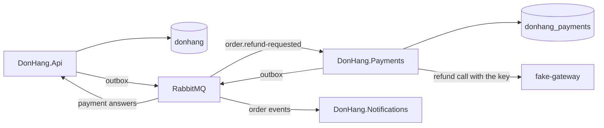

## Before you start

- [[design.l3.when-to-extract-a-service]] — you know that a module earns a service of its own only when one process cannot give it what it needs, and that a split replaces one transaction with separate saves.
- [[backend.l3.idempotent-consumer]] — you know how `OrderEventsConsumer` in Notifications takes messages from RabbitMQ and saves each message id in `inbox_messages` together with its effect.
- [[management.l2.design-doc]] — you know `docs/design/refund-design.md`, the refund design that calls the gateway from a background job instead of inside the customer's request.

## The situation

It is stage-3, and you look in `DonHang.Api` for the code that calls the payment gateway. It is not there. `DonHangDbContext`, which mapped a `Payment` class up to stage-2, maps none now, and the `api` service in `docker-compose.yml` has no setting for the gateway. A new service, `payments`, has the gateway's key and a database of its own, `donhang_payments`.

Yet a refund is more than money. The order must change status in `DonHang.Api`, and the customer must get an email from Notifications. Neither of those lives in Payments.

What does `DonHang.Payments` own now, and how does the rest of Đơn Hàng reach it without sharing its tables or its key?

## Core concepts

- payment gateway — the outside company's HTTP API that actually returns money to a customer; in the lab, the container `fake-gateway` stands in for it.
- owning service — the one service that changes a piece of data; every other service learns about the change from that service's messages.
- a service's own database — a database that only its service is configured to connect to; here `donhang_payments`, a separate database on the same PostgreSQL server as `donhang`.
- refund request — the `order.refund-requested` message that `DonHang.Api` publishes when a customer asks for a refund.

## How it works



Read the diagram from the left. The order still belongs to `DonHang.Api` and lives in `donhang`. The refund rows belong to `DonHang.Payments` and live in `donhang_payments`, in the `payments` table. `DonHang.Api` no longer reads or writes a payment row.

Only `DonHang.Payments` calls the payment gateway, so the gateway's address and key are configured in that one service and nowhere else in Đơn Hàng.

The second version of `refund-design.md` gives the reason. It calls the key and the money records the most sensitive data in the system. In the first version, every copy of `DonHang.Api` held the key and could read and write `payments`. After the split, the key sits in one service's settings and the money records in its database; the design adds that this service is deployed, given access and audited on its own. The copies of `DonHang.Api` that answer every customer no longer carry the key, so fewer places can leak it.

The split has a cost. A refund now changes data that three services own: the refund row in Payments, the order's status in `DonHang.Api` and the customer's email in Notifications. Each changes only its own data; how the three changes are joined is the subject of this module.

Payments brings no new way to talk. It learns of refund requests the way Notifications learns of orders: `DonHang.Api` saves an `order.refund-requested` row in its outbox, the relay publishes it to RabbitMQ, and Payments' consumer saves the message id in its own inbox. Its answers leave through its own outbox to the exchange `donhang.payments` and reach `DonHang.Api` through the queue `orders.payment-events`. Notifications keeps receiving order events from `donhang.orders`, as before.

## In the Đơn Hàng system

Where the `payments` service gets its settings, in `docker-compose.yml`:

```yaml file=docker-compose.yml tag=stage-3 lines=359-371
  payments:
    build:
      context: .
      dockerfile: DonHang.Payments/Dockerfile
    image: donhang-payments:stage-3
    container_name: donhang-payments
    hostname: payments
    environment:
      ConnectionStrings__Default: "Host=db;Database=donhang_payments;Username=donhang;Password=${POSTGRES_PASSWORD}"
      RabbitMq__Host: "rabbitmq"
      RabbitMq__Password: "${RABBITMQ_PASSWORD}"
      Gateway__BaseAddress: "http://fake-gateway:8080/"
      Gateway__ApiKey: "${GATEWAY_API_KEY}"
```

Line 367, the connection string (the setting that names the server, the database and the user to connect as), points the service at the database `donhang_payments` on the server `db` as the user `donhang`: the same server and user that the `api` service uses for `donhang`. Lines 368–369 connect it to the same RabbitMQ as every other service. Lines 370–371 give it the gateway's address and `GATEWAY_API_KEY`. The `api` service, further up the same file, has no `Gateway` setting at all. Further down, `fake-gateway` also reads the key, because it stands in for the gateway that checks it.

How the service uses those settings, in `DonHang.Payments/Program.cs`:

```csharp file=DonHang.Payments/Program.cs tag=stage-3 lines=15-37
// lesson: backend.l3.payments-service
// The Payments service, on its own from stage-3, with its own database,
// donhang_payments. It is the only part of Đơn Hàng that holds the payment
// gateway's address and key, and the only one that reads or writes a
// payment row; DonHang.Api reaches it through RabbitMQ only.
var connectionString = builder.Configuration.GetConnectionString("Default")
    ?? throw new InvalidOperationException("ConnectionStrings:Default is not set");
builder.Services.AddDbContext<PaymentsDbContext>(options => options.UseNpgsql(connectionString));

// lesson: backend.l3.resilience-pipeline
// The HttpClient that GatewayRefundClient uses, with its resilience pipeline
// (AddGatewayRefundClient, at the end of this file).
var gateway = builder.Configuration.GetSection("Gateway").Get<GatewaySettings>() ?? new GatewaySettings();
builder.Services.AddGatewayRefundClient(gateway);

// lesson: backend.l3.payments-service
// Refund requests arrive the way order events reach Notifications: through
// RabbitMQ, into an inbox. The answers leave through this service's own
// outbox, which its own OutboxRelay publishes to donhang.payments.
var rabbitMq = builder.Configuration.GetSection("RabbitMq").Get<RabbitMqSettings>() ?? new RabbitMqSettings();
builder.Services.AddRabbitMq(rabbitMq, clientName: "donhang-payments");
builder.Services.AddOutboxRelay<PaymentsDbContext>(exchange: "donhang.payments");
builder.Services.AddHostedService<RefundRequestedConsumer>();
```

Lines 20–22 register `PaymentsDbContext` on that connection string. That class, in `DonHang.Payments/PaymentsDbContext.cs`, maps three tables: `payments`, plus this service's own `outbox_messages` and `inbox_messages`. Lines 27–28 read the `Gateway` section and register the HTTP client of `GatewayRefundClient`, the class that calls the gateway; how it copes with a slow gateway, which the comment above line 27 names, belongs to a later module.

Lines 34–37 are the messaging. `AddRabbitMq` and `AddOutboxRelay` come from the shared project `DonHang.Messaging`, the same calls `DonHang.Api` makes with its own exchange, `donhang.orders`. Line 37 starts `RefundRequestedConsumer`, built like `OrderEventsConsumer`: it saves the message id in its inbox and acknowledges after the save.

## Seniors often assume…

- **"Now that Payments is a service, the API can call it over HTTP and wait for the refund inside the customer's request."** → Actually `DonHang.Api` reaches Payments only through RabbitMQ: `POST /api/v1/orders/{id}/refund` saves the API's own change and an outbox row, then answers `202` without waiting. The refund design already rejected waiting for the gateway inside the request, because a refund request must be accepted even while the gateway fails (YC-7). A waiting HTTP call to Payments would bring that wait back, and add "Payments is down" to the ways a refund request fails. You notice this when refund requests start failing every time Payments restarts for a deploy.
- **"Payments can still set the order's status in Đơn Hàng's database, since both services use PostgreSQL."** → Actually sharing a PostgreSQL server is not sharing a database: one server holds several databases kept apart, and a connection reaches only the database it names. Payments' connection string names `donhang_payments`, and `PaymentsDbContext` maps no `orders` table. The order's status belongs to `DonHang.Api`, whose `Order` class decides which status changes are allowed; a row written from outside skips those rules. Payments would also have to map `orders` itself, so every change to that table would have to be released with Payments too. You notice this when a migration of `orders`, in a pull request that never touched Payments, breaks refunds.
- **"Each new service needs its own way of sending messages, so Payments brings a second broker."** → Actually Payments uses the same RabbitMQ and the same `DonHang.Messaging` project for its outbox, relay and inbox. What it adds is its own exchange, `donhang.payments`, and its own queue, `payments.refund-requests` (with a dead-letter exchange and queue beside it), on that broker. Here a second broker would be one more server to run, back up and watch, and Payments needs nothing that the shared RabbitMQ cannot already do. You notice this when `scripts/backend/rabbitmq-topology.sh` lists `donhang.payments` and `payments.refund-requests` next to Notifications' queue, on one broker.

## Try it (3 minutes)

With the lab running (`scripts/up.sh`), in the root folder of the example repository:

1. Run `scripts/backend/rabbitmq-topology.sh` and read the part under `== bindings on donhang.orders and donhang.payments`.
2. Find the queue Payments reads, the exchange it is bound to, and where Payments' answers go.
3. Then decide: if `DonHang.Api` had to call the gateway itself again for one urgent case, which settings would the `api` service need, and what would that undo?

Expected result: three lines, `donhang.orders --[order.*]--> notifications.order-events`, `donhang.orders --[order.refund-requested]--> payments.refund-requests` and `donhang.payments --[payment.*]--> orders.payment-events`. Payments reads the same exchange as Notifications through a narrower binding. Since `*` stands for exactly one word, Notifications' `order.*` also receives `order.refund-requested`. Payments' answers reach a queue that `DonHang.Api` reads. For step 3, check your answer below.

<details><summary>Suggested answer</summary>

The `api` service would need `Gateway__BaseAddress` and `Gateway__ApiKey`, like lines 370–371. The key would then sit in every copy of the API again, which undoes the reason `refund-design.md` gives for the split: the key and the money records kept in one service, deployed, given access and audited on its own.

</details>

## Connections

- [[design.l3.when-to-extract-a-service]] — the general rule; Payments is one split that passed it, for the sake of the key and the money records.
- [[design.l3.module-owns-its-tables]] — the same idea one layer down: inside one process a module owns its tables, here a service owns its whole database.
- [[backend.l3.message-broker]] — the broker Payments joins instead of bringing its own.
- [[design.l3.anti-corruption-layer]] — the pattern behind `GatewayRefundClient`, which turns the gateway's answers into Payments' own words.
- [[backend.l3.two-phase-commit]] — the next lesson: why the three services' changes are not saved in one transaction.
- [[backend.l3.saga]] — the order in which a refund passes through the three services.

## Five-line summary

1. At stage-3 `DonHang.Payments` is the one service that owns the `payments` table and calls the payment gateway.
2. Its database, `donhang_payments`, holds the money records; `DonHang.Api` no longer reads or writes a payment row.
3. Only `payments` gets the gateway's address and key, so key and money records stay in one service deployed on its own.
4. A refund now changes data owned by three services: the refund row, the order's status and the customer's email.
5. Payments joins the same RabbitMQ through the shared outbox, relay and inbox, adding only its own exchanges and queues on that broker.
