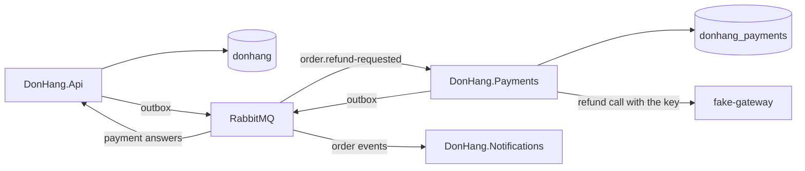

## Bạn cần biết trước

- [[design.l3.when-to-extract-a-service]] — bạn biết rằng một module chỉ đáng được tách thành service riêng khi một process không đáp ứng được thứ nó cần, và tách ra nghĩa là thay một giao dịch bằng nhiều lần lưu riêng rẽ.
- [[backend.l3.idempotent-consumer]] — bạn biết cách `OrderEventsConsumer` trong Notifications nhận message từ RabbitMQ và lưu id của mỗi message vào `inbox_messages` cùng với tác động của nó.
- [[management.l2.design-doc]] — bạn biết `docs/design/refund-design.md`, bản thiết kế hoàn tiền gọi cổng thanh toán từ một job chạy nền thay vì ngay trong request của khách hàng.

## Tình huống

Đang ở stage-3, bạn tìm trong `DonHang.Api` đoạn code gọi cổng thanh toán. Không thấy đâu. `DonHangDbContext`, vốn ánh xạ class `Payment` cho tới stage-2, giờ không ánh xạ class nào như vậy, và service `api` trong `docker-compose.yml` không có thiết lập nào cho cổng thanh toán. Một service mới, `payments`, giữ key của cổng thanh toán và có database riêng, `donhang_payments`.

Nhưng hoàn tiền không chỉ là chuyện tiền. Đơn phải đổi trạng thái trong `DonHang.Api`, và khách hàng phải nhận email từ Notifications. Cả hai thứ đó đều không nằm trong Payments.

Vậy giờ `DonHang.Payments` sở hữu những gì, và phần còn lại của Đơn Hàng làm sao chạm tới nó mà không dùng chung bảng hay key của nó?

## Khái niệm cốt lõi

- cổng thanh toán (payment gateway) — HTTP API của công ty bên ngoài, nơi thực sự trả tiền lại cho khách hàng. Trong lab, container `fake-gateway` đóng vai nó.
- service sở hữu dữ liệu — service duy nhất được thay đổi một phần dữ liệu. Mọi service khác biết về thay đổi đó qua message của service này.
- database riêng của một service — database mà chỉ service của nó được cấu hình để kết nối tới. Ở đây là `donhang_payments`, một database riêng trên cùng PostgreSQL server với `donhang`.
- yêu cầu hoàn tiền — message `order.refund-requested` mà `DonHang.Api` publish khi khách hàng yêu cầu hoàn tiền.

## Cơ chế hoạt động



Đọc sơ đồ từ trái sang. Đơn vẫn thuộc về `DonHang.Api` và nằm trong `donhang`. Các dòng hoàn tiền thuộc về `DonHang.Payments` và nằm trong `donhang_payments`, ở bảng `payments`. `DonHang.Api` không còn đọc hay ghi dòng payment nào.

Chỉ `DonHang.Payments` gọi cổng thanh toán, nên địa chỉ và key của cổng chỉ được cấu hình trong service đó, không ở chỗ nào khác của Đơn Hàng.

Phiên bản thứ hai của `refund-design.md` nêu lý do. Nó gọi key và các bản ghi tiền là dữ liệu nhạy cảm nhất của hệ thống. Ở phiên bản đầu, mọi bản chạy của `DonHang.Api` đều giữ key và đều đọc, ghi được `payments`. Sau khi tách, key nằm trong thiết lập của một service và các bản ghi tiền nằm trong database của service đó. Bản thiết kế viết thêm rằng service này được deploy, cấp quyền và kiểm tra (audit) riêng. Các bản chạy của `DonHang.Api` phục vụ mọi khách hàng không còn mang key, nên ít chỗ có thể làm lộ nó hơn.

Tách ra cũng có cái giá. Giờ một lần hoàn tiền thay đổi dữ liệu thuộc ba service: dòng hoàn tiền trong Payments, trạng thái đơn trong `DonHang.Api` và email cho khách hàng trong Notifications. Mỗi service chỉ đổi dữ liệu của mình. Ba thay đổi đó được nối với nhau ra sao là chủ đề của module này.

Payments không mang tới cách giao tiếp nào mới. Nó biết có yêu cầu hoàn tiền theo đúng cách Notifications biết có đơn: `DonHang.Api` lưu một dòng `order.refund-requested` vào outbox của mình, relay publish dòng đó lên RabbitMQ, và consumer của Payments lưu message id vào inbox riêng. Câu trả lời của Payments đi ra qua outbox riêng tới exchange `donhang.payments` và tới `DonHang.Api` qua queue `orders.payment-events`. Notifications vẫn nhận event của đơn từ `donhang.orders` như trước.

## Trong hệ thống Đơn Hàng

Nơi service `payments` lấy thiết lập, trong `docker-compose.yml`:

```yaml file=docker-compose.yml tag=stage-3 lines=359-371
  payments:
    build:
      context: .
      dockerfile: DonHang.Payments/Dockerfile
    image: donhang-payments:stage-3
    container_name: donhang-payments
    hostname: payments
    environment:
      ConnectionStrings__Default: "Host=db;Database=donhang_payments;Username=donhang;Password=${POSTGRES_PASSWORD}"
      RabbitMq__Host: "rabbitmq"
      RabbitMq__Password: "${RABBITMQ_PASSWORD}"
      Gateway__BaseAddress: "http://fake-gateway:8080/"
      Gateway__ApiKey: "${GATEWAY_API_KEY}"
```

Dòng 367 là connection string (thiết lập ghi tên server, tên database và user dùng để kết nối). Nó trỏ service tới database `donhang_payments` trên server `db` với user `donhang`: cùng server và cùng user mà service `api` dùng cho `donhang`. Dòng 368–369 nối service vào cùng RabbitMQ với mọi service khác. Dòng 370–371 đưa cho nó địa chỉ của cổng thanh toán và `GATEWAY_API_KEY`. Service `api`, ở phía trên trong cùng file, hoàn toàn không có thiết lập `Gateway`. Ở phía dưới, `fake-gateway` cũng đọc key này, vì nó đóng vai cổng thanh toán, bên kiểm tra key.

Cách service dùng các thiết lập đó, trong `DonHang.Payments/Program.cs`:

```csharp file=DonHang.Payments/Program.cs tag=stage-3 lines=15-37
// lesson: backend.l3.payments-service
// The Payments service, on its own from stage-3, with its own database,
// donhang_payments. It is the only part of Đơn Hàng that holds the payment
// gateway's address and key, and the only one that reads or writes a
// payment row; DonHang.Api reaches it through RabbitMQ only.
var connectionString = builder.Configuration.GetConnectionString("Default")
    ?? throw new InvalidOperationException("ConnectionStrings:Default is not set");
builder.Services.AddDbContext<PaymentsDbContext>(options => options.UseNpgsql(connectionString));

// lesson: backend.l3.resilience-pipeline
// The HttpClient that GatewayRefundClient uses, with its resilience pipeline
// (AddGatewayRefundClient, at the end of this file).
var gateway = builder.Configuration.GetSection("Gateway").Get<GatewaySettings>() ?? new GatewaySettings();
builder.Services.AddGatewayRefundClient(gateway);

// lesson: backend.l3.payments-service
// Refund requests arrive the way order events reach Notifications: through
// RabbitMQ, into an inbox. The answers leave through this service's own
// outbox, which its own OutboxRelay publishes to donhang.payments.
var rabbitMq = builder.Configuration.GetSection("RabbitMq").Get<RabbitMqSettings>() ?? new RabbitMqSettings();
builder.Services.AddRabbitMq(rabbitMq, clientName: "donhang-payments");
builder.Services.AddOutboxRelay<PaymentsDbContext>(exchange: "donhang.payments");
builder.Services.AddHostedService<RefundRequestedConsumer>();
```

Dòng 20–22 đăng ký `PaymentsDbContext` với connection string đó. Class này, trong `DonHang.Payments/PaymentsDbContext.cs`, ánh xạ ba bảng: `payments`, cùng `outbox_messages` và `inbox_messages` riêng của service này. Dòng 27–28 đọc phần `Gateway` và đăng ký HTTP client cho `GatewayRefundClient`, class gọi cổng thanh toán. Class đó xoay xở thế nào khi cổng chậm, điều mà comment phía trên dòng 27 nhắc tới, thuộc về một module sau.

Dòng 34–37 là phần messaging. `AddRabbitMq` và `AddOutboxRelay` đến từ project dùng chung `DonHang.Messaging`, đúng những lời gọi mà `DonHang.Api` dùng với exchange riêng của nó, `donhang.orders`. Dòng 37 khởi động `RefundRequestedConsumer`, được viết giống `OrderEventsConsumer`: nó lưu message id vào inbox và acknowledge sau khi lưu.

## Senior hay nhầm rằng…

- **"Giờ Payments đã là service, API có thể gọi nó qua HTTP và chờ hoàn tiền xong ngay trong request của khách hàng."** → Thực ra `DonHang.Api` chỉ chạm tới Payments qua RabbitMQ: `POST /api/v1/orders/{id}/refund` lưu thay đổi của chính API cùng một dòng outbox, rồi trả `202` mà không chờ. Bản thiết kế hoàn tiền đã loại bỏ chuyện chờ cổng thanh toán trong request, vì yêu cầu hoàn tiền phải được nhận cả khi cổng đang lỗi (YC-7). Một lời gọi HTTP chờ Payments sẽ mang lại đúng sự chờ đợi đó, và thêm "Payments đang sập" vào danh sách lý do khiến yêu cầu hoàn tiền thất bại. Bạn sẽ nhận ra khi yêu cầu hoàn tiền lỗi mỗi lần Payments khởi động lại để deploy.
- **"Payments vẫn có thể tự đặt trạng thái đơn trong database của Đơn Hàng, vì cả hai service đều dùng PostgreSQL."** → Thực ra dùng chung PostgreSQL server không phải là dùng chung database: một server chứa nhiều database tách biệt, và một kết nối chỉ chạm tới database nó ghi tên. Connection string của Payments ghi `donhang_payments`, và `PaymentsDbContext` không ánh xạ bảng `orders` nào. Trạng thái đơn thuộc về `DonHang.Api`, nơi class `Order` quyết định được đổi trạng thái nào sang trạng thái nào. Một dòng ghi từ bên ngoài sẽ bỏ qua các quy tắc đó. Payments cũng sẽ phải tự ánh xạ `orders`, nên mọi thay đổi trên bảng đó đều phải release kèm Payments. Bạn sẽ nhận ra khi một migration của `orders`, trong một pull request không hề đụng tới Payments, làm hỏng hoàn tiền.
- **"Mỗi service mới cần cách gửi message riêng, nên Payments mang theo một broker thứ hai."** → Thực ra Payments dùng cùng RabbitMQ và cùng project `DonHang.Messaging` cho outbox, relay và inbox của mình. Thứ nó thêm vào là exchange riêng, `donhang.payments`, và queue riêng, `payments.refund-requests` (kèm một dead-letter exchange và queue bên cạnh), trên chính broker đó. Ở đây broker thứ hai chỉ là thêm một server phải chạy, backup và theo dõi, trong khi Payments không cần gì mà RabbitMQ dùng chung chưa làm được. Bạn sẽ nhận ra khi `scripts/backend/rabbitmq-topology.sh` liệt kê `donhang.payments` và `payments.refund-requests` cạnh queue của Notifications, trên cùng một broker.

## Thử ngay (3 phút)

Khi lab đang chạy (`scripts/up.sh`), ở thư mục gốc của repo ví dụ:

1. Chạy `scripts/backend/rabbitmq-topology.sh` và đọc phần dưới `== bindings on donhang.orders and donhang.payments`.
2. Tìm queue mà Payments đọc, exchange mà queue đó được bind vào, và nơi câu trả lời của Payments đi tới.
3. Rồi hãy xác định: nếu `DonHang.Api` phải tự gọi lại cổng thanh toán cho một trường hợp khẩn, service `api` sẽ cần những thiết lập nào, và điều đó phá bỏ cái gì?

Kết quả mong đợi: ba dòng, `donhang.orders --[order.*]--> notifications.order-events`, `donhang.orders --[order.refund-requested]--> payments.refund-requests` và `donhang.payments --[payment.*]--> orders.payment-events`. Payments đọc cùng exchange với Notifications qua một binding hẹp hơn. Vì `*` thay cho đúng một từ, `order.*` của Notifications cũng nhận `order.refund-requested`. Câu trả lời của Payments tới một queue mà `DonHang.Api` đọc. Ở bước 3, hãy đối chiếu với đáp án bên dưới.

<details><summary>Gợi ý đáp án</summary>

Service `api` sẽ cần `Gateway__BaseAddress` và `Gateway__ApiKey`, như dòng 370–371. Khi đó key lại nằm trong mọi bản chạy của API, phá bỏ đúng lý do mà `refund-design.md` đưa ra khi tách service: key và các bản ghi tiền được giữ trong một service, deploy, cấp quyền và kiểm tra riêng.

</details>

## Liên hệ

- [[design.l3.when-to-extract-a-service]] — quy tắc chung. Payments là một lần tách đã qua được quy tắc đó, vì key và các bản ghi tiền.
- [[design.l3.module-owns-its-tables]] — cùng ý tưởng ở một tầng thấp hơn: trong một process, module sở hữu bảng của mình, còn ở đây service sở hữu cả database.
- [[backend.l3.message-broker]] — broker mà Payments tham gia thay vì mang theo broker riêng.
- [[design.l3.anti-corruption-layer]] — pattern đứng sau `GatewayRefundClient`, class chuyển câu trả lời của cổng thanh toán thành ngôn ngữ riêng của Payments.
- [[backend.l3.two-phase-commit]] — bài tiếp theo: vì sao thay đổi của ba service không được lưu trong một giao dịch.
- [[backend.l3.saga]] — thứ tự mà một lần hoàn tiền đi qua ba service.

## Tóm tắt 5 dòng

1. Ở stage-3, `DonHang.Payments` là service duy nhất sở hữu bảng `payments` và gọi cổng thanh toán.
2. Database của nó, `donhang_payments`, giữ các bản ghi tiền. `DonHang.Api` không còn đọc hay ghi dòng payment nào.
3. Chỉ `payments` có địa chỉ và key của cổng thanh toán, nên key và bản ghi tiền nằm trong một service được deploy riêng.
4. Giờ một lần hoàn tiền thay đổi dữ liệu thuộc ba service: dòng hoàn tiền, trạng thái đơn và email cho khách hàng.
5. Payments tham gia cùng RabbitMQ qua outbox, relay và inbox dùng chung, chỉ thêm exchange và queue riêng trên broker đó.
