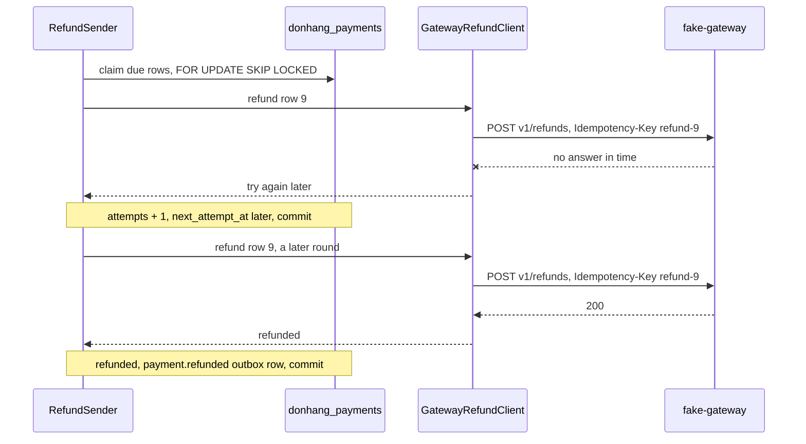

## Before you start

- [[backend.l3.compensating-action]] — you know that a `failed` refund row and its `payment.refund-failed` message start the compensation that moves the order back to `paid`.
- [[backend.l2.retry-with-backoff]] — you know how `NotificationSender` keeps a failed row `pending`, counts `attempts` and moves `next_attempt_at` later with exponential backoff.
- [[backend.l2.idempotent-endpoints]] — you know that an idempotency key lets a client repeat a `POST` after a timeout and still get one result.
- [[design.l3.anti-corruption-layer]] — you know that an anti-corruption layer translates an outside model into Đơn Hàng's own words at one edge.

## The situation

Customer 1 asks for a refund of order 10. The order moves to `refunding`, and Payments saves a `pending` refund row. A few seconds later Payments calls the payment gateway, and the call ends without an answer: the gateway took too long.

Did the gateway return the money? You cannot tell. The call may never have arrived, or the gateway may have refunded and only its answer was lost. If Payments marks the refund failed, the customer may already have the money while the order goes back to `paid`. If it simply calls again, the customer may be refunded twice.

How does Payments keep asking until it gets an answer, without ever refunding order 10 twice?

## Core concepts

- due refund row — a row in `payments` with kind `refund`, status `pending` and a `next_attempt_at` that has passed; the only rows `RefundSender` picks up.
- refund key — the idempotency key `refund-` followed by the row's id, sent on every call for that row, whichever attempt it is.
- three outcomes — refunded, refused, or try again later: the only answers `GatewayRefundClient` gives the rest of Payments, whatever the gateway said.
- give-up time — `GiveUpAfter`, by default 24 hours after the request; after it, a try-again-later answer ends the row as `failed`.

## How it works



In the situation above, say the refund row has id 9. `RefundSender` is a hosted service built like `NotificationSender`: every 2 seconds it opens a transaction on `donhang_payments`, the Payments database, and claims up to 10 due refund rows with `FOR UPDATE SKIP LOCKED`, so a second copy of Payments skips rows already claimed.

For each row it asks `GatewayRefundClient`, the anti-corruption layer toward the gateway. Only that class knows the gateway's address, headers, status codes and JSON. It turns a success status such as `200` into refunded, `422` into refused with the gateway's reason, and any other status, a broken connection or no answer in time into try again later.

No answer is the dangerous case, because the gateway may have refunded already. So every call for row 9 sends the same refund key, `refund-9`. `fake-gateway`, the lab's stand-in for the real payment gateway, answers a key it has seen with the answer it gave the first time and refunds nothing more. A retry is safe because it is the same request again, not a new one.

A refunded answer sets the row to `refunded` and saves a `payment.refunded` outbox row in the same transaction, which moves the saga on. Try again later keeps the row `pending`, adds one to `attempts` and moves `next_attempt_at` later with exponential backoff: by default a random wait of at most 1 minute after the first failure, about twice as long after each later one, never more than 1 hour. Only a refusal, or a try-again-later answer once the give-up time has passed, ends the retries with `failed`. Both save a `payment.refund-failed` outbox row in the same transaction as the row's change, which starts the compensation.

## In the Đơn Hàng system

The whole translation of the gateway's answers lives in `RefundAsync`:

```csharp file=DonHang.Payments/GatewayRefundClient.cs tag=stage-3 lines=61-85
        using var request = new HttpRequestMessage(HttpMethod.Post, "v1/refunds")
        {
            Content = JsonContent.Create(new { orderId = refund.OrderId, amountVnd = refund.AmountVnd }),
        };
        request.Headers.Add("Idempotency-Key", IdempotencyKeyFor(refund));
        try
        {
            using var response = await http.SendAsync(request, cancellationToken);
            if (response.IsSuccessStatusCode) return new(RefundOutcome.Refunded);
            if (response.StatusCode == HttpStatusCode.UnprocessableEntity)
                return new(RefundOutcome.Refused, await ReadReasonAsync(response, cancellationToken));
            return new(RefundOutcome.TryAgainLater, $"the gateway answered {(int)response.StatusCode}");
        }
        catch (HttpRequestException ex)
        {
            return new(RefundOutcome.TryAgainLater, ex.Message);
        }
        catch (TimeoutRejectedException)
        {
            return new(RefundOutcome.TryAgainLater, "the gateway did not answer in time");
        }
        catch (BrokenCircuitException)
        {
            return new(RefundOutcome.TryAgainLater, "the circuit to the gateway is open; not calling it");
        }
```

`IdempotencyKeyFor`, just above this excerpt, returns `refund-{refund.Id}`: the key depends on the row only, never on the attempt. The last two `catch` blocks handle exceptions from two protections that `Program.cs` adds around this `HttpClient`, the subject of a later module. One ends a call that has no answer within a set time; the other refuses to call the gateway for a while after many failed calls. Here both mean try again later.

What happens to the row is decided in `RecordResult`, which has already added one to `Attempts` above this excerpt:

```csharp file=DonHang.Payments/RefundSender.cs tag=stage-3 lines=99-121
        if (result.Outcome == RefundOutcome.Refused || now - refund.RequestedAt >= settings.GiveUpAfter)
        {
            refund.Status = "failed";
            refund.FailureReason = result.Reason;
            logger.LogWarning("Refund {RefundId} for order {OrderId} failed: {Reason}", refund.Id, refund.OrderId, result.Reason);
            return Message("payment.refund-failed", refund, result.Reason, now);
        }

        var delay = NextDelay(refund.Attempts);
        refund.NextAttemptAt = now + delay;
        logger.LogWarning("Refund {RefundId} for order {OrderId}: attempt {Attempt} failed ({Reason}); next attempt in {DelaySeconds} s",
            refund.Id, refund.OrderId, refund.Attempts, result.Reason, Math.Round(delay.TotalSeconds, 1));
        return null;
    }

    // lesson: backend.l3.safe-to-repeat-saga-steps
    // Exponential backoff: FirstRetryDelay after the first failed attempt,
    // then twice as long each time, never more than MaxRetryDelay.
    public TimeSpan BackoffDelay(int attempts)
    {
        var delay = settings.FirstRetryDelay * Math.Pow(2, attempts - 1);
        return delay < settings.MaxRetryDelay ? delay : settings.MaxRetryDelay;
    }
```

The `if` is the only way to `failed`, and it measures the give-up time from `RequestedAt`, not from the last attempt. Otherwise the row stays `pending` and `null` means no message: the saga does not move on yet. `NextDelay`, just below this excerpt, picks a wait between half of `BackoffDelay` and all of it. `RefundSenderTests` checks each outcome, that `BackoffDelay` gives 1, 2, 8 and 60 minutes after attempts 1, 2, 4 and 7, and that each wait from `NextDelay` falls between half of that delay and all of it.

## Seniors often assume…

- **"A timeout from the gateway means no refund happened, so a new request with a new key is safe."** → Actually a timeout only says the answer did not arrive in time; the gateway may have refunded. A new key makes the gateway treat the call as a second refund, while the same key gets the first answer back. You notice this when the gateway lists two refunds for order 10 while `donhang_payments` has one row.
- **"The gateway's own status names can be stored as they are; translating them is extra work."** → Actually `fake-gateway` speaks its own language: `refundId`, its own `status` text, and a `reason` with `422`. Stored as they are, those words would spread into every reader of `payments.status`. `GatewayRefundClient` keeps them in one class, and the row only ever holds `pending`, `refunded` or `failed`. You notice this when a new gateway answer forces changes in `RecordResult` and in queries, instead of in one class.
- **"Retrying a refund forever is safer than ever marking it failed."** → Actually while the row stays `pending`, the order stays `refunding`: it cannot ship, and the customer hears nothing more. Đơn Hàng's refund requirements document asks for automatic retries for at least 24 hours before staff take over, so the give-up time hands the refund to people through the compensation. You notice this when an order sits at `refunding` for days with growing `attempts` and is missing from `GET /api/v1/refunds?status=failed`.

## Try it (3 minutes)

With the lab running (`scripts/up.sh`), in the root folder of the example repository:

1. Run `scripts/backend/gateway-down.sh`. It stops `fake-gateway`, asks for a refund of order 10, waits for three failed calls, then starts the gateway again.
2. In the script's output, read the refund row before and after the gateway comes back, the logged attempts, and the gateway's own list of refunds for order 10.
3. Then decide: why does the gateway list one refund for order 10, and what would make it list two?

Expected result: `202`; `pending | 3` (status | attempts); three log lines, `attempt 1 failed`, `attempt 2 failed`, `attempt 3 failed`, each with its next wait in seconds; then `refunded` once the gateway is back; and exactly one entry, `{"orderId":10,"amountVnd":1730000}`. The lab shortens the waits to seconds.

<details><summary>Suggested answer</summary>

While the gateway was stopped, no call reached it, so the first call after its return made the one refund. Two refunds would need two keys for one row: a call that reached the gateway, lost its answer, and was followed by a call with a new key.

</details>

## Connections

- [[backend.l3.compensating-action]] — what this lesson's `failed` row starts: the order goes back to `paid`.
- [[backend.l2.skip-locked-claiming]] — the same way of claiming rows, now used by Payments for refunds instead of for emails.
- [[backend.l2.at-least-once-jobs]] — the same risk at the gateway: a job that may run twice is harmless only if a second run changes nothing; here the key does that.
- [[backend.l3.choreography-vs-orchestration]] — the next question: which part of the system decides the saga's next step.

## Five-line summary

1. A saga step that calls the gateway must be safe to repeat, because after no answer you cannot know whether the refund happened.
2. `RefundSender` claims due `pending` refund rows with `FOR UPDATE SKIP LOCKED` and calls the gateway for each, as `NotificationSender` does for emails.
3. Every call for one row sends the key `refund-` plus the row's id, so a retry after a timeout cannot refund twice.
4. `GatewayRefundClient` translates the gateway's answers into three outcomes: refunded, refused, or try again later.
5. Try again later waits with exponential backoff; only a refusal, or try again later 24 hours (by default) after the request, marks the row `failed`.
