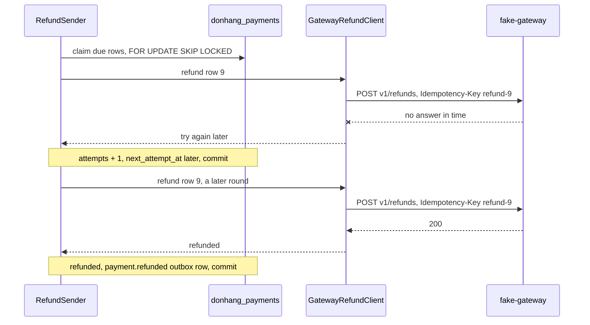

## Bạn cần biết trước

- [[backend.l3.compensating-action]] — bạn biết rằng một dòng hoàn tiền `failed` cùng message `payment.refund-failed` của nó khởi động hành động bù, đưa đơn về lại `paid`.
- [[backend.l2.retry-with-backoff]] — bạn biết `NotificationSender` giữ một dòng thất bại ở `pending`, đếm `attempts` và đẩy `next_attempt_at` lùi lại theo exponential backoff ra sao.
- [[backend.l2.idempotent-endpoints]] — bạn biết rằng idempotency key cho client lặp lại một `POST` sau khi quá thời gian chờ mà vẫn chỉ nhận một kết quả.
- [[design.l3.anti-corruption-layer]] — bạn biết rằng anti-corruption layer dịch model bên ngoài sang ngôn ngữ riêng của Đơn Hàng, tại đúng một chỗ ở biên.

## Tình huống

Khách hàng 1 yêu cầu hoàn tiền đơn 10. Đơn chuyển sang `refunding`, và Payments lưu một dòng hoàn tiền `pending`. Vài giây sau, Payments gọi cổng thanh toán, và lần gọi kết thúc mà không có câu trả lời: cổng thanh toán trả lời quá chậm.

Cổng thanh toán đã trả tiền lại chưa? Bạn không biết được. Có thể lần gọi chưa bao giờ tới nơi, cũng có thể cổng thanh toán đã hoàn tiền và chỉ câu trả lời bị mất. Nếu Payments đánh dấu hoàn tiền thất bại, khách hàng có thể đã nhận tiền trong khi đơn quay về `paid`. Nếu Payments cứ thế gọi lại, khách hàng có thể được hoàn tiền hai lần.

Làm sao để Payments cứ hỏi tiếp cho tới khi có câu trả lời, mà không bao giờ hoàn tiền đơn 10 hai lần?

## Khái niệm cốt lõi

- dòng hoàn tiền tới hạn — một dòng trong `payments` có kind `refund`, status `pending` và `next_attempt_at` đã qua. Đây là những dòng duy nhất `RefundSender` lấy ra xử lý.
- khóa hoàn tiền — idempotency key gồm `refund-` nối với id của dòng, gửi kèm mọi lần gọi cho dòng đó, bất kể là lần thử thứ mấy.
- ba kết quả — đã hoàn, bị từ chối, hoặc thử lại sau: những câu trả lời duy nhất `GatewayRefundClient` đưa cho phần còn lại của Payments, dù cổng thanh toán nói gì.
- thời điểm bỏ cuộc — `GiveUpAfter`, mặc định 24 giờ sau yêu cầu. Qua mốc đó, một câu trả lời "thử lại sau" sẽ kết thúc dòng ở `failed`.

## Cơ chế hoạt động



Trong tình huống trên, giả sử dòng hoàn tiền có id 9. `RefundSender` là một hosted service dựng giống `NotificationSender`: cứ 2 giây, nó mở một giao dịch trên `donhang_payments`, database của Payments, và giữ tối đa 10 dòng hoàn tiền tới hạn bằng `FOR UPDATE SKIP LOCKED`. Nhờ vậy, bản Payments thứ hai chạy song song sẽ bỏ qua các dòng đã bị giữ.

Với mỗi dòng, nó hỏi `GatewayRefundClient`, anti-corruption layer hướng về cổng thanh toán. Chỉ class này biết địa chỉ, header, status code và JSON của cổng thanh toán. Nó đổi status thành công như `200` thành đã hoàn, `422` thành bị từ chối kèm lý do của cổng thanh toán, còn mọi status khác, kết nối bị đứt hay không có câu trả lời kịp lúc đều thành thử lại sau.

Không có câu trả lời là trường hợp nguy hiểm, vì cổng thanh toán có thể đã hoàn tiền rồi. Vì vậy mọi lần gọi cho dòng 9 đều gửi cùng một khóa hoàn tiền, `refund-9`. `fake-gateway`, cổng thanh toán giả thay cho cổng thật trong lab, gặp lại một key đã thấy thì trả đúng câu trả lời của lần đầu và không hoàn thêm đồng nào. Thử lại an toàn vì đó vẫn là yêu cầu cũ gửi lại, không phải một yêu cầu mới.

Câu trả lời đã hoàn đặt dòng thành `refunded` và lưu một dòng outbox `payment.refunded` trong cùng giao dịch, đẩy saga đi tiếp. Thử lại sau giữ dòng ở `pending`, cộng một vào `attempts` và đẩy `next_attempt_at` lùi lại theo exponential backoff. Mặc định, sau lần thất bại đầu là một khoảng chờ ngẫu nhiên không quá 1 phút, mỗi lần sau dài gấp khoảng hai lần, và không bao giờ quá 1 giờ. Chỉ một lần từ chối, hoặc một câu "thử lại sau" khi đã qua thời điểm bỏ cuộc, mới dừng việc thử lại bằng `failed`. Cả hai trường hợp đều lưu một dòng outbox `payment.refund-failed` cùng giao dịch với thay đổi của dòng, và dòng outbox đó khởi động hành động bù.

## Trong hệ thống Đơn Hàng

Toàn bộ phần dịch câu trả lời của cổng thanh toán nằm trong `RefundAsync`:

```csharp file=DonHang.Payments/GatewayRefundClient.cs tag=stage-3 lines=61-85
        using var request = new HttpRequestMessage(HttpMethod.Post, "v1/refunds")
        {
            Content = JsonContent.Create(new { orderId = refund.OrderId, amountVnd = refund.AmountVnd }),
        };
        request.Headers.Add("Idempotency-Key", IdempotencyKeyFor(refund));
        try
        {
            using var response = await http.SendAsync(request, cancellationToken);
            if (response.IsSuccessStatusCode) return new(RefundOutcome.Refunded);
            if (response.StatusCode == HttpStatusCode.UnprocessableEntity)
                return new(RefundOutcome.Refused, await ReadReasonAsync(response, cancellationToken));
            return new(RefundOutcome.TryAgainLater, $"the gateway answered {(int)response.StatusCode}");
        }
        catch (HttpRequestException ex)
        {
            return new(RefundOutcome.TryAgainLater, ex.Message);
        }
        catch (TimeoutRejectedException)
        {
            return new(RefundOutcome.TryAgainLater, "the gateway did not answer in time");
        }
        catch (BrokenCircuitException)
        {
            return new(RefundOutcome.TryAgainLater, "the circuit to the gateway is open; not calling it");
        }
```

`IdempotencyKeyFor`, nằm ngay trên đoạn trích, trả về `refund-{refund.Id}`: key chỉ phụ thuộc vào dòng, không bao giờ phụ thuộc vào lần thử. Hai khối `catch` cuối xử lý exception từ hai lớp bảo vệ mà `Program.cs` thêm quanh `HttpClient` này, chủ đề của một module sau. Lớp thứ nhất cắt một lần gọi không có câu trả lời trong một khoảng thời gian định sẵn. Lớp thứ hai từ chối gọi cổng thanh toán một lúc sau nhiều lần gọi thất bại. Ở đây, cả hai đều nghĩa là thử lại sau.

Số phận của dòng được quyết định trong `RecordResult`, method đã cộng một vào `Attempts` ở phía trên đoạn trích:

```csharp file=DonHang.Payments/RefundSender.cs tag=stage-3 lines=99-121
        if (result.Outcome == RefundOutcome.Refused || now - refund.RequestedAt >= settings.GiveUpAfter)
        {
            refund.Status = "failed";
            refund.FailureReason = result.Reason;
            logger.LogWarning("Refund {RefundId} for order {OrderId} failed: {Reason}", refund.Id, refund.OrderId, result.Reason);
            return Message("payment.refund-failed", refund, result.Reason, now);
        }

        var delay = NextDelay(refund.Attempts);
        refund.NextAttemptAt = now + delay;
        logger.LogWarning("Refund {RefundId} for order {OrderId}: attempt {Attempt} failed ({Reason}); next attempt in {DelaySeconds} s",
            refund.Id, refund.OrderId, refund.Attempts, result.Reason, Math.Round(delay.TotalSeconds, 1));
        return null;
    }

    // lesson: backend.l3.safe-to-repeat-saga-steps
    // Exponential backoff: FirstRetryDelay after the first failed attempt,
    // then twice as long each time, never more than MaxRetryDelay.
    public TimeSpan BackoffDelay(int attempts)
    {
        var delay = settings.FirstRetryDelay * Math.Pow(2, attempts - 1);
        return delay < settings.MaxRetryDelay ? delay : settings.MaxRetryDelay;
    }
```

Câu `if` là đường duy nhất dẫn tới `failed`, và nó tính thời điểm bỏ cuộc từ `RequestedAt`, không phải từ lần thử gần nhất. Ngoài trường hợp đó, dòng ở lại `pending` và `null` nghĩa là không có message: saga chưa đi tiếp. `NextDelay`, nằm ngay dưới đoạn trích, chọn một khoảng chờ nằm giữa một nửa `BackoffDelay` và trọn `BackoffDelay`. `RefundSenderTests` kiểm tra từng kết quả, kiểm tra rằng `BackoffDelay` cho 1, 2, 8 và 60 phút sau lần thử 1, 2, 4 và 7, và rằng mỗi khoảng chờ từ `NextDelay` nằm giữa một nửa khoảng đó và trọn khoảng đó.

## Senior hay nhầm rằng…

- **"Cổng thanh toán quá thời gian chờ nghĩa là chưa hoàn tiền, nên gửi yêu cầu mới với key mới là an toàn."** → Thực ra quá thời gian chờ chỉ nói rằng câu trả lời không tới kịp, còn cổng thanh toán có thể đã hoàn tiền. Key mới khiến cổng thanh toán coi lần gọi là một lần hoàn tiền thứ hai, còn key cũ thì nhận lại câu trả lời đầu tiên. Bạn sẽ nhận ra khi cổng thanh toán liệt kê hai lần hoàn tiền cho đơn 10 trong khi `donhang_payments` chỉ có một dòng.
- **"Cứ lưu nguyên tên trạng thái của cổng thanh toán, dịch lại chỉ thêm việc."** → Thực ra `fake-gateway` nói ngôn ngữ của riêng nó: `refundId`, chữ `status` riêng, và một `reason` đi kèm `422`. Lưu nguyên như vậy, những từ đó sẽ lan sang mọi chỗ đọc `payments.status`. `GatewayRefundClient` giữ chúng trong một class, và dòng chỉ bao giờ chứa `pending`, `refunded` hoặc `failed`. Bạn sẽ nhận ra khi một câu trả lời mới của cổng thanh toán buộc bạn sửa cả `RecordResult` lẫn các query, thay vì chỉ sửa một class.
- **"Thử lại hoàn tiền mãi mãi an toàn hơn là có lúc đánh dấu nó thất bại."** → Thực ra chừng nào dòng còn `pending`, đơn còn ở `refunding`: không giao được hàng, và khách hàng không nghe thêm tin gì. Tài liệu yêu cầu về hoàn tiền của Đơn Hàng đòi thử lại tự động ít nhất 24 giờ trước khi nhân viên tiếp quản, nên thời điểm bỏ cuộc chuyển lần hoàn tiền sang cho người xử lý thông qua hành động bù. Bạn sẽ nhận ra khi một đơn nằm ở `refunding` nhiều ngày, `attempts` cứ tăng, mà không có trong `GET /api/v1/refunds?status=failed`.

## Thử ngay (3 phút)

Khi lab đang chạy (`scripts/up.sh`), ở thư mục gốc của repo ví dụ:

1. Chạy `scripts/backend/gateway-down.sh`. Script dừng `fake-gateway`, yêu cầu hoàn tiền đơn 10, chờ ba lần gọi thất bại, rồi khởi động lại cổng thanh toán.
2. Trong output của script, đọc dòng hoàn tiền trước và sau khi cổng thanh toán chạy lại, các lần thử được ghi log, và danh sách hoàn tiền của chính cổng thanh toán cho đơn 10.
3. Rồi hãy xác định: vì sao cổng thanh toán chỉ liệt kê một lần hoàn tiền cho đơn 10, và điều gì sẽ khiến nó liệt kê hai lần?

Kết quả mong đợi: `202`. `pending | 3` (status | attempts). Ba dòng log, `attempt 1 failed`, `attempt 2 failed`, `attempt 3 failed`, mỗi dòng kèm khoảng chờ tiếp theo tính bằng giây. Sau đó `refunded` khi cổng thanh toán chạy lại, và đúng một mục, `{"orderId":10,"amountVnd":1730000}`. Lab rút ngắn các khoảng chờ xuống còn vài giây.

<details><summary>Gợi ý đáp án</summary>

Trong lúc cổng thanh toán bị dừng, không lần gọi nào tới được nó, nên lần gọi đầu tiên sau khi nó chạy lại là lần hoàn tiền duy nhất. Muốn có hai lần hoàn tiền thì một dòng phải có hai key: một lần gọi đã tới cổng thanh toán nhưng mất câu trả lời, theo sau là một lần gọi với key mới.

</details>

## Liên hệ

- [[backend.l3.compensating-action]] — thứ mà dòng `failed` của bài này khởi động: đơn quay về `paid`.
- [[backend.l2.skip-locked-claiming]] — cùng cách giữ dòng, giờ Payments dùng cho hoàn tiền thay vì cho email.
- [[backend.l2.at-least-once-jobs]] — cùng rủi ro ở cổng thanh toán: một job có thể chạy hai lần chỉ vô hại khi lần chạy thứ hai không thay đổi gì, và ở đây key lo việc đó.
- [[backend.l3.choreography-vs-orchestration]] — câu hỏi tiếp theo: phần nào của hệ thống quyết định bước tiếp theo của saga.

## Tóm tắt 5 dòng

1. Bước saga gọi cổng thanh toán phải lặp lại được an toàn, vì khi không có câu trả lời, bạn không biết hoàn tiền đã xảy ra hay chưa.
2. `RefundSender` giữ các dòng hoàn tiền `pending` tới hạn bằng `FOR UPDATE SKIP LOCKED` và gọi cổng thanh toán cho từng dòng, như `NotificationSender` làm với email.
3. Mọi lần gọi cho một dòng đều gửi key `refund-` cộng id của dòng, nên thử lại sau khi quá thời gian chờ không thể hoàn tiền hai lần.
4. `GatewayRefundClient` dịch câu trả lời của cổng thanh toán thành ba kết quả: đã hoàn, bị từ chối, hoặc thử lại sau.
5. Thử lại sau chờ theo exponential backoff. Chỉ một lần từ chối, hoặc một câu "thử lại sau" khi đã 24 giờ (mặc định) kể từ yêu cầu, mới đánh dấu dòng `failed`.
