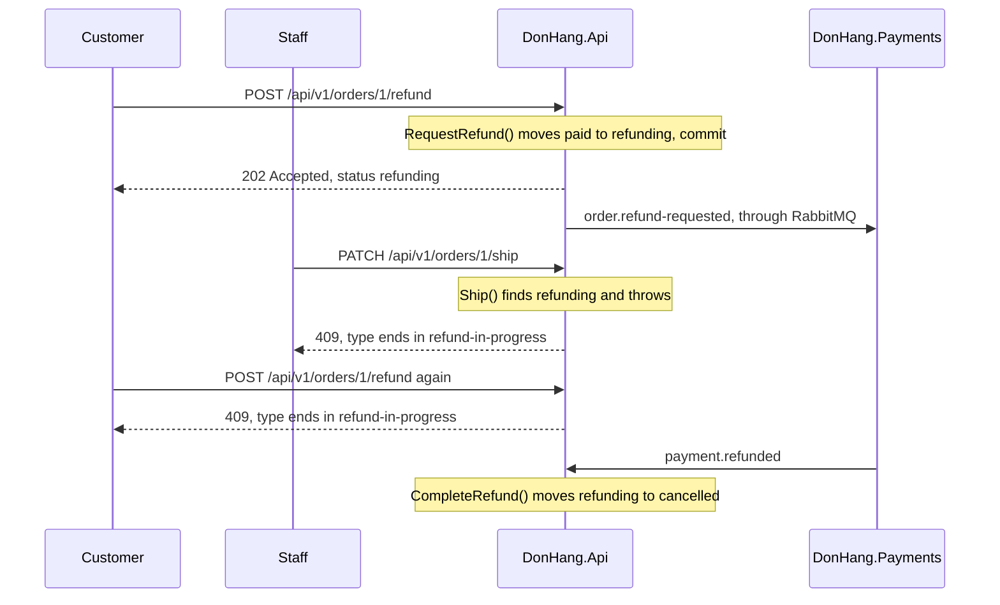

## Before you start

- [[backend.l3.eventual-consistency]] — you know that while the refund saga runs, the order says `refunding` for a time that nothing limits.
- [[design.l2.status-changes-through-methods]] — you know that each status change is a method of `Order` that checks the status it starts from.
- [[design.l3.aggregates-and-invariants]] — you know that a rule holds only if every change passes through one place that checks it.
- [[backend.l2.problem-types]] — you know that a refused status change answers `409` with a Problem Details `type` naming the broken rule.

## The situation

A customer asks for the money back for order 1. The API answers `202 Accepted`, and the order says `refunding`. Payments has not yet reached the gateway, the payment provider that actually sends the money back. That can take seconds, or much longer if the gateway keeps failing.

Meanwhile a staff member works through the paid orders and sends `PATCH /api/v1/orders/1/ship`. At stage-2 this call would have worked, because `Ship()` accepted any `paid` order. If it works now, the customer gets the money back and the goods as well.

What keeps the staff member's request, and every other change, away from an order whose refund is still running?

## Core concepts

- unfinished saga — a saga whose first step is committed while its later steps are not done; every other request can already read what that first step saved.
- in-progress status — a status an order holds only while a saga runs on it, here `refunding`, which each method of `Order` checks before it changes anything.
- `refund-in-progress` — the code `Order` gives when it refuses a change because a refund is running; the API puts it at the end of the `409` answer's `type`.

## How it works



Inside one transaction you never met this problem. At PostgreSQL's default isolation level, other transactions do not see a change until it commits, and by then the whole change is done. A saga commits each step on its own. Once its first step commits, any request can read the order and try to change it, while the refund is still far from done.

Follow the diagram. The customer's request calls `Order.RequestRefund()`, which accepts only a `paid` order and moves it to `refunding`. That change commits together with the `order.refund-requested` message. From then on, every request that loads the order sees `refunding`.

The staff member's request loads the same order and calls `Ship()`. `Ship()` finds `refunding` and throws `OrderStatusException` with the code `refund-in-progress`, so nothing is saved. The API turns that exception into `409`. A second refund request from the customer meets the same check in `RequestRefund()`, so one order never has two refunds running. `Cancel()` refuses a `refunding` order the same way. Only the saga's own later steps move the order on, such as `CompleteRefund()`, which accepts a `refunding` order when `payment.refunded` arrives.

The saga only protects orders that enter it, so stage-3 also closes a second gap. At stage-2 `Cancel()` accepted a `paid` order and set it to `cancelled` with the money still taken. Now `Cancel()` refuses `paid`, so every paid order leaves through `RequestRefund()` and the saga. The first version of the team's design doc for refunds, `docs/design/refund-design.md`, left that choice open; the second records it.

## In the Đơn Hàng system

The two methods the diagram calls on a `refunding` order sit next to each other in `Order`:

```csharp file=DonHang.Domain/Entities.cs tag=stage-3 lines=135-156
    public void Ship()
    {
        if (Status == "cancelled") throw new OrderStatusException(Id, "already-cancelled", $"order {Id} is cancelled");
        if (Status == "shipped") throw new OrderStatusException(Id, "already-shipped", $"order {Id} has already shipped");
        if (Status == "refunding") throw new OrderStatusException(Id, "refund-in-progress", $"order {Id} is being refunded");
        if (Status != "paid") throw new OrderStatusException(Id, "not-paid", $"order {Id} is not paid yet");
        Status = "shipped";
        domainEvents.Add(new OrderShipped(this, DateTimeOffset.UtcNow));
    }

    // lesson: backend.l3.saga-in-progress-status
    // lesson: backend.l3.saga
    // The first step of the refund saga. Only a paid order can ask for its
    // money back; `refunding` then tells every other request that a refund is
    // under way, so a second refund, a cancel or a ship is refused meanwhile.
    public void RequestRefund()
    {
        if (Status == "refunding") throw new OrderStatusException(Id, "refund-in-progress", $"order {Id} is already being refunded");
        if (Status != "paid") throw new OrderStatusException(Id, "not-paid", $"order {Id} is not paid, so there is nothing to refund");
        Status = "refunding";
        domainEvents.Add(new OrderRefundRequested(this, DateTimeOffset.UtcNow));
    }
```

Line 139, `if (Status == "refunding")` in `Ship()`, is the check the staff member's request meets. Line 152 is the same check in `RequestRefund()`, which stops a second refund, and line 153, `if (Status != "paid")`, lets only a `paid` order start one. Every refusal throws before the status changes, so a refused request saves nothing. `Cancel()`, just above the excerpt, has the same `refunding` check and also refuses `paid`. Outside this file, `ExceptionHandlingMiddleware` in `DonHang.Api` turns every `OrderStatusException` into `409`, with the exception's code at the end of the problem's `type`.

The test that pins the closed gap is new at stage-3:

```csharp file=DonHang.Tests/Domain/OrderTests.cs tag=stage-3 lines=63-76
    // lesson: backend.l3.saga-in-progress-status
    // Until stage-2 a paid order could be cancelled here. From stage-3 its
    // money must go back first: it leaves through RequestRefund instead.
    [Fact]
    public void Cancel_PaidOrder_Throws()
    {
        var order = NewOrder();
        order.MarkPaid();

        var ex = Assert.Throws<OrderStatusException>(order.Cancel);

        Assert.Equal("paid", ex.Code);
        Assert.Equal("paid", order.Status);
    }
```

The test builds an order, marks it paid, and expects `Cancel()` to refuse with the code `paid` and leave the status alone. Further down the same file, outside the excerpt, `RequestRefund_RefundingOrder_Throws`, `Cancel_RefundingOrder_Throws` and `Ship_RefundingOrder_Throws` check the `refunding` rules the same way. None of them starts a database, RabbitMQ or Payments. `refunding` is a rule of the order, so it lives in `Order` and is tested like the other status rules.

## Seniors often assume…

- **"Staff can still ship an order while its refund runs; the refund will catch up."** → Actually no step of the saga brings goods back: when the refund succeeds, its last step only moves the order from `refunding` to `cancelled`. So the refund design doc refuses shipping, cancelling and a second refund while the order is `refunding`. You notice this when a staff member's `PATCH …/ship` on a `refunding` order gets `409` with a `type` ending in `refund-in-progress`.
- **"Holding a row lock on the order for the whole saga would keep others out more simply."** → Actually a row lock ends with its transaction, and the saga's first step has to commit before anything else can happen. Until it commits, the code that publishes outbox rows to RabbitMQ cannot see the `order.refund-requested` row, so Payments would never hear of the refund. A transaction kept open across the saga would also hold the order's row while the gateway keeps failing, so every other request that tries to change that order would wait that long. You notice this when you trace the saga: each step runs in a different transaction, often in a different service and database.
- **"`refunding` is only a label for the app to show; the server does not need to check it."** → Actually the app is only one client, and any caller with a token can send requests to the API directly. Only a check inside `Order` holds for every caller. You notice this when the integration test `ShipOrder_Refunding_Returns409` sends the ship request straight to the API, with no app involved, and gets `409`.

## Try it (3 minutes)

In the root folder of the example repository at `stage-3`, with the .NET SDK installed:

1. In `DonHang.Domain/Entities.cs`, put `//` at the start of line 126, the `refunding` check in `Cancel()`.
2. Run `dotnet test DonHang.Tests --filter Cancel_RefundingOrder_Throws` and read the result.
3. Undo the change with `git checkout DonHang.Domain/Entities.cs`, then decide: without line 126, what would a customer's cancel request do to an order that is `refunding`?

Expected result: one test runs and fails, because `Cancel()` no longer throws for a `refunding` order. For item 3, check your answer below.

<details><summary>Suggested answer</summary>

A `refunding` order passes the three checks before line 126, because it is not `cancelled`, `shipped` or `paid`. So line 127 sets it to `cancelled` while Payments is still returning the money. When `payment.refunded` arrives later, `CompleteRefund()` refuses the order, because it only accepts a `refunding` one. The saga's last step can no longer finish.

</details>

## Connections

- [[backend.l3.eventual-consistency]] — names the stretch of time this lesson protects: while the services disagree, `refunding` keeps other changes out.
- [[backend.l2.optimistic-concurrency]] — the same goal over a much shorter window: it refuses a save when the row changed since it was read; `refunding` refuses changes for the whole saga.
- [[management.l2.requirements-document]] — where the rule starts: requirement YC-4 forbids a second refund request for one order, and the design doc extends it to cancel and ship.
- [[backend.l3.compensating-action]] — the next question: where the order goes when the gateway refuses the refund.

## Five-line summary

1. While a saga runs, the order holds its own status, `refunding`, and every change that is not a step of the saga is refused.
2. A saga commits each step separately, so between steps other requests can read the order and try to change it.
3. `RequestRefund()` accepts only `paid`; `Ship()`, `Cancel()` and a second `RequestRefund()` refuse `refunding`, and the API answers `409`.
4. From stage-3 `Cancel()` also refuses `paid`, so every paid order leaves through the refund saga.
5. The rule lives in `Order` and `OrderTests` checks it without any saga running, like every other status rule.
