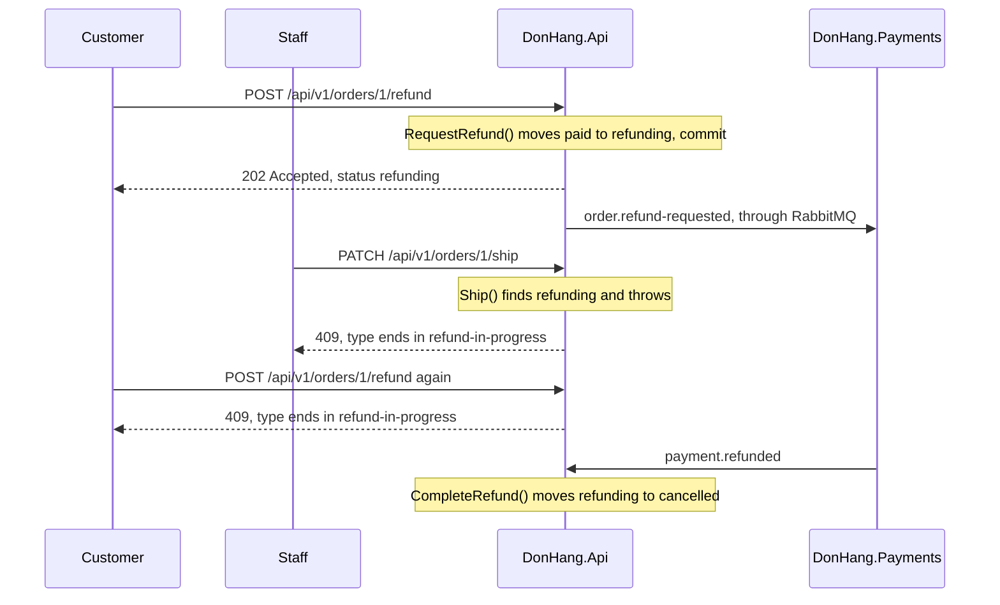

## Bạn cần biết trước

- [[backend.l3.eventual-consistency]] — bạn biết rằng trong lúc saga hoàn tiền chạy, đơn ghi `refunding` trong một khoảng thời gian không gì giới hạn.
- [[design.l2.status-changes-through-methods]] — bạn biết rằng mỗi lần đổi trạng thái là một method của `Order`, và method đó kiểm tra trạng thái xuất phát.
- [[design.l3.aggregates-and-invariants]] — bạn biết rằng một quy tắc chỉ đứng vững khi mọi thay đổi đều đi qua một chỗ duy nhất kiểm tra nó.
- [[backend.l2.problem-types]] — bạn biết rằng một lần đổi trạng thái bị từ chối sẽ trả về `409`, với `type` của Problem Details gọi tên quy tắc bị vi phạm.

## Tình huống

Một khách hàng yêu cầu trả lại tiền cho đơn 1. API trả về `202 Accepted`, và đơn ghi `refunding`. Payments chưa gọi tới cổng thanh toán, tức nhà cung cấp thanh toán thật sự chuyển tiền trả lại. Chuyện đó có thể mất vài giây, hoặc lâu hơn nhiều nếu cổng thanh toán cứ thất bại.

Trong lúc đó, một nhân viên đang xử lý lần lượt các đơn đã thanh toán và gửi `PATCH /api/v1/orders/1/ship`. Ở stage-2, lời gọi này sẽ thành công, vì `Ship()` nhận mọi đơn `paid`. Nếu giờ nó vẫn thành công, khách hàng vừa nhận lại tiền vừa nhận được hàng.

Điều gì chặn request của nhân viên, và mọi thay đổi khác, khỏi một đơn mà lần hoàn tiền vẫn đang chạy?

## Khái niệm cốt lõi

- saga chưa xong — một saga mà bước đầu tiên đã commit còn các bước sau chưa xong. Mọi request khác đều đã đọc được những gì bước đầu tiên lưu lại.
- trạng thái đang xử lý — một trạng thái mà đơn chỉ mang trong lúc có saga chạy trên nó, ở đây là `refunding`. Mỗi method của `Order` kiểm tra trạng thái này trước khi thay đổi bất cứ thứ gì.
- `refund-in-progress` — mã mà `Order` đưa ra khi từ chối một thay đổi vì đang có lần hoàn tiền chạy. API đặt mã này ở cuối `type` của câu trả lời `409`.

## Cơ chế hoạt động



Trong một giao dịch, bạn chưa bao giờ gặp vấn đề này. Ở isolation level mặc định của PostgreSQL, các giao dịch khác không thấy một thay đổi cho tới khi nó commit, và lúc đó toàn bộ thay đổi đã xong. Saga thì commit từng bước riêng. Ngay khi bước đầu tiên commit, bất kỳ request nào cũng đọc được đơn và thử thay đổi nó, trong khi lần hoàn tiền còn lâu mới xong.

Hãy đi theo sơ đồ. Request của khách hàng gọi `Order.RequestRefund()`. Method này chỉ nhận đơn `paid` và chuyển nó sang `refunding`. Thay đổi đó commit cùng với message `order.refund-requested`. Từ đó trở đi, mọi request nạp đơn này đều thấy `refunding`.

Request của nhân viên nạp cùng đơn đó và gọi `Ship()`. `Ship()` thấy `refunding` và ném `OrderStatusException` với mã `refund-in-progress`, nên không có gì được lưu. API biến exception đó thành `409`. Yêu cầu hoàn tiền thứ hai của khách hàng gặp đúng kiểm tra này trong `RequestRefund()`, nên một đơn không bao giờ có hai lần hoàn tiền chạy cùng lúc. `Cancel()` cũng từ chối đơn `refunding` theo cách tương tự. Chỉ các bước sau của chính saga mới đưa đơn đi tiếp, chẳng hạn `CompleteRefund()`, method nhận đơn `refunding` khi `payment.refunded` tới.

Saga chỉ bảo vệ những đơn đi vào nó, nên stage-3 còn bịt thêm một lỗ hổng thứ hai. Ở stage-2, `Cancel()` nhận đơn `paid` và đặt nó thành `cancelled` trong khi tiền vẫn đang bị giữ. Giờ `Cancel()` từ chối `paid`, nên mọi đơn đã thanh toán chỉ có một lối ra là `RequestRefund()` và saga. Phiên bản đầu của design doc về hoàn tiền của nhóm, `docs/design/refund-design.md`, còn để ngỏ lựa chọn này. Phiên bản thứ hai ghi lại nó.

## Trong hệ thống Đơn Hàng

Hai method mà sơ đồ gọi trên một đơn `refunding` nằm cạnh nhau trong `Order`:

```csharp file=DonHang.Domain/Entities.cs tag=stage-3 lines=135-156
    public void Ship()
    {
        if (Status == "cancelled") throw new OrderStatusException(Id, "already-cancelled", $"order {Id} is cancelled");
        if (Status == "shipped") throw new OrderStatusException(Id, "already-shipped", $"order {Id} has already shipped");
        if (Status == "refunding") throw new OrderStatusException(Id, "refund-in-progress", $"order {Id} is being refunded");
        if (Status != "paid") throw new OrderStatusException(Id, "not-paid", $"order {Id} is not paid yet");
        Status = "shipped";
        domainEvents.Add(new OrderShipped(this, DateTimeOffset.UtcNow));
    }

    // lesson: backend.l3.saga-in-progress-status
    // lesson: backend.l3.saga
    // The first step of the refund saga. Only a paid order can ask for its
    // money back; `refunding` then tells every other request that a refund is
    // under way, so a second refund, a cancel or a ship is refused meanwhile.
    public void RequestRefund()
    {
        if (Status == "refunding") throw new OrderStatusException(Id, "refund-in-progress", $"order {Id} is already being refunded");
        if (Status != "paid") throw new OrderStatusException(Id, "not-paid", $"order {Id} is not paid, so there is nothing to refund");
        Status = "refunding";
        domainEvents.Add(new OrderRefundRequested(this, DateTimeOffset.UtcNow));
    }
```

Dòng 139, `if (Status == "refunding")` trong `Ship()`, là kiểm tra mà request của nhân viên gặp phải. Dòng 152 là cùng kiểm tra đó trong `RequestRefund()`, chặn lần hoàn tiền thứ hai, còn dòng 153, `if (Status != "paid")`, chỉ cho đơn `paid` bắt đầu hoàn tiền. Mọi lần từ chối đều ném exception trước khi trạng thái đổi, nên một request bị từ chối không lưu gì cả. `Cancel()`, ngay phía trên đoạn trích, có cùng kiểm tra `refunding` và cũng từ chối `paid`. Ngoài file này, `ExceptionHandlingMiddleware` trong `DonHang.Api` biến mọi `OrderStatusException` thành `409`, với mã của exception nằm ở cuối `type` của problem.

Test chốt lại lỗ hổng đã bịt là test mới ở stage-3:

```csharp file=DonHang.Tests/Domain/OrderTests.cs tag=stage-3 lines=63-76
    // lesson: backend.l3.saga-in-progress-status
    // Until stage-2 a paid order could be cancelled here. From stage-3 its
    // money must go back first: it leaves through RequestRefund instead.
    [Fact]
    public void Cancel_PaidOrder_Throws()
    {
        var order = NewOrder();
        order.MarkPaid();

        var ex = Assert.Throws<OrderStatusException>(order.Cancel);

        Assert.Equal("paid", ex.Code);
        Assert.Equal("paid", order.Status);
    }
```

Test tạo một đơn, đánh dấu đã thanh toán, rồi chờ `Cancel()` từ chối với mã `paid` và giữ nguyên trạng thái. Ở phía dưới cùng file, ngoài đoạn trích, `RequestRefund_RefundingOrder_Throws`, `Cancel_RefundingOrder_Throws` và `Ship_RefundingOrder_Throws` kiểm tra các quy tắc `refunding` theo cùng cách. Không test nào khởi động database, RabbitMQ hay Payments. `refunding` là một quy tắc của đơn, nên nó nằm trong `Order` và được test như mọi quy tắc trạng thái khác.

## Senior hay nhầm rằng…

- **"Nhân viên vẫn có thể giao một đơn trong lúc nó đang hoàn tiền, lần hoàn tiền sẽ tự xử lý sau."** → Thực ra không bước nào của saga lấy hàng về: khi hoàn tiền thành công, bước cuối của nó chỉ chuyển đơn từ `refunding` sang `cancelled`. Vì vậy design doc về hoàn tiền từ chối giao hàng, hủy đơn và lần hoàn tiền thứ hai trong lúc đơn đang `refunding`. Bạn sẽ nhận ra khi `PATCH …/ship` của nhân viên trên một đơn `refunding` nhận `409` với `type` kết thúc bằng `refund-in-progress`.
- **"Giữ khóa dòng trên đơn suốt cả saga sẽ chặn người khác đơn giản hơn."** → Thực ra khóa dòng kết thúc cùng giao dịch của nó, mà bước đầu tiên của saga phải commit thì mọi thứ khác mới diễn ra được. Chừng nào nó chưa commit, đoạn code đẩy các dòng outbox lên RabbitMQ không thấy dòng `order.refund-requested`, nên Payments sẽ không bao giờ biết có lần hoàn tiền. Một giao dịch mở suốt saga cũng sẽ giữ dòng của đơn trong lúc cổng thanh toán cứ thất bại, nên mọi request khác muốn đổi đơn đó đều phải chờ ngần ấy thời gian. Bạn sẽ nhận ra khi lần theo saga: mỗi bước chạy trong một giao dịch khác, thường ở một service và database khác.
- **"`refunding` chỉ là nhãn để app hiển thị, server không cần kiểm tra."** → Thực ra app chỉ là một client, và bất kỳ ai có token đều gửi request thẳng tới API được. Chỉ một kiểm tra nằm trong `Order` mới đứng vững với mọi bên gọi. Bạn sẽ nhận ra khi integration test `ShipOrder_Refunding_Returns409` gửi request giao hàng thẳng tới API, không qua app, và nhận `409`.

## Thử ngay (3 phút)

Ở thư mục gốc của repo ví dụ tại `stage-3`, khi đã cài .NET SDK:

1. Trong `DonHang.Domain/Entities.cs`, thêm `//` vào đầu dòng 126, tức kiểm tra `refunding` trong `Cancel()`.
2. Chạy `dotnet test DonHang.Tests --filter Cancel_RefundingOrder_Throws` và đọc kết quả.
3. Hoàn tác thay đổi bằng `git checkout DonHang.Domain/Entities.cs`, rồi hãy xác định: không có dòng 126, yêu cầu hủy của khách hàng sẽ làm gì với một đơn đang `refunding`?

Kết quả mong đợi: một test chạy và thất bại, vì `Cancel()` không còn ném exception với đơn `refunding`. Ở mục 3, hãy đối chiếu với đáp án bên dưới.

<details><summary>Gợi ý đáp án</summary>

Một đơn `refunding` lọt qua ba kiểm tra trước dòng 126, vì nó không phải `cancelled`, `shipped` hay `paid`. Vậy là dòng 127 đặt nó thành `cancelled` trong khi Payments vẫn đang trả tiền lại. Khi `payment.refunded` tới sau đó, `CompleteRefund()` từ chối đơn, vì method này chỉ nhận đơn `refunding`. Bước cuối của saga không còn hoàn thành được nữa.

</details>

## Liên hệ

- [[backend.l3.eventual-consistency]] — gọi tên khoảng thời gian mà bài này bảo vệ: trong lúc các service còn lệch nhau, `refunding` chặn các thay đổi khác.
- [[backend.l2.optimistic-concurrency]] — cùng mục tiêu nhưng trong một khoảng ngắn hơn nhiều: nó từ chối lần lưu khi dòng đã đổi kể từ lúc đọc, còn `refunding` từ chối thay đổi suốt cả saga.
- [[management.l2.requirements-document]] — nơi quy tắc bắt đầu: yêu cầu YC-4 cấm yêu cầu hoàn tiền thứ hai cho một đơn, và design doc mở rộng nó sang hủy đơn và giao hàng.
- [[backend.l3.compensating-action]] — câu hỏi tiếp theo: đơn đi về đâu khi cổng thanh toán từ chối hoàn tiền.

## Tóm tắt 5 dòng

1. Trong lúc saga chạy, đơn mang trạng thái riêng `refunding`, và mọi thay đổi không phải một bước của saga đều bị từ chối.
2. Saga commit từng bước riêng, nên giữa các bước, request khác có thể đọc đơn và thử thay đổi nó.
3. `RequestRefund()` chỉ nhận `paid`. `Ship()`, `Cancel()` và lần `RequestRefund()` thứ hai từ chối `refunding`, và API trả về `409`.
4. Từ stage-3, `Cancel()` cũng từ chối `paid`, nên mọi đơn đã thanh toán đều ra đi qua saga hoàn tiền.
5. Quy tắc nằm trong `Order`, và `OrderTests` kiểm tra nó mà không cần saga nào chạy, như mọi quy tắc trạng thái khác.
