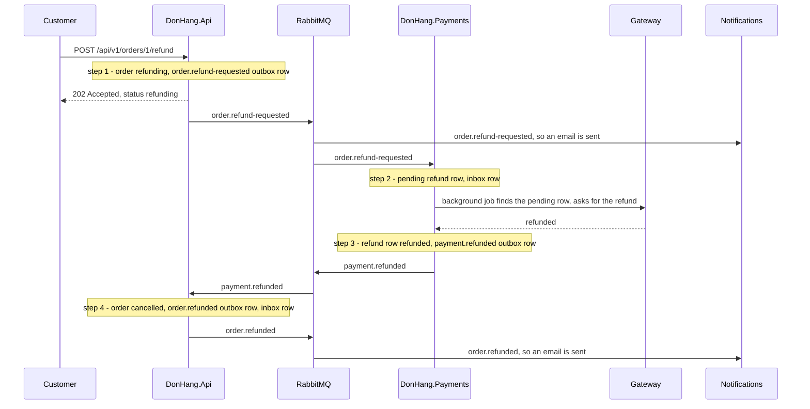

## Before you start

- [[backend.l3.two-phase-commit]] — you know why `refund-design.md` rejects one transaction across `donhang`, `donhang_payments`, RabbitMQ and the gateway.
- [[backend.l3.outbox-pattern]] — you know that an outbox row is saved in the same transaction as the change it describes, and published afterwards.
- [[backend.l3.idempotent-consumer]] — you know that a consumer saves each message's id in its inbox, in the same transaction as its effect, so a repeat changes nothing.
- [[design.l3.dispatching-domain-events]] — you know that an order's events reach their handlers before `SaveChangesAsync`, so a handler's rows join the same save.

## The situation

Customer 1 asks for order 1's money back. At stage-2 the refund existed only as a design: `refund-design.md` first planned to save the refund row, the order's new status and the email in one transaction in `donhang`.

At stage-3 the refund row belongs to `DonHang.Payments`, the order to `DonHang.Api`, the email to Notifications, and only Payments may call the gateway, the outside payment service that returns the money. The previous lesson ruled out a transaction that spans them all. Yet the money must still go back, the order be cancelled and the customer told.

How does a refund across three services finish correctly with no single transaction?

## Core concepts

- **saga** — a sequence of local transactions, each in one service, where each step saves its change together with what starts the next step; the refund in the situation above runs as one.
- local transaction — an ordinary transaction in one service's own database; it commits or rolls back on its own, without asking any other service.
- step — one local transaction of the saga, started by what the step before it saved: a message when the next step is in another service, or a row a background job picks up, as with Payments' two steps; the first step is started by the customer's request.

## How it works



In the situation above, the refund is a saga of four steps, and each note in the diagram is one local transaction.

Step 1 runs in `DonHang.Api`. One transaction moves order 1 to `refunding` and saves an `order.refund-requested` outbox row. The endpoint then answers `202 Accepted` with the order as it is now; no money has moved yet.

Step 2 runs in `DonHang.Payments` when that message arrives. One transaction saves a `pending` refund row and the message id in the inbox. It does not call the gateway: that call leaves the database, and no rollback can undo it, so this step only records the work.

Step 3 also runs in Payments. A background job looks for `pending` refund rows; finding the one step 2 saved is what starts step 3. It calls the gateway, tries again later if the call does not go through, and in one transaction saves the answer on the refund row together with a `payment.refunded` outbox row.

Step 4 runs back in `DonHang.Api`. One transaction moves the order to `cancelled`, saves an `order.refunded` outbox row and records the message id in the inbox. Notifications sends the "order refunded" email from that message, as it sent a "refund requested" email from step 1's message.

Each step commits in its own database and ends there. Between services, what links one step to the next is a message, and each step's message exists only after that step has committed; inside Payments, step 3 is started by the `pending` row that step 2 committed. The outbox means a committed step cannot lose its message. The inbox means a message delivered twice does not run its step twice.

## In the Đơn Hàng system

`scripts/backend/refund-saga.sh` asks for a refund of order 1 and then reads all three databases:

```bash file=scripts/backend/refund-saga.sh tag=stage-3 lines=19-29
# lesson: backend.l3.saga
# Step 1, in DonHang.Api: one transaction moves the order to refunding and
# saves its order.refund-requested outbox row. The answer does not wait for
# the money: 202 Accepted, with the order as it is now.
echo "== POST /api/v1/orders/1/refund as customer 1"
curl -sS -w '\n  -> %{http_code}\n' -X POST "$base/orders/1/refund" -H "Authorization: Bearer $token"
echo

# Steps 2 and 3 run in DonHang.Payments, step 4 back in DonHang.Api; the
# emails come from DonHang.Notifications, one for each order.* message.
wait_for_status 1 cancelled
```

```text output=true
== POST /api/v1/orders/1/refund as customer 1
{"id":...,"customerId":1,"status":"refunding","placedAt":"...","items":[{"productId":1,"quantity":1,"unitPriceVnd":1250000},{"productId":2,"quantity":2,"unitPriceVnd":450000}]}
  -> 202

== donhang: what happened to order 1 (order_status_history)
refund-requested | refunding
refunded | cancelled
== donhang: the messages it saved for RabbitMQ (outbox_messages)
order.refund-requested | t
order.refunded | t
== donhang_payments: order 1's payment rows, then its outbox_messages
charge | paid | 2150000 | card |  | 0
refund | refunded | 2150000 | card | anh.tran@example.com | 1
payment.refunded | t
== donhang_notifications: the emails to customer 1
anh.tran@example.com | refund requested | sent
anh.tran@example.com | order refunded | sent
```

Line 24 sends the request as customer 1, and line 29 waits until the order reaches `cancelled`; `wait_for_status` comes from `scripts/lib/refunds.sh`, outside the excerpt. The output's first part is the answer: `202`, with `status` still `refunding`.

The rest is the saga's trail, printed by queries later in the script, outside the excerpt. `donhang` holds two status changes and two outbox rows, one from step 1 and one from step 4; `t` means the row's `published_at` is set, so the message has reached RabbitMQ. The payment rows show kind, status, amount, method, who asked and attempts: the refund row is `refunded` after one attempt, followed by its `payment.refunded` row from step 3. Notifications sent one email for each `order.*` message.

Step 2 is `HandleAsync` in `DonHang.Payments/RefundRequestedConsumer.cs`:

```csharp file=DonHang.Payments/RefundRequestedConsumer.cs tag=stage-3 lines=80-101
    public async Task HandleAsync(string? messageId, byte[] body)
    {
        var request = Read(body);
        if (!Guid.TryParse(messageId, out var id)) throw new PoisonMessageException("the message has no id");

        using var scope = scopeFactory.CreateScope();
        var db = scope.ServiceProvider.GetRequiredService<PaymentsDbContext>();
        var charge = await db.Payments.SingleOrDefaultAsync(p => p.OrderId == request.OrderId && p.Kind == "charge")
            ?? throw new PoisonMessageException($"order {request.OrderId} has no payment to refund");

        db.InboxMessages.Add(new InboxMessage { MessageId = id });
        db.Payments.Add(NewRefund(charge, request));
        try
        {
            await db.SaveChangesAsync();
        }
        catch (DbUpdateException ex) when (Inbox.IsDuplicate(ex) || IsSecondRefund(ex))
        {
            logger.LogInformation("A refund for order {OrderId} was already requested; skipping message {MessageId}",
                request.OrderId, id);
        }
    }
```

Lines 90–91 add the inbox row and the new refund row, and line 94 saves both in one `SaveChangesAsync`: that is the step's local transaction. Nothing here calls the gateway; `NewRefund`, outside the excerpt, builds a `pending` row for the full amount of the charge. Lines 96–99 handle a repeat: a second copy of the message, or a second request for the same order, breaks a unique index, so nothing is saved and the method returns normally. Step 4 follows the same idea in `DonHang.Api/Messaging/PaymentEventsConsumer.cs`: the inbox row and the order's change are saved by one `SaveChangesAsync`, there inside `OrderService.CompleteRefundAsync`, and `Order.CompleteRefund` in `DonHang.Domain/Entities.cs` is the method that moves the order from `refunding` to `cancelled`.

## Seniors often assume…

- **"A saga is a product you install, like RabbitMQ."** → Actually a saga is a way of arranging pieces you already have: local transactions, an outbox, consumers and an inbox. Đơn Hàng has no saga service and no saga package; its refund saga is two status methods on `Order` (`RequestRefund`, `CompleteRefund`), two consumers and a background job. You notice this when you look for "the saga" in `docker-compose.yml` and find nothing, and following one refund means reading the consumers of three services.
- **"When a later step of a saga fails, the earlier steps are rolled back automatically."** → Actually each step's transaction committed in its own database and ended there, so no later failure can roll it back. Nothing ties step 1 to step 3 except messages and the `pending` row. You notice this when a refund fails in Payments: the order in `donhang` stays `refunding` until a separate message, `payment.refund-failed`, starts a new step that changes it (next lesson); nothing is undone in place.
- **"The refund endpoint should wait for Payments, so it can return the final result."** → Actually waiting would put the gateway's speed, and Payments being up, inside the customer's request. `refund-design.md` says the request waits for no one, and Payments may keep retrying the gateway for up to 24 hours. The `202` says the request was accepted, and `refunding` says what is true right now. You notice this when you compare the response of `refund-saga.sh` with its last lines: the response says `refunding`, the end says `cancelled`.

## Try it (3 minutes)

With the lab running (`scripts/up.sh`), in the root folder of the example repository:

1. Run `scripts/backend/refund-saga.sh`.
2. Find the status code and the `status` in the first answer, the two lines of `order_status_history`, and the refund row in `donhang_payments`.
3. Then decide: which step wrote each of the rows marked `t` in the outbox sections?

Expected result: `202` and `refunding`; `refund-requested | refunding` then `refunded | cancelled`; a `refund | refunded` row with `1` attempt. For item 3, check your answer below.

<details><summary>Suggested answer</summary>

`order.refund-requested` in `donhang` comes from step 1, saved with the order's move to `refunding`. `payment.refunded` in `donhang_payments` comes from step 3, saved with the gateway's answer. `order.refunded` in `donhang` comes from step 4, saved with the order's move to `cancelled`. Step 2 writes no outbox row: its work is the `pending` refund row that step 3 picks up.

</details>

## Connections

- [[backend.l3.two-phase-commit]] — the option a saga replaces: one transaction that keeps every database waiting for the others' vote, instead of several that each commit on their own.
- [[backend.l3.outbox-pattern]] — what keeps each step's message from being lost once the step has committed.
- [[backend.l3.idempotent-consumer]] — what makes a repeated message harmless to a step.
- [[backend.l3.exchanges-and-bindings]] — how each step's message reaches the service that runs the next step.
- [[management.l2.design-doc]] — `refund-design.md`, a design doc, is where the saga's steps were first written down.
- [[backend.l3.compensating-action]] — the next question: what a saga does when a later step fails.

## Five-line summary

1. A saga replaces one transaction across services with a chain of local transactions, each saving its change together with what starts the next.
2. At stage-3 the refund endpoint moves the order to `refunding`, saves an `order.refund-requested` outbox row in one transaction, and answers `202 Accepted`.
3. Payments saves a `pending` refund row, then a background job picks it up and saves the gateway's answer together with a `payment.refunded` outbox row.
4. `DonHang.Api` then cancels the order and saves an `order.refunded` row in one transaction, and Notifications sends the email.
5. The outbox keeps each step's message from being lost, and each inbox makes a repeated message harmless.
