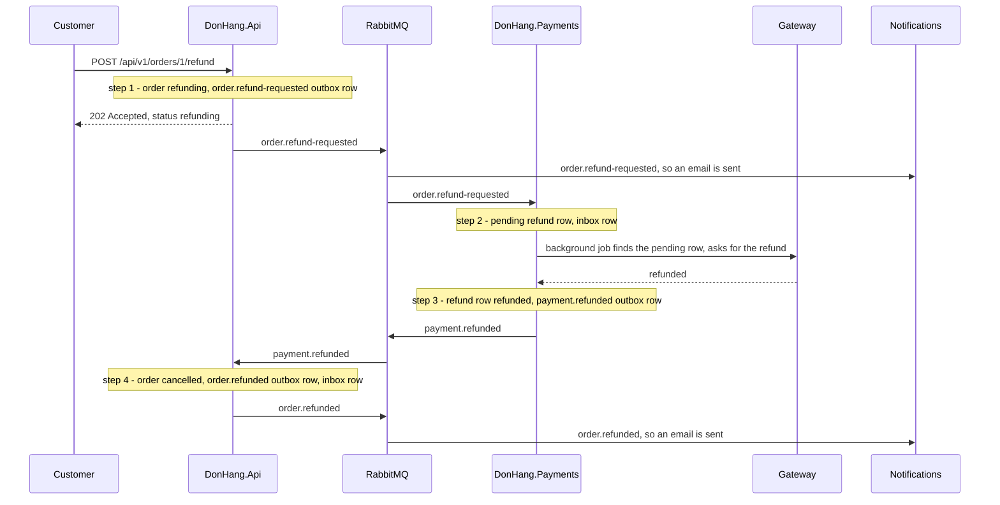

## Bạn cần biết trước

- [[backend.l3.two-phase-commit]] — bạn biết vì sao `refund-design.md` loại bỏ một giao dịch duy nhất trải qua `donhang`, `donhang_payments`, RabbitMQ và cổng thanh toán.
- [[backend.l3.outbox-pattern]] — bạn biết rằng một dòng outbox được lưu trong cùng giao dịch với thay đổi mà nó mô tả, rồi mới được publish sau đó.
- [[backend.l3.idempotent-consumer]] — bạn biết rằng consumer lưu id của mỗi message vào inbox, trong cùng giao dịch với tác dụng của message đó, nên một lần lặp lại không thay đổi gì.
- [[design.l3.dispatching-domain-events]] — bạn biết rằng các event của một đơn tới được handler trước `SaveChangesAsync`, nên các dòng mà handler thêm vào nằm chung lần lưu đó.

## Tình huống

Khách hàng 1 yêu cầu hoàn tiền cho đơn 1. Ở stage-2, hoàn tiền mới chỉ có trên bản thiết kế: ban đầu `refund-design.md` định lưu dòng hoàn tiền, trạng thái mới của đơn và email trong một giao dịch, ngay trong `donhang`.

Ở stage-3, dòng hoàn tiền thuộc về `DonHang.Payments`, đơn thuộc về `DonHang.Api`, email thuộc về Notifications, và chỉ Payments được gọi cổng thanh toán, tức dịch vụ thanh toán bên ngoài trả tiền lại cho khách. Bài trước đã loại bỏ một giao dịch trải qua tất cả các bên đó. Thế nhưng tiền vẫn phải được trả lại, đơn vẫn phải bị hủy và khách hàng vẫn phải được báo.

Làm sao một lần hoàn tiền qua ba service kết thúc đúng khi không có một giao dịch chung nào?

## Khái niệm cốt lõi

- **saga** (Chuỗi transaction cục bộ ở nhiều service, mỗi bước lưu thay đổi rồi gửi message khởi động bước kế) — một chuỗi giao dịch cục bộ, mỗi giao dịch nằm trong một service, trong đó mỗi bước lưu thay đổi của mình cùng với thứ khởi động bước tiếp theo. Lần hoàn tiền trong tình huống trên chạy như một saga.
- giao dịch cục bộ — một giao dịch bình thường trong database riêng của một service. Nó tự commit hoặc rollback, không cần hỏi service nào khác.
- bước — một giao dịch cục bộ của saga, được khởi động bởi thứ mà bước trước đã lưu: một message khi bước sau nằm ở service khác, hoặc một dòng mà background job nhặt lên, như hai bước của Payments. Bước đầu tiên được khởi động bởi request của khách hàng.

## Cơ chế hoạt động



Trong tình huống trên, hoàn tiền là một saga gồm bốn bước, và mỗi ghi chú trong sơ đồ là một giao dịch cục bộ.

Bước 1 chạy trong `DonHang.Api`. Một giao dịch chuyển đơn 1 sang `refunding` và lưu một dòng outbox `order.refund-requested`. Sau đó endpoint trả về `202 Accepted` kèm đơn ở trạng thái hiện tại. Lúc này chưa có đồng nào được chuyển.

Bước 2 chạy trong `DonHang.Payments` khi message đó tới. Một giao dịch lưu một dòng hoàn tiền `pending` và id của message vào inbox. Bước này không gọi cổng thanh toán: lời gọi đó đi ra ngoài database, không rollback nào hoàn tác được nó, nên bước này chỉ ghi lại việc cần làm.

Bước 3 cũng chạy trong Payments. Một background job tìm các dòng hoàn tiền `pending`, và chính lúc nó thấy dòng mà bước 2 đã lưu là lúc bước 3 bắt đầu. Job gọi cổng thanh toán, thử lại sau nếu lời gọi không thành, rồi trong một giao dịch lưu câu trả lời vào dòng hoàn tiền cùng với một dòng outbox `payment.refunded`.

Bước 4 quay lại `DonHang.Api`. Một giao dịch chuyển đơn sang `cancelled`, lưu một dòng outbox `order.refunded` và ghi id của message vào inbox. Notifications gửi email "order refunded" từ message đó, giống như đã gửi email "refund requested" từ message của bước 1.

Mỗi bước commit trong database của chính nó và kết thúc ở đó. Giữa các service, thứ nối bước này với bước sau là một message, và message của mỗi bước chỉ tồn tại sau khi bước đó đã commit. Bên trong Payments, bước 3 được khởi động bởi dòng `pending` mà bước 2 đã commit. Outbox bảo đảm một bước đã commit không thể làm mất message của nó. Inbox bảo đảm một message được giao hai lần không chạy bước của nó hai lần.

## Trong hệ thống Đơn Hàng

`scripts/backend/refund-saga.sh` yêu cầu hoàn tiền cho đơn 1 rồi đọc cả ba database:

```bash file=scripts/backend/refund-saga.sh tag=stage-3 lines=19-29
# lesson: backend.l3.saga
# Step 1, in DonHang.Api: one transaction moves the order to refunding and
# saves its order.refund-requested outbox row. The answer does not wait for
# the money: 202 Accepted, with the order as it is now.
echo "== POST /api/v1/orders/1/refund as customer 1"
curl -sS -w '\n  -> %{http_code}\n' -X POST "$base/orders/1/refund" -H "Authorization: Bearer $token"
echo

# Steps 2 and 3 run in DonHang.Payments, step 4 back in DonHang.Api; the
# emails come from DonHang.Notifications, one for each order.* message.
wait_for_status 1 cancelled
```

```text output=true
== POST /api/v1/orders/1/refund as customer 1
{"id":...,"customerId":1,"status":"refunding","placedAt":"...","items":[{"productId":1,"quantity":1,"unitPriceVnd":1250000},{"productId":2,"quantity":2,"unitPriceVnd":450000}]}
  -> 202

== donhang: what happened to order 1 (order_status_history)
refund-requested | refunding
refunded | cancelled
== donhang: the messages it saved for RabbitMQ (outbox_messages)
order.refund-requested | t
order.refunded | t
== donhang_payments: order 1's payment rows, then its outbox_messages
charge | paid | 2150000 | card |  | 0
refund | refunded | 2150000 | card | anh.tran@example.com | 1
payment.refunded | t
== donhang_notifications: the emails to customer 1
anh.tran@example.com | refund requested | sent
anh.tran@example.com | order refunded | sent
```

Dòng 24 gửi request với tư cách khách hàng 1, và dòng 29 chờ tới khi đơn sang `cancelled`. `wait_for_status` nằm trong `scripts/lib/refunds.sh`, ngoài đoạn trích. Phần đầu của output là câu trả lời: `202`, với `status` vẫn là `refunding`.

Phần còn lại là dấu vết của saga, do các câu truy vấn phía sau trong script in ra, cũng ngoài đoạn trích. `donhang` có hai lần đổi trạng thái và hai dòng outbox, một từ bước 1 và một từ bước 4. `t` nghĩa là `published_at` của dòng đã có giá trị, tức message đã tới RabbitMQ. Các dòng thanh toán cho thấy loại, trạng thái, số tiền, phương thức, người yêu cầu và số lần thử: dòng hoàn tiền là `refunded` sau một lần thử, theo sau là dòng `payment.refunded` của nó từ bước 3. Notifications gửi một email cho mỗi message `order.*`.

Bước 2 là `HandleAsync` trong `DonHang.Payments/RefundRequestedConsumer.cs`:

```csharp file=DonHang.Payments/RefundRequestedConsumer.cs tag=stage-3 lines=80-101
    public async Task HandleAsync(string? messageId, byte[] body)
    {
        var request = Read(body);
        if (!Guid.TryParse(messageId, out var id)) throw new PoisonMessageException("the message has no id");

        using var scope = scopeFactory.CreateScope();
        var db = scope.ServiceProvider.GetRequiredService<PaymentsDbContext>();
        var charge = await db.Payments.SingleOrDefaultAsync(p => p.OrderId == request.OrderId && p.Kind == "charge")
            ?? throw new PoisonMessageException($"order {request.OrderId} has no payment to refund");

        db.InboxMessages.Add(new InboxMessage { MessageId = id });
        db.Payments.Add(NewRefund(charge, request));
        try
        {
            await db.SaveChangesAsync();
        }
        catch (DbUpdateException ex) when (Inbox.IsDuplicate(ex) || IsSecondRefund(ex))
        {
            logger.LogInformation("A refund for order {OrderId} was already requested; skipping message {MessageId}",
                request.OrderId, id);
        }
    }
```

Dòng 90–91 thêm dòng inbox và dòng hoàn tiền mới, rồi dòng 94 lưu cả hai trong một lần `SaveChangesAsync`: đó là giao dịch cục bộ của bước này. Không chỗ nào ở đây gọi cổng thanh toán. `NewRefund`, nằm ngoài đoạn trích, tạo một dòng `pending` với toàn bộ số tiền của lần thu. Dòng 96–99 xử lý trường hợp lặp lại: một bản sao thứ hai của message, hay một yêu cầu thứ hai cho cùng đơn, sẽ vi phạm một unique index, nên không gì được lưu và method trả về bình thường. Bước 4 theo cùng ý tưởng trong `DonHang.Api/Messaging/PaymentEventsConsumer.cs`: dòng inbox và thay đổi của đơn được lưu bằng một lần `SaveChangesAsync`, ở đó nằm trong `OrderService.CompleteRefundAsync`, còn `Order.CompleteRefund` trong `DonHang.Domain/Entities.cs` là method chuyển đơn từ `refunding` sang `cancelled`.

## Senior hay nhầm rằng…

- **"Saga là một sản phẩm cài vào, giống như RabbitMQ."** → Thực ra saga là một cách sắp xếp những thứ bạn đã có: giao dịch cục bộ, outbox, consumer và inbox. Đơn Hàng không có service saga hay package saga nào. Saga hoàn tiền của nó gồm hai method trạng thái trên `Order` (`RequestRefund`, `CompleteRefund`), hai consumer và một background job. Bạn sẽ nhận ra khi đi tìm "cái saga" trong `docker-compose.yml` mà không thấy gì, và muốn lần theo một lần hoàn tiền thì phải đọc consumer của ba service.
- **"Khi một bước sau của saga thất bại, các bước trước tự động được rollback."** → Thực ra giao dịch của mỗi bước đã commit trong database riêng và kết thúc ở đó, nên không lỗi nào xảy ra sau có thể rollback nó. Giữa bước 1 và bước 3 không có gì ràng buộc ngoài các message và dòng `pending`. Bạn sẽ nhận ra khi một lần hoàn tiền thất bại trong Payments: đơn trong `donhang` vẫn ở `refunding` cho tới khi một message riêng, `payment.refund-failed`, khởi động một bước mới thay đổi nó (bài sau). Không có gì được hoàn tác tại chỗ.
- **"Endpoint hoàn tiền nên chờ Payments để trả về kết quả cuối cùng."** → Thực ra chờ như vậy sẽ đặt tốc độ của cổng thanh toán, và chuyện Payments có đang chạy hay không, vào bên trong request của khách hàng. `refund-design.md` ghi rằng request không chờ ai cả, và Payments có thể tiếp tục thử lại cổng thanh toán trong tối đa 24 giờ. `202` cho biết request đã được nhận, còn `refunding` cho biết điều đang đúng ngay lúc này. Bạn sẽ nhận ra khi so response của `refund-saga.sh` với mấy dòng cuối của nó: response ghi `refunding`, cuối cùng ghi `cancelled`.

## Thử ngay (3 phút)

Khi lab đang chạy (`scripts/up.sh`), ở thư mục gốc của repo ví dụ:

1. Chạy `scripts/backend/refund-saga.sh`.
2. Tìm status code và `status` trong câu trả lời đầu tiên, hai dòng của `order_status_history`, và dòng hoàn tiền trong `donhang_payments`.
3. Rồi hãy xác định: bước nào đã ghi từng dòng có đánh dấu `t` trong các phần outbox?

Kết quả mong đợi: `202` và `refunding`, `refund-requested | refunding` rồi `refunded | cancelled`, và một dòng `refund | refunded` với `1` lần thử. Ở mục 3, hãy đối chiếu với đáp án bên dưới.

<details><summary>Gợi ý đáp án</summary>

`order.refund-requested` trong `donhang` đến từ bước 1, được lưu cùng lúc đơn chuyển sang `refunding`. `payment.refunded` trong `donhang_payments` đến từ bước 3, được lưu cùng câu trả lời của cổng thanh toán. `order.refunded` trong `donhang` đến từ bước 4, được lưu cùng lúc đơn chuyển sang `cancelled`. Bước 2 không ghi dòng outbox nào: phần việc của nó là dòng hoàn tiền `pending` mà bước 3 nhặt lên.

</details>

## Liên hệ

- [[backend.l3.two-phase-commit]] — phương án mà saga thay thế: một giao dịch bắt mọi database chờ phiếu của các bên khác, thay vì nhiều giao dịch tự commit riêng.
- [[backend.l3.outbox-pattern]] — thứ giữ cho message của mỗi bước không bị mất sau khi bước đó đã commit.
- [[backend.l3.idempotent-consumer]] — thứ khiến một message lặp lại trở nên vô hại với một bước.
- [[backend.l3.exchanges-and-bindings]] — cách message của mỗi bước tới được service chạy bước tiếp theo.
- [[management.l2.design-doc]] — `refund-design.md`, một design doc, là nơi các bước của saga được viết ra lần đầu.
- [[backend.l3.compensating-action]] — câu hỏi tiếp theo: saga làm gì khi một bước sau thất bại.

## Tóm tắt 5 dòng

1. Saga thay một giao dịch trải qua nhiều service bằng một chuỗi giao dịch cục bộ, mỗi giao dịch lưu thay đổi của mình cùng với thứ khởi động bước tiếp theo.
2. Ở stage-3, endpoint hoàn tiền chuyển đơn sang `refunding`, lưu một dòng outbox `order.refund-requested` trong một giao dịch, rồi trả về `202 Accepted`.
3. Payments lưu một dòng hoàn tiền `pending`, rồi một background job nhặt nó lên và lưu câu trả lời của cổng thanh toán cùng với một dòng outbox `payment.refunded`.
4. Sau đó `DonHang.Api` hủy đơn và lưu một dòng `order.refunded` trong một giao dịch, và Notifications gửi email.
5. Outbox giữ cho message của mỗi bước không bị mất, còn inbox ở mỗi bên khiến một message lặp lại trở nên vô hại.
