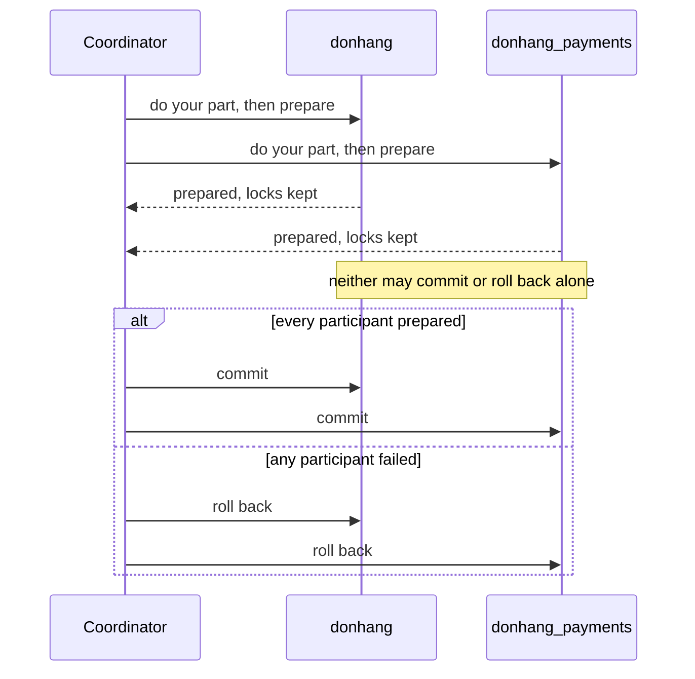

## Before you start

- [[backend.l3.payments-service]] — you know that a refund now changes data owned by three services: the refund row in `donhang_payments`, the order's status in `donhang` and the customer's email in Notifications.
- [[backend.l3.dual-write]] — you know that a change saved in PostgreSQL and a message published to RabbitMQ cannot be put in one transaction, and what goes wrong between the two.
- [[backend.l2.skip-locked-claiming]] — you know that a row locked inside a transaction makes other writers wait until that transaction commits or rolls back.

## The situation

At stage-2, keeping a refund correct was easy. The first version of `refund-design.md` saved the refund row, the order's new status and the email in one transaction, because all three lived in `donhang`. Either all three were saved, or none was.

At stage-3 the refund row lives in `donhang_payments`, the order in `donhang`, and the email request travels through RabbitMQ. In a design meeting, a teammate wants the old guarantee back: "Just make it one transaction across both databases, the broker and the gateway."

Can one transaction stretch over several databases and systems, and what would Đơn Hàng pay for it?

## Core concepts

- **distributed transaction** — one transaction over several databases or systems, in which all of them commit or all of them roll back; keeping the stage-2 guarantee at stage-3 would need one.
- **two-phase commit (2PC)** — a way to run a distributed transaction: a coordinator first has every participant prepare, and lets all of them commit only if all of them prepared.
- coordinator — the program that runs a two-phase commit, asks every participant and announces the decision; PostgreSQL does not play this role, a program outside it does.
- participant — each database or system that holds part of the change and must answer the coordinator; here `donhang`, `donhang_payments`, RabbitMQ and the payment gateway would be the participants.
- prepared transaction — a participant's changes, written down with their locks kept, waiting for the coordinator to say commit or roll back; PostgreSQL makes one with `PREPARE TRANSACTION`, and the coordinator later ends it with `COMMIT PREPARED` or `ROLLBACK PREPARED` and its name.

## How it works



In the situation above, the coordinator would be a program outside both databases, and `donhang` and `donhang_payments` would be two of its participants.

Phase one is prepare. The coordinator asks each participant to do its part of the work and then prepare. A participant that prepares writes its changes down so that it can still commit later, even after a restart, and answers "prepared". From then on it has made a promise: it commits if told to, and it does not change its mind on its own.

Phase two is the decision. Only if every participant answered "prepared" does the coordinator tell all of them to commit. If any one of them refuses or fails before preparing, it tells all of them to roll back. That is how several databases end with the same outcome.

The price is the waiting. A prepared participant keeps its row locks until the decision arrives, because it does not yet know whether its rows will change. Here, the row of order 1 in `donhang` would stay locked while the coordinator waits for `donhang_payments`, and any other request that tries to update that row waits too. If the coordinator stops after the prepares and before the decision, no participant can decide alone: whatever it chose might disagree with what the others were told. Those rows stay locked until the coordinator returns, or until someone ends the prepared transaction by hand.

## In the Đơn Hàng system

Đơn Hàng's PostgreSQL could be a participant only if it were allowed to prepare. `scripts/backend/prepare-transaction.sh` tries the first phase on `donhang`:

```bash file=scripts/backend/prepare-transaction.sh tag=stage-3 lines=7-20
# lesson: backend.l3.two-phase-commit
# A participant in two-phase commit must be able to prepare: write down its
# changes, keep its locks, and promise to commit later if told to. In
# PostgreSQL that is PREPARE TRANSACTION, and it is off unless
# max_prepared_transactions is above 0, which by default it is not. The
# refused PREPARE ends the transaction, so the UPDATE never takes effect.
psql --host db --username donhang --dbname donhang --no-psqlrc --echo-queries \
     --set ON_ERROR_STOP=off <<'SQL'
SHOW max_prepared_transactions;
BEGIN;
UPDATE orders SET status = 'refunding' WHERE id = 1;
PREPARE TRANSACTION 'refund-order-1';
SELECT status FROM orders WHERE id = 1;
SQL
```

```text output=true
SHOW max_prepared_transactions;
 max_prepared_transactions 
---------------------------
 0
(1 row)

BEGIN;
BEGIN
UPDATE orders SET status = 'refunding' WHERE id = 1;
UPDATE 1
PREPARE TRANSACTION 'refund-order-1';
ERROR:  prepared transactions are disabled
HINT:  Set "max_prepared_transactions" to a nonzero value.
SELECT status FROM orders WHERE id = 1;
 status 
--------
 paid
(1 row)
```

Lines 13–14 run `psql`, PostgreSQL's command-line client, on `donhang`; `ON_ERROR_STOP=off` makes it keep running the next lines after an error. Line 15, `SHOW`, reads the setting that controls the feature: `max_prepared_transactions` is `0`, its default, so the server allows no prepared transaction. Lines 16–17, `BEGIN` and `UPDATE`, change order 1 as a participant would in phase one. Line 18, `PREPARE TRANSACTION`, is refused with `prepared transactions are disabled`. A failed `PREPARE TRANSACTION` cancels the whole transaction, so the `SELECT` on line 19 still reads `paid`. The setting can only change when the database server starts; the lab leaves it at `0`.

Why Đơn Hàng leaves it off is in the second version of `refund-design.md`:

```markdown file=docs/design/refund-design.md tag=stage-3 lines=65-74
## Phương án bị loại: một transaction phân tán (two-phase commit)

Bản 1 ghi dòng hoàn tiền, trạng thái đơn và email trong một transaction, vì
mọi thứ cùng nằm trong một cơ sở dữ liệu. Sau khi tách, giữ được điều đó cần
two-phase commit qua `donhang`, `donhang_payments`, RabbitMQ và cổng thanh
toán. Không làm được: RabbitMQ không tham gia được transaction của PostgreSQL,
API HTTP của cổng không có bước prepare, và chính PostgreSQL của Đơn Hàng tắt
`PREPARE TRANSACTION` (`max_prepared_transactions` là 0). Kể cả làm được, một
coordinator dừng giữa chừng sẽ để các dòng bị khóa cho tới khi nó quay lại.
Vì vậy mỗi bước là một transaction cục bộ, nối với nhau bằng outbox và inbox.
```

The heading names the rejected option. Version 1 needed none, because everything lived in one database. Keeping that guarantee after the split would take two-phase commit across `donhang`, `donhang_payments`, RabbitMQ and the gateway, and the section gives three reasons it cannot work.

RabbitMQ cannot take part in a PostgreSQL transaction. The gateway's HTTP API has no prepare step: `POST /v1/refunds` refunds, and nothing asks it to get ready and wait. Đơn Hàng's own PostgreSQL has `PREPARE TRANSACTION` turned off, as the script showed. The section adds that even if all three worked, a coordinator stopping halfway would leave rows locked until it came back. Its last sentence says what Đơn Hàng does instead: each step is its own local transaction in one database, linked to the next by the outbox and inbox; the next lesson builds that.

## Seniors often assume…

- **"Two-phase commit makes a change across services as cheap and safe as a transaction in one database."** → Actually it adds a round of questions to every participant before anything commits, and every prepared participant keeps its locks during that round. In one database a lock lasts as long as one transaction; under two-phase commit it lasts until the slowest participant has answered and the decision has come back. It also adds a failure one database does not have: a coordinator that stops between the phases leaves locked rows that no participant can release on its own. You notice this when updates to one order hang while another service, or the coordinator, restarts.
- **"If one participant is slow, two-phase commit just times out and rolls back, and the others lose nothing."** → Actually the participants that already prepared kept their row locks the whole time they waited, so every request for those rows waited too. A prepared participant must not commit or roll back on its own, because it does not know what the others were told; the protocol leaves the decision to the coordinator, which can still choose roll back only before it has announced a decision. You notice this when one slow database makes requests to another database queue up on rows the slow one never touches.
- **"Any system that supports transactions can take part in a two-phase commit with any other."** → Actually each participant needs a prepare step, and not every system with transactions has one. PostgreSQL has it, `PREPARE TRANSACTION`, but only when `max_prepared_transactions` is above `0`. RabbitMQ has transactions of its own, yet they cover only the broker's own work and have no prepare step. The gateway's HTTP API has no transactions at all. You notice this when `prepare-transaction.sh` prints `prepared transactions are disabled` on Đơn Hàng's own database.

## Try it (3 minutes)

With the lab running (`scripts/up.sh`), in the root folder of the example repository:

1. Run `scripts/backend/prepare-transaction.sh`.
2. Find the value of `max_prepared_transactions`, the error after `PREPARE TRANSACTION`, and the status of order 1 at the end.
3. Then decide: if the setting were above `0` and the prepare succeeded, what would happen to another request that ran `UPDATE orders SET status = 'shipped' WHERE id = 1;` before any decision arrived?

Expected result: `0`; `ERROR:  prepared transactions are disabled` with a hint to set `max_prepared_transactions` to a nonzero value; and `paid`. For step 3, check your answer below.

<details><summary>Suggested answer</summary>

That request would wait. The prepared transaction still holds the row lock on order 1 that its `UPDATE` took, and it keeps that lock until a coordinator sends `COMMIT PREPARED 'refund-order-1'` or `ROLLBACK PREPARED 'refund-order-1'`. If the coordinator never comes back, the request waits for as long as the prepared transaction stays.

</details>

## Connections

- [[foundation.l1.transaction-intro]] — the all-or-nothing rule inside one database; two-phase commit tries to stretch it over several.
- [[backend.l2.transactions-in-practice]] — the same row locks and waits inside one database, which a prepared participant stretches until the coordinator decides.
- [[backend.l3.dual-write]] — the same problem between two systems; two-phase commit is the general answer, which Đơn Hàng cannot use.
- [[backend.l3.saga]] — the next lesson: what `refund-design.md` does instead of one big transaction.

## Five-line summary

1. Two-phase commit can make several databases commit or roll back together, but each prepared participant holds its locks until the coordinator decides.
2. A distributed transaction is one transaction over several databases or systems; keeping the stage-2 refund guarantee at stage-3 would need one.
3. The coordinator has every participant prepare first, and tells all to commit only if all prepared; otherwise all roll back.
4. If the coordinator stops between the phases, no participant can decide alone, and the rows it locked stay locked.
5. Đơn Hàng's PostgreSQL refuses `PREPARE TRANSACTION`, and RabbitMQ and the gateway have no prepare step, so `refund-design.md` rejects two-phase commit.
