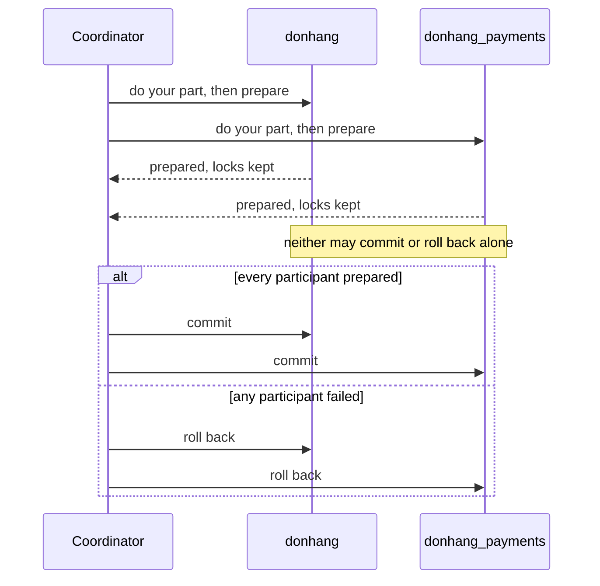

## Bạn cần biết trước

- [[backend.l3.payments-service]] — bạn biết rằng giờ một lần hoàn tiền thay đổi dữ liệu thuộc ba service: dòng hoàn tiền trong `donhang_payments`, trạng thái đơn trong `donhang` và email cho khách hàng trong Notifications.
- [[backend.l3.dual-write]] — bạn biết rằng một thay đổi lưu trong PostgreSQL và một message publish lên RabbitMQ không thể nằm chung một giao dịch, và chuyện gì hỏng giữa hai bước đó.
- [[backend.l2.skip-locked-claiming]] — bạn biết rằng một dòng bị khóa trong giao dịch sẽ bắt các bên ghi khác chờ cho tới khi giao dịch đó commit hoặc rollback.

## Tình huống

Ở stage-2, giữ cho hoàn tiền đúng là chuyện dễ. Phiên bản đầu của `refund-design.md` lưu dòng hoàn tiền, trạng thái mới của đơn và email trong một giao dịch, vì cả ba cùng nằm trong `donhang`. Hoặc cả ba được lưu, hoặc không cái nào.

Ở stage-3, dòng hoàn tiền nằm trong `donhang_payments`, đơn nằm trong `donhang`, còn yêu cầu gửi email đi qua RabbitMQ. Trong buổi họp thiết kế, một đồng nghiệp muốn lấy lại bảo đảm cũ: "Cứ gộp thành một giao dịch qua cả hai database, broker và cổng thanh toán là xong."

Một giao dịch có trải được qua nhiều database và hệ thống không, và Đơn Hàng sẽ phải trả giá gì cho nó?

## Khái niệm cốt lõi

- **giao dịch phân tán** (distributed transaction) — một giao dịch trải trên nhiều database hay hệ thống, trong đó tất cả cùng commit hoặc tất cả cùng rollback. Muốn giữ bảo đảm của stage-2 ở stage-3 thì cần một giao dịch như vậy.
- **two-phase commit (2PC)** (Cách làm giao dịch phân tán: coordinator bảo mọi bên chuẩn bị, rồi chỉ cho commit khi tất cả đã chuẩn bị xong) — cách chạy giao dịch phân tán: coordinator trước hết bảo mọi bên tham gia chuẩn bị (prepare), và chỉ cho tất cả commit khi tất cả đã chuẩn bị xong.
- coordinator — chương trình chạy two-phase commit, hỏi từng bên tham gia và công bố quyết định. PostgreSQL không đóng vai này, một chương trình bên ngoài nó mới đóng.
- bên tham gia (participant) — mỗi database hay hệ thống giữ một phần thay đổi và phải trả lời coordinator. Ở đây `donhang`, `donhang_payments`, RabbitMQ và cổng thanh toán sẽ là các bên tham gia.
- giao dịch đã chuẩn bị (prepared transaction) — thay đổi của một bên tham gia, đã được ghi lại và vẫn giữ khóa, đang chờ coordinator bảo commit hay rollback. PostgreSQL tạo nó bằng `PREPARE TRANSACTION`, và sau đó coordinator kết thúc nó bằng `COMMIT PREPARED` hoặc `ROLLBACK PREPARED` kèm tên của nó.

## Cơ chế hoạt động



Trong tình huống trên, coordinator sẽ là một chương trình nằm ngoài cả hai database, còn `donhang` và `donhang_payments` là hai trong số các bên tham gia.

Pha một là chuẩn bị. Coordinator bảo từng bên tham gia làm phần việc của mình rồi chuẩn bị. Bên nào chuẩn bị thì ghi lại thay đổi để vẫn commit được về sau, kể cả sau khi khởi động lại, rồi trả lời "prepared". Từ lúc đó nó đã hứa: được bảo commit thì commit, và không tự đổi ý.

Pha hai là quyết định. Chỉ khi mọi bên tham gia đều trả lời "prepared", coordinator mới bảo tất cả commit. Nếu bất kỳ bên nào từ chối hoặc lỗi trước khi chuẩn bị xong, nó bảo tất cả rollback. Nhờ vậy nhiều database kết thúc với cùng một kết quả.

Cái giá là sự chờ đợi. Một bên đã chuẩn bị vẫn giữ khóa dòng cho tới khi quyết định tới, vì nó chưa biết các dòng của mình có đổi hay không. Ở đây, dòng của đơn 1 trong `donhang` sẽ bị khóa suốt lúc coordinator chờ `donhang_payments`, và mọi request khác muốn cập nhật dòng đó cũng phải chờ theo. Nếu coordinator dừng sau các lần chuẩn bị và trước khi quyết định, không bên nào tự quyết được: bất cứ lựa chọn nào của nó cũng có thể trái với điều các bên khác đã được bảo. Các dòng đó bị khóa cho tới khi coordinator quay lại, hoặc cho tới khi có người kết thúc giao dịch đã chuẩn bị bằng tay.

## Trong hệ thống Đơn Hàng

PostgreSQL của Đơn Hàng chỉ làm bên tham gia được nếu nó được phép chuẩn bị. `scripts/backend/prepare-transaction.sh` thử pha một trên `donhang`:

```bash file=scripts/backend/prepare-transaction.sh tag=stage-3 lines=7-20
# lesson: backend.l3.two-phase-commit
# A participant in two-phase commit must be able to prepare: write down its
# changes, keep its locks, and promise to commit later if told to. In
# PostgreSQL that is PREPARE TRANSACTION, and it is off unless
# max_prepared_transactions is above 0, which by default it is not. The
# refused PREPARE ends the transaction, so the UPDATE never takes effect.
psql --host db --username donhang --dbname donhang --no-psqlrc --echo-queries \
     --set ON_ERROR_STOP=off <<'SQL'
SHOW max_prepared_transactions;
BEGIN;
UPDATE orders SET status = 'refunding' WHERE id = 1;
PREPARE TRANSACTION 'refund-order-1';
SELECT status FROM orders WHERE id = 1;
SQL
```

```text output=true
SHOW max_prepared_transactions;
 max_prepared_transactions 
---------------------------
 0
(1 row)

BEGIN;
BEGIN
UPDATE orders SET status = 'refunding' WHERE id = 1;
UPDATE 1
PREPARE TRANSACTION 'refund-order-1';
ERROR:  prepared transactions are disabled
HINT:  Set "max_prepared_transactions" to a nonzero value.
SELECT status FROM orders WHERE id = 1;
 status 
--------
 paid
(1 row)
```

Dòng 13–14 chạy `psql`, client dòng lệnh của PostgreSQL, trên `donhang`. `ON_ERROR_STOP=off` khiến nó vẫn chạy tiếp các dòng sau khi gặp lỗi. Dòng 15, `SHOW`, đọc thiết lập điều khiển tính năng này: `max_prepared_transactions` là `0`, giá trị mặc định, nên server không cho phép giao dịch đã chuẩn bị nào. Dòng 16–17, `BEGIN` và `UPDATE`, thay đổi đơn 1 giống như một bên tham gia làm ở pha một. Dòng 18, `PREPARE TRANSACTION`, bị từ chối với `prepared transactions are disabled`. Một lần `PREPARE TRANSACTION` thất bại sẽ hủy cả giao dịch, nên `SELECT` ở dòng 19 vẫn đọc ra `paid`. Thiết lập này chỉ đổi được khi database server khởi động, và lab để nguyên nó ở `0`.

Lý do Đơn Hàng để tắt nằm trong phiên bản thứ hai của `refund-design.md`:

```markdown file=docs/design/refund-design.md tag=stage-3 lines=65-74
## Phương án bị loại: một transaction phân tán (two-phase commit)

Bản 1 ghi dòng hoàn tiền, trạng thái đơn và email trong một transaction, vì
mọi thứ cùng nằm trong một cơ sở dữ liệu. Sau khi tách, giữ được điều đó cần
two-phase commit qua `donhang`, `donhang_payments`, RabbitMQ và cổng thanh
toán. Không làm được: RabbitMQ không tham gia được transaction của PostgreSQL,
API HTTP của cổng không có bước prepare, và chính PostgreSQL của Đơn Hàng tắt
`PREPARE TRANSACTION` (`max_prepared_transactions` là 0). Kể cả làm được, một
coordinator dừng giữa chừng sẽ để các dòng bị khóa cho tới khi nó quay lại.
Vì vậy mỗi bước là một transaction cục bộ, nối với nhau bằng outbox và inbox.
```

Tiêu đề gọi tên phương án bị loại. Bản 1 không cần tới nó, vì mọi thứ nằm trong một database. Giữ được bảo đảm đó sau khi tách sẽ cần two-phase commit qua `donhang`, `donhang_payments`, RabbitMQ và cổng thanh toán, và đoạn này đưa ra ba lý do khiến nó không chạy được.

RabbitMQ không tham gia được giao dịch của PostgreSQL. HTTP API của cổng thanh toán không có bước chuẩn bị: `POST /v1/refunds` hoàn tiền luôn, không có gì bảo nó sẵn sàng rồi chờ. Chính PostgreSQL của Đơn Hàng tắt `PREPARE TRANSACTION`, như script đã cho thấy. Đoạn này nói thêm rằng kể cả cả ba đều làm được, một coordinator dừng giữa chừng vẫn để các dòng bị khóa cho tới khi nó quay lại. Câu cuối nói Đơn Hàng làm gì thay vào đó: mỗi bước là một giao dịch cục bộ riêng trong một database, nối với bước sau bằng outbox và inbox. Bài tiếp theo xây phần đó.

## Senior hay nhầm rằng…

- **"Two-phase commit làm cho một thay đổi trải qua nhiều service rẻ và an toàn như một giao dịch trong một database."** → Thực ra nó thêm một vòng hỏi tới từng bên tham gia trước khi bất cứ thứ gì được commit, và mọi bên đã chuẩn bị đều giữ khóa trong suốt vòng đó. Trong một database, khóa chỉ kéo dài bằng một giao dịch. Với two-phase commit, khóa kéo dài cho tới khi bên chậm nhất trả lời xong và quyết định quay về. Nó còn thêm một kiểu lỗi mà một database không có: coordinator dừng giữa hai pha để lại các dòng bị khóa mà không bên tham gia nào tự gỡ được. Bạn sẽ nhận ra khi các lệnh cập nhật một đơn bị treo trong lúc một service khác, hoặc chính coordinator, khởi động lại.
- **"Nếu một bên tham gia chậm, two-phase commit chỉ việc timeout rồi rollback, các bên khác không mất gì."** → Thực ra các bên đã chuẩn bị giữ khóa dòng suốt thời gian chờ, nên mọi request tới các dòng đó cũng phải chờ theo. Một bên đã chuẩn bị không được tự commit hay rollback, vì nó không biết các bên khác đã được bảo gì. Giao thức để quyết định cho coordinator, và coordinator chỉ còn chọn rollback được khi chưa công bố quyết định nào. Bạn sẽ nhận ra khi một database chậm khiến request tới một database khác xếp hàng trên những dòng mà database chậm kia không hề chạm tới.
- **"Hệ thống nào hỗ trợ giao dịch cũng tham gia two-phase commit được với bất kỳ hệ thống nào khác."** → Thực ra mỗi bên tham gia cần một bước chuẩn bị, và không phải hệ thống nào có giao dịch cũng có bước đó. PostgreSQL có, là `PREPARE TRANSACTION`, nhưng chỉ khi `max_prepared_transactions` lớn hơn `0`. RabbitMQ có giao dịch riêng, nhưng chúng chỉ bao phần việc của chính broker và không có bước chuẩn bị. HTTP API của cổng thanh toán thì không có giao dịch nào. Bạn sẽ nhận ra khi `prepare-transaction.sh` in ra `prepared transactions are disabled` ngay trên database của chính Đơn Hàng.

## Thử ngay (3 phút)

Khi lab đang chạy (`scripts/up.sh`), ở thư mục gốc của repo ví dụ:

1. Chạy `scripts/backend/prepare-transaction.sh`.
2. Tìm giá trị của `max_prepared_transactions`, lỗi sau `PREPARE TRANSACTION` và trạng thái của đơn 1 ở cuối.
3. Rồi hãy xác định: nếu thiết lập đó lớn hơn `0` và bước chuẩn bị thành công, một request khác chạy `UPDATE orders SET status = 'shipped' WHERE id = 1;` trước khi có quyết định sẽ ra sao?

Kết quả mong đợi: `0`, `ERROR:  prepared transactions are disabled` kèm gợi ý đặt `max_prepared_transactions` thành giá trị khác 0, và `paid`. Ở bước 3, hãy đối chiếu với đáp án bên dưới.

<details><summary>Gợi ý đáp án</summary>

Request đó sẽ phải chờ. Giao dịch đã chuẩn bị vẫn giữ khóa dòng trên đơn 1 mà lệnh `UPDATE` của nó lấy, và giữ khóa đó cho tới khi coordinator gửi `COMMIT PREPARED 'refund-order-1'` hoặc `ROLLBACK PREPARED 'refund-order-1'`. Nếu coordinator không bao giờ quay lại, request chờ chừng nào giao dịch đã chuẩn bị còn tồn tại.

</details>

## Liên hệ

- [[foundation.l1.transaction-intro]] — quy tắc tất cả hoặc không có gì bên trong một database. Two-phase commit cố kéo quy tắc đó qua nhiều database.
- [[backend.l2.transactions-in-practice]] — cũng là khóa dòng và sự chờ đợi trong một database, thứ mà một bên đã chuẩn bị kéo dài cho tới khi coordinator quyết định.
- [[backend.l3.dual-write]] — cùng vấn đề giữa hai hệ thống. Two-phase commit là lời giải tổng quát, nhưng Đơn Hàng không dùng được.
- [[backend.l3.saga]] — bài tiếp theo: `refund-design.md` làm gì thay cho một giao dịch lớn.

## Tóm tắt 5 dòng

1. Two-phase commit có thể bắt nhiều database cùng commit hoặc cùng rollback, nhưng mỗi bên đã chuẩn bị giữ khóa cho tới khi coordinator quyết định.
2. Giao dịch phân tán là một giao dịch trải trên nhiều database hay hệ thống. Giữ bảo đảm hoàn tiền của stage-2 ở stage-3 sẽ cần một giao dịch như vậy.
3. Coordinator bảo mọi bên tham gia chuẩn bị trước, và chỉ bảo tất cả commit khi tất cả đã chuẩn bị xong. Nếu không, tất cả rollback.
4. Nếu coordinator dừng giữa hai pha, không bên nào tự quyết được, và các dòng nó đã khóa vẫn bị khóa.
5. PostgreSQL của Đơn Hàng từ chối `PREPARE TRANSACTION`, còn RabbitMQ và cổng thanh toán không có bước chuẩn bị, nên `refund-design.md` loại bỏ two-phase commit.
