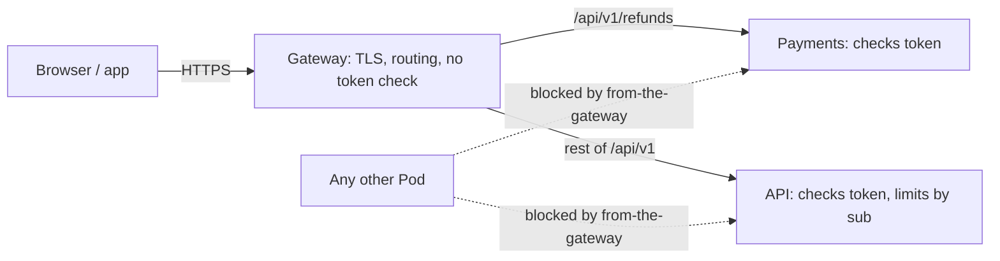

## Before you start

- [[backend.l4.threat-modeling]] — a threat model walks Đơn Hàng's boundaries and records the control that answers each threat; this lesson explains the controls at the browser-to-Gateway boundary.
- [[k8s.l2.gateway-api]] — an HTTPRoute attached to the Gateway sends each path to a Service.
- [[backend.l2.validating-provider-tokens]] — `AddJwtBearer` checks signature, `iss`, `aud` and `exp` on every request itself, without calling Keycloak.
- [[k8s.l3.network-policies]] — staging isolates every Pod in `donhang`, then opens each service only to its callers.

## The situation

It is stage-3, and Payments has just started answering `GET /api/v1/refunds`. To accept tokens, its `Program.cs` repeats the `AddJwtBearer` block from the API almost line for line: the same Keycloak address, the same audience, the same settings for reading the token's fields.

In review, a teammate points out that every request from a browser already passes through one place: Caddy in Compose, the Gateway on staging. Check the token there once, they say, and neither service needs the block. It sounds like less code and one place to fix.

If every request already comes in through one gateway, where should the token be checked?

## Core concepts

- **API gateway** — the single entry point that receives every client request and routes it to the service that answers it, the one place for concerns all requests share, such as TLS and routing.
- **defense in depth** — stacking independent controls so that one failing or being bypassed does not open the system.
- control — something in place that answers a threat, such as a token check or a NetworkPolicy, as in the previous lesson's threat model.

## How it works



In the situation above, the API gateway is Caddy in Compose and the Traefik Gateway on staging. Caddy's lab site on port `8080` and the Gateway both route `/api/v1/refunds` to Payments and the rest of `/api/v1` to the API. On staging, the Gateway also ends TLS. Neither checks the `Authorization` header. Caddy passes incoming headers on by default, and the HTTPRoute rules have no filter that would change them, so the header reaches the service as the client sent it.

Next, each service checks every token itself. The API and Payments each call `AddJwtBearer`, which checks the signature, issuer (`iss`), audience (`aud`) and expiry (`exp`) of each token with Keycloak's public keys. A request through the Gateway and a request from somewhere else get the same check, so trusting a request never depends on its path.

Then a second, independent control sits in front of them. The NetworkPolicy `from-the-gateway` lets only Pods in the namespace `traefik` connect to the API and Payments on port `8080`. A NetworkPolicy works on addresses and ports, so it never reads a token. On a cluster whose CNI plugin enforces policies, a connection from a Pod it does not allow is refused before any HTTP is exchanged; traffic from the Pod's own node, such as the kubelet's probes, is always allowed.

That is defense in depth: each control covers a gap the other leaves. If the NetworkPolicy is missing or bypassed, a caller still needs a valid token. A Pod holding a stolen valid token still cannot connect unless it runs in `traefik`.

Finally, the per-customer limit on placing orders lives in the API, because it counts by the token's `sub`. Only a component that has checked the token can trust that `sub` is real.

## In the Đơn Hàng system

The first control decides who may connect at all:

```yaml file=deploy/gitops/config-repo-kustomize/base/network-policies.yaml tag=stage-3 lines=37-56
# The api and Payments: from Traefik's Pods, in the namespace traefik.
apiVersion: networking.k8s.io/v1
kind: NetworkPolicy
metadata:
  name: from-the-gateway
  namespace: donhang
spec:
  podSelector:
    matchExpressions:
      - key: app
        operator: In
        values: [api, payments]
  policyTypes: ["Ingress"]
  ingress:
    - from:
        - namespaceSelector:
            matchLabels:
              kubernetes.io/metadata.name: traefik
      ports:
        - port: 8080
```

`podSelector` picks the Pods labelled `app: api` or `app: payments`. The only `from` entry is a `namespaceSelector` for `traefik`, so on staging only Pods in the namespace `traefik`, where the Gateway runs, can connect, not just the Gateway itself. Because `default-deny-ingress`, earlier in the same file, isolates every Pod in `donhang`, no other Pod may connect; only the kubelet's probes from the Pod's own node still get through. The NetworkPolicy decides who may open a connection, not what the request may do.

The second control is inside Payments:

```csharp file=DonHang.Payments/Program.cs tag=stage-3 lines=43-59
// Tokens from the same Keycloak realm as the api, checked the same way, for
// GET /api/v1/refunds (staff only).
var authority = builder.Configuration["Keycloak:Authority"]
    ?? throw new InvalidOperationException("Keycloak:Authority is not set");
builder.Services.AddAuthentication(JwtBearerDefaults.AuthenticationScheme)
    .AddJwtBearer(options =>
    {
        options.Authority = authority;
        options.MetadataAddress = builder.Configuration["Keycloak:MetadataAddress"]
            ?? $"{authority}/.well-known/openid-configuration";
        options.Audience = "donhang-api";
        options.RequireHttpsMetadata = false;
        options.MapInboundClaims = false;
        options.TokenValidationParameters.RoleClaimType = "roles";
    });
builder.Services.AddAuthorization(options =>
    options.AddPolicy("StaffOnly", policy => policy.RequireRole("staff")));
```

This is the block the teammate wanted to remove. The comment says it checks tokens "the same way" as the API, and `DonHang.Api/Program.cs`, outside this excerpt, has the same options. `Audience = "donhang-api"` makes Payments reject a token issued for anything else. `AddPolicy` registers a named rule in Payments' code: `StaffOnly` lets through only tokens whose `roles` field, inside the token's payload, includes `staff`. Payments can trust that field only because it checked the signature first.

The per-customer `orders` limit is also in `DonHang.Api/Program.cs`, outside the excerpts. It reads `sub` from the checked caller and counts each customer separately. A comment there explains why it does not count by IP address: behind Caddy, every request arrives from Caddy's address. The gateway sees each client's address, but it cannot tell customers apart, because it never checks the token.

## Trade-offs

| Where tokens are checked | Configuration | What a service trusts | One mistake in the gateway |
|---|---|---|---|
| Only at the gateway | once | whatever reaches it | can expose any service behind it |
| In each service (Đơn Hàng, stage-3) | repeated per service | only a token it checked itself | does not open any service; NetworkPolicy still narrows callers |
| At the gateway and in each service | gateway setup plus each service | only a token it checked itself | does not open any service; bad tokens are also refused earlier |

Checking only at the gateway removes the repeated block, but every service then trusts whatever arrives. A route added without the check exposes the service behind it, and a mistake in the shared check exposes all of them. Checking in each service costs a repeated block of configuration. The third row is a choice Đơn Hàng has not made: it adds a token check at the gateway without removing any service's check.

## What would you choose if…

…the team adds an endpoint to Notifications so that staff can resend an order email? Give Notifications its own `AddJwtBearer` and a staff-only rule like `StaffOnly` before any route reaches it. Then add a rule to the HTTPRoute and add `notifications` to the `values` of `from-the-gateway`. Doing it in the other order leaves a moment when the Gateway sends requests to a service that trusts them all.

…a teammate still wants the Gateway to refuse requests without a token, to save the services work? That can be a third layer if the services keep their own check, because then a gateway mistake costs only that early refusal. If it is offered as a replacement for the services' check, the answer is the first row of the table.

## Seniors often assume…

- **"Once the gateway has checked the token, the services behind it can trust every request they get."** → Actually a service cannot rely on how a request reached it: nothing in the request proves it passed a gateway check. Anything that reaches the service directly, such as a Pod a NetworkPolicy lets through by mistake, skips a check made only at the gateway. In Đơn Hàng the gateway checks nothing, and each service checks every token itself. You notice this when a request sent straight to a Pod's address, without a token, gets data back.
- **"Rules such as 'only the owner may read this order' belong in the API gateway, so services stay simple."** → Actually the `OrderOwner` rule in the API's code asks whether the caller is staff or the order's customer, and `OrdersController` checks it against the order it has just loaded from the API's database. The gateway sees only the path and the headers, so it would have to read the API's data to decide. You notice this when a change to who may see an order needs edits in the gateway and in the API at once.
- **"Checking the same token in two places is wasted work that only slows requests down."** → Actually `AddJwtBearer` checks a token in the service's own process with Keycloak's public keys it already holds, without calling Keycloak. What the repeated check buys is that no service depends on everything in front of it being right. You notice this when one gateway route change would otherwise expose a service nobody touched.

## Try it (3 minutes)

In the root folder of the example repository at tag `stage-3`:

1. Run `grep -n "\.AddJwtBearer(" DonHang.Api/Program.cs DonHang.Payments/Program.cs`.
2. Run `grep -c -i -E "jwt|token" Caddyfile deploy/gitops/config-repo/platform/edge/httproutes.yaml`.

Expected result: the first command prints one line per service, line 61 of the API's `Program.cs` and line 48 of Payments'. The second prints a count of `0` for each file: neither gateway configuration mentions tokens.

Then decide: a Pod in the namespace `traefik` is taken over and sends `GET /api/v1/refunds` straight to Payments with a token it made up. Which control stops it?

<details><summary>Suggested answer</summary>

Not `from-the-gateway`: it lets every Pod in `traefik` connect. The token check in Payments does, because a made-up token has no valid Keycloak signature. That is the point of a second, independent layer.

</details>

## Connections

- [[devops.l1.reverse-proxy-and-tls]] — the same Caddy, seen as a reverse proxy; here it is the API gateway of Compose.
- [[k8s.l2.tls-at-the-gateway]] — the TLS that the API gateway ends on staging, one of the concerns it holds for all requests.
- [[backend.l3.rate-limiting]] — why the `orders` limit counts by `sub` and therefore stays in the API.
- [[backend.l4.threat-modeling]] — the threat model whose browser and Gateway rows this lesson explains.
- [[backend.l4.shared-credentials]] — the next layer: what one service's credentials may do once it is connected.

## Five-line summary

1. An API gateway is one way in for routing and TLS, but each service still checks every token itself.
2. In Đơn Hàng, Caddy's site on port `8080` and the Traefik Gateway route `/api/v1/refunds` to Payments, the rest to the API, and check no token.
3. The API and Payments each run `AddJwtBearer`, so trusting a request never depends on the path it took.
4. Defense in depth stacks independent controls: `from-the-gateway` limits who connects, and the token check still runs.
5. The `orders` limit stays in the API because only a component that checked the token can trust its `sub`.
