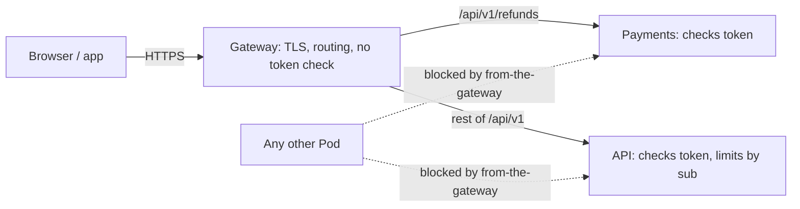

## Bạn cần biết trước

- [[backend.l4.threat-modeling]] — mô hình mối đe dọa đi qua các ranh giới của Đơn Hàng và ghi lại biện pháp trả lời từng mối đe dọa. Bài này giải thích các biện pháp ở ranh giới trình duyệt tới Gateway.
- [[k8s.l2.gateway-api]] — một HTTPRoute gắn vào Gateway gửi mỗi path tới một Service.
- [[backend.l2.validating-provider-tokens]] — `AddJwtBearer` tự kiểm chữ ký, `iss`, `aud` và `exp` ở mọi request, không cần gọi Keycloak.
- [[k8s.l3.network-policies]] — staging cô lập mọi Pod trong `donhang`, rồi mở từng service chỉ cho những bên gọi nó.

## Tình huống

Đang ở stage-3, và Payments vừa bắt đầu trả lời `GET /api/v1/refunds`. Để nhận token, `Program.cs` của nó lặp lại khối `AddJwtBearer` của API gần như từng dòng: cùng địa chỉ Keycloak, cùng audience, cùng các thiết lập để đọc các trường trong token.

Khi review, một đồng nghiệp chỉ ra rằng mọi request từ trình duyệt vốn đã đi qua một chỗ: Caddy trong Compose, Gateway trên staging. Họ bảo cứ kiểm token ở đó một lần, thế là không service nào cần khối kia nữa. Nghe như bớt code và chỉ còn một chỗ để sửa.

Nếu mọi request vốn đã đi vào qua một gateway, thì nên kiểm token ở đâu?

## Khái niệm cốt lõi

- **API gateway** (cửa vào chung nhận mọi request của client và chuyển tới service trả lời nó, nơi đặt việc mọi request cần) — điểm vào duy nhất nhận mọi request của client rồi chuyển tới service trả lời nó, chỗ duy nhất cho những việc mọi request cùng cần, chẳng hạn TLS và định tuyến.
- **phòng thủ nhiều lớp** (defense in depth) — xếp chồng nhiều biện pháp độc lập để một biện pháp hỏng hay bị vượt qua cũng không mở toang hệ thống.
- biện pháp — thứ đã có sẵn để trả lời một mối đe dọa, chẳng hạn kiểm token hay một NetworkPolicy, như trong mô hình mối đe dọa của bài trước.

## Cơ chế hoạt động



Trong tình huống trên, API gateway là Caddy trong Compose và Gateway Traefik trên staging. Site lab của Caddy ở cổng `8080` và Gateway đều chuyển `/api/v1/refunds` tới Payments, phần còn lại của `/api/v1` tới API. Trên staging, Gateway còn kết thúc TLS. Cả hai đều không kiểm header `Authorization`. Mặc định Caddy chuyển tiếp nguyên các header nhận được, và các rule của HTTPRoute không có filter nào đổi chúng, nên header tới service đúng như client gửi.

Tiếp theo, mỗi service tự kiểm mọi token. API và Payments đều gọi `AddJwtBearer`, kiểm chữ ký, issuer (`iss`), audience (`aud`) và hạn dùng (`exp`) của từng token bằng public key của Keycloak. Request đi qua Gateway và request đến từ chỗ khác bị kiểm như nhau, nên một request được tin hay không chẳng bao giờ phụ thuộc vào đường nó đã đi.

Rồi một biện pháp thứ hai, độc lập, đứng trước chúng. NetworkPolicy `from-the-gateway` chỉ cho các Pod trong namespace `traefik` kết nối tới API và Payments ở cổng `8080`. NetworkPolicy làm việc với địa chỉ và cổng, nên nó không bao giờ đọc token. Trên cluster có CNI plugin thực thi policy, kết nối từ một Pod không được phép bị từ chối trước khi có bất kỳ trao đổi HTTP nào. Traffic từ chính node của Pod, chẳng hạn các probe của kubelet, luôn được cho qua.

Đó là phòng thủ nhiều lớp: mỗi biện pháp lấp chỗ hở mà biện pháp kia để lại. Nếu NetworkPolicy thiếu hoặc bị vượt qua, bên gọi vẫn cần một token hợp lệ. Một Pod giữ token hợp lệ bị đánh cắp vẫn không kết nối được, trừ khi nó chạy trong `traefik`.

Cuối cùng, giới hạn đặt đơn theo từng khách nằm trong API, vì nó đếm theo `sub` của token. Chỉ thành phần đã kiểm token mới tin được rằng `sub` là thật.

## Trong hệ thống Đơn Hàng

Biện pháp thứ nhất quyết định ai được kết nối:

```yaml file=deploy/gitops/config-repo-kustomize/base/network-policies.yaml tag=stage-3 lines=37-56
# The api and Payments: from Traefik's Pods, in the namespace traefik.
apiVersion: networking.k8s.io/v1
kind: NetworkPolicy
metadata:
  name: from-the-gateway
  namespace: donhang
spec:
  podSelector:
    matchExpressions:
      - key: app
        operator: In
        values: [api, payments]
  policyTypes: ["Ingress"]
  ingress:
    - from:
        - namespaceSelector:
            matchLabels:
              kubernetes.io/metadata.name: traefik
      ports:
        - port: 8080
```

`podSelector` chọn các Pod có nhãn `app: api` hoặc `app: payments`. Mục `from` duy nhất là một `namespaceSelector` cho `traefik`, nên trên staging chỉ các Pod trong namespace `traefik`, nơi Gateway chạy, kết nối được, chứ không riêng gì Gateway. Vì `default-deny-ingress`, ở phía trên trong cùng file, cô lập mọi Pod trong `donhang`, không Pod nào khác được kết nối. Chỉ các probe của kubelet từ chính node của Pod vẫn đi qua. NetworkPolicy quyết ai được mở kết nối, không quyết request được làm gì.

Biện pháp thứ hai nằm trong Payments:

```csharp file=DonHang.Payments/Program.cs tag=stage-3 lines=43-59
// Tokens from the same Keycloak realm as the api, checked the same way, for
// GET /api/v1/refunds (staff only).
var authority = builder.Configuration["Keycloak:Authority"]
    ?? throw new InvalidOperationException("Keycloak:Authority is not set");
builder.Services.AddAuthentication(JwtBearerDefaults.AuthenticationScheme)
    .AddJwtBearer(options =>
    {
        options.Authority = authority;
        options.MetadataAddress = builder.Configuration["Keycloak:MetadataAddress"]
            ?? $"{authority}/.well-known/openid-configuration";
        options.Audience = "donhang-api";
        options.RequireHttpsMetadata = false;
        options.MapInboundClaims = false;
        options.TokenValidationParameters.RoleClaimType = "roles";
    });
builder.Services.AddAuthorization(options =>
    options.AddPolicy("StaffOnly", policy => policy.RequireRole("staff")));
```

Đây là khối mà đồng nghiệp muốn bỏ. Comment nói nó kiểm token "the same way", tức giống hệt API, và `DonHang.Api/Program.cs`, ngoài đoạn trích này, có cùng các option. `Audience = "donhang-api"` khiến Payments từ chối token cấp cho bất kỳ thứ gì khác. `AddPolicy` đăng ký một quy tắc có tên trong code của Payments: `StaffOnly` chỉ cho qua token mà trường `roles`, trong payload của token, có `staff`. Payments tin được trường đó chỉ vì nó đã kiểm chữ ký trước.

Giới hạn `orders` theo từng khách cũng nằm trong `DonHang.Api/Program.cs`, ngoài các đoạn trích. Nó đọc `sub` từ bên gọi đã được kiểm và đếm riêng từng khách. Một comment ở đó giải thích vì sao không đếm theo địa chỉ IP: đứng sau Caddy, mọi request đều tới từ địa chỉ của Caddy. Gateway thấy địa chỉ của từng client, nhưng không phân biệt được các khách, vì nó không bao giờ kiểm token.

## Đánh đổi

| Kiểm token ở đâu | Cấu hình | Service tin vào gì | Một lỗi ở gateway |
|---|---|---|---|
| Chỉ ở gateway | một lần | bất cứ thứ gì tới được nó | có thể làm lộ mọi service phía sau |
| Trong từng service (Đơn Hàng, stage-3) | lặp lại ở mỗi service | chỉ token nó tự kiểm | không mở service nào, NetworkPolicy vẫn thu hẹp bên gọi |
| Ở gateway và trong từng service | thiết lập gateway cộng từng service | chỉ token nó tự kiểm | không mở service nào, token sai còn bị từ chối sớm hơn |

Chỉ kiểm ở gateway thì bỏ được khối lặp lại, nhưng khi đó mọi service tin bất cứ thứ gì tới. Một route thêm vào mà quên kiểm sẽ làm lộ service phía sau nó, còn một lỗi trong bước kiểm dùng chung làm lộ tất cả. Kiểm trong từng service tốn một khối cấu hình lặp lại. Dòng thứ ba là lựa chọn Đơn Hàng chưa đưa ra: thêm bước kiểm token ở gateway mà không bỏ bước kiểm của service nào.

## Bạn sẽ chọn gì nếu…

…đội thêm một endpoint vào Notifications để nhân viên gửi lại email đơn hàng? Hãy cho Notifications `AddJwtBearer` riêng và một quy tắc chỉ cho nhân viên giống `StaffOnly` trước khi có route nào tới nó. Sau đó thêm một rule vào HTTPRoute và thêm `notifications` vào `values` của `from-the-gateway`. Làm theo thứ tự ngược lại sẽ có lúc Gateway gửi request tới một service tin mọi request.

…một đồng nghiệp vẫn muốn Gateway từ chối request không có token, để đỡ việc cho các service? Đó có thể là lớp thứ ba nếu các service giữ bước kiểm của mình, vì khi đó một lỗi ở gateway chỉ làm mất bước từ chối sớm. Nếu nó được đưa ra để thay cho bước kiểm của service, câu trả lời là dòng đầu của bảng.

## Senior hay nhầm rằng…

- **"Gateway đã kiểm token rồi thì các service phía sau tin được mọi request chúng nhận."** → Thực ra service không thể dựa vào đường request đã đi để tới nó, vì không gì trong request chứng minh nó đã qua bước kiểm ở gateway. Bất cứ thứ gì tới thẳng service, chẳng hạn một Pod mà NetworkPolicy cho qua do nhầm, đều bỏ qua bước kiểm chỉ có ở gateway. Trong Đơn Hàng, gateway không kiểm gì, và mỗi service tự kiểm mọi token. Bạn sẽ nhận ra khi một request gửi thẳng tới địa chỉ của Pod, không kèm token, vẫn nhận được dữ liệu.
- **"Các quy tắc như 'chỉ chủ đơn mới được đọc đơn này' thuộc về API gateway, để service được đơn giản."** → Thực ra quy tắc `OrderOwner` trong code của API hỏi bên gọi có phải nhân viên hay khách của đơn đó không, và `OrdersController` kiểm nó với đơn vừa tải từ database của API. Gateway chỉ thấy path và header, nên muốn quyết thì nó phải đọc dữ liệu của API. Bạn sẽ nhận ra khi một thay đổi về ai được xem đơn cần sửa cùng lúc cả gateway lẫn API.
- **"Kiểm cùng một token ở hai chỗ là làm thừa, chỉ khiến request chậm hơn."** → Thực ra `AddJwtBearer` kiểm token ngay trong process của service bằng public key của Keycloak mà nó đã giữ sẵn, không gọi Keycloak. Bước kiểm lặp lại mua được điều này: không service nào phải trông vào chuyện mọi thứ đứng trước nó đều đúng. Bạn sẽ nhận ra khi chỉ một thay đổi route ở gateway lẽ ra đã làm lộ một service không ai đụng tới.

## Thử ngay (3 phút)

Ở thư mục gốc của repo ví dụ tại tag `stage-3`:

1. Chạy `grep -n "\.AddJwtBearer(" DonHang.Api/Program.cs DonHang.Payments/Program.cs`.
2. Chạy `grep -c -i -E "jwt|token" Caddyfile deploy/gitops/config-repo/platform/edge/httproutes.yaml`.

Kết quả mong đợi: lệnh thứ nhất in một dòng cho mỗi service, dòng 61 trong `Program.cs` của API và dòng 48 của Payments. Lệnh thứ hai in số đếm `0` cho mỗi file: cấu hình của cả hai gateway đều không nhắc tới token.

Rồi hãy xác định: một Pod trong namespace `traefik` bị chiếm và gửi `GET /api/v1/refunds` thẳng tới Payments với một token tự bịa. Biện pháp nào chặn nó?

<details><summary>Gợi ý đáp án</summary>

Không phải `from-the-gateway`: nó cho mọi Pod trong `traefik` kết nối. Bước kiểm token trong Payments chặn được, vì token tự bịa không có chữ ký Keycloak hợp lệ. Đó chính là ý nghĩa của một lớp thứ hai, độc lập.

</details>

## Liên hệ

- [[devops.l1.reverse-proxy-and-tls]] — cũng Caddy đó, nhìn dưới góc reverse proxy. Ở đây nó là API gateway của Compose.
- [[k8s.l2.tls-at-the-gateway]] — TLS mà API gateway kết thúc trên staging, một trong những việc nó đảm nhận cho mọi request.
- [[backend.l3.rate-limiting]] — vì sao giới hạn `orders` đếm theo `sub` và do đó nằm lại trong API.
- [[backend.l4.threat-modeling]] — mô hình mối đe dọa có các dòng về trình duyệt và Gateway mà bài này giải thích.
- [[backend.l4.shared-credentials]] — lớp tiếp theo: thông tin đăng nhập của một service được làm gì khi nó đã kết nối.

## Tóm tắt 5 dòng

1. API gateway là một cửa vào chung cho định tuyến và TLS, nhưng mỗi service vẫn tự kiểm mọi token.
2. Trong Đơn Hàng, site của Caddy ở cổng `8080` và Gateway Traefik chuyển `/api/v1/refunds` tới Payments, phần còn lại tới API, và không kiểm token nào.
3. API và Payments đều chạy `AddJwtBearer`, nên một request được tin hay không chẳng bao giờ phụ thuộc vào đường nó đã đi.
4. Phòng thủ nhiều lớp xếp chồng các biện pháp độc lập: `from-the-gateway` giới hạn ai được kết nối, và bước kiểm token vẫn chạy.
5. Giới hạn `orders` nằm lại trong API vì chỉ thành phần đã kiểm token mới tin được `sub` của nó.
