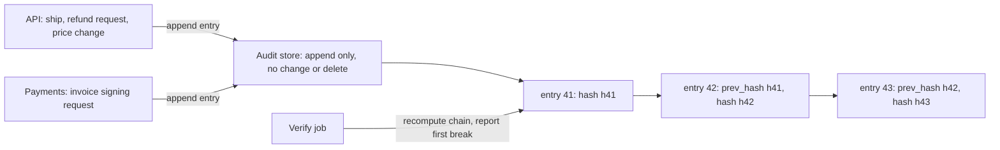

## Before you start

- [[backend.l4.signing-key-custody]] — ADR `0015` makes Payments record every request to sign an invoice; this lesson asks what makes such a record trustworthy.
- [[design.l3.read-model]] — `order_status_history` is written by `RecordOrderStatusHistory` from the order's events; this lesson checks whether it can serve as evidence.
- [[devops.l3.signing-images]] — a transparency log keeps a public record of signatures; the audit log borrows its central idea.
- [[devops.l2.centralized-logs]] — Loki collects every container's output with a `service` label; this lesson separates those logs from an audit log.

## The situation

An accountant asks you who requested the refund on an order. Payments answers at once: the refund row in the `payments` table of the database `donhang_payments` holds an email in `requested_by` and a time in `requested_at`. Would that answer hold if the customer said they never asked?

You check who can write that row: Payments, and anything signed in as `donhang`, the one database user every service connects as. An `UPDATE` there records nothing about who changed it. Loki has refund lines too, but each service prints whatever its code says.

What must a record of who did what have, so that it still counts when those it records could have touched it?

## Core concepts

- **audit log** — a record of who did what to which resource, when and with what outcome, kept so it can serve later as evidence, such as of who asked for a refund.
- entry — one record in the audit log: `actor` (the caller's `sub` from a checked token), `action`, `resource`, `at` and `outcome`; `sub` is the field of the access token that names the signed-in user.
- hash — a short fingerprint computed from bytes; change any byte and the hash comes out different, as with the invoice bytes in the signing lessons.
- hash chain — each entry stores `prev_hash`, the hash of the entry before it, and its own `hash` is computed over its fields and that `prev_hash`.
- **tamper-evident** — built so that a change leaves a mark a check can find, as a hash chain does for any changed entry or any removed entry that has entries after it; it makes tampering visible, not impossible.
- append-only store — a store where the services may add entries but may not change or delete any.

## How it works



In the situation above, Payments or anyone holding `donhang` can rewrite the refund row. An audit log moves the record out of reach of those it records.

When the API ships an order or accepts a refund request, it appends an entry to the audit store, a store separate from the services' databases: the caller's `sub` from the token it already checked, the action, the resource such as `order/42`, the time and the outcome. Payments appends one for each invoice signing request. Each entry carries `prev_hash`, the hash of the entry before it, and its own `hash`, computed over its fields and `prev_hash`.

Now change one old entry, say the `actor` of a refund request. When the chain is recomputed from the start, that entry's hash and every hash after it come out different from the stored ones. Removing an entry that has entries after it breaks the link at the next entry: its `prev_hash` no longer matches the hash of the entry now before it. The verify job recomputes the chain on a schedule and reports the first place it breaks. That is what makes the log tamper-evident: the chain does not prevent a change, it shows it.

The chain alone is not enough. Someone who rewrites an entry and every later one gets a chain that checks again, and removing the newest entries leaves a shorter chain that still checks. So the store decides who may change or delete: the services may only append, and `donhang` has no rights at all. The store limits who can try; the chain shows when someone tried anyway.

A transparency log, where Cosign records signing events, rests on the same idea: a record that is kept, not rewritten, so a later change can be noticed.

## In the Đơn Hàng system

The refund row's record of who asked:

```csharp file=DonHang.Payments/Payment.cs tag=stage-4 lines=19-22
    // lesson: backend.l3.safe-to-repeat-saga-steps
    // A refund only: who asked and when (YC-8), and RefundSender's retries.
    public string? RequestedBy { get; set; }
    public DateTimeOffset? RequestedAt { get; set; }
```

YC-8, in `refund-requirements.md`, is the requirement that each refund keep who asked and when, never changed or deleted later. `RequestedBy` and `RequestedAt` are two ordinary columns of the `payments` row, `requested_by` and `requested_at`. `RefundRequestedConsumer`, outside this excerpt, fills `RequestedBy` with the customer's email from the message, not the `sub` of whoever called. Payments can update the column, and so can any connection as `donhang`; nothing records who changed it or when.

`order_status_history` has the same weakness: `RecordOrderStatusHistory` writes the event, the new status and the time, but no field names who acted, and the API can update the table. `threat-model.md` lists both weaknesses as finding P4: records their own service can change without a trace.

The design that answers P4:

```markdown file=docs/design/audit-log.md tag=stage-4 lines=17-40
### Hành động được kiểm toán

| Hành động | Ai ghi entry |
|---|---|
| Giao đơn (`PATCH /api/v1/orders/{id}/ship`) | API |
| Yêu cầu hoàn tiền (`POST /api/v1/orders/{id}/refund`) | API |
| Đổi giá sản phẩm (`PATCH /api/v1/products/{id}`) | API |
| Cấp hay bỏ một role ở Keycloak | Keycloak; cách lấy entry từ Keycloak quyết khi dựng |
| Xin ký một hóa đơn | Payments |

### Trường của mỗi entry

| Trường | Nội dung |
|---|---|
| `actor` | `sub` của người gọi, lấy từ token đã kiểm; job nền ghi tên service |
| `action` | Tên hành động, ví dụ `order.ship` |
| `resource` | Đối tượng bị tác động, ví dụ `order/42` |
| `at` | Thời điểm, theo giờ của service ghi |
| `outcome` | `allowed`, `denied` hoặc `failed`, kèm mã lỗi nếu có |
| `prev_hash` | Hash của entry ngay trước trong cùng chuỗi |
| `hash` | Hash của entry này, tính cả `prev_hash` |

Không entry nào chứa token, mật khẩu, khóa hay secret, kể cả khi hành động
thất bại vì chúng.
```

The first table lists five audited actions and who writes each entry; for Keycloak, how its entries reach the log is decided when the log is built. The second table is the entry. `actor` is the `sub` from the checked token, or the service's name for a background job, and `outcome` keeps denied and failed attempts as well as allowed ones. The last lines rule out tokens, passwords, keys and secrets in any entry, even when the action failed because of one.

The rest of the file, outside the excerpt, describes the chain, a verify job and the store: separate from the services' databases, append only for the services, no rights at all for `donhang` or any database user a service connects as, readable only by auditors and the team lead. The product for the store is not chosen. At stage-4 none of this is built; `audit-log.md` is a plan.

## Trade-offs

| Where "who did what" is recorded | Who can change it unseen | Can it show who acted? | What it costs |
|---|---|---|---|
| Columns in the service's own tables (`requested_by`, `order_status_history`) | the service, and any connection as `donhang` | no: a change records nothing, and `requested_by` is an email from a message | nothing; it already exists |
| Application log lines in Loki | any service writes any line to its own output | no: a line is only as true as the code that printed it | nothing; it already exists for debugging |
| Hash-chained entries in a separate append-only store | not the services; a change by anyone else shows in the verify job, unless they also rewrite every later entry or remove only the newest ones | yes, for the listed actions | a store to run, a verify job, an entry in each audited action, a decision on how long to keep entries |

The first two rows are not wrong; they serve running the refund and finding bugs. Only the third is built to be read by someone who does not trust the services.

## What would you choose if…

…a new endpoint changes something a customer or the accountant might dispute later? Add it to the actions table of `audit-log.md`. `backend-review-checklist.md` asks this question of every new action.

…you need to find out why refunds failed overnight? Loki and the traces. The audit log tells you who asked and whether it was allowed, not what broke inside the service.

…an auditor asks for the full request behind each refund, headers included? Keep to the entry's fields. The `Authorization` header carries the caller's access token, and the design keeps tokens out of every entry.

## Seniors often assume…

- **"Our application logs in Loki already are the audit log."** → Actually Loki collects whatever each container prints, and any service can print any line, so a line naming who acted is only a claim by that service's code. Those logs exist to find bugs. You notice this when you try to prove who requested a refund from Loki and find only text the service chose to write, with nothing tied to the caller's checked token.
- **"To be complete, an audit log has to record every request the API receives."** → Actually it records the actions someone may later need to prove, the ones `audit-log.md` lists. Recording every request buries those few among reads, and whole requests carry tokens the design keeps out. You notice this when finding one refund request means filtering through thousands of `GET` entries.
- **"If the app can only append to the log, nobody can tamper with it."** → Actually append-only limits the services, not whoever administers the store, and it does not stop a service from appending an entry that is false. The hash chain makes a later change show; it cannot make a false entry true. You notice this when you ask who holds administrator rights on the store and the answer includes someone the log is meant to record.

## Try it (3 minutes)

At 10:02 the API appended an entry: the caller's `sub`, a refund request, `order/7`, `allowed`. Later, four attempts are made to change the story:

1. Someone signed in as `donhang` updates `requested_by` of that order's refund row in `payments` to another email.
2. The same person tries to update the `actor` of the 10:02 entry in the audit store.
3. An administrator of the audit store changes that entry's `actor` and leaves every stored hash as it was.
4. The same administrator changes the entry and recomputes the hash of every entry after it.

For each attempt, decide what happens under the design in `audit-log.md`.

Expected result: one verdict per attempt — succeeds and records nothing, refused, reported by the verify job, or not caught by the chain alone.

<details><summary>Suggested answer</summary>

1. Succeeds and records nothing in `payments`. But the 10:02 entry still names the original caller's `sub`, so the two records now disagree, and only the refund row was within reach of `donhang`.
2. Refused: `donhang` has no rights on the audit store.
3. Reported: the recomputed hash of that entry no longer matches its stored `hash`, and the verify job reports the break at that entry.
4. Not caught by the chain alone: every hash checks again. This is why the store, not the chain, decides who can change entries, and why the administrators of the store matter as much as its permissions for the services.

</details>

## Connections

- [[backend.l4.signing-key-custody]] — the reason this log must exist: ADR `0015` makes Payments record each signing request, which helps only if Payments cannot rewrite the record.
- [[backend.l4.shared-credentials]] — the cause of finding P4: the shared user `donhang` reaches every service's rows, so those rows cannot serve as evidence.
- [[backend.l3.safe-to-repeat-saga-steps]] — where `RequestedBy` and `RequestedAt` came from: enough to run the refund, not enough to prove who asked.
- [[devops.l3.signing-images]] — the same idea at a public scale: a record of signing events that is kept, not rewritten.
- [[k8s.l3.api-request-checks]] — the checks that decide whether a request is allowed; the audit entry's `outcome` records what such a check decided.
- [[devops.l2.centralized-logs]] — the opposite purpose: logs to find bugs, written by the services they describe.

## Five-line summary

1. An audit log counts as evidence only if those it records cannot change it unseen, so entries are hash-chained in an append-only store.
2. `requested_by` and `order_status_history` sit in tables their own service and the shared user `donhang` can update, recording nothing.
3. Loki serves debugging: every service prints whatever lines its code writes, so a log line cannot prove who acted.
4. `audit-log.md` lists five audited actions and each entry's `actor` (`sub`), action, resource, time and outcome, never a token or secret.
5. Each entry's hash covers the previous hash, so a change breaks the chain from that entry on; the store keeps services from changing anything.
