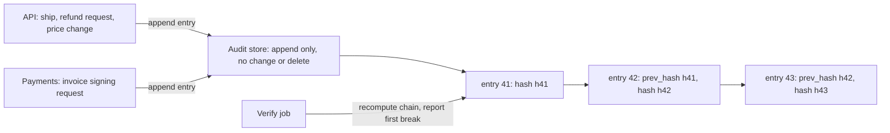

## Bạn cần biết trước

- [[backend.l4.signing-key-custody]] — ADR `0015` buộc Payments ghi lại mọi yêu cầu ký hóa đơn. Bài này hỏi điều gì khiến bản ghi đó đáng tin.
- [[design.l3.read-model]] — `order_status_history` do `RecordOrderStatusHistory` ghi từ các event của đơn hàng. Bài này xét xem nó có dùng làm bằng chứng được không.
- [[devops.l3.signing-images]] — transparency log giữ một bản ghi công khai các chữ ký. Nhật ký kiểm toán mượn ý chính của nó.
- [[devops.l2.centralized-logs]] — Loki gom output của mọi container kèm label `service`. Bài này tách các log đó khỏi nhật ký kiểm toán.

## Tình huống

Kế toán hỏi bạn ai đã yêu cầu hoàn tiền cho một đơn hàng. Payments trả lời ngay: dòng hoàn tiền trong bảng `payments` của database `donhang_payments` có một email ở `requested_by` và một thời điểm ở `requested_at`. Nếu khách hàng nói họ chưa từng yêu cầu, câu trả lời đó có còn đứng vững không?

Bạn kiểm xem ai ghi được dòng đó: Payments, và bất cứ thứ gì đăng nhập bằng `donhang`, user database duy nhất mà mọi service dùng để kết nối. Một lệnh `UPDATE` ở đó không ghi lại gì về người đã sửa. Loki cũng có các dòng log về hoàn tiền, nhưng mỗi service in ra những gì code của nó bảo in.

Một bản ghi ai làm gì phải có gì, để vẫn có giá trị khi chính những người bị ghi lại có thể đã đụng vào nó?

## Khái niệm cốt lõi

- **nhật ký kiểm toán** (audit log) — bản ghi ai đã làm gì với tài nguyên nào, lúc nào và kết quả ra sao, được giữ để về sau làm bằng chứng, chẳng hạn về người đã yêu cầu hoàn tiền.
- entry — một bản ghi trong nhật ký kiểm toán: `actor` (`sub` của người gọi, lấy từ token đã kiểm), `action`, `resource`, `at` và `outcome`. `sub` là trường của access token cho biết người dùng đang đăng nhập.
- hash — một dấu vân tay ngắn tính từ các byte. Đổi bất kỳ byte nào thì hash ra khác, như với các byte hóa đơn trong những bài về ký.
- chuỗi hash — mỗi entry lưu `prev_hash`, tức hash của entry ngay trước nó, còn `hash` của chính nó được tính trên các trường của nó cùng `prev_hash` đó.
- **lộ dấu sửa đổi** (tamper-evident) — được thiết kế sao cho một thay đổi để lại dấu mà phép kiểm tìm ra được, như chuỗi hash làm với mọi entry bị sửa, hay mọi entry bị xóa mà còn entry khác phía sau. Nó làm lần sửa trộm lộ ra, chứ không làm cho không ai sửa trộm được.
- kho chỉ cho thêm — nơi lưu mà các service được thêm entry nhưng không được sửa hay xóa entry nào.

## Cơ chế hoạt động



Trong tình huống trên, Payments hay bất kỳ ai giữ `donhang` đều viết lại được dòng hoàn tiền. Nhật ký kiểm toán đưa bản ghi ra khỏi tầm tay của chính những người bị ghi.

Khi API giao một đơn hay nhận một yêu cầu hoàn tiền, nó thêm một entry vào kho kiểm toán, một kho tách khỏi database của các service: `sub` của người gọi lấy từ token mà API đã kiểm, hành động, tài nguyên như `order/42`, thời điểm và kết quả. Payments thêm một entry cho mỗi yêu cầu ký hóa đơn. Mỗi entry mang `prev_hash`, hash của entry ngay trước nó, và `hash` của chính nó, tính trên các trường của nó cùng `prev_hash`.

Giờ thử sửa một entry cũ, chẳng hạn `actor` của một yêu cầu hoàn tiền. Khi tính lại chuỗi từ đầu, hash của entry đó và mọi hash phía sau đều ra khác với giá trị đã lưu. Xóa một entry còn entry khác phía sau thì làm đứt mắt nối ở entry kế tiếp: `prev_hash` của entry này không còn khớp với hash của entry giờ đứng trước nó. Verify job tính lại chuỗi theo lịch và báo chỗ đứt đầu tiên. Chính điều này khiến nhật ký lộ dấu sửa đổi: chuỗi không ngăn được thay đổi, nó làm thay đổi hiện ra.

Chỉ có chuỗi thì chưa đủ. Ai viết lại một entry và mọi entry sau nó sẽ có một chuỗi lại kiểm khớp, còn xóa các entry mới nhất thì để lại một chuỗi ngắn hơn mà vẫn khớp. Vì thế kho quyết định ai được sửa hay xóa: các service chỉ được thêm, còn `donhang` không có quyền gì cả. Kho giới hạn ai thử được, còn chuỗi cho thấy khi có người vẫn cứ thử.

Transparency log, nơi Cosign ghi lại các lần ký, dựa trên cùng ý tưởng đó: một bản ghi được giữ nguyên chứ không bị viết lại, nên thay đổi về sau sẽ bị nhận ra.

## Trong hệ thống Đơn Hàng

Phần ghi lại ai đã yêu cầu trên dòng hoàn tiền:

```csharp file=DonHang.Payments/Payment.cs tag=stage-4 lines=19-22
    // lesson: backend.l3.safe-to-repeat-saga-steps
    // A refund only: who asked and when (YC-8), and RefundSender's retries.
    public string? RequestedBy { get; set; }
    public DateTimeOffset? RequestedAt { get; set; }
```

YC-8, trong `refund-requirements.md`, là yêu cầu mỗi lần hoàn tiền phải giữ lại ai đã yêu cầu và lúc nào, không bao giờ bị sửa hay xóa về sau. `RequestedBy` và `RequestedAt` là hai cột bình thường của dòng trong `payments`: `requested_by` và `requested_at`. `RefundRequestedConsumer`, nằm ngoài đoạn trích, điền vào `RequestedBy` email của khách hàng lấy từ message, không phải `sub` của người đã gọi. Payments sửa được cột này, mọi kết nối bằng `donhang` cũng vậy, và không có gì ghi lại ai đã sửa hay sửa lúc nào.

`order_status_history` có cùng điểm yếu: `RecordOrderStatusHistory` ghi event, trạng thái mới và thời điểm, nhưng không có trường nào cho biết ai đã thực hiện, và API sửa được bảng này. `threat-model.md` liệt kê cả hai điểm yếu thành phát hiện P4: các bản ghi mà chính service của chúng sửa được mà không để lại dấu vết.

Thiết kế trả lời P4:

```markdown file=docs/design/audit-log.md tag=stage-4 lines=17-40
### Hành động được kiểm toán

| Hành động | Ai ghi entry |
|---|---|
| Giao đơn (`PATCH /api/v1/orders/{id}/ship`) | API |
| Yêu cầu hoàn tiền (`POST /api/v1/orders/{id}/refund`) | API |
| Đổi giá sản phẩm (`PATCH /api/v1/products/{id}`) | API |
| Cấp hay bỏ một role ở Keycloak | Keycloak; cách lấy entry từ Keycloak quyết khi dựng |
| Xin ký một hóa đơn | Payments |

### Trường của mỗi entry

| Trường | Nội dung |
|---|---|
| `actor` | `sub` của người gọi, lấy từ token đã kiểm; job nền ghi tên service |
| `action` | Tên hành động, ví dụ `order.ship` |
| `resource` | Đối tượng bị tác động, ví dụ `order/42` |
| `at` | Thời điểm, theo giờ của service ghi |
| `outcome` | `allowed`, `denied` hoặc `failed`, kèm mã lỗi nếu có |
| `prev_hash` | Hash của entry ngay trước trong cùng chuỗi |
| `hash` | Hash của entry này, tính cả `prev_hash` |

Không entry nào chứa token, mật khẩu, khóa hay secret, kể cả khi hành động
thất bại vì chúng.
```

Bảng đầu liệt kê năm hành động được kiểm toán và bên ghi entry cho từng hành động. Với Keycloak, entry tới nhật ký bằng cách nào sẽ được quyết khi dựng nhật ký. Bảng thứ hai là cấu trúc một entry. `actor` là `sub` lấy từ token đã kiểm, hoặc tên service nếu là job nền, còn `outcome` giữ cả các lần bị từ chối và thất bại chứ không chỉ các lần được phép. Mấy dòng cuối loại token, mật khẩu, khóa và secret khỏi mọi entry, kể cả khi hành động thất bại vì một trong số đó.

Phần còn lại của file, ngoài đoạn trích, mô tả chuỗi hash, một verify job và kho lưu: tách khỏi database của các service, các service chỉ được thêm, `donhang` hay bất kỳ user database nào mà service dùng để kết nối đều không có quyền gì, và chỉ kiểm toán viên cùng trưởng nhóm được đọc. Sản phẩm dùng làm kho chưa được chọn. Ở stage-4 chưa có gì trong số này được dựng, `audit-log.md` mới là một bản kế hoạch.

## Đánh đổi

| "Ai làm gì" được ghi ở đâu | Ai sửa được mà không bị thấy | Có cho biết ai đã làm không? | Cái giá |
|---|---|---|---|
| Các cột trong bảng của chính service (`requested_by`, `order_status_history`) | chính service đó, và mọi kết nối bằng `donhang` | không: một lần sửa không ghi lại gì, và `requested_by` là email lấy từ message | không tốn gì, nó đã có sẵn |
| Các dòng log ứng dụng trong Loki | service nào cũng ghi được bất kỳ dòng nào vào output của mình | không: một dòng log chỉ đúng bằng phần code đã in nó ra | không tốn gì, nó đã có sẵn để tìm bug |
| Các entry nối chuỗi hash trong một kho chỉ cho thêm, tách riêng | không phải các service. Thay đổi của bất kỳ ai khác sẽ hiện ra ở verify job, trừ khi họ viết lại luôn mọi entry phía sau hoặc chỉ xóa các entry mới nhất | có, với các hành động trong danh sách | một kho phải vận hành, một verify job, một lần ghi entry trong mỗi hành động được kiểm toán, một quyết định giữ entry bao lâu |

Hai dòng đầu không sai: chúng dùng để chạy quy trình hoàn tiền và tìm bug. Chỉ dòng thứ ba được dựng ra để người không tin các service đọc.

## Bạn sẽ chọn gì nếu…

…một endpoint mới thay đổi thứ mà khách hàng hay kế toán có thể tranh cãi về sau? Thêm nó vào bảng hành động trong `audit-log.md`. `backend-review-checklist.md` đặt câu hỏi này cho mọi hành động mới.

…bạn cần tìm hiểu vì sao các lần hoàn tiền thất bại trong đêm? Dùng Loki và trace. Nhật ký kiểm toán cho biết ai đã yêu cầu và có được phép hay không, không cho biết thứ gì hỏng bên trong service.

…một kiểm toán viên đòi toàn bộ request đằng sau mỗi lần hoàn tiền, kể cả header? Chỉ giữ các trường của entry. Header `Authorization` mang access token của người gọi, và thiết kế loại token khỏi mọi entry.

## Senior hay nhầm rằng…

- **"Log ứng dụng của mình trong Loki đã là nhật ký kiểm toán rồi."** → Thực ra Loki gom bất cứ thứ gì mỗi container in ra, và service nào cũng in được bất kỳ dòng nào, nên một dòng ghi tên người đã làm chỉ là lời khẳng định của code service đó. Các log này có để tìm bug. Bạn sẽ nhận ra khi thử dùng Loki để chứng minh ai đã yêu cầu hoàn tiền và chỉ thấy những dòng chữ service tự chọn ghi, không gắn với token đã kiểm của người gọi.
- **"Muốn đầy đủ, nhật ký kiểm toán phải ghi mọi request mà API nhận."** → Thực ra nó ghi những hành động mà về sau có thể có người cần chứng minh, tức những hành động `audit-log.md` liệt kê. Ghi mọi request sẽ vùi số ít đó giữa các lần đọc, và request nguyên vẹn mang theo token mà thiết kế loại ra. Bạn sẽ nhận ra khi muốn tìm một yêu cầu hoàn tiền mà phải lọc qua hàng nghìn entry `GET`.
- **"App chỉ được thêm vào nhật ký thì không ai sửa trộm được."** → Thực ra chỉ cho thêm giới hạn các service, không giới hạn người quản trị kho, và nó không ngăn một service thêm vào một entry sai sự thật. Chuỗi hash làm một thay đổi về sau hiện ra, nó không biến được một entry sai thành đúng. Bạn sẽ nhận ra khi hỏi ai có quyền quản trị kho và câu trả lời có cả người mà nhật ký đang ghi lại.

## Thử ngay (3 phút)

Lúc 10:02, API thêm một entry: `sub` của người gọi, một yêu cầu hoàn tiền, `order/7`, `allowed`. Sau đó có bốn lần thử đổi câu chuyện:

1. Ai đó đăng nhập bằng `donhang` sửa `requested_by` trên dòng hoàn tiền của đơn đó trong `payments` thành một email khác.
2. Cũng người đó thử sửa `actor` của entry lúc 10:02 trong kho kiểm toán.
3. Một người quản trị kho kiểm toán đổi `actor` của entry đó và giữ nguyên mọi hash đã lưu.
4. Cũng người quản trị đó đổi entry và tính lại hash của mọi entry phía sau.

Với từng lần thử, hãy xác định điều gì xảy ra theo thiết kế trong `audit-log.md`.

Kết quả mong đợi: một kết luận cho mỗi lần thử — thành công và không ghi lại gì, bị từ chối, bị verify job báo, hoặc chuỗi hash một mình không bắt được.

<details><summary>Gợi ý đáp án</summary>

1. Thành công và không ghi lại gì trong `payments`. Nhưng entry lúc 10:02 vẫn ghi `sub` của người gọi ban đầu, nên giờ hai bản ghi mâu thuẫn nhau, và chỉ dòng hoàn tiền nằm trong tầm tay của `donhang`.
2. Bị từ chối: `donhang` không có quyền gì trên kho kiểm toán.
3. Bị báo: hash tính lại của entry đó không còn khớp với `hash` đã lưu, và verify job báo chỗ đứt tại entry đó.
4. Chuỗi hash một mình không bắt được: mọi hash lại khớp. Đó là lý do kho, chứ không phải chuỗi, quyết định ai được sửa entry, và vì sao người quản trị kho quan trọng không kém quyền mà kho cấp cho các service.

</details>

## Liên hệ

- [[backend.l4.signing-key-custody]] — lý do nhật ký này phải có: ADR `0015` buộc Payments ghi lại từng yêu cầu ký, nhưng bản ghi đó chỉ có ích khi Payments không viết lại được bản ghi.
- [[backend.l4.shared-credentials]] — nguyên nhân của phát hiện P4: user dùng chung `donhang` chạm được tới dữ liệu của mọi service, nên các dòng đó không làm bằng chứng được.
- [[backend.l3.safe-to-repeat-saga-steps]] — nơi `RequestedBy` và `RequestedAt` ra đời: đủ để chạy quy trình hoàn tiền, không đủ để chứng minh ai đã yêu cầu.
- [[devops.l3.signing-images]] — cùng ý tưởng ở quy mô công khai: một bản ghi các lần ký được giữ nguyên, không bị viết lại.
- [[k8s.l3.api-request-checks]] — các phép kiểm quyết định một request có được phép không. `outcome` của entry kiểm toán ghi lại phép kiểm đó đã quyết gì.
- [[devops.l2.centralized-logs]] — mục đích ngược lại: log để tìm bug, do chính các service mà chúng mô tả ghi ra.

## Tóm tắt 5 dòng

1. Nhật ký kiểm toán chỉ là bằng chứng khi người bị ghi không sửa được nó mà không bị thấy, nên các entry được nối chuỗi hash trong một kho chỉ cho thêm.
2. `requested_by` và `order_status_history` nằm trong bảng mà chính service của chúng và user dùng chung `donhang` sửa được, không ghi lại gì.
3. Loki dùng để tìm bug: service nào cũng in những dòng code của nó viết ra, nên một dòng log không chứng minh được ai đã làm.
4. `audit-log.md` liệt kê năm hành động được kiểm toán, và mỗi entry có `actor` (`sub`), hành động, tài nguyên, thời điểm, kết quả, không bao giờ có token hay secret.
5. Hash của mỗi entry tính cả hash trước đó, nên một thay đổi làm đứt chuỗi từ entry đó trở đi. Kho giữ cho các service không sửa được gì.
