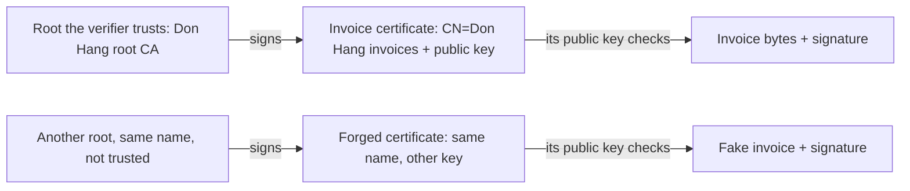

## Before you start

- [[backend.l4.signing-documents]] — a public key checks that an invoice is unchanged and was signed with the matching private key; this lesson asks whose key that is.
- [[k8s.l3.cert-manager]] — an `Issuer` says who signs a certificate; `lab-ca` signs with the lab's own authority, kept in a Secret.
- [[k8s.l2.tls-at-the-gateway]] — the lab's own authority signs the Gateway's certificate, and `curl --cacert` trusts it.
- [[foundation.l1.tls-and-https]] — a certificate binds names to a public key, and a browser checks its name, signer and dates.

## The situation

It is stage-4, and the accountant from the last lesson is back. A customer has sent a file with order 1 at 2,140,000 VND, a signature, and a public key described as Đơn Hàng's. The accountant runs the same check as `InvoiceSigning.Verify` with that key, and it passes.

Then a developer points out a problem. Anyone can make a key pair, sign a fake invoice and attach their own public key, and the check passes for them too. The signature proves which key signed. It says nothing about whose key that is.

How can the accountant tell that a public key really belongs to Đơn Hàng?

## Core concepts

- certificate — a small document that states a name and a public key and is signed by whoever vouches that the two belong together; it contains no private key.
- **certificate authority (CA)** — a party whose signature on a certificate vouches that the public key in it belongs to the name in it.
- root certificate — a CA's own certificate, signed with its own key, so nothing vouches for it except the verifiers that choose to trust it.
- **certificate chain** — the sequence from a certificate up to a root, each certificate signed with the key of the next one, which a verifier checks signature by signature.
- **PKI (public key infrastructure)** — the whole arrangement of CAs, the certificates they issue and the roots each verifier trusts, which together tell a verifier whose a public key is.

## How it works



In the situation above, the missing piece is a statement the accountant can check: this public key belongs to Đơn Hàng. A certificate is that statement, and a CA's signature on it is what makes it checkable. Đơn Hàng runs its own CA, whose root certificate the accountant installs once, from a source they trust. The root signs an invoice certificate that names `CN=Don Hang invoices` and holds the invoice public key. A certificate's name is called its subject; `CN=` marks the part of it that holds the name.

When an invoice arrives with its certificate, the verifier does two checks in order. First it follows the certificate chain: it checks the invoice certificate's signature with the root's public key, and finds that root among the ones it trusts. Here the chain is only two certificates long; a longer chain repeats the same check at each step. Only then does it take the public key from that certificate and check the invoice's signature with it, as in the last lesson.

The bottom row is the fake. Anyone can make a root, give it the same name, and issue a certificate that says `CN=Don Hang invoices`. Names cost nothing. That chain ends at a root the accountant never installed, so the first check fails and the second one no longer matters.

So trust does not come from the certificate. It comes from the verifier's own list of roots, and PKI is the name for this whole arrangement. Its weakest point sits behind the top-left box: the root's private key, which made the top row's `signs` arrow. Whoever holds it can issue a certificate for any name the verifiers accept, including `CN=Don Hang invoices` with a key of their own. That key therefore needs more protection than any key it certifies.

## In the Đơn Hàng system

The sample issues the invoice certificate and checks it against one trusted root. In .NET, `X509Certificate2` is a certificate and `X509Chain` checks a certificate chain; X.509 is the name of the certificate format.

```csharp file=samples/DonHang.Samples/Samples/Security/InvoiceCertificates.cs tag=stage-4 lines=32-54
    public static X509Certificate2 IssueInvoiceCertificate(X509Certificate2 root, ECDsa invoiceKey)
    {
        var request = new CertificateRequest(InvoiceSubject, invoiceKey, HashAlgorithmName.SHA256);
        request.CertificateExtensions.Add(new X509BasicConstraintsExtension(false, false, 0, true));
        request.CertificateExtensions.Add(new X509KeyUsageExtension(X509KeyUsageFlags.DigitalSignature, true));
        request.CertificateExtensions.Add(X509AuthorityKeyIdentifierExtension.CreateFromCertificate(root, true, false));
        var now = DateTimeOffset.UtcNow;
        return request.Create(root, now.AddHours(-1), now.AddYears(2), RandomNumberGenerator.GetBytes(16));
    }

    // lesson: backend.l4.pki-and-signing
    // The verifier trusts one root, Đơn Hàng's, and nothing from the
    // machine's own store. The chain must lead from the certificate to that
    // root, every signature checked on the way. RevocationMode.NoCheck: the
    // lab publishes no CRL or OCSP responder to ask whether it was revoked.
    public static bool IsTrusted(X509Certificate2 certificate, X509Certificate2 trustedRoot)
    {
        using var chain = new X509Chain();
        chain.ChainPolicy.TrustMode = X509ChainTrustMode.CustomRootTrust;
        chain.ChainPolicy.CustomTrustStore.Add(trustedRoot);
        chain.ChainPolicy.RevocationMode = X509RevocationMode.NoCheck;
        return chain.Build(certificate);
    }
```

`IssueInvoiceCertificate` puts the name `InvoiceSubject` and the invoice public key into a request. It marks the certificate as not a CA and limits its key to `DigitalSignature`. `request.Create(root, …)` has the root sign it. The remaining lines set the validity dates, a random serial number and a reference to the signing root.

`CreateRoot`, above the excerpt, is the other half: its certificate is marked as a CA, its key may only sign certificates (`KeyCertSign`), and `CreateSelfSigned` signs it with its own key.

`IsTrusted` is the verifier. `X509ChainTrustMode.CustomRootTrust` with the root in `CustomTrustStore` means: trust this one root and nothing in the machine's own store. `chain.Build` returns `true` only when the chain from the certificate reaches that root. `RevocationMode.NoCheck` turns off asking whether a CA has withdrawn the certificate before its end date. The two acronyms in the comment name ways a CA publishes that answer; this lesson covers neither.

One of the sample's tests:

```csharp file=samples/DonHang.Samples.Tests/InvoiceSigningTests.cs tag=stage-4 lines=59-69
    [Fact]
    public void SameSubjectFromAnotherRoot_IsNotTrusted()
    {
        using var root = InvoiceCertificates.CreateRoot();
        using var otherRoot = InvoiceCertificates.CreateRoot();
        using var key = InvoiceSigning.NewKey();
        using var forged = InvoiceCertificates.IssueInvoiceCertificate(otherRoot, key);

        Assert.Equal(InvoiceCertificates.InvoiceSubject, forged.Subject);
        Assert.False(InvoiceCertificates.IsTrusted(forged, root));
    }
```

`otherRoot` comes from a second call to `CreateRoot()` with the same default subject, so it even has the same name. The forged certificate's subject equals `InvoiceSubject`, as the first assert checks, and `IsTrusted` still returns `false`: no certificate in its chain was signed with the trusted root's key. The test above the excerpt issues the same kind of certificate from `root` and gets `true`. The test below it takes the public key for the invoice check from `certificate.PublicKey`, the certificate that passed, not from whoever sent the invoice.

You have met this split between a CA certificate and a certificate for one job before. From stage-3, `scripts/dev-secrets.sh` creates the lab CA with `basicConstraints=critical,CA:TRUE` and a key usage that includes `keyCertSign`. The certificate it signs for the Gateway's hosts gets `extendedKeyUsage=serverAuth`, a key meant only for proving a server's identity in TLS. The file `secrets/lab-ca.key` is the lab's version of the key that needs the most protection: whoever reads it can sign a certificate for any host name with the same authority that `curl --cacert secrets/lab-ca.crt` trusts.

## Trade-offs

| How the verifier learns Đơn Hàng's public key | What the verifier must receive once | When the invoice key changes | Who can make another key pass as Đơn Hàng's |
|---|---|---|---|
| The raw public key, handed over directly | each public key, through a channel they trust | every verifier needs the new key | whoever can swap the key on that channel |
| A certificate from Đơn Hàng's own root (the sample) | the root certificate | Đơn Hàng issues a new certificate; verifiers change nothing | whoever holds the root's private key |
| A certificate from a root the verifier already trusts, run by an outside CA | nothing new, if that root is already in their list | the outside CA issues a new certificate | the outside CA, and whoever holds its key |

The first row is simplest with one verifier and a key that never changes. The second costs running a CA and protecting its key, and pays off once there are many verifiers or the signing key gets replaced. The third spares verifiers from installing a root, but puts an outside party inside your trust. Browsers already hold such a list of roots; how to pick such a CA is outside this lesson.

## What would you choose if…

…one accountant checks invoices once a year, and the key does not change? Handing over the public key in person can be enough. A CA would add one more key to protect and no check the accountant lacks.

…thousands of customers check invoices, and the invoice key will be replaced over the years? A root that each verifier installs once. Replacing the invoice key then means issuing a new certificate, not reaching every verifier again.

…the verifier accepts only roots from a list it chose itself? Your own root helps only if they add it to that list. Which roots count is the verifier's decision, never the signer's.

## Seniors often assume…

- **"If the signature checks out with the key in the certificate, the invoice comes from the name in it, whoever signed the certificate."** → Actually a certificate is only as good as its signer, because anyone can make one with any name. The signature check shows the invoice matches the certificate; only the chain to a trusted root makes the name mean anything. You notice this when a fake invoice arrives with its own certificate, `Verify` returns `true` with that certificate's key, and `IsTrusted` returns `false`.
- **"A certificate has to be kept secret, like the private key."** → Actually a certificate holds a name, a public key and the CA's signature, nothing that can sign, because its purpose is to be handed to every verifier. A TLS server sends its certificate to clients whenever it authenticates with a certificate. You notice this when `curl --cacert secrets/lab-ca.crt` needs only the CA's certificate, while the file that lets someone issue certificates is `lab-ca.key`.
- **"The Gateway's certificate can sign our invoices too, since both belong to Đơn Hàng."** → Actually that certificate says its key is for authenticating a server (`serverAuth`), and it chains to the lab CA, not to the root that invoice verifiers trust. One key with two jobs also widens the blast radius: the Gateway's key sits in a Secret in the cluster, so anyone who could read that Secret could sign invoices. You notice this when the threat model's entry for the invoice key would have to list every place the Gateway's TLS Secret is readable.

## Try it (3 minutes)

In the root folder of the example repository at tag `stage-4`, with the .NET SDK installed:

1. In `samples/DonHang.Samples.Tests/InvoiceSigningTests.cs`, in `SameSubjectFromAnotherRoot_IsNotTrusted`, change `IsTrusted(forged, root)` to `IsTrusted(forged, otherRoot)`.
2. Run `dotnet test samples/DonHang.Samples.Tests --filter InvoiceSigningTests`, then undo your change.

Expected result: five tests pass, and `SameSubjectFromAnotherRoot_IsNotTrusted` fails on its `Assert.False`, because the same forged certificate is now trusted.

Then decide: the certificate did not change at all. What did?

<details><summary>Suggested answer</summary>

The verifier's list of trusted roots. A chain is accepted or rejected relative to the roots one verifier trusts; the certificate alone carries no verdict. That is why giving a verifier the wrong root does as much harm as a forged certificate.

</details>

## Connections

- [[backend.l4.signing-documents]] — the step before: that lesson proves which key signed, this one ties the key to a name.
- [[backend.l4.signing-key-custody]] — where the invoice key lives, the next question once its certificate is trusted.
- [[k8s.l2.tls-at-the-gateway]] — the same chain check, run by `curl` and browsers for the Gateway's certificate.
- [[devops.l3.signing-images]] — the same idea in keyless signing, where a short-lived certificate ties a signing key to CI's identity.
- [[backend.l2.validating-provider-tokens]] — the api trusts Keycloak's keys because it downloads them from a configured address; a certificate serves verifiers you never configured.

## Five-line summary

1. A signature proves which key signed; only a certificate from a CA the verifier trusts ties that key to a name.
2. A verifier follows the certificate chain, signature by signature, to a root it trusts; PKI is that arrangement of CAs, certificates and trusted roots.
3. `InvoiceCertificates` makes a root that may only sign certificates and an invoice certificate whose key may only sign; `IsTrusted` trusts only that root.
4. A certificate with the identical name from another root fails, because its chain never reaches a root the verifier trusts.
5. Whoever holds a CA's private key can issue any name its verifiers accept, so that key needs the most protection.
