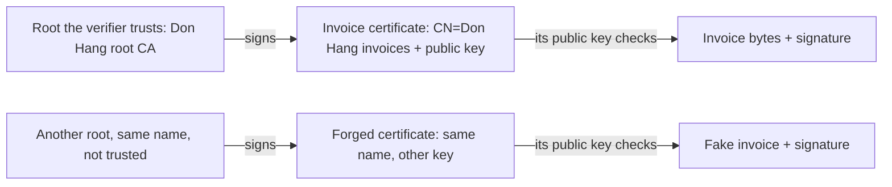

## Bạn cần biết trước

- [[backend.l4.signing-documents]] — public key kiểm được rằng hóa đơn chưa đổi và đã được ký bằng private key tương ứng. Bài này hỏi khóa đó là của ai.
- [[k8s.l3.cert-manager]] — một `Issuer` cho biết ai ký chứng chỉ. `lab-ca` ký bằng tổ chức cấp chứng chỉ riêng của lab, khóa nằm trong một Secret.
- [[k8s.l2.tls-at-the-gateway]] — tổ chức cấp chứng chỉ riêng của lab ký chứng chỉ cho Gateway, và `curl --cacert` tin nó.
- [[foundation.l1.tls-and-https]] — chứng chỉ gắn các tên với một public key, và trình duyệt kiểm tên, bên ký và ngày hiệu lực của nó.

## Tình huống

Đang ở stage-4, và kế toán ở bài trước quay lại. Một khách hàng gửi tới một file ghi đơn hàng 1 giá 2.140.000 VND, kèm chữ ký và một public key được nói là của Đơn Hàng. Kế toán chạy đúng phép kiểm như `InvoiceSigning.Verify` với khóa đó, và nó hợp lệ.

Rồi một developer chỉ ra một lỗ hổng. Ai cũng tạo được một cặp khóa, ký một hóa đơn giả và đính kèm public key của chính mình, và phép kiểm cũng hợp lệ với họ. Chữ ký chứng minh khóa nào đã ký. Nó không nói gì về chuyện khóa đó là của ai.

Làm sao kế toán biết một public key thật sự thuộc về Đơn Hàng?

## Khái niệm cốt lõi

- chứng chỉ (certificate) — một tài liệu nhỏ ghi một cái tên và một public key, được ký bởi bên đứng ra xác nhận hai thứ đó đi cùng nhau. Trong đó không có private key nào.
- **tổ chức cấp chứng chỉ (CA)** (certificate authority) — bên mà chữ ký trên chứng chỉ xác nhận rằng public key trong đó thuộc về cái tên trong đó.
- root certificate — chứng chỉ của chính một CA, ký bằng khóa của chính nó, nên không có gì bảo chứng cho nó ngoài những bên kiểm tự chọn tin nó.
- **chuỗi chứng chỉ** (certificate chain) — dãy đi từ một chứng chỉ lên tới một root, mỗi chứng chỉ được ký bằng khóa của chứng chỉ kế tiếp. Bên kiểm đi theo dãy này, kiểm từng chữ ký một.
- **PKI (public key infrastructure)** — toàn bộ hệ thống gồm các CA, các chứng chỉ chúng cấp và các root mà mỗi bên kiểm tin. Gộp lại, chúng cho bên kiểm biết một public key là của ai.

## Cơ chế hoạt động



Trong tình huống trên, thứ còn thiếu là một lời xác nhận mà kế toán kiểm được: public key này thuộc về Đơn Hàng. Chứng chỉ chính là lời xác nhận đó, và chữ ký của CA trên nó làm nó kiểm được. Đơn Hàng tự vận hành CA của mình. Kế toán cài root certificate của CA đó một lần, từ một nguồn họ tin. Root ký một chứng chỉ hóa đơn mang tên `CN=Don Hang invoices` và chứa public key dùng cho hóa đơn. Tên của một chứng chỉ gọi là subject. `CN=` đánh dấu phần chứa cái tên trong subject.

Khi một hóa đơn tới kèm chứng chỉ của nó, bên kiểm làm hai phép kiểm theo thứ tự. Trước hết, nó đi theo chuỗi chứng chỉ: kiểm chữ ký trên chứng chỉ hóa đơn bằng public key của root, và tìm thấy root đó trong danh sách root nó tin. Ở đây chuỗi chỉ dài hai chứng chỉ. Chuỗi dài hơn thì lặp lại đúng phép kiểm đó ở mỗi bước. Chỉ sau đó nó mới lấy public key từ chứng chỉ ấy và kiểm chữ ký của hóa đơn, như ở bài trước.

Hàng dưới là đồ giả. Ai cũng tạo được một root, đặt cho nó cùng cái tên, rồi cấp một chứng chỉ ghi `CN=Don Hang invoices`. Cái tên chẳng tốn gì. Chuỗi đó kết thúc ở một root mà kế toán chưa bao giờ cài, nên phép kiểm thứ nhất thất bại và phép kiểm thứ hai không còn ý nghĩa.

Vậy niềm tin không đến từ chứng chỉ. Nó đến từ danh sách root của chính bên kiểm, và PKI là tên của toàn bộ cách sắp xếp này. Điểm yếu nhất nằm sau ô trên cùng bên trái: private key của root, thứ tạo ra mũi tên `signs` ở hàng trên. Ai giữ nó thì cấp được chứng chỉ cho bất kỳ cái tên nào mà các bên kiểm chấp nhận, kể cả `CN=Don Hang invoices` với một khóa của riêng họ. Vì thế khóa đó cần được bảo vệ kỹ hơn mọi khóa mà nó chứng nhận.

## Trong hệ thống Đơn Hàng

Sample cấp chứng chỉ hóa đơn và kiểm nó với một root được tin duy nhất. Trong .NET, `X509Certificate2` là một chứng chỉ, còn `X509Chain` kiểm một chuỗi chứng chỉ. X.509 là tên định dạng của chứng chỉ.

```csharp file=samples/DonHang.Samples/Samples/Security/InvoiceCertificates.cs tag=stage-4 lines=32-54
    public static X509Certificate2 IssueInvoiceCertificate(X509Certificate2 root, ECDsa invoiceKey)
    {
        var request = new CertificateRequest(InvoiceSubject, invoiceKey, HashAlgorithmName.SHA256);
        request.CertificateExtensions.Add(new X509BasicConstraintsExtension(false, false, 0, true));
        request.CertificateExtensions.Add(new X509KeyUsageExtension(X509KeyUsageFlags.DigitalSignature, true));
        request.CertificateExtensions.Add(X509AuthorityKeyIdentifierExtension.CreateFromCertificate(root, true, false));
        var now = DateTimeOffset.UtcNow;
        return request.Create(root, now.AddHours(-1), now.AddYears(2), RandomNumberGenerator.GetBytes(16));
    }

    // lesson: backend.l4.pki-and-signing
    // The verifier trusts one root, Đơn Hàng's, and nothing from the
    // machine's own store. The chain must lead from the certificate to that
    // root, every signature checked on the way. RevocationMode.NoCheck: the
    // lab publishes no CRL or OCSP responder to ask whether it was revoked.
    public static bool IsTrusted(X509Certificate2 certificate, X509Certificate2 trustedRoot)
    {
        using var chain = new X509Chain();
        chain.ChainPolicy.TrustMode = X509ChainTrustMode.CustomRootTrust;
        chain.ChainPolicy.CustomTrustStore.Add(trustedRoot);
        chain.ChainPolicy.RevocationMode = X509RevocationMode.NoCheck;
        return chain.Build(certificate);
    }
```

`IssueInvoiceCertificate` đưa cái tên `InvoiceSubject` và public key của hóa đơn vào một request. Nó đánh dấu chứng chỉ này không phải CA và giới hạn khóa của nó ở `DigitalSignature`. `request.Create(root, …)` để root ký chứng chỉ. Các dòng còn lại đặt ngày hiệu lực, một số serial ngẫu nhiên và một tham chiếu tới root đã ký.

`CreateRoot`, nằm phía trên đoạn trích, là nửa còn lại: chứng chỉ của nó được đánh dấu là CA, khóa của nó chỉ được ký chứng chỉ (`KeyCertSign`), và `CreateSelfSigned` ký nó bằng chính khóa của nó.

`IsTrusted` là bên kiểm. `X509ChainTrustMode.CustomRootTrust` cùng root nằm trong `CustomTrustStore` nghĩa là: chỉ tin đúng root này, không tin gì trong kho chứng chỉ có sẵn của máy. `chain.Build` chỉ trả về `true` khi chuỗi từ chứng chỉ đi tới được root đó. `RevocationMode.NoCheck` tắt bước hỏi xem CA có rút lại chứng chỉ trước ngày hết hạn hay không. Hai từ viết tắt trong comment là tên các cách CA công bố câu trả lời đó. Bài này không dạy cách nào.

Một test của sample:

```csharp file=samples/DonHang.Samples.Tests/InvoiceSigningTests.cs tag=stage-4 lines=59-69
    [Fact]
    public void SameSubjectFromAnotherRoot_IsNotTrusted()
    {
        using var root = InvoiceCertificates.CreateRoot();
        using var otherRoot = InvoiceCertificates.CreateRoot();
        using var key = InvoiceSigning.NewKey();
        using var forged = InvoiceCertificates.IssueInvoiceCertificate(otherRoot, key);

        Assert.Equal(InvoiceCertificates.InvoiceSubject, forged.Subject);
        Assert.False(InvoiceCertificates.IsTrusted(forged, root));
    }
```

`otherRoot` đến từ lần gọi `CreateRoot()` thứ hai với cùng subject mặc định, nên nó còn trùng cả tên. Subject của chứng chỉ giả bằng đúng `InvoiceSubject`, như assert đầu tiên kiểm, vậy mà `IsTrusted` vẫn trả về `false`: không chứng chỉ nào trong chuỗi của nó được ký bằng khóa của root được tin. Test phía trên đoạn trích cấp cùng loại chứng chỉ từ `root` và nhận `true`. Test phía dưới lấy public key để kiểm hóa đơn từ `certificate.PublicKey`, tức chứng chỉ đã qua phép kiểm, chứ không lấy từ người gửi hóa đơn.

Bạn đã gặp sự tách bạch này giữa chứng chỉ CA và chứng chỉ cho một việc riêng. Từ stage-3, `scripts/dev-secrets.sh` tạo CA của lab với `basicConstraints=critical,CA:TRUE` và key usage có `keyCertSign`. Chứng chỉ nó ký cho các host của Gateway mang `extendedKeyUsage=serverAuth`, tức khóa chỉ dùng để chứng minh danh tính server trong TLS. File `secrets/lab-ca.key` là phiên bản trong lab của khóa cần bảo vệ nhất: ai đọc được nó thì ký được chứng chỉ cho bất kỳ host name nào, bằng chính tổ chức cấp chứng chỉ mà `curl --cacert secrets/lab-ca.crt` tin.

## Đánh đổi

| Bên kiểm biết public key của Đơn Hàng bằng cách nào | Bên kiểm cần nhận một lần thứ gì | Khi khóa ký hóa đơn đổi | Ai làm được khóa khác giả làm khóa của Đơn Hàng |
|---|---|---|---|
| Public key thô, trao tận tay | từng public key, qua một kênh họ tin | mọi bên kiểm cần khóa mới | ai tráo được khóa trên kênh đó |
| Chứng chỉ từ root riêng của Đơn Hàng (sample) | root certificate | Đơn Hàng cấp chứng chỉ mới, bên kiểm không phải đổi gì | ai giữ private key của root |
| Chứng chỉ từ một root bên kiểm đã tin, do CA bên ngoài vận hành | không cần gì mới, nếu root đó đã có trong danh sách của họ | CA bên ngoài cấp chứng chỉ mới | CA bên ngoài, và ai giữ khóa của nó |

Dòng thứ nhất đơn giản nhất khi chỉ có một bên kiểm và khóa không bao giờ đổi. Dòng thứ hai tốn công vận hành một CA và bảo vệ khóa của nó, và đáng làm khi có nhiều bên kiểm hoặc khi khóa ký sẽ bị thay. Dòng thứ ba giúp bên kiểm khỏi phải cài root, nhưng đặt một bên ngoài vào trong vòng tin cậy của bạn. Trình duyệt đã có sẵn một danh sách root như vậy. Chọn CA nào thì nằm ngoài bài này.

## Bạn sẽ chọn gì nếu…

…một kế toán kiểm hóa đơn mỗi năm một lần, và khóa không đổi? Trao public key tận tay có thể là đủ. Một CA chỉ thêm một khóa phải bảo vệ mà không thêm phép kiểm nào kế toán đang thiếu.

…hàng nghìn khách hàng kiểm hóa đơn, và khóa ký hóa đơn sẽ bị thay qua các năm? Một root mà mỗi bên kiểm cài một lần. Khi đó thay khóa hóa đơn chỉ là cấp một chứng chỉ mới, không phải liên hệ lại từng bên kiểm.

…bên kiểm chỉ chấp nhận root từ một danh sách họ tự chọn? Root riêng của bạn chỉ có ích khi họ thêm nó vào danh sách đó. Root nào được tính là quyết định của bên kiểm, không bao giờ là của bên ký.

## Senior hay nhầm rằng…

- **"Nếu chữ ký kiểm hợp lệ với khóa trong chứng chỉ thì hóa đơn đến từ cái tên trong đó, bất kể ai ký chứng chỉ."** → Thực ra chứng chỉ chỉ đáng tin bằng bên ký nó, vì ai cũng tạo được chứng chỉ với bất kỳ cái tên nào. Phép kiểm chữ ký cho thấy hóa đơn khớp với chứng chỉ. Chỉ chuỗi dẫn tới một root được tin mới làm cái tên có nghĩa. Bạn sẽ nhận ra khi một hóa đơn giả tới kèm chứng chỉ riêng của nó, `Verify` trả về `true` với khóa của chứng chỉ đó, còn `IsTrusted` trả về `false`.
- **"Chứng chỉ phải được giữ bí mật, như private key."** → Thực ra chứng chỉ chứa một cái tên, một public key và chữ ký của CA, không có gì ký được, vì mục đích của nó là được trao cho mọi bên kiểm. Server TLS gửi chứng chỉ của nó cho client mỗi khi xác thực bằng chứng chỉ. Bạn sẽ nhận ra khi `curl --cacert secrets/lab-ca.crt` chỉ cần chứng chỉ của CA, còn file cho phép ai đó cấp chứng chỉ là `lab-ca.key`.
- **"Chứng chỉ của Gateway cũng ký được hóa đơn, vì cả hai đều thuộc Đơn Hàng."** → Thực ra chứng chỉ đó ghi rằng khóa của nó dùng để xác thực server (`serverAuth`), và chuỗi của nó dẫn tới CA của lab, không phải tới root mà các bên kiểm hóa đơn tin. Một khóa làm hai việc còn nới rộng phạm vi ảnh hưởng: khóa của Gateway nằm trong một Secret trong cluster, nên ai đọc được Secret đó cũng ký được hóa đơn. Bạn sẽ nhận ra khi mục dành cho khóa hóa đơn trong mô hình mối đe dọa phải liệt kê mọi nơi đọc được TLS Secret của Gateway.

## Thử ngay (3 phút)

Ở thư mục gốc của repo ví dụ tại tag `stage-4`, khi đã cài .NET SDK:

1. Trong `samples/DonHang.Samples.Tests/InvoiceSigningTests.cs`, ở `SameSubjectFromAnotherRoot_IsNotTrusted`, đổi `IsTrusted(forged, root)` thành `IsTrusted(forged, otherRoot)`.
2. Chạy `dotnet test samples/DonHang.Samples.Tests --filter InvoiceSigningTests`, rồi hoàn tác thay đổi.

Kết quả mong đợi: năm test pass, còn `SameSubjectFromAnotherRoot_IsNotTrusted` thất bại ở `Assert.False`, vì chính chứng chỉ giả đó giờ được tin.

Rồi hãy xác định: chứng chỉ không đổi chút nào. Vậy cái gì đã đổi?

<details><summary>Gợi ý đáp án</summary>

Danh sách root được tin của bên kiểm. Một chuỗi được chấp nhận hay bị từ chối là tùy theo các root mà một bên kiểm tin. Bản thân chứng chỉ không mang phán quyết nào. Đó là lý do đưa nhầm root cho bên kiểm cũng gây hại ngang một chứng chỉ giả.

</details>

## Liên hệ

- [[backend.l4.signing-documents]] — bước trước: bài đó chứng minh khóa nào đã ký, bài này gắn khóa với một cái tên.
- [[backend.l4.signing-key-custody]] — khóa ký hóa đơn nằm ở đâu, câu hỏi tiếp theo khi chứng chỉ của nó đã được tin.
- [[k8s.l2.tls-at-the-gateway]] — cùng phép kiểm chuỗi, do `curl` và trình duyệt chạy với chứng chỉ của Gateway.
- [[devops.l3.signing-images]] — cùng ý tưởng trong keyless signing, nơi một chứng chỉ ngắn hạn gắn khóa ký với danh tính của CI.
- [[backend.l2.validating-provider-tokens]] — api tin các khóa của Keycloak vì nó tải chúng từ một địa chỉ đã cấu hình. Chứng chỉ phục vụ được cả những bên kiểm bạn chưa từng cấu hình.

## Tóm tắt 5 dòng

1. Chữ ký chứng minh khóa nào đã ký. Chỉ chứng chỉ từ một CA mà bên kiểm tin mới gắn khóa đó với một cái tên.
2. Bên kiểm đi theo chuỗi chứng chỉ, từng chữ ký một, tới một root nó tin. PKI là cách sắp xếp gồm CA, chứng chỉ và các root được tin đó.
3. `InvoiceCertificates` tạo một root chỉ được ký chứng chỉ và một chứng chỉ hóa đơn có khóa chỉ được ký. `IsTrusted` chỉ tin root đó.
4. Một chứng chỉ trùng hệt tên nhưng từ root khác sẽ thất bại, vì chuỗi của nó không bao giờ tới được root mà bên kiểm tin.
5. Ai giữ private key của một CA thì cấp được chứng chỉ cho bất kỳ cái tên nào các bên kiểm của nó chấp nhận, nên khóa đó cần được bảo vệ nhất.
