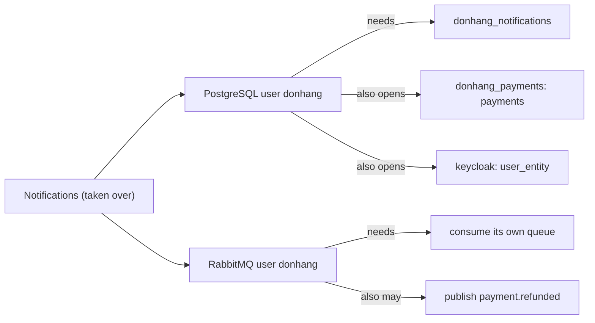

## Before you start

- [[backend.l4.api-gateway]] — defense in depth stacks independent controls; this lesson adds the layer behind the connection.
- [[k8s.l3.roles-and-role-bindings]] — least privilege grants only what the work needs, the same principle applied here to database and broker users.
- [[backend.l4.shop-id-rollout]] — release 3 moves the services to roles that are not superusers and lack `BYPASSRLS`.
- [[backend.l3.message-broker]] — Notifications sends order emails from its own database and takes its messages from RabbitMQ.

## The situation

It is stage-4, and you are fixing a typo in an order email template in Notifications. To run it locally you open `docker-compose.yml` and read its environment. The connection string says `Username=donhang`. A few screens down, Payments says `Username=donhang` too, and so does the API.

Notifications only uses its own database and one queue, then sends emails. Payments holds every payment and refund. Yet both sign in to PostgreSQL and RabbitMQ with the same user and the same password.

If someone found a flaw in Notifications tomorrow and took over its process, what could they reach with what it holds?

## Core concepts

- **blast radius** — everything an attacker can reach with what one compromised part holds, such as its passwords, keys and network access.
- superuser — a PostgreSQL user for whom the server skips every permission check except the right to sign in. In PostgreSQL a user is a role that may sign in, so this lesson uses "user" and "role" for the same thing; it is not a Kubernetes Role.
- the RabbitMQ permissions configure, write and read — what a broker user may do in a vhost (RabbitMQ's group of exchanges and queues): configure creates or deletes exchanges and queues, write lets it publish to an exchange, and read lets it consume from a queue.

## How it works



In the situation above, the blast radius of a flaw in Notifications is not its own database and queue. It is everything its two credentials open.

First, the PostgreSQL credential. In Compose the API, Notifications and Payments all connect as `donhang`. That user is the superuser the `db` image creates from `POSTGRES_USER`. Each service's connection string names its own database, but nothing ties the user to that database. The same user and password open `donhang_payments` and, in Compose, the `keycloak` database, where Keycloak keeps its user accounts in the table `user_entity`.

Next, the RabbitMQ credential. The three services sign in as `donhang`, the broker's default user, created from `RABBITMQ_DEFAULT_USER`. It may configure, write and read everything in the vhost `/`. So Notifications' credentials could publish a message that looks like it came from Payments, such as `payment.refunded`, or consume another service's queue.

Least privilege is how you shrink this. A database role per service that may use only its own database, and a RabbitMQ user per service limited to its own exchanges and queues, would make the blast radius of Notifications roughly what Notifications needs.

Finally, the network layer does not do this job. On staging, the NetworkPolicy `db` lets Notifications reach PostgreSQL, because its own database lives there. A NetworkPolicy decides which Pods may open a connection, not what that connection may do once open. Credentials and their permissions are the layer that limits what happens after the connection.

## In the Đơn Hàng system

Notifications' environment in Compose:

```yaml file=docker-compose.yml tag=stage-4 lines=308-318
  notifications:
    build:
      context: .
      dockerfile: DonHang.Notifications/Dockerfile
    image: donhang-notifications:stage-3
    container_name: donhang-notifications
    hostname: notifications
    environment:
      ConnectionStrings__Default: "Host=db;Database=donhang_notifications;Username=donhang;Password=${POSTGRES_PASSWORD}"
      RabbitMq__Host: "rabbitmq"
      RabbitMq__Password: "${RABBITMQ_PASSWORD}"
```

The image name still carries `stage-3`; only the environment lines matter here. `Database=donhang_notifications` is only where the connection starts. `Username=donhang` and `POSTGRES_PASSWORD` are the same values the `db` service uses for `POSTGRES_USER` and `POSTGRES_PASSWORD`, and the same ones in the API's and Payments' connection strings. `RabbitMq__Password` is the same `RABBITMQ_PASSWORD` the broker's default user gets. No RabbitMQ user name is set here; the shared messaging code defaults it to `donhang`.

The script that proves it:

```bash file=scripts/backend/shared-credentials.sh tag=stage-4 lines=21-34
# lesson: backend.l4.shared-credentials
# The same user and password open every database on the server: the user
# is donhang, the superuser the db image creates from POSTGRES_USER, and
# the api and Payments are given it too. Nothing below changes any data.
echo "superuser: $(as_notifications --dbname donhang_notifications --command "SELECT rolsuper FROM pg_roles WHERE rolname = current_user" | sed 's/^t$/yes/;s/^f$/no/')"
echo "rows it can read in donhang_payments.payments: $(as_notifications --dbname donhang_payments --command "SELECT count(*) FROM payments")"
echo "users it can read in keycloak.user_entity: $(as_notifications --dbname keycloak --command "SELECT count(*) FROM user_entity")"
echo

# lesson: backend.l4.shared-credentials
# The three services also share RabbitMQ's user donhang, which may
# configure, write and read every exchange and queue of the vhost.
echo "== what RabbitMQ's user donhang may do"
docker compose exec -T rabbitmq rabbitmqctl list_user_permissions --quiet donhang
```

```text output=true
== notifications connects to PostgreSQL as: donhang (database donhang_notifications)
superuser: yes
rows it can read in donhang_payments.payments: ...
users it can read in keycloak.user_entity: 7

== what RabbitMQ's user donhang may do
vhost	configure	write	read
/	.*	.*	.*
```

`as_notifications`, defined above the excerpt, runs `psql`, PostgreSQL's command-line client, with the user and password read from Notifications' running container. The lines above the excerpt also print the first line of the output, the user and database read from Notifications' connection string. Each query only reads. The payments count is masked in the captured output because other scripts in the repository create refunds, so the number changes from run to run. The last line shows the broker user's three permissions on the vhost `/`; `.*` in each column means every exchange and queue.

`docs/design/threat-model.md` records this as findings P1 and P2. Both are deferred to release 3 of the multi-shop rollout, which already moves the services to a role without `BYPASSRLS`. At stage-4 the per-service roles and users are only a plan.

## Trade-offs

| Credentials | What Notifications' password opens | Cost to run | Weak spot |
|---|---|---|---|
| One superuser and one broker user for all (Đơn Hàng, stage-4) | every database on the server, every exchange and queue | one password per server (PostgreSQL, RabbitMQ) | one flaw anywhere has the reach of all services |
| A role and a broker user per service, limited to its own data (planned, release 3) | its own database, its own exchanges and queues | a password per service, permissions to keep up to date | a permission granted too widely quietly widens it again |
| A separate PostgreSQL server and broker per service | only its own servers | more servers to run, back up and upgrade | costs grow with each service, for isolation the second row mostly gives |

The first row is cheap until something is taken over. The second row keeps one server and one broker and moves the limit into users and permissions. The third row only pays off if a service's data needs isolation that permissions on a shared server cannot give, for example a separate team or a separate host to protect.

## What would you choose if…

…a reporting job needs to read `orders` before release 3 ships? Give it its own database user that may only read what it needs, rather than handing it `donhang`. A new consumer is the cheapest moment to start with a small blast radius, because nothing yet depends on it having more.

…the team asks whether the RabbitMQ users could be split before release 3? That change does not depend on row-level security, so it can go first if forged messages such as `payment.refunded` worry the team more than the database. The threat model groups both because release 3 already touches every service's credentials, so one rollout changes them once.

## Seniors often assume…

- **"Services inside our own network trust each other anyway, so one shared password is fine."** → Actually a shared password turns trust in one service into trust in all of them, because whoever takes one over signs in exactly as the others do. The network says who can connect, not who is behind the connection. You notice this when a flaw reported in a service that only sends emails is ranked as severe as one in Payments.
- **"The NetworkPolicies already stop Notifications from touching the payments data."** → Actually on staging the NetworkPolicy `db` lets Notifications connect to PostgreSQL, because it needs its own database on that server, and `donhang_payments` lives there too. A NetworkPolicy works on addresses and ports and never sees which database or table a query names. In Compose there is no NetworkPolicy at all. You notice this when `shared-credentials.sh` reads `payments` while every policy is in place.
- **"A superuser for the app is harmless because the app's own code never runs dangerous queries."** → Actually the risk is what someone else runs with the same password, not what your code runs. A superuser skips every permission check, and PostgreSQL also lets superusers bypass row-level security, so release 3's tenant isolation would not hold under it. You notice this when, in Compose, a leaked connection string from one service is enough to read Keycloak's user accounts.

## Try it (3 minutes)

In the root folder of the example repository at tag `stage-4`, with the lab running:

1. Run `scripts/backend/shared-credentials.sh`.

Expected result: the first line names `donhang` and the database `donhang_notifications`; then `superuser: yes`, a count of rows in `payments`, a count of users in `user_entity`, and the RabbitMQ line `/` with `.*` under configure, write and read.

Then decide: after release 3 gives each service its own role and broker user, which lines of this output should change, and to what?

<details><summary>Suggested answer</summary>

The first line names Notifications' own role instead of `donhang`. `superuser` becomes `no`. The two counts should fail with a permission error instead of printing a number, if that role is given no rights in `donhang_payments` or `keycloak`. The script asks about the user `donhang`, so it would need to ask about Notifications' own broker user instead; that user's permissions should cover only Notifications' own exchanges and queues.

</details>

## Connections

- [[backend.l4.api-gateway]] — the layer before this one: who may connect; this lesson is what the connection may do.
- [[backend.l4.threat-modeling]] — where findings P1 and P2 were written down; this lesson explains them.
- [[devops.l1.secrets-vs-config]] — how a password reaches a service; this lesson asks how much that password opens.
- [[backend.l3.row-level-security]] — a limit inside one database that a superuser skips, which is why release 3 changes roles first.
- [[k8s.l3.service-accounts]] — the same least-privilege idea for a Pod's identity toward the Kubernetes API.

## Five-line summary

1. A shared credential gives every service the blast radius of all of them; least privilege per service keeps it small.
2. In Compose the API, Notifications and Payments use the PostgreSQL superuser `donhang` and RabbitMQ's default user `donhang`.
3. `shared-credentials.sh` signs in as Notifications and reads `payments` and Keycloak's users, and shows the broker user may do everything.
4. A NetworkPolicy decides who may connect; the user and its permissions decide what the connection may do.
5. `threat-model.md` defers per-service roles and users to release 3, which already moves services off `BYPASSRLS`.
