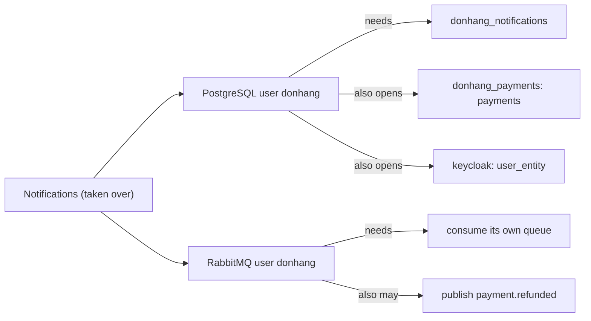

## Bạn cần biết trước

- [[backend.l4.api-gateway]] — phòng thủ nhiều lớp xếp chồng các biện pháp độc lập. Bài này thêm lớp đứng sau kết nối.
- [[k8s.l3.roles-and-role-bindings]] — quyền tối thiểu chỉ cấp đúng những gì công việc cần, và ở đây cùng nguyên tắc đó áp dụng cho user của database và broker.
- [[backend.l4.shop-id-rollout]] — release 3 chuyển các service sang những role không phải superuser và không có `BYPASSRLS`.
- [[backend.l3.message-broker]] — Notifications gửi email đơn hàng từ database riêng của nó và nhận message từ RabbitMQ.

## Tình huống

Đang ở stage-4, và bạn đang sửa một lỗi chính tả trong mẫu email đơn hàng của Notifications. Để chạy nó ở máy mình, bạn mở `docker-compose.yml` và đọc phần environment. Connection string ghi `Username=donhang`. Kéo xuống vài màn hình, Payments cũng ghi `Username=donhang`, API cũng vậy.

Notifications chỉ dùng database riêng của nó và một queue, rồi gửi email. Payments giữ mọi khoản thanh toán và hoàn tiền. Vậy mà cả hai đăng nhập vào PostgreSQL và RabbitMQ bằng cùng một user, cùng một mật khẩu.

Nếu ngày mai có người tìm ra một lỗ hổng trong Notifications và chiếm được process của nó, họ với tới được những gì bằng thứ nó đang giữ?

## Khái niệm cốt lõi

- **phạm vi ảnh hưởng** (blast radius) — mọi thứ kẻ tấn công với tới được bằng những gì một phần bị chiếm đang giữ, chẳng hạn mật khẩu, khóa và quyền truy cập mạng của nó.
- superuser — user PostgreSQL mà server bỏ qua mọi kiểm tra quyền, trừ quyền đăng nhập. Trong PostgreSQL, user là một role được phép đăng nhập, nên bài này dùng "user" và "role" cho cùng một thứ. Nó không phải Role của Kubernetes.
- ba quyền configure, write và read của RabbitMQ — những gì một user của broker được làm trong một vhost (nhóm exchange và queue của RabbitMQ): configure tạo hoặc xóa exchange và queue, write cho phép publish vào một exchange, còn read cho phép consume từ một queue.

## Cơ chế hoạt động



Trong tình huống trên, phạm vi ảnh hưởng của một lỗ hổng trong Notifications không phải là database và queue của riêng nó. Đó là mọi thứ mà hai thông tin đăng nhập của nó mở được.

Trước hết là thông tin đăng nhập PostgreSQL. Trong Compose, API, Notifications và Payments đều kết nối bằng `donhang`. User đó là superuser mà image `db` tạo từ `POSTGRES_USER`. Connection string của mỗi service ghi database riêng của nó, nhưng không gì gắn user vào database đó. Cùng user và mật khẩu ấy mở được `donhang_payments`, và trong Compose cả database `keycloak`, nơi Keycloak giữ tài khoản người dùng trong bảng `user_entity`.

Tiếp theo là thông tin đăng nhập RabbitMQ. Ba service đăng nhập bằng `donhang`, user mặc định của broker, được tạo từ `RABBITMQ_DEFAULT_USER`. User này được configure, write và read mọi thứ trong vhost `/`. Vì thế thông tin đăng nhập của Notifications có thể publish một message trông như đến từ Payments, chẳng hạn `payment.refunded`, hoặc consume queue của service khác.

Quyền tối thiểu là cách thu hẹp phạm vi này. Mỗi service một role database chỉ dùng được database của chính nó, và một user RabbitMQ riêng chỉ giới hạn trong exchange và queue của nó, thì phạm vi ảnh hưởng của Notifications sẽ gần đúng bằng những gì Notifications cần.

Cuối cùng, lớp mạng không làm thay được việc này. Trên staging, NetworkPolicy `db` cho Notifications tới được PostgreSQL, vì database riêng của nó nằm ở đó. NetworkPolicy quyết Pod nào được mở kết nối, không quyết kết nối đó được làm gì khi đã mở. Thông tin đăng nhập và quyền của nó mới là lớp giới hạn những gì xảy ra sau khi kết nối.

## Trong hệ thống Đơn Hàng

Phần environment của Notifications trong Compose:

```yaml file=docker-compose.yml tag=stage-4 lines=308-318
  notifications:
    build:
      context: .
      dockerfile: DonHang.Notifications/Dockerfile
    image: donhang-notifications:stage-3
    container_name: donhang-notifications
    hostname: notifications
    environment:
      ConnectionStrings__Default: "Host=db;Database=donhang_notifications;Username=donhang;Password=${POSTGRES_PASSWORD}"
      RabbitMq__Host: "rabbitmq"
      RabbitMq__Password: "${RABBITMQ_PASSWORD}"
```

Tên image vẫn mang `stage-3`, ở đây chỉ các dòng environment là đáng kể. `Database=donhang_notifications` chỉ là chỗ kết nối bắt đầu. `Username=donhang` và `POSTGRES_PASSWORD` chính là những giá trị service `db` dùng cho `POSTGRES_USER` và `POSTGRES_PASSWORD`, cũng là những giá trị trong connection string của API và Payments. `RabbitMq__Password` là cùng `RABBITMQ_PASSWORD` mà user mặc định của broker nhận. Ở đây không đặt tên user RabbitMQ nào, code messaging dùng chung mặc định lấy `donhang`.

Script chứng minh điều đó:

```bash file=scripts/backend/shared-credentials.sh tag=stage-4 lines=21-34
# lesson: backend.l4.shared-credentials
# The same user and password open every database on the server: the user
# is donhang, the superuser the db image creates from POSTGRES_USER, and
# the api and Payments are given it too. Nothing below changes any data.
echo "superuser: $(as_notifications --dbname donhang_notifications --command "SELECT rolsuper FROM pg_roles WHERE rolname = current_user" | sed 's/^t$/yes/;s/^f$/no/')"
echo "rows it can read in donhang_payments.payments: $(as_notifications --dbname donhang_payments --command "SELECT count(*) FROM payments")"
echo "users it can read in keycloak.user_entity: $(as_notifications --dbname keycloak --command "SELECT count(*) FROM user_entity")"
echo

# lesson: backend.l4.shared-credentials
# The three services also share RabbitMQ's user donhang, which may
# configure, write and read every exchange and queue of the vhost.
echo "== what RabbitMQ's user donhang may do"
docker compose exec -T rabbitmq rabbitmqctl list_user_permissions --quiet donhang
```

```text output=true
== notifications connects to PostgreSQL as: donhang (database donhang_notifications)
superuser: yes
rows it can read in donhang_payments.payments: ...
users it can read in keycloak.user_entity: 7

== what RabbitMQ's user donhang may do
vhost	configure	write	read
/	.*	.*	.*
```

`as_notifications`, định nghĩa phía trên đoạn trích, chạy `psql`, client dòng lệnh của PostgreSQL, với user và mật khẩu đọc từ container Notifications đang chạy. Các dòng phía trên đoạn trích cũng in dòng đầu tiên của output, tức user và database đọc từ connection string của Notifications. Mỗi truy vấn chỉ đọc. Số khoản thanh toán bị che trong output đã ghi lại, vì các script khác trong repo tạo hoàn tiền, nên con số thay đổi giữa các lần chạy. Dòng cuối cho thấy ba quyền của user broker trên vhost `/`. `.*` ở mỗi cột nghĩa là mọi exchange và queue.

`docs/design/threat-model.md` ghi điều này thành hai phát hiện P1 và P2. Cả hai được hoãn sang release 3 của đợt triển khai nhiều cửa hàng, release vốn đã chuyển các service sang một role không có `BYPASSRLS`. Ở stage-4, role và user riêng cho từng service mới chỉ là kế hoạch.

## Đánh đổi

| Thông tin đăng nhập | Mật khẩu của Notifications mở được gì | Chi phí vận hành | Điểm yếu |
|---|---|---|---|
| Một superuser và một user broker cho tất cả (Đơn Hàng, stage-4) | mọi database trên server, mọi exchange và queue | một mật khẩu cho mỗi server (PostgreSQL, RabbitMQ) | một lỗ hổng ở bất kỳ đâu có tầm với của mọi service |
| Mỗi service một role và một user broker, chỉ trên dữ liệu của nó (kế hoạch, release 3) | database riêng, exchange và queue riêng của nó | một mật khẩu cho mỗi service, quyền phải luôn được cập nhật | một quyền cấp quá rộng lặng lẽ nới phạm vi ra lại |
| Mỗi service một server PostgreSQL và một broker riêng | chỉ các server của riêng nó | thêm server phải chạy, sao lưu và nâng cấp | chi phí tăng theo từng service, để đổi lấy mức cô lập mà dòng thứ hai phần lớn đã cho |

Dòng thứ nhất rẻ cho tới khi có thứ bị chiếm. Dòng thứ hai giữ một server và một broker, rồi chuyển giới hạn vào user và quyền. Dòng thứ ba chỉ đáng khi dữ liệu của một service cần mức cô lập mà quyền trên một server dùng chung không cho được, chẳng hạn khi có một đội riêng hay một máy chủ riêng cần bảo vệ.

## Bạn sẽ chọn gì nếu…

…một job báo cáo cần đọc `orders` trước khi release 3 ra mắt? Hãy cho nó một user database riêng chỉ đọc được những gì nó cần, thay vì đưa nó `donhang`. Một consumer mới là thời điểm rẻ nhất để bắt đầu với phạm vi ảnh hưởng nhỏ, vì chưa có gì phụ thuộc vào chuyện nó có nhiều quyền hơn.

…đội hỏi có thể tách các user RabbitMQ trước release 3 không? Thay đổi đó không phụ thuộc vào row-level security, nên có thể làm trước nếu đội lo các message giả như `payment.refunded` hơn là lo database. Mô hình mối đe dọa gộp cả hai vì release 3 vốn đã đụng tới thông tin đăng nhập của mọi service, nên một đợt triển khai đổi chúng một lần.

## Senior hay nhầm rằng…

- **"Các service trong mạng của chính mình đằng nào cũng tin nhau, nên dùng chung một mật khẩu cũng ổn."** → Thực ra mật khẩu dùng chung biến sự tin tưởng dành cho một service thành tin tưởng dành cho tất cả, vì ai chiếm được một service sẽ đăng nhập y hệt các service kia. Mạng cho biết ai kết nối được, không cho biết ai đứng sau kết nối. Bạn sẽ nhận ra khi một lỗ hổng được báo trong một service chỉ gửi email lại bị xếp mức nghiêm trọng ngang một lỗ hổng trong Payments.
- **"Các NetworkPolicy đã chặn Notifications chạm vào dữ liệu thanh toán rồi."** → Thực ra trên staging, NetworkPolicy `db` cho Notifications kết nối tới PostgreSQL, vì nó cần database riêng trên server đó, và `donhang_payments` cũng nằm ở đó. NetworkPolicy làm việc với địa chỉ và cổng, không bao giờ thấy truy vấn nhắc tới database hay bảng nào. Trong Compose thì không có NetworkPolicy nào cả. Bạn sẽ nhận ra khi `shared-credentials.sh` đọc được `payments` trong lúc mọi policy vẫn đang có hiệu lực.
- **"Cho app dùng superuser thì vô hại, vì code của app không bao giờ chạy truy vấn nguy hiểm."** → Thực ra rủi ro nằm ở những gì người khác chạy bằng cùng mật khẩu đó, không phải những gì code của bạn chạy. Superuser bỏ qua mọi kiểm tra quyền, và PostgreSQL còn cho superuser vượt qua row-level security, nên cách ly tenant của release 3 sẽ không giữ được dưới nó. Bạn sẽ nhận ra khi, trong Compose, connection string bị lộ từ một service là đủ để đọc tài khoản người dùng của Keycloak.

## Thử ngay (3 phút)

Ở thư mục gốc của repo ví dụ tại tag `stage-4`, khi lab đang chạy:

1. Chạy `scripts/backend/shared-credentials.sh`.

Kết quả mong đợi: dòng đầu ghi `donhang` và database `donhang_notifications`, tiếp theo là `superuser: yes`, số dòng trong `payments`, số user trong `user_entity`, và dòng RabbitMQ `/` với `.*` dưới configure, write và read.

Rồi hãy xác định: sau khi release 3 cho mỗi service role và user broker riêng, những dòng nào của output này phải đổi, và đổi thành gì?

<details><summary>Gợi ý đáp án</summary>

Dòng đầu ghi role riêng của Notifications thay vì `donhang`. `superuser` thành `no`. Hai số đếm phải báo lỗi không đủ quyền thay vì in ra một con số, nếu role đó không được cấp quyền nào trong `donhang_payments` hay `keycloak`. Script hỏi về user `donhang`, nên nó cần chuyển sang hỏi về user broker riêng của Notifications. Quyền của user đó chỉ nên phủ exchange và queue của chính Notifications.

</details>

## Liên hệ

- [[backend.l4.api-gateway]] — lớp đứng trước lớp này: ai được kết nối. Bài này nói về những gì kết nối được làm.
- [[backend.l4.threat-modeling]] — nơi ghi lại hai phát hiện P1 và P2. Bài này giải thích chúng.
- [[devops.l1.secrets-vs-config]] — mật khẩu tới service bằng cách nào. Bài này hỏi mật khẩu đó mở được bao nhiêu.
- [[backend.l3.row-level-security]] — một giới hạn bên trong một database mà superuser bỏ qua, nên release 3 đổi role trước tiên.
- [[k8s.l3.service-accounts]] — cùng ý tưởng quyền tối thiểu, áp cho danh tính của Pod khi làm việc với Kubernetes API.

## Tóm tắt 5 dòng

1. Thông tin đăng nhập dùng chung trao cho mỗi service phạm vi ảnh hưởng của tất cả, còn quyền tối thiểu cho từng service giữ nó nhỏ.
2. Trong Compose, API, Notifications và Payments dùng superuser PostgreSQL `donhang` và user mặc định `donhang` của RabbitMQ.
3. `shared-credentials.sh` đăng nhập như Notifications, đọc được `payments` và user của Keycloak, và cho thấy user broker được làm mọi thứ.
4. NetworkPolicy quyết ai được kết nối, còn user và quyền của nó quyết kết nối được làm gì.
5. `threat-model.md` hoãn role và user riêng cho từng service sang release 3, release vốn đã đưa các service ra khỏi `BYPASSRLS`.
