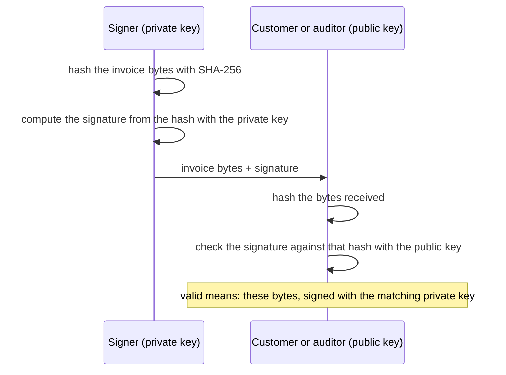

## Before you start

- [[backend.l4.threat-modeling]] — tampering and repudiation are two of STRIDE's questions; this lesson answers both for a document.
- [[backend.l2.validating-provider-tokens]] — a public key checks a signature but cannot make one; here it checks a document instead of a token.
- [[devops.l3.signing-images]] — a signature over an image digest ties the image to its signer; here the signed thing is an invoice's bytes.
- [[backend.l1.issuing-a-jwt]] — the stage-1 API signed its tokens with HMAC-SHA256 and one key.

## The situation

It is stage-4, and the team plans to send each customer an invoice when an order is paid. Before anyone builds it, the accountant asks one question. Months from now, a customer shows a file saying order 1 cost 2,140,000 VND, while your records say 2,150,000. The accountant cannot open your database, and the customer has no reason to trust your word over the file.

The repository already has a sample, `InvoiceSigning`, that signs an invoice, though Đơn Hàng issues none yet.

How can someone outside Đơn Hàng check, on their own, that an invoice is exactly the one Đơn Hàng issued?

## Core concepts

- hash — a short value of fixed size computed from any number of bytes; for a hash such as SHA-256 it is not feasible to find two different byte sequences with the same value, so in practice changing the bytes changes the value. SHA-256 is the hash the sample uses.
- private key — the secret half of a key pair, the only part that can make a signature that the matching public key accepts.
- **digital signature** — a value computed from a hash of a document with a private key; anyone with the matching public key can check that the document is unchanged and was signed with that key.
- **non-repudiation** — the property that the signer cannot credibly deny having signed, which holds only while the private key is held by the signer alone.

## How it works



In the situation above, the accountant needs a check that works without your database and without your word. A digital signature gives that. The signer hashes the invoice's bytes with SHA-256 and computes the signature from that hash with the private key, then sends the bytes and the signature.

The verifier hashes the bytes it received and checks the signature against that hash with the public key. If one byte of the invoice changed, the hash is, in practice, different and the check fails. If the signature was made with a different private key, the check fails too. A valid check says two things: these are the bytes that were signed, and they were signed with the private key that matches this public key.

Compare stage-1. The API signed tokens with HMAC-SHA256 and one key that both makes and checks signatures. Whoever holds that key to check a token can also make tokens, so only the API could check them. A private-key signature splits the two jobs. The public key can go to a customer or an auditor, and neither can sign with it. The check assumes the verifier holds Đơn Hàng's real public key; how they can tell the key is Đơn Hàng's is the next lesson.

Non-repudiation comes from the same split. If only Đơn Hàng holds the private key, Đơn Hàng cannot credibly deny a valid signature later. If the key has been copied, anyone with the copy could have signed, and the signature no longer points at one signer.

A signature does not hide the invoice. The bytes travel as they are, and anyone who has them can read them.

## In the Đơn Hàng system

The sample makes the bytes, signs them and checks them:

```csharp file=samples/DonHang.Samples/Samples/Security/InvoiceSigning.cs tag=stage-4 lines=23-45
    // The bytes that get signed. They are made once and kept with the
    // signature: serialising the invoice again later may not give the same
    // bytes, and the signature covers these exact ones.
    public static byte[] ToBytes(Invoice invoice) => JsonSerializer.SerializeToUtf8Bytes(invoice, JsonSerializerOptions.Web);

    // A key pair made in memory, for the lab only: where the real key lives
    // and who may use it is ADR 0015 (an HSM only Payments can call).
    public static ECDsa NewKey() => ECDsa.Create(ECCurve.NamedCurves.nistP256);

    // lesson: backend.l4.signing-documents
    // lesson: backend.l4.signing-key-custody
    // Signing needs the private key: ECDsa over the SHA-256 hash of the bytes.
    // Checking needs only the public key, exported as SubjectPublicKeyInfo,
    // the form a certificate carries; the key that checks cannot sign.
    public static byte[] Sign(byte[] invoiceBytes, ECDsa privateKey) =>
        privateKey.SignData(invoiceBytes, HashAlgorithmName.SHA256);

    public static bool Verify(byte[] invoiceBytes, byte[] signature, byte[] publicKey)
    {
        using var key = ECDsa.Create();
        key.ImportSubjectPublicKeyInfo(publicKey, out _);
        return key.VerifyData(invoiceBytes, signature, HashAlgorithmName.SHA256);
    }
```

`ECDsa` is the .NET class that holds a private and public key pair and makes and checks this kind of signature; how it computes one is not needed here. Look at `ToBytes` first. The invoice is turned into JSON bytes once, and those bytes are what gets signed and what should be kept with the signature. A signature covers exact bytes. If you kept only the `Invoice` object and serialised it again later, a changed setting such as indentation would give different bytes for the same invoice, and the check would fail although nothing in the invoice changed.

`Sign` calls `SignData` with the private key and `HashAlgorithmName.SHA256`, which hashes the bytes and signs the hash in one call. `Verify` never sees the private key: it builds a key from the exported public key with `ImportSubjectPublicKeyInfo` and returns what `VerifyData` answers, `true` or `false`. `NewKey` makes the key pair in memory, which the comment marks as lab-only. Where the real key would live is what the comment's ADR 0015 and its acronym name; that is a later lesson, and you do not need either here.

One of the sample's tests:

```csharp file=samples/DonHang.Samples.Tests/InvoiceSigningTests.cs tag=stage-4 lines=24-34
    [Fact]
    public void Signature_FailsWhenAnAmountChanges()
    {
        using var key = InvoiceSigning.NewKey();
        var signature = InvoiceSigning.Sign(InvoiceBytes, key);

        var changed = Encoding.UTF8.GetBytes(Encoding.UTF8.GetString(InvoiceBytes).Replace("2150000", "2150001"));

        Assert.NotEqual(InvoiceBytes, changed);
        Assert.False(InvoiceSigning.Verify(changed, signature, key.ExportSubjectPublicKeyInfo()));
    }
```

`InvoiceBytes`, defined above the excerpt, holds the bytes of order 1, the same order as in the situation, with a total of 2,150,000 VND. The test changes the total by one dong in those bytes and keeps the old signature, and `Verify` returns `false`. The test above the excerpt checks that the unchanged bytes verify with the public key alone; the one below it checks that a public key from another pair fails. Notice the edit is plain text replacement: the signed bytes were readable all along.

## Trade-offs

| How the invoice is backed | Who can check it later | Who can make a fake that passes | What must stay protected |
|---|---|---|---|
| A row in Đơn Hàng's database, sent over HTTPS | only someone who asks Đơn Hàng and trusts the answer | whoever can write that row | the database |
| HMAC with one shared key, as the stage-1 tokens | anyone given the key | anyone given the key | one key, copied to every checker |
| A private-key signature (the sample) | anyone with the public key | only the holder of the private key | the private key; the public key can be shared |

The first row is cheapest and enough while nobody outside needs to check. The second row lets others check, but every checker could also have made the invoice, so it proves nothing between them. The third row costs a key pair to manage and the discipline of keeping the signed bytes, and it is the only one that gives an outsider a check of their own.

## What would you choose if…

…invoices are only ever shown in Đơn Hàng's own pages to the customer who placed the order? The database row is enough: everyone who reads the invoice already trusts Đơn Hàng's answer, so a signature adds a key to protect and no new check.

…the accountant asks for an old invoice again? Hand over the stored signed bytes and their signature, not a new serialisation of the order from the database. Only the stored bytes are guaranteed to match the signature.

…two internal services need to check values only they exchange? A shared key can be simpler when every checker is also trusted to sign. It stops being enough the moment one checker must not be able to sign.

## Seniors often assume…

- **"Signing a document encrypts it, so only the receiver can read it."** → Actually the signature is computed next to the bytes, which stay exactly as they were, because the verifier needs those bytes as they are to hash them. A signature hides nothing. You notice this when the test above edits the signed invoice with a plain `Replace` on its text.
- **"A valid signature proves that what the invoice says is true."** → Actually it proves only that the bytes have not changed since they were signed with that key. If the signer put a wrong price in the invoice, the signature over that wrong price is just as valid. You notice this when an invoice with a typo verifies as well as a correct one, and the fix is a new invoice, not a different check.
- **"Sending the invoice over HTTPS already proves later who issued it."** → Actually TLS protects the bytes while they travel on one connection, not after. Once the customer saves the file, nothing in it shows where it came from or whether it was edited. You notice this when a customer forwards an invoice by email and the accountant has nothing to check it against except your database.

## Try it (3 minutes)

In the root folder of the example repository at tag `stage-4`, with the .NET SDK installed:

1. Run `dotnet test samples/DonHang.Samples.Tests --filter InvoiceSigningTests`.
2. In `samples/DonHang.Samples.Tests/InvoiceSigningTests.cs`, in `Signature_FailsWhenAnAmountChanges`, change `Replace("2150000", "2150001")` to `Replace("450000", "450001")`, which changes a unit price instead of the total. Run the same command again, then undo your change.

Expected result: all six tests pass both times; the class has more tests than the three described above. The changed price still makes `Verify` return `false`, so the test still passes.

Then decide: the total in the changed bytes still reads `2150000`, so why does the check fail?

<details><summary>Suggested answer</summary>

The signature is over a hash of the whole byte array, not over the total. It does not know which bytes are a price and which are a name; any changed byte gives, in practice, a different hash, and the old signature no longer matches it.

</details>

## Connections

- [[backend.l2.validating-provider-tokens]] — the same public-key check, applied to tokens instead of documents.
- [[backend.l4.pki-and-signing]] — the next step: this lesson proves which key signed, that one ties the key to a name.
- [[backend.l4.signing-key-custody]] — where the private key lives, the condition non-repudiation depends on.
- [[devops.l3.build-provenance]] — the same signature idea applied to a statement about how an image was built.
- [[backend.l1.hashing-passwords]] — a hash used alone; here the hash is what the private key signs.

## Five-line summary

1. A digital signature lets anyone with the public key check that a document is unchanged and was signed with the matching private key.
2. Stage-1's HMAC key both made and checked signatures, so only the API could check; a public key checks but cannot sign.
3. Non-repudiation holds only while the signer alone holds the private key.
4. `InvoiceSigning` signs invoice bytes with `ECDsa` over SHA-256 and verifies them with the public key alone; the signed bytes are the ones to keep.
5. A signature hides nothing: anyone can read the invoice, and the signature only shows it is unchanged since signing.
