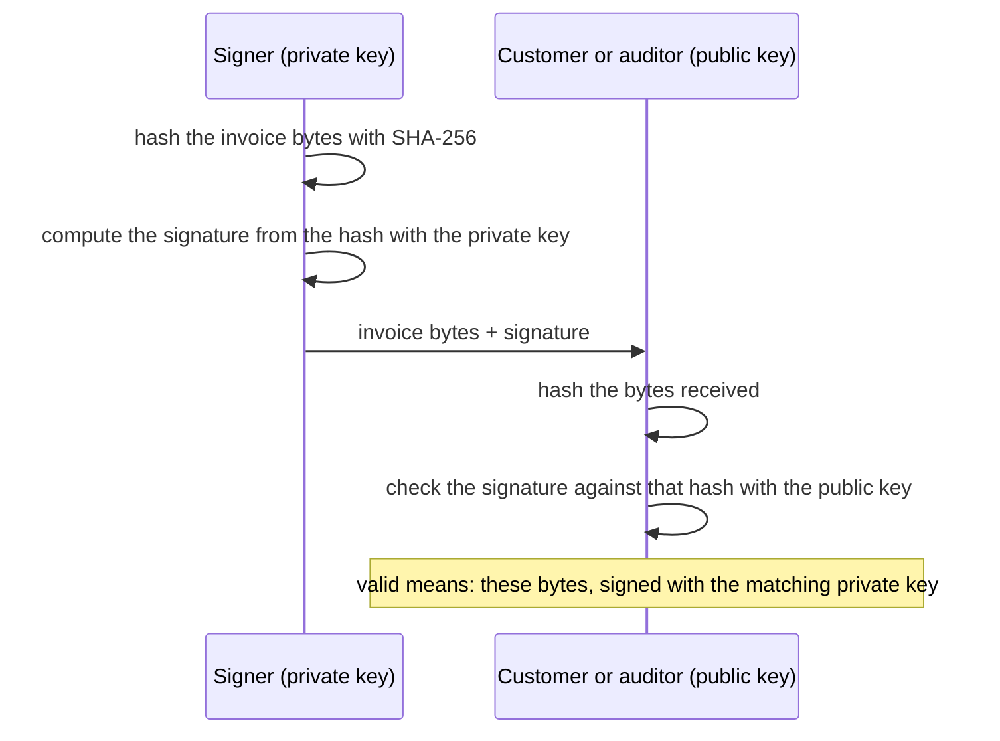

## Bạn cần biết trước

- [[backend.l4.threat-modeling]] — sửa đổi và chối bỏ là hai câu hỏi của STRIDE. Bài này trả lời cả hai cho một tài liệu.
- [[backend.l2.validating-provider-tokens]] — public key kiểm được chữ ký nhưng không tạo được chữ ký. Ở đây nó kiểm một tài liệu thay vì một token.
- [[devops.l3.signing-images]] — chữ ký trên image digest gắn image với người ký. Ở đây thứ được ký là các byte của một hóa đơn.
- [[backend.l1.issuing-a-jwt]] — API ở stage-1 ký token bằng HMAC-SHA256 với một khóa duy nhất.

## Tình huống

Đang ở stage-4, và đội định gửi cho mỗi khách hàng một hóa đơn khi đơn hàng được thanh toán. Trước khi ai bắt tay xây, kế toán hỏi một câu. Vài tháng nữa, một khách hàng đưa ra một file ghi đơn hàng 1 giá 2.140.000 VND, trong khi dữ liệu của bạn ghi 2.150.000. Kế toán không mở được database của bạn, còn khách hàng chẳng có lý do gì để tin lời bạn hơn tin file đó.

Repo đã có sẵn một sample, `InvoiceSigning`, ký một hóa đơn, dù Đơn Hàng chưa phát hành hóa đơn nào.

Làm sao để một người bên ngoài Đơn Hàng tự mình kiểm được rằng một hóa đơn đúng là hóa đơn Đơn Hàng đã phát hành, không sai một chữ?

## Khái niệm cốt lõi

- hash — một giá trị ngắn, kích thước cố định, tính từ một dãy byte dài bao nhiêu cũng được. Với hash như SHA-256, không khả thi để tìm ra hai dãy byte khác nhau cho cùng một giá trị, nên trên thực tế đổi byte là đổi giá trị. SHA-256 là hash mà sample dùng.
- private key — nửa bí mật của một cặp khóa, phần duy nhất tạo được chữ ký mà public key tương ứng chấp nhận.
- **chữ ký số** (digital signature) — một giá trị tính từ hash của tài liệu bằng private key. Ai có public key tương ứng cũng kiểm được rằng tài liệu chưa bị đổi và đã được ký bằng khóa đó.
- **chống chối bỏ** (non-repudiation) — tính chất người ký không thể chối là mình đã ký mà vẫn còn được tin. Nó chỉ đúng khi private key chỉ một mình người ký giữ.

## Cơ chế hoạt động



Trong tình huống trên, kế toán cần một phép kiểm không dựa vào database của bạn, cũng không dựa vào lời bạn. Chữ ký số cho đúng điều đó. Bên ký hash các byte của hóa đơn bằng SHA-256, tính chữ ký từ hash đó bằng private key, rồi gửi đi cả các byte lẫn chữ ký.

Bên kiểm hash các byte nhận được và đối chiếu chữ ký với hash đó bằng public key. Nếu hóa đơn đổi dù chỉ một byte, trên thực tế hash sẽ khác và phép kiểm thất bại. Nếu chữ ký được tạo bằng một private key khác, phép kiểm cũng thất bại. Kiểm hợp lệ nói lên hai điều: đây đúng là các byte đã được ký, và chúng được ký bằng private key khớp với public key này.

So với stage-1. API ký token bằng HMAC-SHA256 với một khóa vừa tạo vừa kiểm chữ ký. Ai giữ khóa đó để kiểm token thì cũng tạo được token, nên chỉ API kiểm được chúng. Chữ ký bằng private key tách hai vai trò ra. Public key có thể đưa cho khách hàng hay kiểm toán viên, và không ai trong họ ký được bằng nó. Phép kiểm giả định bên kiểm đang giữ đúng public key thật của Đơn Hàng. Làm sao họ biết khóa đó là của Đơn Hàng thì để bài sau.

Chống chối bỏ đến từ chính sự tách đó. Nếu chỉ Đơn Hàng giữ private key, về sau Đơn Hàng không thể chối một chữ ký hợp lệ mà vẫn được tin. Nếu khóa đã bị sao chép, ai có bản sao cũng có thể đã ký, và chữ ký không còn chỉ về một người ký duy nhất.

Chữ ký không che giấu hóa đơn. Các byte đi nguyên như cũ, và ai có chúng cũng đọc được.

## Trong hệ thống Đơn Hàng

Sample tạo các byte, ký chúng và kiểm chúng:

```csharp file=samples/DonHang.Samples/Samples/Security/InvoiceSigning.cs tag=stage-4 lines=23-45
    // The bytes that get signed. They are made once and kept with the
    // signature: serialising the invoice again later may not give the same
    // bytes, and the signature covers these exact ones.
    public static byte[] ToBytes(Invoice invoice) => JsonSerializer.SerializeToUtf8Bytes(invoice, JsonSerializerOptions.Web);

    // A key pair made in memory, for the lab only: where the real key lives
    // and who may use it is ADR 0015 (an HSM only Payments can call).
    public static ECDsa NewKey() => ECDsa.Create(ECCurve.NamedCurves.nistP256);

    // lesson: backend.l4.signing-documents
    // lesson: backend.l4.signing-key-custody
    // Signing needs the private key: ECDsa over the SHA-256 hash of the bytes.
    // Checking needs only the public key, exported as SubjectPublicKeyInfo,
    // the form a certificate carries; the key that checks cannot sign.
    public static byte[] Sign(byte[] invoiceBytes, ECDsa privateKey) =>
        privateKey.SignData(invoiceBytes, HashAlgorithmName.SHA256);

    public static bool Verify(byte[] invoiceBytes, byte[] signature, byte[] publicKey)
    {
        using var key = ECDsa.Create();
        key.ImportSubjectPublicKeyInfo(publicKey, out _);
        return key.VerifyData(invoiceBytes, signature, HashAlgorithmName.SHA256);
    }
```

`ECDsa` là class .NET giữ một cặp private key và public key, dùng để tạo và kiểm loại chữ ký này. Ở đây không cần biết nó tính chữ ký ra sao. Hãy xem `ToBytes` trước. Hóa đơn được chuyển thành các byte JSON một lần, và chính các byte đó được ký và cần được giữ cùng chữ ký. Chữ ký phủ đúng từng byte. Nếu bạn chỉ giữ object `Invoice` rồi sau này serialise lại, một thiết lập đã đổi, chẳng hạn thụt lề, sẽ cho ra byte khác cho cùng một hóa đơn, và phép kiểm thất bại dù trong hóa đơn không có gì thay đổi.

`Sign` gọi `SignData` với private key và `HashAlgorithmName.SHA256`, hash các byte rồi ký hash đó trong một lần gọi. `Verify` không bao giờ thấy private key: nó dựng một khóa từ public key đã export bằng `ImportSubjectPublicKeyInfo` và trả về đúng câu trả lời của `VerifyData`, `true` hoặc `false`. `NewKey` tạo cặp khóa trong bộ nhớ, và comment ghi rõ chỉ dùng cho lab. Khóa thật sẽ nằm ở đâu là điều mà ADR 0015 và từ viết tắt trong comment nhắc tới. Đó là chuyện của một bài sau, ở đây bạn không cần đến cả hai.

Một test của sample:

```csharp file=samples/DonHang.Samples.Tests/InvoiceSigningTests.cs tag=stage-4 lines=24-34
    [Fact]
    public void Signature_FailsWhenAnAmountChanges()
    {
        using var key = InvoiceSigning.NewKey();
        var signature = InvoiceSigning.Sign(InvoiceBytes, key);

        var changed = Encoding.UTF8.GetBytes(Encoding.UTF8.GetString(InvoiceBytes).Replace("2150000", "2150001"));

        Assert.NotEqual(InvoiceBytes, changed);
        Assert.False(InvoiceSigning.Verify(changed, signature, key.ExportSubjectPublicKeyInfo()));
    }
```

`InvoiceBytes`, định nghĩa phía trên đoạn trích, chứa các byte của đơn hàng 1, đúng đơn hàng trong tình huống, với tổng tiền 2.150.000 VND. Test đổi tổng tiền thêm một đồng trong các byte đó, giữ nguyên chữ ký cũ, và `Verify` trả về `false`. Test phía trên đoạn trích kiểm rằng các byte chưa đổi kiểm hợp lệ chỉ với public key. Test phía dưới kiểm rằng public key của một cặp khóa khác thì thất bại. Để ý rằng phép sửa chỉ là thay chuỗi văn bản thông thường: các byte đã ký vốn đọc được từ đầu.

## Đánh đổi

| Hóa đơn được bảo chứng bằng gì | Về sau ai kiểm được | Ai làm được bản giả qua được phép kiểm | Thứ phải được bảo vệ |
|---|---|---|---|
| Một dòng trong database của Đơn Hàng, gửi qua HTTPS | chỉ người hỏi Đơn Hàng và tin câu trả lời | ai ghi được vào dòng đó | database |
| HMAC với một khóa dùng chung, như token ở stage-1 | ai được đưa khóa | ai được đưa khóa | một khóa, sao chép tới mọi bên kiểm |
| Chữ ký bằng private key (sample) | ai có public key | chỉ người giữ private key | private key, còn public key thì chia sẻ được |

Dòng thứ nhất rẻ nhất và đủ khi chưa có ai bên ngoài cần kiểm. Dòng thứ hai cho người khác kiểm, nhưng bên kiểm nào cũng có thể đã tự tạo ra hóa đơn, nên giữa họ với nhau nó không chứng minh được gì. Dòng thứ ba tốn một cặp khóa phải quản lý và kỷ luật giữ lại các byte đã ký, và đó là cách duy nhất cho người ngoài một phép kiểm của riêng họ.

## Bạn sẽ chọn gì nếu…

…hóa đơn chỉ hiện trên các trang của chính Đơn Hàng, cho đúng khách hàng đã đặt đơn? Dòng trong database là đủ. Ai đọc hóa đơn cũng đã tin câu trả lời của Đơn Hàng, nên chữ ký chỉ thêm một khóa phải bảo vệ mà không thêm phép kiểm nào mới.

…kế toán xin lại một hóa đơn cũ? Hãy đưa các byte đã ký được lưu lại và chữ ký của chúng, đừng serialise lại đơn hàng từ database. Chỉ các byte đã lưu mới chắc chắn khớp với chữ ký.

…hai service nội bộ cần kiểm những giá trị chỉ chúng trao đổi với nhau? Khóa dùng chung có thể đơn giản hơn khi bên kiểm nào cũng được tin để ký. Nó hết đủ ngay khi có một bên kiểm không được phép ký.

## Senior hay nhầm rằng…

- **"Ký một tài liệu là mã hóa nó, nên chỉ người nhận đọc được."** → Thực ra chữ ký được tính ra và đặt cạnh các byte, còn các byte vẫn y nguyên, vì bên kiểm cần đúng các byte đó để hash. Chữ ký không che giấu gì cả. Bạn sẽ nhận ra khi test ở trên sửa hóa đơn đã ký chỉ bằng một lệnh `Replace` thông thường trên văn bản của nó.
- **"Chữ ký hợp lệ chứng minh nội dung hóa đơn là đúng."** → Thực ra nó chỉ chứng minh các byte chưa đổi kể từ lúc được ký bằng khóa đó. Nếu bên ký ghi sai giá trong hóa đơn, chữ ký trên mức giá sai đó vẫn hợp lệ y như thường. Bạn sẽ nhận ra khi một hóa đơn gõ nhầm kiểm hợp lệ y như một hóa đơn đúng, và cách sửa là một hóa đơn mới chứ không phải một phép kiểm khác.
- **"Gửi hóa đơn qua HTTPS là đủ để về sau chứng minh ai đã phát hành nó."** → Thực ra TLS bảo vệ các byte khi chúng đang đi trên một kết nối, không bảo vệ sau đó. Khi khách hàng đã lưu file, không có gì trong file cho biết nó từ đâu tới hay đã bị sửa chưa. Bạn sẽ nhận ra khi khách hàng chuyển tiếp hóa đơn qua email và kế toán không có gì để đối chiếu ngoài database của bạn.

## Thử ngay (3 phút)

Ở thư mục gốc của repo ví dụ tại tag `stage-4`, khi đã cài .NET SDK:

1. Chạy `dotnet test samples/DonHang.Samples.Tests --filter InvoiceSigningTests`.
2. Trong `samples/DonHang.Samples.Tests/InvoiceSigningTests.cs`, ở `Signature_FailsWhenAnAmountChanges`, đổi `Replace("2150000", "2150001")` thành `Replace("450000", "450001")`, tức đổi một đơn giá thay vì tổng tiền. Chạy lại đúng lệnh đó, rồi hoàn tác thay đổi.

Kết quả mong đợi: cả sáu test đều pass ở cả hai lần. Class có nhiều test hơn ba test đã mô tả ở trên. Đơn giá bị đổi vẫn khiến `Verify` trả về `false`, nên test vẫn pass.

Rồi hãy xác định: tổng tiền trong các byte đã đổi vẫn ghi `2150000`, vậy tại sao phép kiểm thất bại?

<details><summary>Gợi ý đáp án</summary>

Chữ ký phủ hash của toàn bộ mảng byte, không phải chỉ tổng tiền. Nó không biết byte nào là giá, byte nào là tên. Đổi bất kỳ byte nào thì trên thực tế hash cũng khác, và chữ ký cũ không còn khớp với nó nữa.

</details>

## Liên hệ

- [[backend.l2.validating-provider-tokens]] — cùng phép kiểm bằng public key, áp cho token thay vì tài liệu.
- [[backend.l4.pki-and-signing]] — bước tiếp theo: bài này chứng minh khóa nào đã ký, bài đó gắn khóa với một cái tên.
- [[backend.l4.signing-key-custody]] — private key nằm ở đâu, điều kiện mà chống chối bỏ phụ thuộc vào.
- [[devops.l3.build-provenance]] — cùng ý tưởng chữ ký, áp cho một khẳng định về cách image được build.
- [[backend.l1.hashing-passwords]] — hash dùng một mình. Ở đây hash là thứ được private key ký.

## Tóm tắt 5 dòng

1. Chữ ký số cho phép ai có public key cũng kiểm được rằng tài liệu chưa đổi và đã được ký bằng private key tương ứng.
2. Khóa HMAC ở stage-1 vừa tạo vừa kiểm chữ ký, nên chỉ API kiểm được, còn public key kiểm được nhưng không ký được.
3. Chống chối bỏ chỉ đúng khi một mình người ký giữ private key.
4. `InvoiceSigning` ký các byte hóa đơn bằng `ECDsa` trên SHA-256 và kiểm chúng chỉ với public key. Các byte đã ký là thứ cần giữ lại.
5. Chữ ký không che giấu gì: ai cũng đọc được hóa đơn, và chữ ký chỉ cho thấy nó chưa đổi kể từ lúc ký.
