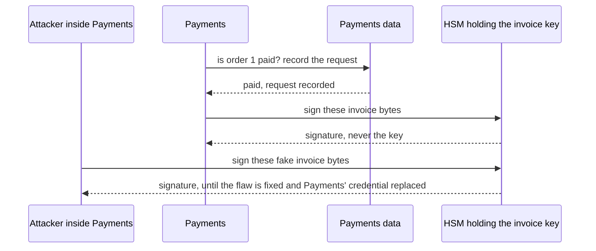

## Before you start

- [[backend.l4.pki-and-signing]] — a certificate ties the invoice public key to Đơn Hàng's name; this lesson asks where the matching private key lives.
- [[backend.l4.shared-credentials]] — whoever takes over a service gets every credential it holds, the blast radius this lesson shrinks for one key.
- [[devops.l3.sealed-secrets]] — a SealedSecret keeps a value safe in Git, and the controller turns it back into a plain Secret in the cluster.
- [[devops.l3.secret-rotation]] — replacing a leaked secret makes the old one useless; this lesson meets a key whose copies cannot be made useless that way.

## The situation

Payments will soon sign the invoice of every paid order. The platform developer proposes putting the invoice private key in a SealedSecret, the way the payment company's API key reaches Payments: a secret value that company issued and can cancel and replace.

Someone finds a flaw in Payments, gets a shell in its Pod for one afternoon, and the team patches it next morning. The API key is easy: the company issues a new one. But a copied invoice key signs exactly like the original, and old invoices still check against the old certificate, so whatever the copy signs checks too.

Where must the key live so that fixing the flaw also ends the forging?

## Core concepts

- copy of a private key — the same bytes as the original, so it signs exactly as the original does; a signature made with a copy cannot be told apart from one the owner made, and nothing records who used it.
- **HSM (hardware security module)** — a device that creates private keys inside itself and signs on request, and can keep a key from ever leaving it, so callers get signatures, never the key.
- signing request — what a permitted caller sends the HSM: the bytes to sign; the HSM checks who is asking, not what the bytes say.
- lab key — the key the sample creates in memory with `InvoiceSigning.NewKey()`, which the ADR allows for the lab only.

## How it works



In the situation above, the trouble with a SealedSecret is where the key ends up. The controller turns it into a Secret, Payments reads it at start, and from then on the key's bytes sit in Payments' memory. Whoever can read that memory, or read that Secret in the cluster, has the key itself. A copy needs nothing else to sign. It keeps signing after the flaw is closed, and no signature shows which copy made it.

With the HSM, the private key is created inside the device and stays there. Payments first checks its data that the order is paid and records the request, then sends invoice bytes and gets a signature back, as in the top half of the diagram. An attacker who takes over Payments can send requests too, the bottom half. But they hold only the ability to ask. Once the flaw is fixed and the credential Payments uses to call the HSM is replaced, the attacker loses the ability to ask and cannot make new signatures with that key. Unlike the key, that credential can be cancelled at its issuer.

The HSM has no way to tell a real invoice from a fake one: it knows who is calling, not which orders are paid, so it signs whatever a permitted caller sends (ADR `0015`). That is why Payments checks first. The check stops a bug or a wrong message from getting a fake invoice signed. It does not stop an attacker who controls Payments and skips it. What the HSM limits is how long the forging can last, not whether it can start.

## In the Đơn Hàng system

ADR `0015` records the choice. Its options and decision:

```markdown file=docs/adr/0015-khoa-ky-hoa-don-trong-hsm.md tag=stage-4 lines=23-41
### Các phương án

- Khóa trong một SealedSecret mà Payments đọc lúc khởi động: không thêm thành
  phần nào, cùng cách giữ khóa API của cổng (ADR 0006). Nhưng khóa nằm trong
  bộ nhớ của Payments; ai chiếm được Payments, hay đọc được Secret trong
  cluster, chép được khóa và ký tiếp sau khi lỗ hổng đã được vá.
- Khóa trong một HSM chỉ Payments được gọi: HSM tạo khóa bên trong nó, ký khi
  được yêu cầu, và không cho khóa ra ngoài. Payments nhận chữ ký, không bao giờ
  nhận khóa. Thêm một thành phần phải vận hành hoặc thuê.

### Quyết định

Chọn HSM. Kẻ chiếm được Payments chỉ xin được chữ ký trong lúc còn chiếm,
không mang khóa đi được; sau khi vá, không chữ ký mới nào được tạo bằng khóa
đó.

HSM ký mọi thứ một bên được phép gửi tới, nên Payments tự giới hạn những gì
nó xin ký: chỉ hóa đơn của đơn mà Payments ghi là đã thanh toán, và mỗi lần
xin ký được ghi vào nhật ký kiểm toán (`docs/design/audit-log.md`).
```

The first option is the platform developer's: a SealedSecret, no new component, like the payment company's API key under ADR `0006`. Its weakness: whoever takes over Payments or reads the Secret copies the key and keeps signing after the fix. The second is an HSM only Payments may call, at the price of one more component to run or rent. The decision picks the HSM and adds Payments' own limit: sign only invoices of paid orders, and record every request.

The sample shows what the ADR rules out in production:

```csharp file=samples/DonHang.Samples/Samples/Security/InvoiceSigning.cs tag=stage-4 lines=28-38
    // A key pair made in memory, for the lab only: where the real key lives
    // and who may use it is ADR 0015 (an HSM only Payments can call).
    public static ECDsa NewKey() => ECDsa.Create(ECCurve.NamedCurves.nistP256);

    // lesson: backend.l4.signing-documents
    // lesson: backend.l4.signing-key-custody
    // Signing needs the private key: ECDsa over the SHA-256 hash of the bytes.
    // Checking needs only the public key, exported as SubjectPublicKeyInfo,
    // the form a certificate carries; the key that checks cannot sign.
    public static byte[] Sign(byte[] invoiceBytes, ECDsa privateKey) =>
        privateKey.SignData(invoiceBytes, HashAlgorithmName.SHA256);
```

`ECDsa` is .NET's object holding the key pair. `NewKey()` creates it in the process's memory, and `Sign` takes that private key as an argument: code that has the key in hand, which is exactly what the HSM option avoids. SHA-256 is the hash function used, and SubjectPublicKeyInfo is the format a certificate stores a public key in; neither matters for where the key lives.

The rest of the ADR, not quoted here, lists consequences, replies to comments and reasons to revisit it. No invoice key sits in the repository, in a Secret or in a service's memory. The key cannot be exported, so losing the HSM loses the key: Đơn Hàng would create a new key and get a new certificate, and invoices already signed still check with the old certificate.

Where the HSM runs, Đơn Hàng's own hardware or the hosting provider's service, follows from where the system runs; ADR `0023` makes that choice. At stage-4 there are no invoices and no HSM yet, only the sample and this ADR.

## Trade-offs

| Where the invoice key is kept | Where the key is while Payments signs | What taking over Payments gives | After the flaw is fixed | What it adds |
|---|---|---|---|---|
| A key file with a password | Payments' memory, unlocked with a password Payments also holds | the key and its password | the copy keeps signing | nothing |
| A SealedSecret Payments reads at start | Payments' memory, and a Secret in the cluster | the key | the copy keeps signing | nothing; the same path as the payment company's API key |
| An HSM only Payments may call | inside the HSM | the ability to ask for signatures | no new signatures for the attacker, once Payments' credential for the HSM is replaced | a component to run or rent; a lost HSM means a new key and certificate |

The first two rows differ less than they look: in both, Payments must hold the usable key to sign. Only the third row changes what an attacker can carry away.

## What would you choose if…

…the secret is a key you can cancel at its issuer, such as the payment company's API key? A SealedSecret can be enough. After a leak the company issues a new key and the old one stops working, the reply recorded under "Ý kiến đã nhận" in ADR `0015`.

…the key signs documents that outsiders check for years, without asking Đơn Hàng? An HSM, because a signature made with a stolen copy is indistinguishable from a real one for as long as the certificate is trusted.

…a second service also wants to sign? Revisit the ADR before granting it access: every permitted caller widens what the HSM will sign. ADR `0015` names this, and an outside party demanding its own certificate, as reasons to revisit it.

## Seniors often assume…

- **"A key file protected by a password is as safe as an HSM."** → Actually the service must unlock the key to sign, so the password lives in its configuration, such as a Secret, and the unlocked key lives in its memory. Taking over the service yields both. You notice this when the threat model's entry for the key file lists the same readers as the Secret that holds its password.
- **"With the key in an HSM, nobody can ever get a fake invoice signed."** → Actually the HSM signs whatever a permitted caller sends, because it checks the caller, not the invoice. Payments' own rule, only invoices of paid orders, is what blocks fakes, and an attacker inside Payments can skip it. You notice this when a signed invoice turns up for an order that Payments' data never marked as paid, with no recorded signing request behind it.
- **"An HSM is just hardware that makes cryptography faster."** → Actually its point here is custody: it creates the key inside itself and can keep it from leaving. ADR `0015` chooses it to limit an attacker to the time they can ask as Payments, and says nothing about speed. You notice this when the ADR's cost line names one more component to run or rent, and says nothing about faster signing.

## Try it (3 minutes)

In the root folder of the example repository at tag `stage-4`:

1. Run `git grep -n "NewKey()"` (it searches every file Git tracks for that text and prints file:line for each match).
2. Read which folders the matches come from.

Expected result: one match in `samples/DonHang.Samples/Samples/Security/InvoiceSigning.cs`, where it is defined, and seven in `samples/DonHang.Samples.Tests/InvoiceSigningTests.cs`. Nothing under `DonHang.Payments`. So the lab key exists only in the sample and its tests; no production code holds a key in memory.

Then decide: with the HSM in place, an attacker held a shell in the Payments Pod from 13:00 to 17:00 one day, and the flaw was fixed that evening. Which signed invoices can you no longer trust, and which question can you not yet answer?

<details><summary>Suggested answer</summary>

Invoices signed after the fix and the credential change are fine. Invoices signed between 13:00 and 17:00 are suspect: compare Payments' recorded signing requests with the orders its data marks as paid. The open question is whether the attacker also changed those records; a record they could rewrite proves nothing. With the key in a SealedSecret instead, every invoice carrying that key's signature would be suspect, whatever date it shows, including ones made in the future, because a copy can sign an invoice with any date.

</details>

## Connections

- [[backend.l4.pki-and-signing]] — the step before: a certificate makes the key Đơn Hàng's; this lesson keeps anyone else from holding it.
- [[backend.l4.audit-log]] — the next question: the record of signing requests helps only if an attacker in Payments cannot rewrite it.
- [[backend.l3.payments-service]] — why Payments is the one caller: it alone owns the payment records that say an order is paid.
- [[k8s.l3.encryption-at-rest]] — protects Secrets inside etcd, but anyone RBAC allows still reads the value; an HSM never hands the key to anyone.
- [[management.l3.weighing-options-in-an-adr]] — ADR `0015` follows the same form: two options judged against one attack, with the chosen one's cost named.

## Five-line summary

1. A signing key a service can read can be copied, so keep it in an HSM that signs and never hands it out.
2. A copy signs exactly like the original and keeps signing after the flaw that leaked it is fixed.
3. ADR `0015` rejects a SealedSecret for the invoice key and chooses an HSM only Payments may call.
4. The HSM signs whatever Payments sends, so Payments asks only for invoices of paid orders and records each request.
5. Where the HSM runs is the hosting decision's; the in-memory key in `InvoiceSigning` is for the lab only.
