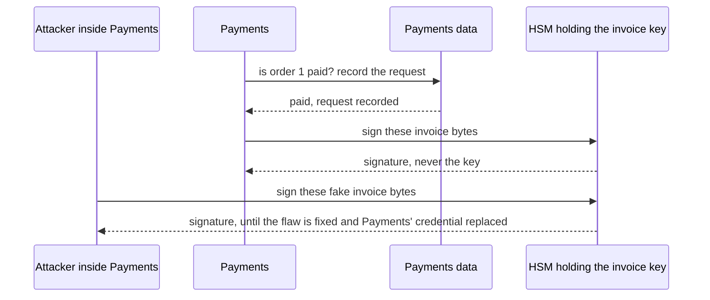

## Bạn cần biết trước

- [[backend.l4.pki-and-signing]] — chứng chỉ gắn public key của hóa đơn với tên Đơn Hàng. Bài này hỏi private key tương ứng nằm ở đâu.
- [[backend.l4.shared-credentials]] — ai chiếm được một service thì có mọi thông tin đăng nhập nó giữ. Đó là phạm vi ảnh hưởng mà bài này thu hẹp cho một khóa.
- [[devops.l3.sealed-secrets]] — SealedSecret giữ an toàn một giá trị trong Git, rồi controller biến nó trở lại thành một Secret bình thường trong cluster.
- [[devops.l3.secret-rotation]] — thay một secret bị lộ thì secret cũ hết dùng được. Bài này gặp một khóa mà các bản sao không thể bị vô hiệu theo cách đó.

## Tình huống

Sắp tới Payments sẽ ký hóa đơn của mọi đơn hàng đã thanh toán. Developer phụ trách nền tảng đề xuất để private key của hóa đơn trong một SealedSecret, giống cách khóa API của công ty thanh toán tới được Payments: một giá trị bí mật do công ty đó cấp, và họ hủy rồi cấp lại được.

Có người tìm ra một lỗ hổng trong Payments, chiếm được shell trong Pod của nó suốt một buổi chiều, và sáng hôm sau đội vá xong. Khóa API thì dễ: công ty cấp khóa mới. Nhưng một bản sao của khóa hóa đơn ký y hệt bản gốc, và hóa đơn cũ vẫn kiểm theo chứng chỉ cũ, nên bản sao ký gì thì cái đó cũng kiểm hợp lệ.

Khóa phải nằm ở đâu để vá lỗ hổng xong thì cũng chấm dứt được chuyện giả mạo?

## Khái niệm cốt lõi

- bản sao của private key — đúng các byte như bản gốc, nên nó ký y như bản gốc. Chữ ký tạo bằng bản sao không phân biệt được với chữ ký do chủ khóa tạo, và không có gì ghi lại ai đã dùng nó.
- **HSM (hardware security module)** — thiết bị tự tạo private key bên trong nó và ký khi được yêu cầu, có thể không bao giờ cho khóa ra ngoài. Bên gọi nhận chữ ký, không bao giờ nhận khóa.
- yêu cầu ký — thứ một bên được phép gửi tới HSM: các byte cần ký. HSM kiểm ai đang hỏi, không kiểm các byte nói gì.
- khóa lab — khóa mà sample tạo trong bộ nhớ bằng `InvoiceSigning.NewKey()`, và ADR chỉ cho phép dùng trong lab.

## Cơ chế hoạt động



Trong tình huống trên, vấn đề của SealedSecret là khóa rốt cuộc nằm ở đâu. Controller biến nó thành một Secret, Payments đọc Secret lúc khởi động, và từ đó các byte của khóa nằm trong bộ nhớ của Payments. Ai đọc được bộ nhớ đó, hay đọc được Secret đó trong cluster, là có chính khóa. Bản sao không cần gì thêm để ký. Nó vẫn ký tiếp sau khi lỗ hổng đã được vá, và không chữ ký nào cho biết bản sao nào đã tạo ra nó.

Với HSM, private key được tạo bên trong thiết bị và ở luôn trong đó. Payments trước hết kiểm dữ liệu của mình rằng đơn hàng đã thanh toán và ghi lại yêu cầu, rồi gửi các byte hóa đơn và nhận lại chữ ký, như nửa trên của sơ đồ. Kẻ tấn công chiếm được Payments cũng gửi được yêu cầu, như nửa dưới. Nhưng họ chỉ giữ được quyền hỏi. Khi lỗ hổng đã được vá và thông tin đăng nhập mà Payments dùng để gọi HSM đã được thay, kẻ tấn công mất quyền hỏi và không tạo thêm được chữ ký mới nào bằng khóa đó. Khác với khóa, thông tin đăng nhập này hủy được ở nơi đã cấp nó.

HSM không có cách nào phân biệt hóa đơn thật với hóa đơn giả: nó biết ai đang gọi, không biết đơn hàng nào đã thanh toán, nên bên được phép gửi gì nó cũng ký (ADR `0015`). Vì thế Payments phải kiểm trước. Phép kiểm này chặn một bug hay một message sai khiến hóa đơn giả được ký. Nó không chặn được kẻ tấn công đã điều khiển Payments và bỏ qua nó. Thứ HSM giới hạn là chuyện giả mạo kéo dài được bao lâu, không phải chuyện nó có bắt đầu được hay không.

## Trong hệ thống Đơn Hàng

ADR `0015` ghi lại lựa chọn này. Các phương án và quyết định của nó:

```markdown file=docs/adr/0015-khoa-ky-hoa-don-trong-hsm.md tag=stage-4 lines=23-41
### Các phương án

- Khóa trong một SealedSecret mà Payments đọc lúc khởi động: không thêm thành
  phần nào, cùng cách giữ khóa API của cổng (ADR 0006). Nhưng khóa nằm trong
  bộ nhớ của Payments; ai chiếm được Payments, hay đọc được Secret trong
  cluster, chép được khóa và ký tiếp sau khi lỗ hổng đã được vá.
- Khóa trong một HSM chỉ Payments được gọi: HSM tạo khóa bên trong nó, ký khi
  được yêu cầu, và không cho khóa ra ngoài. Payments nhận chữ ký, không bao giờ
  nhận khóa. Thêm một thành phần phải vận hành hoặc thuê.

### Quyết định

Chọn HSM. Kẻ chiếm được Payments chỉ xin được chữ ký trong lúc còn chiếm,
không mang khóa đi được; sau khi vá, không chữ ký mới nào được tạo bằng khóa
đó.

HSM ký mọi thứ một bên được phép gửi tới, nên Payments tự giới hạn những gì
nó xin ký: chỉ hóa đơn của đơn mà Payments ghi là đã thanh toán, và mỗi lần
xin ký được ghi vào nhật ký kiểm toán (`docs/design/audit-log.md`).
```

Phương án thứ nhất là đề xuất của developer phụ trách nền tảng: một SealedSecret, không thêm thành phần nào, giống khóa API của công ty thanh toán theo ADR `0006`. Điểm yếu của nó: ai chiếm được Payments hay đọc được Secret thì chép được khóa và ký tiếp sau khi vá. Phương án thứ hai là một HSM chỉ Payments được gọi, với cái giá là thêm một thành phần phải vận hành hoặc thuê. Quyết định chọn HSM và thêm giới hạn của chính Payments: chỉ ký hóa đơn của đơn đã thanh toán, và ghi lại mọi yêu cầu.

Sample cho thấy đúng điều mà ADR loại trừ ở production:

```csharp file=samples/DonHang.Samples/Samples/Security/InvoiceSigning.cs tag=stage-4 lines=28-38
    // A key pair made in memory, for the lab only: where the real key lives
    // and who may use it is ADR 0015 (an HSM only Payments can call).
    public static ECDsa NewKey() => ECDsa.Create(ECCurve.NamedCurves.nistP256);

    // lesson: backend.l4.signing-documents
    // lesson: backend.l4.signing-key-custody
    // Signing needs the private key: ECDsa over the SHA-256 hash of the bytes.
    // Checking needs only the public key, exported as SubjectPublicKeyInfo,
    // the form a certificate carries; the key that checks cannot sign.
    public static byte[] Sign(byte[] invoiceBytes, ECDsa privateKey) =>
        privateKey.SignData(invoiceBytes, HashAlgorithmName.SHA256);
```

`ECDsa` là object của .NET giữ cặp khóa. `NewKey()` tạo nó trong bộ nhớ của process, còn `Sign` nhận private key đó làm tham số: code cầm khóa trong tay, đúng thứ mà phương án HSM tránh. SHA-256 là hàm hash được dùng, còn SubjectPublicKeyInfo là định dạng chứng chỉ dùng để lưu public key. Cả hai đều không liên quan tới chuyện khóa nằm ở đâu.

Phần còn lại của ADR, không trích ở đây, liệt kê hệ quả, trả lời các ý kiến và lý do để xem xét lại. Không có khóa hóa đơn nào nằm trong repo, trong một Secret hay trong bộ nhớ của một service. Khóa không export được, nên mất HSM là mất khóa: Đơn Hàng sẽ tạo khóa mới và xin chứng chỉ mới, còn các hóa đơn đã ký vẫn kiểm được bằng chứng chỉ cũ.

HSM chạy ở đâu, trên phần cứng của chính Đơn Hàng hay dịch vụ của nhà cung cấp hosting, tùy vào hệ thống chạy ở đâu. ADR `0023` đưa ra lựa chọn đó. Ở stage-4 chưa có hóa đơn và cũng chưa có HSM, chỉ có sample và ADR này.

## Đánh đổi

| Khóa hóa đơn được giữ ở đâu | Khóa nằm ở đâu khi Payments ký | Chiếm được Payments thì có gì | Sau khi vá lỗ hổng | Thêm gì |
|---|---|---|---|---|
| Một file khóa có mật khẩu | bộ nhớ của Payments, mở khóa bằng mật khẩu mà Payments cũng giữ | khóa và mật khẩu của nó | bản sao vẫn ký tiếp | không thêm gì |
| Một SealedSecret mà Payments đọc lúc khởi động | bộ nhớ của Payments, và một Secret trong cluster | khóa | bản sao vẫn ký tiếp | không thêm gì, cùng đường đi với khóa API của công ty thanh toán |
| Một HSM chỉ Payments được gọi | bên trong HSM | quyền xin chữ ký | kẻ tấn công không có chữ ký mới nào, khi thông tin đăng nhập của Payments với HSM đã được thay | một thành phần phải vận hành hoặc thuê, mất HSM nghĩa là khóa mới và chứng chỉ mới |

Hai dòng đầu khác nhau ít hơn vẻ ngoài: ở cả hai, Payments phải giữ khóa dùng được thì mới ký được. Chỉ dòng thứ ba thay đổi thứ mà kẻ tấn công mang đi được.

## Bạn sẽ chọn gì nếu…

…secret là một khóa bạn hủy được ở nơi cấp nó, như khóa API của công ty thanh toán? SealedSecret có thể là đủ. Sau khi lộ, công ty cấp khóa mới và khóa cũ hết dùng được. Đây là câu trả lời được ghi ở mục "Ý kiến đã nhận" trong ADR `0015`.

…khóa ký những tài liệu mà người bên ngoài kiểm trong nhiều năm, không cần hỏi Đơn Hàng? HSM, vì chữ ký tạo bằng bản sao bị đánh cắp không phân biệt được với chữ ký thật chừng nào chứng chỉ còn được tin.

…một service thứ hai cũng muốn ký? Hãy xem xét lại ADR trước khi cấp quyền: mỗi bên được phép gọi thêm vào lại mở rộng những gì HSM sẽ ký. ADR `0015` nêu điều này, cùng chuyện một bên ngoài đòi chứng chỉ riêng, là các lý do để xem xét lại nó.

## Senior hay nhầm rằng…

- **"File khóa có mật khẩu bảo vệ thì an toàn ngang HSM."** → Thực ra service phải mở khóa thì mới ký được, nên mật khẩu nằm trong cấu hình của nó, chẳng hạn một Secret, còn khóa đã mở nằm trong bộ nhớ của nó. Chiếm được service là có cả hai. Bạn sẽ nhận ra khi mục cho file khóa trong mô hình mối đe dọa liệt kê đúng những bên đọc được như Secret giữ mật khẩu của nó.
- **"Khóa đã nằm trong HSM thì không ai có thể khiến một hóa đơn giả được ký."** → Thực ra HSM ký mọi thứ một bên được phép gửi tới, vì nó kiểm bên gọi, không kiểm hóa đơn. Chính quy tắc của Payments, chỉ ký hóa đơn của đơn đã thanh toán, mới chặn được đồ giả, và kẻ tấn công bên trong Payments có thể bỏ qua quy tắc đó. Bạn sẽ nhận ra khi xuất hiện một hóa đơn đã ký cho một đơn hàng mà dữ liệu của Payments chưa bao giờ đánh dấu là đã thanh toán, và đằng sau nó không có yêu cầu ký nào được ghi lại.
- **"HSM chỉ là phần cứng giúp mã hóa nhanh hơn."** → Thực ra ở đây ý nghĩa của nó là giữ khóa: nó tạo khóa bên trong mình và có thể không cho khóa ra ngoài. ADR `0015` chọn nó để giới hạn kẻ tấn công trong khoảng thời gian họ còn hỏi được dưới danh nghĩa Payments, và không nói gì về tốc độ. Bạn sẽ nhận ra khi dòng chi phí của ADR nêu thêm một thành phần phải vận hành hoặc thuê, và không nhắc gì tới ký nhanh hơn.

## Thử ngay (3 phút)

Ở thư mục gốc của repo ví dụ tại tag `stage-4`:

1. Chạy `git grep -n "NewKey()"` (lệnh này tìm chuỗi đó trong mọi file Git theo dõi và in file:dòng cho từng kết quả).
2. Đọc xem các kết quả nằm trong những thư mục nào.

Kết quả mong đợi: một kết quả trong `samples/DonHang.Samples/Samples/Security/InvoiceSigning.cs`, nơi nó được định nghĩa, và bảy kết quả trong `samples/DonHang.Samples.Tests/InvoiceSigningTests.cs`. Không có gì dưới `DonHang.Payments`. Vậy khóa lab chỉ có trong sample và test của nó, không code production nào giữ khóa trong bộ nhớ.

Rồi hãy xác định: khi đã có HSM, một kẻ tấn công giữ shell trong Pod của Payments từ 13:00 tới 17:00 một ngày, và lỗ hổng được vá ngay tối hôm đó. Những hóa đơn đã ký nào bạn không còn tin được nữa, và câu hỏi nào bạn chưa trả lời được?

<details><summary>Gợi ý đáp án</summary>

Hóa đơn ký sau khi vá và sau khi đổi thông tin đăng nhập thì không sao. Hóa đơn ký trong khoảng 13:00 tới 17:00 là đáng ngờ: hãy đối chiếu các yêu cầu ký mà Payments đã ghi lại với các đơn hàng mà dữ liệu của nó đánh dấu là đã thanh toán. Câu hỏi còn bỏ ngỏ là kẻ tấn công có sửa luôn các bản ghi đó không. Một bản ghi mà họ viết lại được thì không chứng minh được gì. Nếu khóa nằm trong SealedSecret, mọi hóa đơn mang chữ ký của khóa đó đều đáng ngờ, dù ghi ngày nào, kể cả những hóa đơn làm ra trong tương lai, vì bản sao ký được hóa đơn với bất kỳ ngày nào.

</details>

## Liên hệ

- [[backend.l4.pki-and-signing]] — bước trước: chứng chỉ làm cho khóa thành của Đơn Hàng, còn bài này giữ cho không ai khác cầm được khóa đó.
- [[backend.l4.audit-log]] — câu hỏi tiếp theo: bản ghi các yêu cầu ký chỉ có ích khi kẻ tấn công bên trong Payments không viết lại được nó.
- [[backend.l3.payments-service]] — vì sao Payments là bên gọi duy nhất: chỉ nó sở hữu các bản ghi thanh toán cho biết đơn hàng đã được thanh toán.
- [[k8s.l3.encryption-at-rest]] — bảo vệ Secret bên trong etcd, nhưng ai được RBAC cho phép vẫn đọc được giá trị. HSM thì không bao giờ trao khóa cho ai.
- [[management.l3.weighing-options-in-an-adr]] — ADR `0015` theo đúng hình thức đó: hai phương án được cân nhắc trước cùng một kiểu tấn công, kèm cái giá của phương án được chọn.

## Tóm tắt 5 dòng

1. Khóa ký mà service đọc được thì có thể bị sao chép, nên hãy giữ nó trong một HSM chỉ ký và không bao giờ trao khóa ra ngoài.
2. Bản sao ký y như bản gốc và vẫn ký tiếp sau khi lỗ hổng làm lộ nó đã được vá.
3. ADR `0015` loại SealedSecret cho khóa hóa đơn và chọn một HSM chỉ Payments được gọi.
4. HSM ký mọi thứ Payments gửi tới, nên Payments chỉ xin ký hóa đơn của đơn đã thanh toán và ghi lại từng yêu cầu.
5. HSM chạy ở đâu thuộc về quyết định hosting. Khóa trong bộ nhớ ở `InvoiceSigning` chỉ dùng cho lab.
