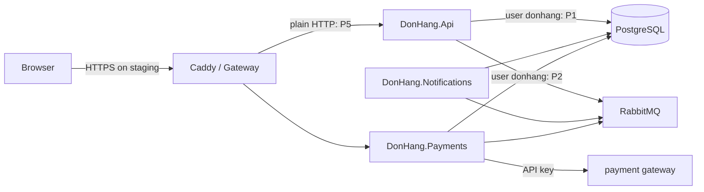

## Before you start

- [[backend.l4.data-ownership]] — each kind of data has one owner, such as Payments with `donhang_payments`.
- [[design.l4.architecture-review-findings]] — a review ends in risks tied to decisions, each with an owner and a next step.
- [[k8s.l3.network-policies]] — staging isolates every Pod in `donhang`, then opens each service only to its callers.
- [[backend.l3.payments-service]] — only `payments` holds the payment gateway's address and key.

## The situation

It is early in stage-4, before `docs/design/threat-model.md` exists, and the team is about to start the multi-shop rollout. In a meeting, a teammate says security is covered: staging serves the browser over HTTPS, every service checks tokens, and a penetration test is booked before launch.

Later you open `docker-compose.yml` and notice that the API, Notifications and Payments all connect to PostgreSQL with `Username=donhang`. If someone took over Notifications, that password would open `donhang_payments` too. No document mentions it, so nobody has decided whether it is acceptable.

How do you find, before an attacker does, each place where Đơn Hàng's security could fail, and make sure each one gets a decision?

## Core concepts

- **threat model** — a written list of what could go wrong with a system's security, where in its data flow it could happen, and what is done about each case, made before an attacker finds the gaps.
- data flow — the path data takes between the parts of a system, such as the "Data flow" diagram in `STAGE.md`.
- **trust boundary** — a place in the data flow where data passes between parts that trust each other to different degrees, such as browser to Gateway, a service to PostgreSQL, or Payments to the payment gateway.
- **STRIDE** — the checklist `threat-model.md` uses, six kinds of threat to ask about at each boundary: spoofing (pretending to be someone else), tampering (changing data), repudiation (denying an action when nothing proves it), information disclosure (reading what you should not), denial of service (making a part unavailable) and elevation of privilege (gaining rights you were not given).
- control and finding — a control is something already in place that answers a threat, such as a token check; a finding is a threat no control answers yet, recorded with an owner and one decision: fix it, accept it with a reason, or defer it to a named plan.
- penetration test — a team attacking the running system on purpose to find holes in it.

## How it works



Start from the data flow, not from a list of attacks. The diagram starts from the one in `STAGE.md`, adds the staging Gateway, and marks the findings `P1`, `P2` and `P5` of `threat-model.md`, shown in the next section. In Compose the reverse proxy in front is Caddy; on staging it is the Gateway, which runs Traefik.

Next, mark the trust boundaries. In the situation above, the arrow from each service to PostgreSQL is one: the database accepts whoever presents the user and password, and every service holds that password. The arrows to RabbitMQ have the same shape. Browser to Gateway is another, because anyone who can reach the address can send a request. Payments to the payment gateway is a third, because the gateway sits outside Đơn Hàng.

At each boundary, ask the six STRIDE questions in turn: could someone pretend to be the caller, change the data, deny having done it, read what they should not, stop the other side, or gain rights they were not given?

For each threat, write down the control that already answers it, or a finding. At the browser boundary, spoofing is answered: the services check every token. At the database boundary, information disclosure is not, because every service signs in as `donhang`, so it becomes a finding with an owner and one decision.

Finally, the model is reviewed every time the data flow changes, because a new arrow can cross a new boundary.

## In the Đơn Hàng system

`threat-model.md` walks the stage-3 data flow boundary by boundary. Here are the first three boundaries:

```markdown file=docs/design/threat-model.md tag=stage-4 lines=11-33
### Trình duyệt → Caddy / Gateway

| STRIDE | Mối đe dọa | Biện pháp hoặc phát hiện |
|---|---|---|
| S | Gọi API bằng token giả hay token của người khác | API và Payments tự kiểm chữ ký, issuer, audience, hạn của mọi token (`AddJwtBearer`); Caddy và Gateway không kiểm token |
| T, I | Đọc hay sửa request trên đường truyền | Staging: HTTPS ở Gateway (chứng chỉ của lab CA). Compose: HTTP thường, chỉ trên máy dev |
| D | Một khách hay một trang gửi quá nhiều request | Giới hạn `orders` (theo `sub`) và `catalog-reads` (số đọc đồng thời) trong `Program.cs`, giữ nguyên |
| E | Khách gọi việc của nhân viên | Policy `StaffOnly` đọc role `staff` trong token; `OrderOwner` chỉ cho xem đơn của chính mình |

### Gateway → API, Payments

| STRIDE | Mối đe dọa | Biện pháp hoặc phát hiện |
|---|---|---|
| S | Pod khác gọi thẳng API, bỏ qua Gateway | NetworkPolicy `from-the-gateway`: chỉ Pod của Traefik tới được api và Payments; hai service vẫn kiểm mọi token |
| T, I | Đọc hay sửa request trong cluster | P5 |

### Service → PostgreSQL

| STRIDE | Mối đe dọa | Biện pháp hoặc phát hiện |
|---|---|---|
| I, E | Một service bị chiếm đọc database của service khác | P1 |
| T, R | Service sửa lại dòng ghi ai đã yêu cầu gì | P4 |
| S | Pod lạ kết nối database | NetworkPolicy `db`: chỉ các service, migration và job backup |
```

The document is in Vietnamese by design. Each heading is one trust boundary, and each row gives STRIDE letters, the threat, and either the control or a finding number. In the browser boundary's S row, the API and Payments check each token themselves with `AddJwtBearer`: its signature, issuer (who issued it, Keycloak), audience (which API it is meant for) and expiry. Caddy and the Gateway check no token. The T, I row answers reading or changing a request on the way: on staging the Gateway serves HTTPS with a certificate the lab issues itself, while in Compose the app's requests reach Caddy over plain HTTP, on a developer's machine. The D and E rows keep existing controls: request limits in `Program.cs`, `orders` per customer (`sub`, the user id claim in the token), and the policies `StaffOnly` and `OrderOwner`.

Under Gateway → API, Payments, the S row answers a Pod that calls the API directly: the NetworkPolicy `from-the-gateway` lets only Pods in the namespace `traefik`, where Traefik runs, reach the api and Payments, which still check every token. The T, I row has no control, only `P5`. Under Service → PostgreSQL, only the S row has a control, the NetworkPolicy `db`.

The findings sit together at the end, followed by when to look again:

```markdown file=docs/design/threat-model.md tag=stage-4 lines=64-81
### Phát hiện và quyết định

| Số | Phát hiện | Quyết định | Người phụ trách |
|---|---|---|---|
| P1 | API, Notifications và Payments cùng vào PostgreSQL bằng `donhang`, superuser do image `db` tạo từ `POSTGRES_USER`; với thông tin đó mở được mọi database trên server, và trong Compose cả database `keycloak` (Keycloak cũng dùng `donhang`) | Hoãn: role riêng cho mỗi service, chỉ có quyền trên database của nó, làm ở release 3 của `multi-shop-data-rollout.md` | Lập trình viên backend |
| P2 | Ba service vào RabbitMQ bằng `donhang`, user mặc định của broker, được configure, write, read trên mọi thứ của vhost `/` | Hoãn: user riêng cho mỗi service, cùng release 3 | Lập trình viên backend |
| P3 | `customers.email` không có dấu đã xác minh; email đơn hàng gửi tới địa chỉ đó | Sửa theo ADR 0014 (Keycloak giữ email khách) | Trưởng nhóm |
| P4 | `requested_by` của dòng hoàn tiền và `order_status_history` do chính service ghi, sửa được bằng service đó và bằng user chung `donhang`; sửa không để lại dấu vết | Hoãn: nhật ký kiểm toán theo `audit-log.md` | Lập trình viên backend |
| P5 | Gateway gọi các Pod api và Payments bằng HTTP thường: NetworkPolicy quyết ai được kết nối, nhưng dữ liệu đi qua mạng giữa các node không mã hóa, và api chỉ biết bên gọi qua địa chỉ của nó | Chấp nhận: một cluster, một đội, NetworkPolicy đã giới hạn bên gọi. Mã hóa và xác minh bên gọi trong cluster: chưa làm theo ADR 0021, điều kiện mở lại ở đó | Lập trình viên phụ trách nền tảng |
| P6 | Hóa đơn ký số (kế hoạch) cần một khóa riêng mà chỉ Đơn Hàng ký được | Quyết ở ADR 0015 (khóa trong HSM) | Trưởng nhóm |

### Khi nào xem lại

Mỗi khi luồng dữ liệu đổi: thêm service, thêm ranh giới, thêm bên ngoài.
Lần đổi đã biết là đưa `shop_id` vào (ADR 0013): nó thêm mối đe dọa một cửa
hàng đọc dữ liệu của cửa hàng khác, được trả lời bằng row-level security đứng
sau bộ lọc cửa hàng trong code. P1 và P2 được sửa trong cùng release 3, vì
release đó vốn đã chuyển service sang role không có `BYPASSRLS`.
```

`P1` is the situation. In PostgreSQL a role is the account a service signs in as, with its own permissions; `donhang` is one. The API, Notifications and Payments all sign in as `donhang`, a superuser, a PostgreSQL user that skips every permission check. The `db` image creates it from `POSTGRES_USER`, so it opens every database on the server, in Compose even `keycloak`.

`P2` is the same shape in RabbitMQ: all three use `donhang`, the broker's default user, with configure, write and read permissions on everything in the virtual host `/`. A virtual host is a named space in RabbitMQ with its own exchanges and queues; `/` is the default one, and Đơn Hàng's connection code names no other. Both findings are deferred to release 3 of `multi-shop-data-rollout.md`, which gives each service its own user.

`P4` is tampering and repudiation: `requested_by` on a refund row, and `order_status_history`, are written by the service itself, which can rewrite them, as can anyone holding `donhang`, and no trace remains. It is deferred to the design in `audit-log.md`. `P5` is accepted with a reason: one cluster, one team, and NetworkPolicy already limits the callers. `P3`, order emails sent to an address nobody verified, is fixed by ADR `0014`, which lets Keycloak hold customers' emails. `P6`, a planned key for signing invoices, is decided in ADR `0015`, the subject of a later lesson.

The last paragraph says to look again whenever the data flow changes. Adding `shop_id` under ADR `0013` adds the threat of one shop reading another's data. The shop filter in code answers it, with row-level security in the database as a second check if the code misses it. `P1` and `P2` are fixed in the same release 3, because it already moves the services to roles without `BYPASSRLS`, the attribute that lets a role skip row-level security.

## Trade-offs

| Decision for a finding | What stays open | Fits when | In `threat-model.md` |
|---|---|---|---|
| Fix | nothing, until the data flow changes | the threat is likely or costly and the fix is affordable now | `P3` |
| Accept with a reason | the threat, on purpose | the reason holds today and names when to look again | `P5` |
| Defer to a named plan | the threat, until that plan ships | a planned change will soon reach the same place | `P1`, `P2`, `P4` |

## What would you choose if…

…Payments adds a second payment gateway with its own API key? That is a new trust boundary. Add a section to `threat-model.md` before the code ships and ask all six STRIDE questions there. The first gateway's answers, such as keeping the key only in Payments' configuration, are candidates to check, not rows to copy.

…a teammate offers to close `P1` this week with one new PostgreSQL role shared by the three services? A shared role must reach all three databases, so a taken-over Notifications still reads `donhang_payments`; only the superuser rights go. If release 3 stays on schedule, keep the deferral. If it slips, look at `P1` again and write the new decision into the table.

## Seniors often assume…

- **"Security gets checked by a penetration test at the end; it is not something you design."** → Actually the findings in `threat-model.md` come from design choices. A model made from the data flow finds them while the fix is still a planned change. A test at the end finds them only after the design is built, and a test report records no decision, such as accepting `P5` with a reason. You notice this when a late report lists a problem whose fix touches every service at once.
- **"Since every request uses HTTPS, there is nothing left to model inside the system."** → Actually HTTPS covers one boundary, browser to Gateway: it keeps a request from being read or changed on the way and proves the server's identity to the browser. It does not tell the API who is calling (TLS only optionally authenticates the client, and here it ends at the Gateway); the token check does. Inside, the Gateway reaches the Pods over plain HTTP (`P5`), and every service signs in to PostgreSQL as `donhang` (`P1`). You notice this when `docker-compose.yml` shows the same user in three services' connection strings.
- **"A finished threat model lists every possible attack, so after it the system is safe."** → Actually it lists the threats found at the boundaries the team drew, each with a decision. `P1`, `P2` and `P4` stay open until their plans ship, and `P5` by choice. It also covers only the data flow it was made from. You notice this when a new service appears and the document has no section for it.

## Try it (3 minutes)

In the root folder of the example repository at tag `stage-4`:

1. Run `grep -n "Username=" docker-compose.yml`.
2. Compare the user in each line with finding `P1` in `docs/design/threat-model.md`.

Expected result: six lines, 140, 158, 300, 316, 351 and 367, for the API, Notifications, Payments and their migrations. Each pair names one database, `donhang`, `donhang_notifications` or `donhang_payments`, and every line uses `Username=donhang`.

Then decide: someone takes over the Notifications container. Using the Service → PostgreSQL table, which STRIDE letters describe what they could now do to Payments' data?

<details><summary>Suggested answer</summary>

I and E, from `P1`: as the `donhang` superuser they can read `donhang_payments`, with rights Notifications was never meant to have. T and R, from `P4`: they can rewrite `requested_by` on a refund row, leaving no trace.

</details>

## Connections

- [[design.l4.architecture-review-findings]] — the same shape of output, applied to security.
- [[backend.l4.shop-data-layout]] — the decision in ADR `0013` that adds a new threat.
- [[management.l3.architecture-decision-record]] — the format in which `P3` and `P6` get decided.
- [[devops.l3.software-supply-chain]] — the same questions asked about the path from source code to a running image.
- [[backend.l4.shared-credentials]] — the fix for `P1` and `P2`.
- [[backend.l4.audit-log]] — the plan that `P4` is deferred to.

## Five-line summary

1. A threat model walks a system's data flow boundary by boundary and records, for each security threat, the control that answers it or a decision.
2. A trust boundary is where data passes between parts trusting each other differently, such as service to database.
3. STRIDE asks six questions at each boundary: spoofing, tampering, repudiation, information disclosure, denial of service, elevation of privilege.
4. Đơn Hàng's findings include every service signing in as `donhang`, and refund rows Payments itself can rewrite.
5. Review the model whenever the data flow changes; adding `shop_id` brought the threat of one shop reading another's data.
