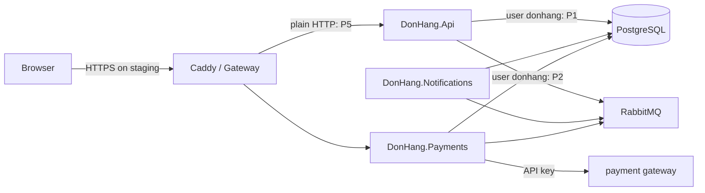

## Bạn cần biết trước

- [[backend.l4.data-ownership]] — mỗi loại dữ liệu có một chủ, chẳng hạn Payments với `donhang_payments`.
- [[design.l4.architecture-review-findings]] — một buổi review kết thúc bằng các rủi ro gắn với quyết định, mỗi rủi ro có người phụ trách và bước tiếp theo.
- [[k8s.l3.network-policies]] — staging cô lập mọi Pod trong `donhang`, rồi mở từng service chỉ cho những bên gọi nó.
- [[backend.l3.payments-service]] — chỉ `payments` giữ địa chỉ và khóa của cổng thanh toán.

## Tình huống

Đang ở đầu stage-4, khi `docs/design/threat-model.md` chưa có, và đội sắp bắt đầu triển khai nhiều cửa hàng. Trong một buổi họp, một đồng nghiệp nói bảo mật đã ổn: staging phục vụ trình duyệt qua HTTPS, service nào cũng kiểm token, và đã đặt lịch một đợt penetration test trước khi ra mắt.

Sau đó bạn mở `docker-compose.yml` và thấy API, Notifications và Payments đều kết nối PostgreSQL bằng `Username=donhang`. Nếu ai đó chiếm được Notifications, mật khẩu đó cũng mở được `donhang_payments`. Không tài liệu nào nhắc tới điều này, nên chưa ai quyết nó có chấp nhận được hay không.

Làm sao tìm ra, trước kẻ tấn công, từng chỗ bảo mật của Đơn Hàng có thể hỏng, và chắc chắn chỗ nào cũng có một quyết định?

## Khái niệm cốt lõi

- **mô hình mối đe dọa** (threat model) — danh sách viết ra những gì có thể hỏng về bảo mật của một hệ thống, nó có thể xảy ra ở đâu trong luồng dữ liệu, và làm gì với từng trường hợp, lập ra trước khi kẻ tấn công tìm thấy lỗ hổng.
- luồng dữ liệu — đường dữ liệu đi giữa các phần của hệ thống, chẳng hạn sơ đồ "Data flow" trong `STAGE.md`.
- **ranh giới tin cậy** (trust boundary) — chỗ trong luồng dữ liệu mà dữ liệu đi qua giữa hai phần tin nhau ở mức khác nhau, chẳng hạn trình duyệt tới Gateway, một service tới PostgreSQL, hay Payments tới cổng thanh toán.
- **STRIDE** (danh mục sáu loại mối đe dọa: giả mạo, sửa đổi, chối bỏ, lộ thông tin, từ chối dịch vụ, leo thang quyền) — danh mục mà `threat-model.md` dùng, sáu câu hỏi đặt ra ở mỗi ranh giới: spoofing (giả làm người khác), tampering (sửa dữ liệu), repudiation (chối một hành động khi không gì chứng minh được), information disclosure (đọc thứ không được đọc), denial of service (làm một phần ngừng phục vụ) và elevation of privilege (có được quyền không ai cấp).
- biện pháp và phát hiện — biện pháp là thứ đã có sẵn để trả lời một mối đe dọa, chẳng hạn kiểm token, còn phát hiện là mối đe dọa chưa biện pháp nào trả lời, được ghi kèm người phụ trách và một quyết định: sửa, chấp nhận kèm lý do, hoặc hoãn sang một kế hoạch có tên.
- penetration test — một nhóm cố ý tấn công hệ thống đang chạy để tìm lỗ hổng.

## Cơ chế hoạt động



Hãy bắt đầu từ luồng dữ liệu, không phải từ một danh sách các kiểu tấn công. Sơ đồ lấy từ sơ đồ trong `STAGE.md`, thêm Gateway của staging, và đánh dấu các phát hiện `P1`, `P2` và `P5` của `threat-model.md`, có ở phần sau. Trong Compose, reverse proxy đứng trước là Caddy. Trên staging đó là Gateway, chạy Traefik.

Tiếp theo, đánh dấu các ranh giới tin cậy. Trong tình huống trên, mũi tên từ mỗi service tới PostgreSQL là một ranh giới: database nhận bất kỳ ai đưa ra đúng user và mật khẩu, và service nào cũng giữ mật khẩu đó. Các mũi tên tới RabbitMQ có cùng dạng. Trình duyệt tới Gateway là một ranh giới khác, vì ai tới được địa chỉ đó cũng gửi được request. Payments tới cổng thanh toán là ranh giới thứ ba, vì cổng thanh toán nằm ngoài Đơn Hàng.

Ở mỗi ranh giới, lần lượt đặt sáu câu hỏi STRIDE: ai đó có thể giả làm bên gọi, sửa dữ liệu, chối đã làm, đọc thứ không được đọc, làm bên kia ngừng phục vụ, hay có được quyền không ai cấp không?

Với mỗi mối đe dọa, ghi lại biện pháp đã trả lời nó, hoặc ghi một phát hiện. Ở ranh giới trình duyệt, spoofing đã có câu trả lời: các service kiểm mọi token. Ở ranh giới database, information disclosure thì chưa, vì service nào cũng đăng nhập bằng `donhang`, nên nó thành một phát hiện có người phụ trách và một quyết định.

Cuối cùng, mô hình được xem lại mỗi khi luồng dữ liệu đổi, vì một mũi tên mới có thể đi qua một ranh giới mới.

## Trong hệ thống Đơn Hàng

`threat-model.md` đi qua luồng dữ liệu của stage-3, từng ranh giới một. Đây là ba ranh giới đầu:

```markdown file=docs/design/threat-model.md tag=stage-4 lines=11-33
### Trình duyệt → Caddy / Gateway

| STRIDE | Mối đe dọa | Biện pháp hoặc phát hiện |
|---|---|---|
| S | Gọi API bằng token giả hay token của người khác | API và Payments tự kiểm chữ ký, issuer, audience, hạn của mọi token (`AddJwtBearer`); Caddy và Gateway không kiểm token |
| T, I | Đọc hay sửa request trên đường truyền | Staging: HTTPS ở Gateway (chứng chỉ của lab CA). Compose: HTTP thường, chỉ trên máy dev |
| D | Một khách hay một trang gửi quá nhiều request | Giới hạn `orders` (theo `sub`) và `catalog-reads` (số đọc đồng thời) trong `Program.cs`, giữ nguyên |
| E | Khách gọi việc của nhân viên | Policy `StaffOnly` đọc role `staff` trong token; `OrderOwner` chỉ cho xem đơn của chính mình |

### Gateway → API, Payments

| STRIDE | Mối đe dọa | Biện pháp hoặc phát hiện |
|---|---|---|
| S | Pod khác gọi thẳng API, bỏ qua Gateway | NetworkPolicy `from-the-gateway`: chỉ Pod của Traefik tới được api và Payments; hai service vẫn kiểm mọi token |
| T, I | Đọc hay sửa request trong cluster | P5 |

### Service → PostgreSQL

| STRIDE | Mối đe dọa | Biện pháp hoặc phát hiện |
|---|---|---|
| I, E | Một service bị chiếm đọc database của service khác | P1 |
| T, R | Service sửa lại dòng ghi ai đã yêu cầu gì | P4 |
| S | Pod lạ kết nối database | NetworkPolicy `db`: chỉ các service, migration và job backup |
```

Tài liệu này cố ý viết bằng tiếng Việt. Mỗi tiêu đề là một ranh giới tin cậy, và mỗi dòng ghi các chữ cái STRIDE, mối đe dọa, rồi biện pháp hoặc số của phát hiện. Ở dòng S của ranh giới trình duyệt, API và Payments tự kiểm từng token bằng `AddJwtBearer`: chữ ký, issuer (bên phát token, tức Keycloak), audience (token dành cho API nào) và hạn dùng. Caddy và Gateway không kiểm token nào. Dòng T, I trả lời chuyện đọc hay sửa request trên đường truyền: trên staging, Gateway phục vụ HTTPS bằng chứng chỉ do chính lab cấp, còn trong Compose, request của app tới Caddy bằng HTTP thường, trên máy của lập trình viên. Dòng D và E giữ các biện pháp sẵn có: giới hạn request trong `Program.cs`, `orders` theo từng khách (`sub`, claim chứa id người dùng trong token), và hai policy `StaffOnly` và `OrderOwner`.

Dưới Gateway → API, Payments, dòng S trả lời trường hợp một Pod gọi thẳng API: NetworkPolicy `from-the-gateway` chỉ cho các Pod trong namespace `traefik`, nơi Traefik chạy, tới được api và Payments, và hai service này vẫn kiểm mọi token. Dòng T, I không có biện pháp nào, chỉ có `P5`. Dưới Service → PostgreSQL, chỉ dòng S có biện pháp, là NetworkPolicy `db`.

Các phát hiện nằm chung ở cuối, tiếp theo là khi nào xem lại:

```markdown file=docs/design/threat-model.md tag=stage-4 lines=64-81
### Phát hiện và quyết định

| Số | Phát hiện | Quyết định | Người phụ trách |
|---|---|---|---|
| P1 | API, Notifications và Payments cùng vào PostgreSQL bằng `donhang`, superuser do image `db` tạo từ `POSTGRES_USER`; với thông tin đó mở được mọi database trên server, và trong Compose cả database `keycloak` (Keycloak cũng dùng `donhang`) | Hoãn: role riêng cho mỗi service, chỉ có quyền trên database của nó, làm ở release 3 của `multi-shop-data-rollout.md` | Lập trình viên backend |
| P2 | Ba service vào RabbitMQ bằng `donhang`, user mặc định của broker, được configure, write, read trên mọi thứ của vhost `/` | Hoãn: user riêng cho mỗi service, cùng release 3 | Lập trình viên backend |
| P3 | `customers.email` không có dấu đã xác minh; email đơn hàng gửi tới địa chỉ đó | Sửa theo ADR 0014 (Keycloak giữ email khách) | Trưởng nhóm |
| P4 | `requested_by` của dòng hoàn tiền và `order_status_history` do chính service ghi, sửa được bằng service đó và bằng user chung `donhang`; sửa không để lại dấu vết | Hoãn: nhật ký kiểm toán theo `audit-log.md` | Lập trình viên backend |
| P5 | Gateway gọi các Pod api và Payments bằng HTTP thường: NetworkPolicy quyết ai được kết nối, nhưng dữ liệu đi qua mạng giữa các node không mã hóa, và api chỉ biết bên gọi qua địa chỉ của nó | Chấp nhận: một cluster, một đội, NetworkPolicy đã giới hạn bên gọi. Mã hóa và xác minh bên gọi trong cluster: chưa làm theo ADR 0021, điều kiện mở lại ở đó | Lập trình viên phụ trách nền tảng |
| P6 | Hóa đơn ký số (kế hoạch) cần một khóa riêng mà chỉ Đơn Hàng ký được | Quyết ở ADR 0015 (khóa trong HSM) | Trưởng nhóm |

### Khi nào xem lại

Mỗi khi luồng dữ liệu đổi: thêm service, thêm ranh giới, thêm bên ngoài.
Lần đổi đã biết là đưa `shop_id` vào (ADR 0013): nó thêm mối đe dọa một cửa
hàng đọc dữ liệu của cửa hàng khác, được trả lời bằng row-level security đứng
sau bộ lọc cửa hàng trong code. P1 và P2 được sửa trong cùng release 3, vì
release đó vốn đã chuyển service sang role không có `BYPASSRLS`.
```

`P1` chính là tình huống ở đầu bài. Trong PostgreSQL, role là tài khoản mà một service đăng nhập bằng, có quyền riêng của nó, và `donhang` là một role như vậy. API, Notifications và Payments đều đăng nhập bằng `donhang`, một superuser, tức user PostgreSQL bỏ qua mọi kiểm tra quyền. Image `db` tạo nó từ `POSTGRES_USER`, nên nó mở được mọi database trên server, trong Compose cả `keycloak`.

`P2` có cùng dạng, nhưng ở RabbitMQ: cả ba dùng `donhang`, user mặc định của broker, có quyền configure, write và read trên mọi thứ trong virtual host `/`. Virtual host là một vùng có tên trong RabbitMQ, có exchange và queue riêng. `/` là vùng mặc định, và code kết nối của Đơn Hàng không chỉ định vùng nào khác. Cả hai phát hiện được hoãn sang release 3 của `multi-shop-data-rollout.md`, release cho mỗi service một user riêng.

`P4` là tampering và repudiation: `requested_by` trên một dòng hoàn tiền, và `order_status_history`, do chính service ghi. Service đó viết lại được chúng, ai giữ `donhang` cũng vậy, và không để lại dấu vết nào. Phát hiện này được hoãn sang thiết kế trong `audit-log.md`. `P5` được chấp nhận kèm lý do: một cluster, một đội, và NetworkPolicy đã giới hạn bên gọi. `P3`, email đơn hàng gửi tới một địa chỉ chưa ai xác minh, được sửa bằng ADR `0014`, để Keycloak giữ email của khách. `P6`, một khóa dự kiến dùng để ký hóa đơn, được quyết ở ADR `0015`, chủ đề của một bài sau.

Đoạn cuối nói hãy xem lại mỗi khi luồng dữ liệu đổi. Thêm `shop_id` theo ADR `0013` mang tới mối đe dọa một cửa hàng đọc dữ liệu của cửa hàng khác. Bộ lọc cửa hàng trong code trả lời mối đe dọa đó, còn row-level security trong database là lớp kiểm tra thứ hai nếu code bỏ sót. `P1` và `P2` được sửa trong cùng release 3, vì release đó vốn đã chuyển các service sang role không có `BYPASSRLS`, thuộc tính cho một role bỏ qua row-level security.

## Đánh đổi

| Quyết định cho một phát hiện | Cái gì còn mở | Hợp khi | Trong `threat-model.md` |
|---|---|---|---|
| Sửa | không còn gì, tới khi luồng dữ liệu đổi | mối đe dọa dễ xảy ra hoặc gây thiệt hại lớn, và sửa ngay bây giờ thì vừa sức | `P3` |
| Chấp nhận kèm lý do | mối đe dọa, có chủ ý | lý do còn đúng ở hiện tại và ghi rõ khi nào xem lại | `P5` |
| Hoãn sang một kế hoạch có tên | mối đe dọa, tới khi kế hoạch đó ra mắt | một thay đổi đã lên kế hoạch sắp chạm tới đúng chỗ đó | `P1`, `P2`, `P4` |

## Bạn sẽ chọn gì nếu…

…Payments thêm một cổng thanh toán thứ hai với API key riêng? Đó là một ranh giới tin cậy mới. Hãy thêm một mục vào `threat-model.md` trước khi code ra mắt và đặt đủ sáu câu hỏi STRIDE ở đó. Câu trả lời cho cổng thứ nhất, chẳng hạn chỉ giữ khóa trong cấu hình của Payments, là các điểm cần kiểm lại, không phải các dòng để chép sang.

…một đồng nghiệp đề nghị đóng `P1` ngay tuần này bằng một role PostgreSQL mới dùng chung cho ba service? Một role dùng chung phải vào được cả ba database, nên một Notifications bị chiếm vẫn đọc được `donhang_payments`, chỉ có quyền superuser là mất đi. Nếu release 3 vẫn đúng lịch, hãy giữ quyết định hoãn. Nếu nó bị trễ, hãy xem lại `P1` và ghi quyết định mới vào bảng.

## Senior hay nhầm rằng…

- **"Bảo mật được kiểm bằng một đợt penetration test ở cuối, đó không phải thứ cần thiết kế."** → Thực ra các phát hiện trong `threat-model.md` đến từ những lựa chọn thiết kế. Một mô hình lập từ luồng dữ liệu tìm ra chúng khi cách sửa vẫn còn là một thay đổi trong kế hoạch. Một đợt test ở cuối chỉ tìm ra chúng sau khi thiết kế đã xây xong, và báo cáo test không ghi quyết định nào, chẳng hạn chấp nhận `P5` kèm lý do. Bạn sẽ nhận ra khi một báo cáo muộn liệt kê một vấn đề mà cách sửa chạm vào mọi service cùng lúc.
- **"Request nào cũng dùng HTTPS thì bên trong hệ thống không còn gì để mô hình hóa."** → Thực ra HTTPS chỉ phủ một ranh giới, trình duyệt tới Gateway: nó giữ cho request không bị đọc hay sửa trên đường truyền và chứng minh danh tính của server với trình duyệt. Nó không cho API biết ai đang gọi (TLS chỉ xác thực client nếu được bật thêm, và ở đây nó kết thúc tại Gateway), chỉ bước kiểm token mới cho biết điều đó. Bên trong, Gateway tới các Pod bằng HTTP thường (`P5`), và service nào cũng đăng nhập PostgreSQL bằng `donhang` (`P1`). Bạn sẽ nhận ra khi `docker-compose.yml` cho thấy cùng một user trong connection string của ba service.
- **"Một mô hình mối đe dọa làm xong thì liệt kê mọi kiểu tấn công có thể có, nên sau đó hệ thống an toàn."** → Thực ra nó liệt kê các mối đe dọa tìm được ở những ranh giới mà đội đã vẽ, mỗi mối đe dọa kèm một quyết định. `P1`, `P2` và `P4` còn mở tới khi kế hoạch của chúng ra mắt, còn `P5` mở có chủ ý. Nó cũng chỉ phủ luồng dữ liệu mà nó được lập từ đó. Bạn sẽ nhận ra khi một service mới xuất hiện mà tài liệu không có mục nào cho nó.

## Thử ngay (3 phút)

Ở thư mục gốc của repo ví dụ tại tag `stage-4`:

1. Chạy `grep -n "Username=" docker-compose.yml`.
2. So user trong mỗi dòng với phát hiện `P1` trong `docs/design/threat-model.md`.

Kết quả mong đợi: sáu dòng, 140, 158, 300, 316, 351 và 367, cho API, Notifications, Payments và migration của từng service. Mỗi cặp ghi một database, `donhang`, `donhang_notifications` hoặc `donhang_payments`, và dòng nào cũng dùng `Username=donhang`.

Rồi hãy xác định: ai đó chiếm được container Notifications. Dựa vào bảng Service → PostgreSQL, những chữ cái STRIDE nào mô tả điều họ giờ làm được với dữ liệu của Payments?

<details><summary>Gợi ý đáp án</summary>

I và E, từ `P1`: với superuser `donhang`, họ đọc được `donhang_payments`, bằng quyền mà Notifications vốn không được có. T và R, từ `P4`: họ viết lại được `requested_by` trên một dòng hoàn tiền mà không để lại dấu vết.

</details>

## Liên hệ

- [[design.l4.architecture-review-findings]] — cùng một dạng kết quả, áp dụng cho bảo mật.
- [[backend.l4.shop-data-layout]] — quyết định trong ADR `0013` mang tới một mối đe dọa mới.
- [[management.l3.architecture-decision-record]] — dạng văn bản mà `P3` và `P6` được quyết trong đó.
- [[devops.l3.software-supply-chain]] — cùng các câu hỏi đó, đặt cho đường đi từ mã nguồn tới một image đang chạy.
- [[backend.l4.shared-credentials]] — cách sửa `P1` và `P2`.
- [[backend.l4.audit-log]] — kế hoạch mà `P4` được hoãn sang.

## Tóm tắt 5 dòng

1. Mô hình mối đe dọa đi qua luồng dữ liệu của hệ thống từng ranh giới một, và ghi lại, với mỗi mối đe dọa về bảo mật, biện pháp trả lời nó hoặc một quyết định.
2. Ranh giới tin cậy là chỗ dữ liệu đi qua giữa hai phần tin nhau ở mức khác nhau, chẳng hạn service tới database.
3. STRIDE đặt sáu câu hỏi ở mỗi ranh giới: spoofing, tampering, repudiation, information disclosure, denial of service, elevation of privilege.
4. Trong các phát hiện của Đơn Hàng có: service nào cũng đăng nhập bằng `donhang`, và các dòng hoàn tiền mà chính Payments viết lại được.
5. Hãy xem lại mô hình mỗi khi luồng dữ liệu đổi, vì thêm `shop_id` đã mang tới mối đe dọa một cửa hàng đọc dữ liệu của cửa hàng khác.
