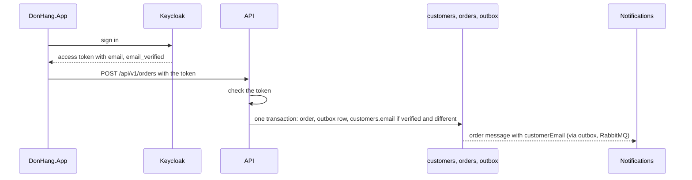

## Before you start

- [[backend.l4.shared-credentials]] — you know that blast radius is everything one compromised part's credentials open; this lesson rejects an option because it widens it.
- [[backend.l4.data-ownership]] — you know that each kind of data has one owner and every copy needs a rule to stay current; here the rule is for the customer's email.
- [[backend.l2.openid-connect-id-token]] — you know that Keycloak issues the tokens and `sub` is its id for the user; this lesson reads two more fields from the access token.
- [[management.l3.weighing-options-in-an-adr]] — you know that an ADR judges each serious option against the same needs; ADR `0014` does that for three options.

## The situation

It is stage-4. A customer has changed and confirmed their email in their Keycloak account, so their account shows the new address as verified. The next day they place an order, and the confirmation goes to the old address.

You trace it. Notifications sends to `customerEmail` in the order message. The API copied that value from `customers.email` when it wrote the outbox row. Nothing updated `customers.email` after the account changed.

`data-ownership.md` lists exactly this as its one open question: two places hold the email, and nothing keeps them equal. Which one should the team trust, and how does the other copy stay current without giving any service more power than it needs?

## Core concepts

- verified email — an address whose holder has shown they can read it; Keycloak keeps this as `emailVerified` for each account, while `customers` keeps no such mark.
- claim — one named field inside a token, such as `sub`, `email` or `email_verified`, that the API can trust once it has checked the token.
- refresh on use — keeping a copy current by overwriting it with the owner's value whenever a request brings that value along, instead of on a schedule.
- review condition — a situation, written into an ADR, that makes the team look at the decision again.

## How it works



The diagram is the design ADR `0014` decides; at stage-4 no code runs it yet.

In the situation above, two parts hold the customer's email, and only Keycloak knows whether it is verified. Every account in `keycloak/donhang-realm.json`, the file that describes Đơn Hàng's Keycloak setup (its clients and user accounts), carries `"emailVerified": true`. The `Customer` class in `DonHang.Domain/Entities.cs` has `Email` but no field like it. So the column your team writes can hold an address nobody has confirmed lately; `threat-model.md` records this as finding P3.

That makes Keycloak the owner. The question left is how `customers.email` stays current. Follow the diagram from the top. In its context section, outside the excerpts below, ADR `0014` records that the access token the API already receives carries the claims `email` and `email_verified`. Its reason: in that file the client `donhang-app` lists the `email` scope among the scopes it gets by default. So the ADR needs no Keycloak change.

When the customer places an order, the API checks the token as it does today. If `email_verified` is `true` and `email` differs from `customers.email`, the API overwrites the column in the same transaction that stores the order and its outbox row. An unverified address is never copied. That is refresh on use: the copy is current up to the customer's last order.

The last arrow, the outbox row later published through RabbitMQ as the order message Notifications receives, does not change. The outbox row still takes `customerEmail` from `customers`, so `OrderMessage` keeps its shape, and Notifications and Payments need nothing new.

## In the Đơn Hàng system

The options and the decision of ADR `0014`:

```markdown file=docs/adr/0014-keycloak-giu-email-khach-hang.md tag=stage-4 lines=21-43
### Các phương án

- Giữ hai bản, thêm một job đồng bộ định kỳ từ Keycloak sang `customers`: hai
  nơi vẫn cùng giữ email, giữa hai lần chạy chúng vẫn lệch, và job cần một
  credential đọc được mọi tài khoản ở Keycloak.
- Keycloak là chủ; API làm mới `customers.email` từ claim `email` của access
  token mỗi khi khách đặt đơn, chỉ khi `email_verified` là `true`. Bản trong
  `customers` thành bản sao có cách giữ cho mới, không cần credential mới.
- Bỏ bản sao; Notifications hỏi Keycloak email của khách cho mỗi email gửi
  đi: không còn lệch, nhưng Notifications cần một credential đọc được mọi tài
  khoản ở Keycloak, mở rộng blast radius của một service chỉ gửi email, và mỗi
  email phụ thuộc thêm vào Keycloak.

### Quyết định

Chọn phương án thứ hai: Keycloak là chủ của email khách. Khi khách đặt đơn,
API đọc `email` và `email_verified` từ access token đã kiểm; nếu
`email_verified` là `true` và email khác `customers.email`, API cập nhật
`customers.email` trong cùng transaction với đơn. Email chưa xác minh không
được chép.

Phương án thứ ba bị từ chối vì credential của nó; phương án thứ nhất vì vẫn
giữ hai chủ và cũng cần credential đó.
```

Lines 3–12 are the three options. The first keeps both copies and adds a periodic job that copies from Keycloak to `customers`; between runs they still disagree. The second is refresh on use and needs no new credential; the third drops the copy and has Notifications ask Keycloak for every email it sends. The first and third share one cost: a credential that can read every account at Keycloak. In the first, the job holds it wherever it runs. In the third it goes to Notifications, a service that only sends emails, widening its blast radius to every customer's account, and each email would also depend on Keycloak answering.

Lines 16–20 are the decision, and lines 22–23 reject the other two for that credential, the first also for keeping two owners.

The consequences, and when the team looks again:

```markdown file=docs/adr/0014-keycloak-giu-email-khach-hang.md tag=stage-4 lines=45-55
### Hệ quả

- `customers.email` thành bản sao của Keycloak, mới tới lần đặt đơn gần nhất.
- `OrderMessage` giữ nguyên hình dạng: `customerEmail` vẫn lấy từ `customers`
  lúc ghi outbox, Notifications và Payments không đổi.
- Chưa làm ở stage-4: chưa có code làm mới email; câu hỏi mở trong
  `data-ownership.md` giữ nguyên, kèm dòng trỏ tới ADR này.

Đội xem lại khi email phải gửi cho khách đã lâu không đăng nhập (bản sao của
họ không được làm mới), hoặc khi một service khác cần email khách mà không có
access token của khách.
```

Line 3 states the price of refresh on use: the copy is only as fresh as the customer's last order. Lines 4–5 keep `OrderMessage` as it is, so no consumer has to change. Lines 6–7 say the ADR is accepted but not built at stage-4: no code refreshes the email yet, and the open question in `data-ownership.md` stays, now pointing to this ADR. Lines 9–11 are the two review conditions: emails that must reach customers who have not signed in for a long time, and another service that needs a customer's email without that customer's access token. Signing in alone does not refresh the copy; only an order does, so the first condition covers customers who have not ordered since their email changed.

## Trade-offs

| Option | Copies that can disagree | New credential | Each email depends on Keycloak | Unverified address |
|---|---|---|---|---|
| Keep both, periodic job copies from Keycloak | yes, between runs | one that reads every account | no | depends on what the job copies |
| Keycloak owns, refresh on use (chosen) | yes, until the customer's next order | none | no | never copied |
| Drop the copy, Notifications asks Keycloak | no | one that reads every account, held by Notifications | yes | depends on what Notifications checks |

The second row accepts a copy that can be stale for customers who stop ordering. In exchange it adds no credential and no new dependency to the email path. The third row is the only one with no stale copy, and it pays for that by giving Notifications, a service that only sends emails, a credential that reads every account, and by adding one more service every email waits for.

## What would you choose if…

…a refund email must reach a customer who changed their email and has not ordered since? That is the first review condition, and the comments section at the end of ADR `0014` raises this very case. Keep the decision until it happens often enough to matter, then reopen the ADR and weigh asking Keycloak for that one customer's email, only when such an email must go out, against the credential it needs.

…a new Support service needs customers' emails to answer chats, without their access tokens? That is the second review condition. Reopen the ADR before handing Support a credential that reads every Keycloak account, because that is the cost the ADR rejected for Notifications.

…the token the customer signs in with carries an `email` whose `email_verified` is `false`, then they order? Keep the ADR as written: the API copies nothing, so `customers.email` keeps its current value, and the confirmation goes there.

## Seniors often assume…

- **"The copy in our own database is the more reliable one, because our team controls it."** → Actually controlling a column does not confirm that anyone reads the address in it. Keycloak records whether each account's email is verified; `customers` has no such mark, so your copy can be the stale one. You notice this when an order confirmation reaches an address the customer no longer uses, finding P3 in `threat-model.md`.
- **"Letting Notifications query Keycloak directly is the simplest fix and costs nothing in security."** → Actually it needs a credential that can read every account at Keycloak, held by a service that only sends emails. A flaw in Notifications would then reach every customer's account data, and each email would also wait on Keycloak. You notice this when you write down what that credential may read and the answer is every account, not the one customer the email is for.
- **"Once an ADR is accepted, the code has to change in the same release."** → Actually an ADR records a decision and its reasons; when the code follows is planned work. ADR `0014` is accepted, and its consequences state that no code refreshes the email at stage-4. You notice this when `data-ownership.md` still shows the open question at stage-4, with a line pointing to the accepted ADR.

## Try it (3 minutes)

In the root folder of the example repository at tag `stage-4`:

1. Open `keycloak/donhang-realm.json` and find `defaultClientScopes` of the client `donhang-app`, then `emailVerified` of each user.
2. Open `DonHang.Domain/Entities.cs` and read the class `Customer`.

Expected result: `defaultClientScopes` of `donhang-app` contains `"email"`; every user has `"emailVerified": true`; `Customer` has `Email` and `IdentitySubject` but no field saying whether the email is verified.

Then decide: with ADR `0014` built, a customer orders twice. Before the first order their account's email is verified and differs from `customers.email`. Before the second, their token carries a different `email` with `email_verified` `false`. Where does each order's confirmation go?

<details><summary>Suggested answer</summary>

The first confirmation goes to the new verified address: the API overwrites `customers.email` in the same transaction as the order and its outbox row, so the message carries the new value. The second goes to that same address, the last verified one, because `email_verified` is `false` and the API copies nothing.

</details>

## Connections

- [[backend.l4.data-ownership]] — the rule this lesson applies: the open question in that design doc is answered here by naming Keycloak the owner.
- [[backend.l4.shared-credentials]] — the same blast-radius argument, here used to reject an option before it is built.
- [[backend.l2.validating-provider-tokens]] — how the API checks the access token; this lesson trusts two more claims from that check.
- [[management.l3.proposing-an-adr]] — how an ADR like `0014` is proposed and collects comments before it is accepted.
- [[backend.l4.message-schema-evolution]] — the steps a change to `OrderMessage` would need, which ADR `0014` avoids by keeping its shape.
- [[backend.l4.threat-modeling]] — where finding P3 was written down; this lesson is its fix.

## Five-line summary

1. Keycloak records whether a customer's email is verified, so ADR `0014` makes Keycloak its owner and `customers.email` a copy.
2. The copy is refreshed on use: when a customer orders, the API takes `email` from the token only if `email_verified` is `true`.
3. A periodic job or Notifications asking Keycloak would need a credential that reads every account, widening blast radius.
4. `OrderMessage` keeps its shape, and no code refreshes the email yet: the ADR is accepted but not built at stage-4.
5. The ADR names when to reopen it: customers who stop signing in, or a service that needs emails without the customer's token.
