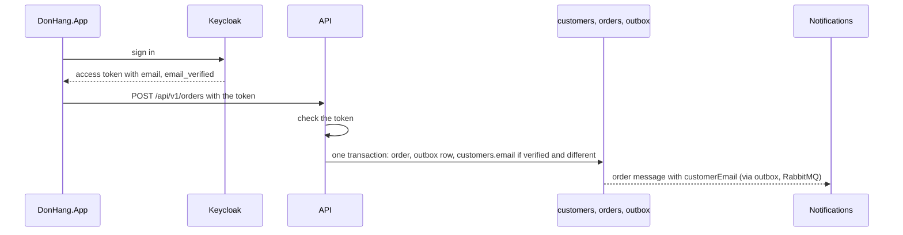

## Bạn cần biết trước

- [[backend.l4.shared-credentials]] — bạn biết rằng phạm vi ảnh hưởng là mọi thứ mà thông tin đăng nhập của một phần bị chiếm mở được. Bài này loại một phương án vì nó nới rộng phạm vi đó.
- [[backend.l4.data-ownership]] — bạn biết rằng mỗi loại dữ liệu có một chủ, và mỗi bản sao cần một quy tắc để luôn cập nhật. Ở đây quy tắc ấy dành cho email của khách.
- [[backend.l2.openid-connect-id-token]] — bạn biết rằng Keycloak cấp các token và `sub` là id của nó cho người dùng. Bài này đọc thêm hai trường nữa từ access token.
- [[management.l3.weighing-options-in-an-adr]] — bạn biết rằng một ADR đánh giá mọi phương án nghiêm túc theo cùng những nhu cầu. ADR `0014` làm vậy với ba phương án.

## Tình huống

Đang ở stage-4. Một khách đã đổi email và xác nhận nó trong tài khoản Keycloak, nên tài khoản hiện địa chỉ mới là đã xác minh. Hôm sau họ đặt một đơn, và email xác nhận lại đi tới địa chỉ cũ.

Bạn lần theo dấu vết. Notifications gửi tới `customerEmail` trong message của đơn. API chép giá trị đó từ `customers.email` khi ghi dòng outbox. Sau khi tài khoản đổi email, không gì cập nhật `customers.email`.

`data-ownership.md` ghi đúng chuyện này là câu hỏi mở duy nhất của nó: hai nơi giữ email, và không gì giữ cho chúng bằng nhau. Đội nên tin nơi nào, và bản còn lại được giữ cập nhật bằng cách nào mà không trao cho service nào nhiều quyền hơn mức nó cần?

## Khái niệm cốt lõi

- email đã xác minh — một địa chỉ mà người giữ nó đã chứng tỏ họ đọc được. Keycloak giữ dấu này là `emailVerified` cho từng tài khoản, còn `customers` không giữ dấu nào như vậy.
- claim — một trường có tên bên trong token, chẳng hạn `sub`, `email` hay `email_verified`, mà API tin được sau khi đã kiểm token.
- làm mới khi dùng — giữ bản sao cập nhật bằng cách ghi đè nó bằng giá trị của chủ mỗi khi một request mang giá trị đó tới, thay vì theo lịch.
- điều kiện xem lại — một tình huống, ghi trong ADR, khiến đội phải xem lại quyết định.

## Cơ chế hoạt động



Sơ đồ là thiết kế mà ADR `0014` quyết định. Ở stage-4 chưa có code nào chạy nó.

Trong tình huống trên, hai phần cùng giữ email của khách, và chỉ Keycloak biết email đó đã được xác minh hay chưa. Mọi tài khoản trong `keycloak/donhang-realm.json`, file mô tả cấu hình Keycloak của Đơn Hàng (các client và tài khoản người dùng), đều có `"emailVerified": true`. Class `Customer` trong `DonHang.Domain/Entities.cs` có `Email` nhưng không có trường nào như thế. Vì vậy cột mà đội bạn ghi có thể chứa một địa chỉ đã lâu không ai xác nhận. `threat-model.md` ghi điều này thành phát hiện P3.

Điều đó khiến Keycloak là chủ. Câu hỏi còn lại là `customers.email` được giữ cập nhật bằng cách nào. Hãy theo sơ đồ từ trên xuống. Trong phần bối cảnh của mình, nằm ngoài các đoạn trích bên dưới, ADR `0014` ghi rằng access token mà API vốn đã nhận mang sẵn hai claim `email` và `email_verified`. Lý do: trong file đó, client `donhang-app` có scope `email` trong danh sách scope nó được cấp mặc định. Nên ADR không cần đổi gì ở Keycloak.

Khi khách đặt đơn, API kiểm token như hiện nay. Nếu `email_verified` là `true` và `email` khác `customers.email`, API ghi đè cột đó trong cùng giao dịch lưu đơn và dòng outbox của đơn. Địa chỉ chưa xác minh không bao giờ được chép. Đó là làm mới khi dùng: bản sao mới tới lần đặt đơn gần nhất của khách.

Mũi tên cuối, tức dòng outbox sau đó được publish qua RabbitMQ thành message của đơn mà Notifications nhận, không đổi. Dòng outbox vẫn lấy `customerEmail` từ `customers`, nên `OrderMessage` giữ nguyên hình dạng, còn Notifications và Payments không cần gì mới.

## Trong hệ thống Đơn Hàng

Các phương án và quyết định của ADR `0014`:

```markdown file=docs/adr/0014-keycloak-giu-email-khach-hang.md tag=stage-4 lines=21-43
### Các phương án

- Giữ hai bản, thêm một job đồng bộ định kỳ từ Keycloak sang `customers`: hai
  nơi vẫn cùng giữ email, giữa hai lần chạy chúng vẫn lệch, và job cần một
  credential đọc được mọi tài khoản ở Keycloak.
- Keycloak là chủ; API làm mới `customers.email` từ claim `email` của access
  token mỗi khi khách đặt đơn, chỉ khi `email_verified` là `true`. Bản trong
  `customers` thành bản sao có cách giữ cho mới, không cần credential mới.
- Bỏ bản sao; Notifications hỏi Keycloak email của khách cho mỗi email gửi
  đi: không còn lệch, nhưng Notifications cần một credential đọc được mọi tài
  khoản ở Keycloak, mở rộng blast radius của một service chỉ gửi email, và mỗi
  email phụ thuộc thêm vào Keycloak.

### Quyết định

Chọn phương án thứ hai: Keycloak là chủ của email khách. Khi khách đặt đơn,
API đọc `email` và `email_verified` từ access token đã kiểm; nếu
`email_verified` là `true` và email khác `customers.email`, API cập nhật
`customers.email` trong cùng transaction với đơn. Email chưa xác minh không
được chép.

Phương án thứ ba bị từ chối vì credential của nó; phương án thứ nhất vì vẫn
giữ hai chủ và cũng cần credential đó.
```

Dòng 3–12 là ba phương án. Phương án thứ nhất giữ cả hai bản và thêm một job định kỳ chép từ Keycloak sang `customers`. Giữa hai lần chạy, hai bản vẫn lệch nhau. Phương án thứ hai là làm mới khi dùng và không cần thông tin đăng nhập mới. Phương án thứ ba bỏ bản sao, để Notifications hỏi Keycloak cho mỗi email nó gửi. Phương án thứ nhất và thứ ba chung một cái giá: thông tin đăng nhập đọc được mọi tài khoản ở Keycloak. Ở phương án thứ nhất, job giữ nó ở bất cứ đâu job chạy. Ở phương án thứ ba, nó về tay Notifications, một service chỉ gửi email, làm phạm vi ảnh hưởng của service này nới tới tài khoản của mọi khách, và mỗi email còn phải chờ Keycloak trả lời.

Dòng 16–20 là quyết định, còn dòng 22–23 loại hai phương án kia vì thông tin đăng nhập đó, riêng phương án thứ nhất còn vì vẫn giữ hai chủ.

Hệ quả, và khi nào đội xem lại:

```markdown file=docs/adr/0014-keycloak-giu-email-khach-hang.md tag=stage-4 lines=45-55
### Hệ quả

- `customers.email` thành bản sao của Keycloak, mới tới lần đặt đơn gần nhất.
- `OrderMessage` giữ nguyên hình dạng: `customerEmail` vẫn lấy từ `customers`
  lúc ghi outbox, Notifications và Payments không đổi.
- Chưa làm ở stage-4: chưa có code làm mới email; câu hỏi mở trong
  `data-ownership.md` giữ nguyên, kèm dòng trỏ tới ADR này.

Đội xem lại khi email phải gửi cho khách đã lâu không đăng nhập (bản sao của
họ không được làm mới), hoặc khi một service khác cần email khách mà không có
access token của khách.
```

Dòng 3 nêu cái giá của làm mới khi dùng: bản sao chỉ mới tới lần đặt đơn gần nhất của khách. Dòng 4–5 giữ `OrderMessage` như cũ, nên không consumer nào phải đổi. Dòng 6–7 cho biết ADR đã được chấp nhận nhưng chưa được xây ở stage-4: chưa có code làm mới email, và câu hỏi mở trong `data-ownership.md` vẫn còn, giờ trỏ tới ADR này. Dòng 9–11 là hai điều kiện xem lại: email phải tới được những khách đã lâu không đăng nhập, và một service khác cần email của khách mà không có access token của khách đó. Chỉ đăng nhập thôi không làm mới bản sao, chỉ đặt đơn mới làm. Nên điều kiện thứ nhất bao cả những khách chưa đặt đơn nào kể từ khi đổi email.

## Đánh đổi

| Phương án | Có bản sao lệch được không | Thông tin đăng nhập mới | Mỗi email phụ thuộc Keycloak | Địa chỉ chưa xác minh |
|---|---|---|---|---|
| Giữ cả hai, job định kỳ chép từ Keycloak | có, giữa hai lần chạy | một cái đọc được mọi tài khoản | không | tùy job chép những gì |
| Keycloak là chủ, làm mới khi dùng (được chọn) | có, tới lần đặt đơn tiếp theo của khách | không có | không | không bao giờ được chép |
| Bỏ bản sao, Notifications hỏi Keycloak | không | một cái đọc được mọi tài khoản, do Notifications giữ | có | tùy Notifications kiểm những gì |

Dòng thứ hai chấp nhận một bản sao có thể cũ với những khách thôi đặt đơn. Đổi lại, nó không thêm thông tin đăng nhập nào và không thêm phụ thuộc mới vào đường đi của email. Dòng thứ ba là dòng duy nhất không có bản sao cũ. Nó trả giá cho điều đó bằng cách trao cho Notifications, một service chỉ gửi email, thông tin đăng nhập đọc được mọi tài khoản, và thêm một service nữa mà mọi email phải chờ.

## Bạn sẽ chọn gì nếu…

…một email hoàn tiền phải tới được một khách đã đổi email và chưa đặt đơn nào kể từ đó? Đó là điều kiện xem lại thứ nhất, và phần góp ý ở cuối ADR `0014` nêu đúng trường hợp này. Hãy giữ quyết định cho tới khi chuyện này xảy ra đủ thường xuyên để đáng kể. Khi đó, mở lại ADR và cân nhắc hỏi Keycloak email của riêng khách đó, chỉ khi một email như vậy phải gửi đi, so với thông tin đăng nhập mà cách này cần.

…một service Support mới cần email của khách để trả lời chat, mà không có access token của họ? Đó là điều kiện xem lại thứ hai. Hãy mở lại ADR trước khi trao cho Support thông tin đăng nhập đọc được mọi tài khoản Keycloak, vì đó chính là cái giá mà ADR đã từ chối với Notifications.

…token khách dùng để đăng nhập mang một `email` có `email_verified` là `false`, rồi họ đặt đơn? Hãy giữ ADR như đã viết: API không chép gì, nên `customers.email` giữ giá trị hiện tại, và email xác nhận đi tới đó.

## Senior hay nhầm rằng…

- **"Bản trong database của chính mình đáng tin hơn, vì đội mình kiểm soát nó."** → Thực ra kiểm soát một cột không xác nhận được rằng có ai đọc được địa chỉ trong đó, vì Keycloak mới là nơi ghi email của từng tài khoản đã xác minh hay chưa, còn `customers` không có dấu nào như vậy, nên bản của bạn có thể là bản cũ. Bạn sẽ nhận ra khi một email xác nhận đơn tới địa chỉ khách không còn dùng, tức phát hiện P3 trong `threat-model.md`.
- **"Cho Notifications hỏi thẳng Keycloak là cách sửa đơn giản nhất và không tốn gì về bảo mật."** → Thực ra cách này cần thông tin đăng nhập đọc được mọi tài khoản ở Keycloak, do một service chỉ gửi email giữ, vì thế một lỗ hổng trong Notifications sẽ với tới dữ liệu tài khoản của mọi khách, và mỗi email còn phải chờ Keycloak. Bạn sẽ nhận ra khi ghi ra thông tin đăng nhập đó được đọc những gì, và câu trả lời là mọi tài khoản, không phải riêng khách mà email gửi tới.
- **"ADR đã được chấp nhận thì code phải đổi ngay trong cùng release."** → Thực ra ADR ghi lại một quyết định và lý do của nó, còn khi nào code theo kịp là việc được lên kế hoạch. ADR `0014` đã được chấp nhận, và phần hệ quả của nó ghi rằng ở stage-4 chưa có code làm mới email. Bạn sẽ nhận ra khi `data-ownership.md` ở stage-4 vẫn còn câu hỏi mở, kèm một dòng trỏ tới ADR đã được chấp nhận.

## Thử ngay (3 phút)

Ở thư mục gốc của repo ví dụ tại tag `stage-4`:

1. Mở `keycloak/donhang-realm.json`, tìm `defaultClientScopes` của client `donhang-app`, rồi `emailVerified` của từng user.
2. Mở `DonHang.Domain/Entities.cs` và đọc class `Customer`.

Kết quả mong đợi: `defaultClientScopes` của `donhang-app` có `"email"`, mọi user đều có `"emailVerified": true`, còn `Customer` có `Email` và `IdentitySubject` nhưng không có trường nào cho biết email đã xác minh hay chưa.

Rồi hãy xác định: khi ADR `0014` đã được xây, một khách đặt hai đơn. Trước đơn thứ nhất, email trong tài khoản của họ đã xác minh và khác `customers.email`. Trước đơn thứ hai, token của họ mang một `email` khác, với `email_verified` là `false`. Email xác nhận của mỗi đơn đi tới đâu?

<details><summary>Gợi ý đáp án</summary>

Email xác nhận thứ nhất tới địa chỉ mới đã xác minh: API ghi đè `customers.email` trong cùng giao dịch với đơn và dòng outbox của đơn, nên message mang giá trị mới. Email thứ hai tới chính địa chỉ đó, địa chỉ đã xác minh gần nhất, vì `email_verified` là `false` và API không chép gì.

</details>

## Liên hệ

- [[backend.l4.data-ownership]] — quy tắc mà bài này áp dụng: câu hỏi mở trong tài liệu thiết kế đó được trả lời ở đây bằng cách gọi tên Keycloak là chủ.
- [[backend.l4.shared-credentials]] — cùng lập luận về phạm vi ảnh hưởng, ở đây dùng để loại một phương án trước khi nó được xây.
- [[backend.l2.validating-provider-tokens]] — API kiểm access token thế nào. Bài này tin thêm hai claim từ bước kiểm đó.
- [[management.l3.proposing-an-adr]] — một ADR như `0014` được đề xuất và nhận góp ý thế nào trước khi được chấp nhận.
- [[backend.l4.message-schema-evolution]] — các bước mà một thay đổi ở `OrderMessage` sẽ cần, thứ ADR `0014` tránh được bằng cách giữ nguyên hình dạng của nó.
- [[backend.l4.threat-modeling]] — nơi phát hiện P3 được ghi lại. Bài này là cách sửa nó.

## Tóm tắt 5 dòng

1. Keycloak ghi lại email của khách đã xác minh hay chưa, nên ADR `0014` cho Keycloak làm chủ email và `customers.email` là bản sao.
2. Bản sao được làm mới khi dùng: khi khách đặt đơn, API lấy `email` từ token chỉ khi `email_verified` là `true`.
3. Một job định kỳ, hay Notifications hỏi Keycloak, sẽ cần thông tin đăng nhập đọc được mọi tài khoản, làm nới rộng phạm vi ảnh hưởng.
4. `OrderMessage` giữ nguyên hình dạng, và chưa có code làm mới email: ADR đã được chấp nhận nhưng chưa được xây ở stage-4.
5. ADR nêu khi nào mở lại: khách thôi đăng nhập, hoặc một service cần email mà không có token của khách.
