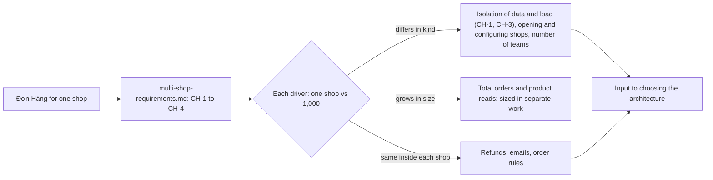

## Before you start

- [[design.l4.conways-law]] — you know that the number of teams and where they meet is itself an architectural driver.
- [[backend.l3.multi-tenancy]] — you know a tenant must be kept to its own data, and a noisy neighbor can slow the others anyway.
- [[management.l2.requirements-document]] — you know how a requirements document states goals, numbered requirements, out of scope and open questions.

## The situation

The leadership of the company wants to rent Đơn Hàng to other shops. Today the running system serves one shop: orders, products and customers carry no shop at all. Tables with a shop exist only in the lab files under `db/tenancy/`. The product owner and the team circulate a draft, `multi-shop-requirements.md`, before anyone chooses an architecture.

In the first meeting, one developer says that 1,000 shops is simply 1,000 times the traffic. Another says every requirement written so far must be redone. Which of Đơn Hàng's drivers really change when it serves 1,000 shops, and which stay as they are?

## Core concepts

- a change of context — a new situation the system must serve, such as many shops instead of one, which can move its drivers before a line of code changes.
- an assumption — a number the team writes down to plan with and marks as a guess, not a measurement, so it can be corrected when real data arrives.
- a driver that changes — one whose value in the draft's table for 1,000 shops differs in kind from its value for one shop, not only in size.
- a driver that only grows — the same kind of need with larger numbers, left to sizing work.
- a driver that stays — a need that works the same way inside each shop, so the parts built for it can keep their shape.

## How it works



In the situation above, the left box is the system you know: one shop, no shop on any row. The second box is the draft. It does not propose a design. It sets the new context in four requirements, `CH-1` to `CH-4`: each shop sees only its own data, a new shop opens without a deploy, one shop's busy day does not slow the others, and each shop has its own settings.

The diamond is the step that answers the two developers. The draft puts every driver in one table with two columns, one shop and 1,000 shops, and marks every number as an assumption. Reading row by row, you sort each driver into one of three branches.

The upper branch holds the drivers that differ in kind. Isolation of data and of load (`CH-1`, `CH-3`) was not needed with one shop, which had no neighbor to slow down, and is now required. Opening a shop never happened and now happens every week. One team becomes three or four, so someone must now decide where teams meet and who changes what. Faster servers answer none of these.

The middle branch is volume: totals grow, and the draft leaves sizing to separate work.

The lower branch matters as much as the upper one. Refunds, emails and the order rules work the same way inside each shop, so the parts built for them can keep their shape. Both the upper and the lower branch feed the architecture choice: one says what must change, the other what must not be broken.

## In the Đơn Hàng system

The four requirements that set the new context:

```markdown file=docs/team/multi-shop-requirements.md tag=stage-4 lines=21-30
### Yêu cầu phi chức năng

- CH-1: Khách và nhân viên của một cửa hàng chỉ thấy và chỉ sửa được dữ liệu
  của cửa hàng đó: đơn, sản phẩm, khách, hoàn tiền, email.
- CH-2: Mở một cửa hàng mới không cần deploy, không cần đội phát hành bản
  mới hay chạy migration.
- CH-3: Ngày đông khách của một cửa hàng không làm chậm các cửa hàng khác:
  đọc sản phẩm và đặt đơn ở các cửa hàng còn lại vẫn trả lời như ngày thường.
- CH-4: Mỗi cửa hàng có cấu hình riêng (tên, thương hiệu trên app, email gửi
  khách), đổi được mà không cần deploy.
```

`CH-1` asks that a shop's customers and staff see and change only that shop's orders, products, customers, refunds and emails. `CH-2` asks that a new shop open with no deploy, no new release and no migration. `CH-3` is the noisy neighbor written as a requirement: on one shop's busy day, product reads and order placing in the other shops answer as on a normal day. `CH-4` gives each shop its own name, brand in the app and the email sent to customers, changed without a deploy. None of them names a class or a table: they say what shops and their users need, and leave how to the architecture.

The drivers side by side:

```markdown file=docs/team/multi-shop-requirements.md tag=stage-4 lines=32-42
### Yếu tố định hình: một cửa hàng và 1.000 cửa hàng

| Yếu tố | Một cửa hàng (stage-3) | 1.000 cửa hàng (giả định) |
|---|---|---|
| Cô lập giữa cửa hàng | Không cần: chỉ có một | Bắt buộc (CH-1) |
| Mở cửa hàng mới | Không xảy ra | Vài cửa hàng mỗi tuần, không deploy (CH-2) |
| Cấu hình | Ghi trong code và cấu hình chung | Theo từng cửa hàng (CH-4) |
| Cửa hàng đông nhất | Là toàn bộ tải | Vài cửa hàng lớn giữ phần lớn số đơn; một cửa hàng có thể chiếm 10% tổng số đơn trong ngày khuyến mãi của nó (CH-3) |
| Đơn mỗi cửa hàng mỗi ngày | Như hôm nay | Trung bình 50, cửa hàng lớn nhất tới 5.000 |
| Người làm hệ thống | Một đội: product owner, scrum master, bốn lập trình viên, một tester | Ba tới bốn đội |
| Hoàn tiền, email, quy tắc đơn | Như `refund-requirements.md` và code hiện có | Không đổi trong mỗi cửa hàng |
```

The column headers say "one shop (stage-3)" and "1,000 shops (assumed)". Outside this excerpt, lines 3–5 say every number in the document is the team's assumption, marked where it appears, not a measurement.

Read the rows top to bottom. Isolation goes from "not needed, there is only one" to "required". Opening a shop goes from "never happens" to "a few shops a week, without a deploy". Settings go from code and shared configuration to per shop. The people go from one team, a product owner, a scrum master, four developers and a tester, to three or four teams.

Two rows carry numbers that only grow: one shop can reach 10% of all orders on its promotion day, and the largest shop takes up to 5,000 orders a day. The busiest-shop row also points to `CH-3`, a change in kind: with one shop there was no neighbor to slow down. Outside this excerpt, lines 44–45 add that total orders and product reads grow with the number of shops, and that estimating that load is separate work.

The last row says refunds, emails and order rules do not change inside each shop. The section "Không đổi", outside this excerpt, explains it: refunds still follow `YC-1` to `YC-10` of `refund-requirements.md`, and what changes is that every row of data must know which shop it belongs to.

## Trade-offs

| Way to read the change | What it gets right | What it misses | What it costs |
|---|---|---|---|
| A speed problem: more orders | total volume does grow | isolation, opening shops, settings and teams, none of which more speed answers | effort on speed while `CH-1` and `CH-2` stay open |
| A rebuild: every requirement rewritten | assumes nothing is safe | refunds, emails and order rules stay; their parts can keep their shape | rewriting working parts that no requirement asks to change |
| Driver by driver, side by side (the draft) | which drivers change, which grow, which stay | real numbers: every figure is still an assumption | a table to write and keep true, and open questions to answer |

The third row is what the draft does. Its cost is honest: it does not know the real numbers yet, and it says so.

## What would you choose if…

…the product owner learns that one contract demands a separate copy of the system for its shop? That is the first open question in the draft, due before the architecture is chosen. Write the answer into the requirements first, because it changes the isolation driver for that shop. The choice it feeds is the next lesson's.

…a teammate wants to start by measuring how many orders the system can take for 1,000 shops? The draft puts sizing in separate work. Do that work when you need numbers to size the system; it cannot answer the drivers that change in kind, such as `CH-1` and `CH-2`, which the architecture must meet whatever the totals turn out to be.

…a shop asks for refund rules of its own? The draft says refunds are the same in every shop, so the request changes a driver the draft lists as stable. Add it to the requirements as a change, and expect the refund parts to lose the "keep their shape" status the draft gives them.

## Seniors often assume…

- **"Going from one shop to 1,000 is mainly a performance problem."** → Actually volume is two rows of the table, and the rows that change in kind are isolation, opening and configuring shops, and the number of teams. Faster servers answer none of `CH-1`, `CH-2` or `CH-4`, and `CH-3` is about one shop hurting the others, not about total speed. You notice this when a plan for 1,000 shops talks only about more copies and bigger databases, and never says how a query knows its shop.
- **"Serving many shops means the system has to be rebuilt as microservices."** → Actually no changed driver names a split: isolation must hold inside every service however the system is cut. The team row does change, and that reopens where teams meet, which is not the same as a rebuild. You notice this when a proposal to split more services cannot name the `CH` requirement it answers.
- **"Every requirement written for one shop has to be rewritten when there are many."** → Actually the draft keeps `YC-1` to `YC-10` and the order rules as they are inside each shop. What changes is that each row of data must know its shop. You notice this when a plan schedules a rewrite of the refund code that no `CH` requirement mentions.

## Try it (3 minutes)

1. Take three statements a stakeholder might add to the draft: (a) an order email shows the shop's own name as the sender; (b) the largest shop reaches 5,000 orders a day; (c) a paid order still cannot be cancelled in the app.
2. For each one, say which branch of the diagram it belongs to, and which row or requirement of the draft supports your answer.

Expected result: one statement per branch: one that changes in kind, one that only grows, one that stays.

<details><summary>Suggested answer</summary>

(a) changes in kind: per-shop settings, `CH-4`, which lists the email sent to customers. (b) only grows: the orders-per-shop row, a size that the draft leaves to separate work. (c) stays: refund rules follow `refund-requirements.md` in every shop, as the last row of the table says.

</details>

## Connections

- [[design.l4.architectural-drivers]] — the same driver-by-driver reading, applied here when the context changes instead of the code.
- [[design.l4.conways-law]] — why "three or four teams" is a row in the table and not a staffing detail.
- [[backend.l3.multi-tenancy]] — the isolation and the noisy neighbor that `CH-1` and `CH-3` turn into requirements.
- [[backend.l3.tenant-isolation-models]] — the data layouts a later ADR chooses between; this lesson does not pick one.
- [[backend.l3.rate-limiting]] — a limit per customer keeps one client from taking capacity others need; `CH-3` asks the same between shops.
- [[management.l2.requirements-document]] — the form `multi-shop-requirements.md` follows, open questions included.
- [[design.l4.one-deployment-for-all-shops]] — next: ADR `0012` weighs the options against these drivers.

## Five-line summary

1. Serving 1,000 shops changes which drivers matter most: isolation, opening shops and teams change, while the rules inside each shop stay.
2. The running Đơn Hàng serves one shop; its orders and products carry no shop, and shop tables exist only in `db/tenancy/` lab files.
3. `multi-shop-requirements.md` asks that each shop see only its data, open without a deploy, and not slow the others on a busy day.
4. It marks every number as an assumption and sets each driver side by side for one shop and 1,000; sizing total volume is separate work.
5. Refunds, emails and order rules work the same inside each shop, so the parts built for them can keep their shape.
