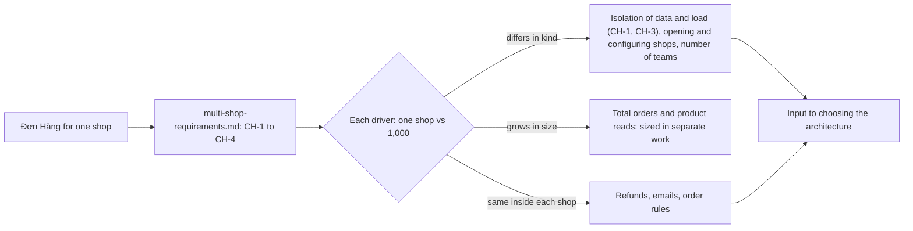

## Bạn cần biết trước

- [[design.l4.conways-law]] — bạn biết số đội và chỗ các đội gặp nhau tự nó là một yếu tố định hình kiến trúc.
- [[backend.l3.multi-tenancy]] — bạn biết mỗi tenant phải bị giữ trong dữ liệu của riêng mình, và dù vậy một noisy neighbor vẫn có thể làm chậm các tenant khác.
- [[management.l2.requirements-document]] — bạn biết một tài liệu yêu cầu nêu mục tiêu, các yêu cầu đánh số, phần ngoài phạm vi và các câu hỏi còn mở ra sao.

## Tình huống

Ban lãnh đạo công ty muốn cho các cửa hàng khác thuê Đơn Hàng. Hệ thống đang chạy hôm nay phục vụ một cửa hàng: đơn, sản phẩm và khách không gắn với cửa hàng nào. Các bảng có cột cửa hàng chỉ nằm trong những file thử nghiệm dưới `db/tenancy/`. Trước khi ai chọn kiến trúc, product owner và đội chuyền tay nhau một bản nháp, `multi-shop-requirements.md`.

Trong buổi họp đầu tiên, một lập trình viên nói 1.000 cửa hàng chẳng qua là gấp 1.000 lần lưu lượng. Một người khác nói mọi yêu cầu viết tới giờ đều phải làm lại. Khi phục vụ 1.000 cửa hàng, những yếu tố nào của Đơn Hàng thật sự đổi, và những yếu tố nào giữ nguyên?

## Khái niệm cốt lõi

- thay đổi bối cảnh — một tình huống mới mà hệ thống phải phục vụ, như nhiều cửa hàng thay vì một, có thể làm dịch chuyển các yếu tố định hình trước khi một dòng code nào đổi.
- giả định — một con số đội ghi ra để lập kế hoạch và đánh dấu là phỏng đoán, không phải số đo, để sửa được khi có dữ liệu thật.
- yếu tố đổi — yếu tố mà giá trị cho 1.000 cửa hàng trong bảng của bản nháp khác về bản chất so với giá trị cho một cửa hàng, không chỉ khác về độ lớn.
- yếu tố chỉ lớn lên — cùng một loại nhu cầu với con số lớn hơn, để lại cho phần việc ước lượng quy mô.
- yếu tố giữ nguyên — nhu cầu vận hành y như cũ bên trong mỗi cửa hàng, nên các phần được xây cho nó giữ được hình dạng.

## Cơ chế hoạt động



Trong tình huống trên, ô bên trái là hệ thống bạn đã biết: một cửa hàng, không dòng dữ liệu nào mang cửa hàng. Ô thứ hai là bản nháp. Bản nháp không đề xuất thiết kế. Nó đặt ra bối cảnh mới bằng bốn yêu cầu, từ `CH-1` tới `CH-4`: mỗi cửa hàng chỉ thấy dữ liệu của mình, cửa hàng mới mở được mà không cần deploy, ngày đông khách của một cửa hàng không làm chậm các cửa hàng khác, và mỗi cửa hàng có cấu hình riêng.

Hình thoi là bước trả lời hai lập trình viên kia. Bản nháp đặt mọi yếu tố vào một bảng có hai cột, một cửa hàng và 1.000 cửa hàng, và đánh dấu mọi con số là giả định. Đọc từng hàng, bạn xếp mỗi yếu tố vào một trong ba nhánh.

Nhánh trên chứa các yếu tố khác về bản chất. Cô lập dữ liệu và cô lập tải (`CH-1`, `CH-3`) không cần khi chỉ có một cửa hàng, vì không có hàng xóm nào để làm chậm, còn giờ thì bắt buộc. Mở cửa hàng trước đây chưa từng xảy ra, giờ xảy ra hằng tuần. Một đội thành ba hay bốn đội, nên giờ phải có người quyết định các đội gặp nhau ở đâu và ai sửa phần nào. Server nhanh hơn không giải được điều nào trong số này.

Nhánh giữa là khối lượng: tổng số tăng lên, và bản nháp để phần ước lượng quy mô cho một việc riêng.

Nhánh dưới quan trọng không kém nhánh trên. Hoàn tiền, email và các quy tắc đơn vận hành y như cũ bên trong mỗi cửa hàng, nên các phần được xây cho chúng giữ được hình dạng. Cả nhánh trên lẫn nhánh dưới đều là đầu vào cho lựa chọn kiến trúc: một nhánh nói cái gì phải đổi, nhánh kia nói cái gì không được làm hỏng.

## Trong hệ thống Đơn Hàng

Bốn yêu cầu đặt ra bối cảnh mới:

```markdown file=docs/team/multi-shop-requirements.md tag=stage-4 lines=21-30
### Yêu cầu phi chức năng

- CH-1: Khách và nhân viên của một cửa hàng chỉ thấy và chỉ sửa được dữ liệu
  của cửa hàng đó: đơn, sản phẩm, khách, hoàn tiền, email.
- CH-2: Mở một cửa hàng mới không cần deploy, không cần đội phát hành bản
  mới hay chạy migration.
- CH-3: Ngày đông khách của một cửa hàng không làm chậm các cửa hàng khác:
  đọc sản phẩm và đặt đơn ở các cửa hàng còn lại vẫn trả lời như ngày thường.
- CH-4: Mỗi cửa hàng có cấu hình riêng (tên, thương hiệu trên app, email gửi
  khách), đổi được mà không cần deploy.
```

`CH-1` yêu cầu khách và nhân viên của một cửa hàng chỉ thấy và chỉ sửa được đơn, sản phẩm, khách, hoàn tiền và email của chính cửa hàng đó. `CH-2` yêu cầu mở cửa hàng mới mà không cần deploy, không cần phát hành bản mới, không chạy migration. `CH-3` là noisy neighbor viết thành yêu cầu: vào ngày đông khách của một cửa hàng, đọc sản phẩm và đặt đơn ở các cửa hàng khác vẫn trả lời như ngày thường. `CH-4` cho mỗi cửa hàng tên, thương hiệu trên app và email gửi khách của riêng mình, đổi được mà không cần deploy. Không yêu cầu nào nêu tên một class hay một bảng: chúng nói cửa hàng và người dùng của nó cần gì, còn làm thế nào thì để kiến trúc quyết.

Các yếu tố đặt cạnh nhau:

```markdown file=docs/team/multi-shop-requirements.md tag=stage-4 lines=32-42
### Yếu tố định hình: một cửa hàng và 1.000 cửa hàng

| Yếu tố | Một cửa hàng (stage-3) | 1.000 cửa hàng (giả định) |
|---|---|---|
| Cô lập giữa cửa hàng | Không cần: chỉ có một | Bắt buộc (CH-1) |
| Mở cửa hàng mới | Không xảy ra | Vài cửa hàng mỗi tuần, không deploy (CH-2) |
| Cấu hình | Ghi trong code và cấu hình chung | Theo từng cửa hàng (CH-4) |
| Cửa hàng đông nhất | Là toàn bộ tải | Vài cửa hàng lớn giữ phần lớn số đơn; một cửa hàng có thể chiếm 10% tổng số đơn trong ngày khuyến mãi của nó (CH-3) |
| Đơn mỗi cửa hàng mỗi ngày | Như hôm nay | Trung bình 50, cửa hàng lớn nhất tới 5.000 |
| Người làm hệ thống | Một đội: product owner, scrum master, bốn lập trình viên, một tester | Ba tới bốn đội |
| Hoàn tiền, email, quy tắc đơn | Như `refund-requirements.md` và code hiện có | Không đổi trong mỗi cửa hàng |
```

Tiêu đề hai cột ghi "Một cửa hàng (stage-3)" và "1.000 cửa hàng (giả định)". Ngoài đoạn trích này, dòng 3–5 nói mọi con số trong tài liệu là giả định của đội, được đánh dấu tại chỗ, không phải số đo.

Đọc các hàng từ trên xuống. Cô lập đi từ "không cần, chỉ có một" tới "bắt buộc". Mở cửa hàng đi từ "không xảy ra" tới "vài cửa hàng mỗi tuần, không deploy". Cấu hình đi từ code và cấu hình chung tới theo từng cửa hàng. Con người đi từ một đội, gồm một product owner, một scrum master, bốn lập trình viên và một tester, tới ba hay bốn đội.

Hai hàng mang những con số chỉ lớn lên: một cửa hàng có thể chiếm 10% tổng số đơn trong ngày khuyến mãi của nó, và cửa hàng lớn nhất nhận tới 5.000 đơn mỗi ngày. Hàng cửa hàng đông nhất cũng trỏ tới `CH-3`, một thay đổi về bản chất: với một cửa hàng thì không có hàng xóm nào để làm chậm. Ngoài đoạn trích này, dòng 44–45 nói thêm rằng tổng số đơn và lượt đọc sản phẩm tăng theo số cửa hàng, và ước lượng tải đó là một việc riêng.

Hàng cuối nói hoàn tiền, email và quy tắc đơn không đổi trong mỗi cửa hàng. Mục "Không đổi", nằm ngoài đoạn trích, giải thích điều này: hoàn tiền vẫn theo `YC-1` tới `YC-10` của `refund-requirements.md`, còn điều thay đổi là mỗi dòng dữ liệu phải biết nó thuộc cửa hàng nào.

## Đánh đổi

| Cách đọc thay đổi | Đúng ở chỗ | Bỏ sót | Cái giá |
|---|---|---|---|
| Bài toán tốc độ: nhiều đơn hơn | tổng khối lượng đúng là tăng | cô lập, mở cửa hàng, cấu hình và số đội, không điều nào giải được bằng tốc độ | công sức đổ vào tốc độ trong khi `CH-1` và `CH-2` vẫn bỏ ngỏ |
| Xây lại: viết lại mọi yêu cầu | không coi gì là an toàn | hoàn tiền, email và quy tắc đơn vẫn giữ nguyên, các phần của chúng giữ được hình dạng | viết lại những phần đang chạy tốt mà không yêu cầu nào đòi đổi |
| Từng yếu tố, đặt cạnh nhau (bản nháp) | yếu tố nào đổi, yếu tố nào lớn lên, yếu tố nào giữ nguyên | số liệu thật: mọi con số vẫn là giả định | một bảng phải viết và giữ cho đúng, cùng các câu hỏi còn mở phải trả lời |

Hàng thứ ba là cách bản nháp làm. Cái giá của nó được nói thẳng: bản nháp chưa biết số liệu thật, và ghi rõ điều đó.

## Bạn sẽ chọn gì nếu…

…product owner biết tin một hợp đồng đòi cửa hàng của họ phải có một bản sao hệ thống riêng? Đó là câu hỏi còn mở đầu tiên trong bản nháp, phải trả lời trước khi chọn kiến trúc. Hãy ghi câu trả lời vào tài liệu yêu cầu trước, vì nó làm đổi yếu tố cô lập cho cửa hàng đó. Lựa chọn mà nó làm đầu vào thuộc về bài sau.

…một đồng đội muốn bắt đầu bằng cách đo hệ thống nhận được bao nhiêu đơn cho 1.000 cửa hàng? Bản nháp để phần ước lượng quy mô cho một việc riêng. Hãy làm việc đó khi bạn cần số liệu để định cỡ hệ thống. Nó không trả lời được các yếu tố đổi về bản chất, như `CH-1` và `CH-2`, những thứ kiến trúc phải đáp ứng dù tổng số cuối cùng ra sao.

…một cửa hàng xin quy tắc hoàn tiền của riêng mình? Bản nháp nói hoàn tiền giống nhau ở mọi cửa hàng, nên yêu cầu này đổi một yếu tố mà bản nháp xếp vào loại ổn định. Hãy thêm nó vào tài liệu yêu cầu như một thay đổi, và chuẩn bị tinh thần là các phần hoàn tiền sẽ mất trạng thái "giữ được hình dạng" mà bản nháp đã gán cho chúng.

## Senior hay nhầm rằng…

- **"Đi từ một cửa hàng lên 1.000 chủ yếu là bài toán hiệu năng."** → Thực ra khối lượng chỉ là hai hàng của bảng, còn những hàng đổi về bản chất là cô lập, mở và cấu hình cửa hàng, và số đội. Server nhanh hơn không giải được `CH-1`, `CH-2` hay `CH-4`, còn `CH-3` nói về chuyện một cửa hàng làm hại các cửa hàng khác, không phải tổng tốc độ. Bạn sẽ nhận ra khi một kế hoạch cho 1.000 cửa hàng chỉ nói tới thêm bản sao và database lớn hơn, mà không hề nói một câu truy vấn biết cửa hàng của nó bằng cách nào.
- **"Phục vụ nhiều cửa hàng nghĩa là hệ thống phải xây lại thành microservice."** → Thực ra không yếu tố đổi nào đòi phải tách: cô lập phải giữ được bên trong mọi service, dù hệ thống được chia thế nào. Hàng về đội đúng là đổi, và điều đó mở lại câu hỏi các đội gặp nhau ở đâu, nhưng đó không phải là xây lại. Bạn sẽ nhận ra khi một đề xuất tách thêm service không nêu được yêu cầu `CH` nào mà nó đáp ứng.
- **"Mọi yêu cầu viết cho một cửa hàng đều phải viết lại khi có nhiều cửa hàng."** → Thực ra bản nháp giữ nguyên `YC-1` tới `YC-10` và các quy tắc đơn bên trong mỗi cửa hàng. Điều thay đổi là mỗi dòng dữ liệu phải biết cửa hàng của nó. Bạn sẽ nhận ra khi một kế hoạch xếp lịch viết lại code hoàn tiền mà không yêu cầu `CH` nào nhắc tới.

## Thử ngay (3 phút)

1. Lấy ba câu mà một bên liên quan có thể thêm vào bản nháp: (a) email về đơn hiện tên riêng của cửa hàng ở chỗ người gửi, (b) cửa hàng lớn nhất đạt 5.000 đơn mỗi ngày, (c) đơn đã thanh toán vẫn không hủy được trong app.
2. Với mỗi câu, nói nó thuộc nhánh nào của sơ đồ, và hàng hay yêu cầu nào của bản nháp chống lưng cho câu trả lời.

Kết quả mong đợi: mỗi nhánh một câu: một câu đổi về bản chất, một câu chỉ lớn lên, một câu giữ nguyên.

<details><summary>Gợi ý đáp án</summary>

(a) đổi về bản chất: cấu hình theo từng cửa hàng, `CH-4`, trong đó có email gửi khách. (b) chỉ lớn lên: hàng đơn mỗi cửa hàng, một độ lớn mà bản nháp để cho việc riêng. (c) giữ nguyên: quy tắc hoàn tiền theo `refund-requirements.md` ở mọi cửa hàng, như hàng cuối của bảng ghi.

</details>

## Liên hệ

- [[design.l4.architectural-drivers]] — cùng cách đọc từng yếu tố một, ở đây áp dụng khi bối cảnh đổi chứ không phải code đổi.
- [[design.l4.conways-law]] — vì sao "ba tới bốn đội" là một hàng trong bảng chứ không phải chi tiết nhân sự.
- [[backend.l3.multi-tenancy]] — sự cô lập và noisy neighbor mà `CH-1` và `CH-3` biến thành yêu cầu.
- [[backend.l3.tenant-isolation-models]] — các cách bố trí dữ liệu mà một ADR sau này sẽ chọn, bài này không chọn cách nào.
- [[backend.l3.rate-limiting]] — giới hạn theo từng khách giữ một client không chiếm phần năng lực người khác cần, `CH-3` đòi điều tương tự giữa các cửa hàng.
- [[management.l2.requirements-document]] — khuôn mà `multi-shop-requirements.md` đi theo, kể cả các câu hỏi còn mở.
- [[design.l4.one-deployment-for-all-shops]] — tiếp theo: ADR `0012` cân các phương án với những yếu tố này.

## Tóm tắt 5 dòng

1. Phục vụ 1.000 cửa hàng làm đổi những yếu tố quan trọng nhất: cô lập, mở cửa hàng và số đội thay đổi, còn các quy tắc bên trong mỗi cửa hàng giữ nguyên.
2. Đơn Hàng đang chạy phục vụ một cửa hàng: đơn và sản phẩm không gắn với cửa hàng nào, và bảng có cửa hàng chỉ nằm trong các file thử nghiệm ở `db/tenancy/`.
3. `multi-shop-requirements.md` yêu cầu mỗi cửa hàng chỉ thấy dữ liệu của mình, mở được mà không cần deploy, và không làm chậm cửa hàng khác vào ngày đông khách.
4. Bản nháp đánh dấu mọi con số là giả định và đặt từng yếu tố cạnh nhau cho một cửa hàng và 1.000 cửa hàng, còn ước lượng tổng khối lượng là việc riêng.
5. Hoàn tiền, email và quy tắc đơn vận hành y như cũ trong mỗi cửa hàng, nên các phần được xây cho chúng giữ được hình dạng.
