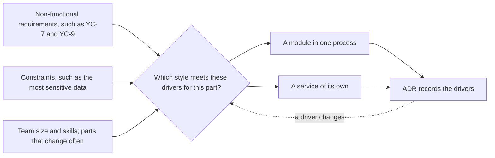

## Before you start

- [[design.l3.when-to-extract-a-service]] — you know a module becomes a service only when it needs something one process cannot give, and what a split costs.
- [[management.l3.weighing-options-in-an-adr]] — you know ADR `0003` weighs three options against the same needs from its context.
- [[management.l2.non-functional-requirements]] — you know YC-7 and YC-9 say how well refunds must work, not what they do.

## The situation

In Sprint 17 two teammates disagree about Catalog. At stage-3 `DonHang.Api` holds two modules, Ordering and Catalog, while Notifications and Payments run as services of their own. One teammate calls this half-finished: large online shops run everything as microservices, so Catalog should become a service too. The other wants Notifications and Payments folded back, because one process was simpler to run. The pull request that starts the Catalog split waits for your review, and both sides argue from a shape they like, not from what Đơn Hàng needs. What should decide which shape each part of Đơn Hàng gets?

## Core concepts

- **architectural driver** — a need or constraint that shapes how a system is split and run, such as a non-functional requirement, the team's size and skills, or a part that changes often.
- **architecture style** — a recurring shape for a whole system, such as a layered monolith, a modular monolith or microservices; a style is good or bad only against a set of drivers.
- fit — a style fits a part of the system when it meets that part's drivers at a cost the team accepts; without drivers there is nothing to measure fit against.
- reason to revisit — a change in a driver, not a change in fashion, that makes the team weigh a choice again.

## How it works



Read the diagram from the left. The three boxes on that side are kinds of architectural drivers, and they come before any style is named. In the situation above, both teammates start on the right, with a shape, and look for reasons afterwards.

The question in the middle is asked per part, not once for the whole system. For a part of Đơn Hàng, its two answers are the boxes on the right: a module in `DonHang.Api` or a service of its own. A whole new system may also start as one process with layers (see the last case below).

Payments faces drivers that Catalog does not: an answer within 2 seconds while the gateway fails, no refund paid twice, and the gateway's key and the money rows as the most sensitive data. The key and the money rows are what ruled out keeping refunds inside `DonHang.Api`; the ADR rejects no option for YC-7 or YC-9. No stage-3 ADR names such a driver for Catalog, so it stays a module behind `ICatalog`, its module contract. That is why stage-3 Đơn Hàng is a modular monolith with two services split off: one way of choosing, applied part by part.

The answer goes into an ADR together with its drivers, not only with the style it picked. That record makes the dashed arrow work: when a driver changes, such as a new team or a new requirement, the team can see which choices rested on it and weigh them again. A style becoming popular is not on that arrow, because it changes nothing Đơn Hàng needs.

So the same team can rightly reach different styles for different systems, or for the same system at different times.

## In the Đơn Hàng system

The context of ADR `0003`, before any option is named:

```markdown file=docs/adr/0003-tach-payments-thanh-service.md tag=stage-3 lines=11-17
### Bối cảnh

Hoàn tiền phải đáp ứng `docs/team/refund-requirements.md`: nhận yêu cầu trong
2 giây kể cả khi cổng thanh toán lỗi (YC-7), không hoàn hai lần (YC-9), tự
gửi lại trong 24 giờ (YC-10). Khóa API của cổng và các dòng tiền là phần nhạy
cảm nhất của hệ thống. Ở thiết kế bản 1, mọi bản sao của `DonHang.Api` đều giữ
khóa đó và đọc ghi được bảng `payments`.
```

Lines 13–15 bring three non-functional requirements from `refund-requirements.md`: accept a refund request within 2 seconds even when the gateway fails (YC-7), never refund twice (YC-9), and keep resending on its own for at least 24 hours before staff take over (YC-10). Lines 15–17 add a constraint: the gateway's API key and the money rows are the most sensitive part, yet in version 1 every copy of `DonHang.Api` holds that key and can read and write `payments`. No line here names a style. The service comes later, in the decision, as the option that keeps the key and the money rows in a service of their own.

The context of ADR `0002`:

```markdown file=docs/adr/0002-tach-notifications-thanh-service.md tag=stage-3 lines=10-24
### Bối cảnh

Đến stage-2, email cho khách là dòng trong bảng `notifications` của database
`donhang`. `QueuedNotifier` ghi dòng đó cùng transaction với đơn, và
`NotificationSender` chạy trong mọi bản sao của `DonHang.Api`, nhận dòng bằng
`FOR UPDATE SKIP LOCKED`. Cách này đúng cho một process. Hai điều đã đổi:

- Cổng thanh toán sắp được gọi từ một service khác (ADR 0003), và service đó
  cũng phải báo tin cho khách. Nếu email vẫn nằm trong API, Payments phải gọi
  vào API hoặc ghi vào bảng của API.
- Máy chủ email chậm hay lỗi thì job gửi chiếm tài nguyên của chính process
  đang nhận đơn. Lỗi của việc gửi email nên tách khỏi việc đặt đơn.

Chỉ chuyện số bản sao thì chưa đủ lý do: job gửi email vẫn chạy được với số
bản sao của API.
```

Lines 12–14 describe the stage-2 design: email rows written in the same transaction as the order and sent by every copy of `DonHang.Api`. Line 15 says that design was right for one process, then names two drivers that changed. Lines 17–19: another service, Payments, must also message customers, and with email inside the API it would have to call the API or write to its tables. Lines 20–21: a slow or failing email server takes resources from the process that takes orders. Lines 23–24 name a tempting reason and reject it: the email job could run with the API's number of copies, so scaling alone did not justify a separate service. Keeping the rejected reason next to the accepted ones shows that the split did not come from wanting services.

## Trade-offs

The first two columns are drivers from the two ADR contexts; the last is the cost a style brings, which fit weighs against them:

| Style | Who holds the gateway key | A slow email server | More to run |
|---|---|---|---|
| Layered monolith | every copy of the one process | slows the process that takes orders | nothing beyond one process |
| Modular monolith | every copy of the one process | slows the process that takes orders | nothing beyond one process |
| Services | only the service that needs it | orders are still placed; messages wait in the queue | an image, a pipeline, a database and a dashboard per service |

No row wins every column. The drivers say which column counts for which part: for Payments the key column decided; for Notifications the email column did, together with Payments needing to message customers; and for Catalog no stage-3 ADR points to any column that one process cannot answer.

## What would you choose if…

…the only complaint about Catalog were that product pages get far more traffic than order taking? Start from the reason ADR `0002` rejected for email. If more copies of the whole `DonHang.Api` carry the load, scaling alone does not justify a service. Keep Catalog a module, and weigh a split only if it needs something one process cannot give.

…a second team were formed to own Catalog, with its own release schedule? Then a new driver exists: two teams that deploy one process share every release of it, so they may have to wait on each other. A split becomes worth weighing, and the ADR that proposes it names that driver and the costs from the table's last column.

…you were starting a small new system with one developer and no requirement stricter than the usual? No driver asks for separate processes, so one process with layers is the cheaper fit. Module boundaries can come when parts start to change for different reasons, and services when a driver asks for one.

## Seniors often assume…

- **"Microservices are the target architecture, and a monolith is only a step on the way there."** → Actually a style is a fit for a set of drivers, not a level of maturity. Stage-3 Đơn Hàng keeps Ordering and Catalog in one process on purpose, and ADR `0002` refuses to split for a reason that one process already met. You notice this belief when a split is planned with no driver in its ADR, only "the next step".
- **"The best architecture is the one that large, well-known companies use."** → Actually a style that suits many teams and heavy load answers those drivers, not yours. Copying it brings the costs without the needs that pay for them; ADR `0002` alone, in its consequences, lists an image, a pipeline, a database and a dashboard more, plus calls that can fail. You notice this when the team spends more time running services than changing what customers use.
- **"The features to build decide the architecture; non-functional requirements only matter when tuning later."** → Actually the same feature can be built in different shapes: ADR `0003` lists refunds inside `DonHang.Api` and refunds in a separate service. What separated them were the drivers in its context, and the key and the money rows ruled out the in-API option. You notice this when a requirement found late, such as answering while a dependency fails, forces work out of a request, which is a change of structure, not a setting.

## Try it (3 minutes)

Open `docs/adr/0002-tach-notifications-thanh-service.md` and `docs/adr/0003-tach-payments-thanh-service.md` in the `don-hang` repository at tag `stage-3`.

1. In each context section, mark every sentence that names a driver, and every sentence that names a style as the goal.
2. In `0002`, find the reason the ADR rejects.

Expected result: in `0003`, lines 13–17 name YC-7, YC-9, YC-10, and the key and money rows as the most sensitive part. In `0002`, lines 17–21 name a second service that must message customers and email failures inside the process that takes orders. No line in either context names a style as the goal. Lines 23–24 of `0002` reject the number of copies as a reason.

The pull request from the situation splits Catalog into a service. Write the one question you would ask in review, and the kind of answer that would make you approve it.

<details><summary>Suggested answer</summary>

Ask: "Which driver does Catalog have that one process cannot meet?" Approve when the answer names one, such as a separate team that needs its own release schedule, or Catalog failures that must not reach order taking. The answer should come as an ADR that also lists what the split costs: one more image, pipeline, database and dashboard to run, and calls that can fail. "Large shops do it" names no driver of Đơn Hàng.

</details>

## Connections

- [[design.l3.when-to-extract-a-service]] — the reasons for one split; this lesson turns them into the rule for every choice of style.
- [[management.l3.weighing-options-in-an-adr]] — how an ADR weighs options; this lesson is about where the needs it weighs them against come from.
- [[management.l2.non-functional-requirements]] — the most common kind of architectural driver.
- [[design.l3.when-not-to-event-source]] — the same reasoning one level down: a way of storing data chosen per aggregate against its needs.
- [[management.l3.build-buy-or-adopt]] — the same rule for getting a capability: the context decides, not a default answer.
- [[design.l4.where-boundaries-are-enforced]] — the next step: what each style changes about where a boundary holds.

## Five-line summary

1. An architecture is chosen from its drivers, the needs and constraints that shape how a system is split and run, not from a style.
2. An architecture style, such as a layered monolith, a modular monolith or microservices, is good or bad only against a set of drivers.
3. ADR `0003` starts from drivers: YC-7, YC-9 and the gateway's key; the key and money rows rule out keeping refunds in the API.
4. ADR `0002` rejects scaling as a reason for Notifications, because the email job could run with the API's number of copies.
5. Different parts and different times can rightly get different styles; a changed driver, not fashion, is the reason to revisit a choice.
