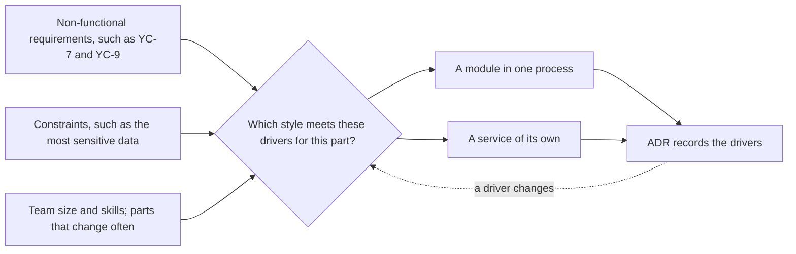

## Bạn cần biết trước

- [[design.l3.when-to-extract-a-service]] — bạn biết một module chỉ thành service khi nó cần thứ một process không đáp ứng được, và biết tách ra thì tốn những gì.
- [[management.l3.weighing-options-in-an-adr]] — bạn biết ADR `0003` cân ba lựa chọn theo cùng các nhu cầu nêu trong phần bối cảnh của nó.
- [[management.l2.non-functional-requirements]] — bạn biết YC-7 và YC-9 nói hoàn tiền phải chạy tốt đến mức nào, chứ không nói nó làm gì.

## Tình huống

Ở Sprint 17, hai đồng nghiệp bất đồng về Catalog. Ở stage-3, `DonHang.Api` chứa hai module là Ordering và Catalog, còn Notifications và Payments chạy thành service riêng. Một người cho rằng thế là làm dở dang: các cửa hàng online lớn chạy toàn bộ bằng microservice, nên Catalog cũng phải thành service. Người kia muốn gộp Notifications và Payments trở lại, vì một process thì vận hành đơn giản hơn. Pull request bắt đầu tách Catalog đang chờ bạn review, và cả hai bên đều lập luận từ một hình dạng mình thích, chứ không từ thứ Đơn Hàng cần. Vậy điều gì nên quyết định mỗi phần của Đơn Hàng có hình dạng nào?

## Khái niệm cốt lõi

- **yếu tố định hình kiến trúc** (architectural driver) — một nhu cầu hay ràng buộc quyết định cách chia và chạy hệ thống, chẳng hạn một yêu cầu phi chức năng, quy mô và kỹ năng của team, hay một phần thay đổi thường xuyên.
- **kiểu kiến trúc** (architecture style) — một hình dạng lặp lại cho cả hệ thống, như layered monolith, modular monolith hay microservice. Một kiểu chỉ tốt hay xấu khi đặt cạnh một tập yếu tố định hình kiến trúc.
- vừa vặn — một kiểu vừa vặn với một phần của hệ thống khi nó đáp ứng các yếu tố định hình của phần đó với cái giá team chấp nhận được. Không có yếu tố định hình thì chẳng có gì để đo độ vừa vặn.
- lý do xem lại — một yếu tố định hình thay đổi, chứ không phải trào lưu thay đổi, khiến team phải cân lại một lựa chọn.

## Cơ chế hoạt động



Đọc sơ đồ từ bên trái. Ba ô ở bên đó là ba loại yếu tố định hình kiến trúc, và chúng có mặt trước khi bất kỳ kiểu nào được nêu tên. Trong tình huống trên, cả hai đồng nghiệp đều bắt đầu từ bên phải, tức là từ một hình dạng, rồi mới đi tìm lý do.

Câu hỏi ở giữa được đặt cho từng phần, không phải một lần cho cả hệ thống. Với một phần của Đơn Hàng, hai câu trả lời là hai ô bên phải: một module trong `DonHang.Api`, hoặc một service riêng. Một hệ thống hoàn toàn mới cũng có thể bắt đầu bằng một process chia tầng (xem trường hợp cuối ở phần dưới).

Payments gặp những yếu tố định hình mà Catalog không có: trả lời trong 2 giây ngay cả khi cổng thanh toán lỗi, không bao giờ hoàn tiền hai lần, và khóa của cổng cùng các dòng tiền là dữ liệu nhạy cảm nhất. Chính khóa và các dòng tiền đã loại phương án giữ hoàn tiền trong `DonHang.Api`. ADR không loại lựa chọn nào vì YC-7 hay YC-9. Không ADR nào ở stage-3 nêu một yếu tố như vậy cho Catalog, nên Catalog vẫn là module nằm sau `ICatalog`, hợp đồng của module đó. Vì thế Đơn Hàng ở stage-3 là một modular monolith với hai service đã tách ra: cùng một lối chọn, áp dụng cho từng phần.

Câu trả lời được ghi vào ADR cùng với các yếu tố định hình của nó, không chỉ với kiểu đã chọn. Bản ghi đó giúp mũi tên nét đứt hoạt động: khi một yếu tố định hình thay đổi, chẳng hạn có team mới hay yêu cầu mới, team thấy được những lựa chọn nào dựa trên nó và cân lại. Một kiểu trở nên phổ biến thì không nằm trên mũi tên đó, vì nó không đổi gì trong những thứ Đơn Hàng cần.

Vậy nên cùng một team có thể đi đến các kiểu khác nhau cho các hệ thống khác nhau, hoặc cho cùng một hệ thống ở những thời điểm khác nhau, và cả hai đều đúng.

## Trong hệ thống Đơn Hàng

Phần bối cảnh của ADR `0003`, trước khi lựa chọn nào được nêu:

```markdown file=docs/adr/0003-tach-payments-thanh-service.md tag=stage-3 lines=11-17
### Bối cảnh

Hoàn tiền phải đáp ứng `docs/team/refund-requirements.md`: nhận yêu cầu trong
2 giây kể cả khi cổng thanh toán lỗi (YC-7), không hoàn hai lần (YC-9), tự
gửi lại trong 24 giờ (YC-10). Khóa API của cổng và các dòng tiền là phần nhạy
cảm nhất của hệ thống. Ở thiết kế bản 1, mọi bản sao của `DonHang.Api` đều giữ
khóa đó và đọc ghi được bảng `payments`.
```

Dòng 13–15 mang ba yêu cầu phi chức năng từ `refund-requirements.md`: nhận yêu cầu hoàn tiền trong 2 giây ngay cả khi cổng thanh toán lỗi (YC-7), không bao giờ hoàn hai lần (YC-9), và tự gửi lại trong ít nhất 24 giờ trước khi nhân viên xử lý tay (YC-10). Dòng 15–17 thêm một ràng buộc: khóa API của cổng và các dòng tiền là phần nhạy cảm nhất, vậy mà ở bản 1, mọi bản sao của `DonHang.Api` đều giữ khóa đó và đọc ghi được `payments`. Không dòng nào ở đây nêu tên một kiểu. Service xuất hiện sau, trong phần quyết định, như lựa chọn giữ khóa và các dòng tiền trong một service riêng.

Phần bối cảnh của ADR `0002`:

```markdown file=docs/adr/0002-tach-notifications-thanh-service.md tag=stage-3 lines=10-24
### Bối cảnh

Đến stage-2, email cho khách là dòng trong bảng `notifications` của database
`donhang`. `QueuedNotifier` ghi dòng đó cùng transaction với đơn, và
`NotificationSender` chạy trong mọi bản sao của `DonHang.Api`, nhận dòng bằng
`FOR UPDATE SKIP LOCKED`. Cách này đúng cho một process. Hai điều đã đổi:

- Cổng thanh toán sắp được gọi từ một service khác (ADR 0003), và service đó
  cũng phải báo tin cho khách. Nếu email vẫn nằm trong API, Payments phải gọi
  vào API hoặc ghi vào bảng của API.
- Máy chủ email chậm hay lỗi thì job gửi chiếm tài nguyên của chính process
  đang nhận đơn. Lỗi của việc gửi email nên tách khỏi việc đặt đơn.

Chỉ chuyện số bản sao thì chưa đủ lý do: job gửi email vẫn chạy được với số
bản sao của API.
```

Dòng 12–14 mô tả thiết kế ở stage-2: dòng email được ghi cùng giao dịch với đơn, và mọi bản sao của `DonHang.Api` đều gửi. Dòng 15 nói thiết kế đó đúng cho một process, rồi nêu hai yếu tố định hình đã thay đổi. Dòng 17–19: một service khác là Payments cũng phải báo tin cho khách, và nếu email nằm trong API thì nó phải gọi vào API hoặc ghi vào bảng của API. Dòng 20–21: máy chủ email chậm hay lỗi sẽ lấy tài nguyên của process đang nhận đơn. Dòng 23–24 nêu một lý do hấp dẫn rồi bác bỏ nó: job gửi email chạy được với số bản sao của API, nên riêng chuyện scale không đủ biện minh cho một service riêng. Giữ lý do bị bác bỏ ngay cạnh các lý do được chấp nhận cho thấy lần tách này không đến từ chuyện muốn có service.

## Đánh đổi

Hai cột đầu là các yếu tố định hình lấy từ phần bối cảnh của hai ADR. Cột cuối là cái giá mà một kiểu mang theo, và độ vừa vặn cân cái giá đó với hai cột kia:

| Kiểu | Ai giữ khóa của cổng | Máy chủ email chậm | Phải vận hành thêm |
|---|---|---|---|
| Layered monolith | mọi bản sao của process duy nhất | làm chậm process đang nhận đơn | không gì ngoài một process |
| Modular monolith | mọi bản sao của process duy nhất | làm chậm process đang nhận đơn | không gì ngoài một process |
| Service | chỉ service cần đến nó | đơn vẫn được đặt, message chờ trong hàng đợi | mỗi service một image, một pipeline, một database và một dashboard |

Không hàng nào thắng ở mọi cột. Các yếu tố định hình cho biết cột nào quan trọng với phần nào: với Payments, cột khóa quyết định. Với Notifications, cột email quyết định, cùng với chuyện Payments cần báo tin cho khách. Còn với Catalog, không ADR nào ở stage-3 chỉ ra cột nào mà một process không đáp ứng được.

## Bạn sẽ chọn gì nếu…

…lời phàn nàn duy nhất về Catalog là trang sản phẩm có lượng truy cập lớn hơn nhiều so với phần nhận đơn? Hãy bắt đầu từ lý do mà ADR `0002` đã bác bỏ cho email. Nếu thêm bản sao của cả `DonHang.Api` gánh được tải, thì riêng chuyện scale không đủ biện minh cho một service. Giữ Catalog là module, và chỉ cân nhắc tách khi nó cần thứ một process không đáp ứng được.

…một team thứ hai được lập ra để sở hữu Catalog, với lịch release riêng? Khi đó có một yếu tố định hình mới: hai team cùng deploy một process thì dùng chung mọi lần release của nó, nên có thể phải chờ nhau. Lúc này việc tách đáng được cân nhắc, và ADR đề xuất tách sẽ nêu yếu tố đó cùng các chi phí ở cột cuối của bảng.

…bạn bắt đầu một hệ thống mới nhỏ, với một lập trình viên và không có yêu cầu nào khắt khe hơn thông thường? Không yếu tố nào đòi các process riêng, nên một process chia tầng là lựa chọn vừa vặn và rẻ hơn. Ranh giới module có thể đến khi các phần bắt đầu thay đổi vì những lý do khác nhau, và service đến khi một yếu tố định hình đòi hỏi.

## Senior hay nhầm rằng…

- **"Microservice là kiến trúc đích, còn monolith chỉ là một bước trên đường đến đó."** → Thực ra một kiểu là sự vừa vặn với một tập yếu tố định hình, không phải một cấp độ trưởng thành. Đơn Hàng ở stage-3 cố ý giữ Ordering và Catalog trong một process, và ADR `0002` từ chối tách vì một lý do mà một process đã đáp ứng. Bạn sẽ nhận ra niềm tin này khi một lần tách được lên kế hoạch mà ADR của nó không có yếu tố định hình nào, chỉ có "bước tiếp theo".
- **"Kiến trúc tốt nhất là kiến trúc các công ty lớn, nổi tiếng đang dùng."** → Thực ra một kiểu hợp với nhiều team và tải nặng là câu trả lời cho các yếu tố định hình đó, không phải của bạn. Sao chép nó thì mang về cái giá mà không có các nhu cầu để bù lại. Chỉ riêng ADR `0002`, ở phần hệ quả, đã liệt kê thêm một image, một pipeline, một database và một dashboard, cộng với các lời gọi có thể thất bại. Bạn sẽ nhận ra khi team tốn nhiều thời gian vận hành service hơn là sửa những thứ khách hàng dùng.
- **"Các tính năng cần làm quyết định kiến trúc, còn yêu cầu phi chức năng chỉ quan trọng khi tinh chỉnh về sau."** → Thực ra cùng một tính năng có thể làm theo nhiều hình dạng: ADR `0003` liệt kê hoàn tiền nằm trong `DonHang.Api` và hoàn tiền trong một service riêng. Thứ phân biệt chúng là các yếu tố định hình trong phần bối cảnh, và khóa cùng các dòng tiền đã loại phương án nằm trong API. Bạn sẽ nhận ra khi một yêu cầu phát hiện muộn, chẳng hạn phải trả lời trong lúc một phụ thuộc đang lỗi, buộc phải đưa công việc ra khỏi request, tức là thay đổi cấu trúc, không phải một thiết lập.

## Thử ngay (3 phút)

Mở `docs/adr/0002-tach-notifications-thanh-service.md` và `docs/adr/0003-tach-payments-thanh-service.md` trong repo `don-hang` ở tag `stage-3`.

1. Trong mỗi phần bối cảnh, đánh dấu mọi câu nêu một yếu tố định hình, và mọi câu nêu một kiểu như mục tiêu.
2. Trong `0002`, tìm lý do mà ADR bác bỏ.

Kết quả mong đợi: trong `0003`, dòng 13–17 nêu YC-7, YC-9, YC-10, cùng khóa và các dòng tiền là phần nhạy cảm nhất. Trong `0002`, dòng 17–21 nêu một service thứ hai phải báo tin cho khách, và lỗi email nằm trong process đang nhận đơn. Không dòng nào trong hai phần bối cảnh nêu một kiểu như mục tiêu. Dòng 23–24 của `0002` bác bỏ số bản sao như một lý do.

Pull request trong tình huống tách Catalog thành service. Hãy viết câu hỏi duy nhất bạn sẽ hỏi khi review, và kiểu câu trả lời khiến bạn approve.

<details><summary>Gợi ý đáp án</summary>

Hỏi: "Catalog có yếu tố định hình nào mà một process không đáp ứng được?" Approve khi câu trả lời nêu được một yếu tố, chẳng hạn một team riêng cần lịch release riêng, hoặc lỗi của Catalog không được lan sang phần nhận đơn. Câu trả lời nên có dạng một ADR, liệt kê cả cái giá khi tách: thêm một image, một pipeline, một database và một dashboard phải vận hành, và các lời gọi có thể thất bại. "Các cửa hàng lớn đều làm vậy" không nêu yếu tố định hình nào của Đơn Hàng.

</details>

## Liên hệ

- [[design.l3.when-to-extract-a-service]] — các lý do cho một lần tách. Bài này biến chúng thành quy tắc cho mọi lựa chọn kiểu kiến trúc.
- [[management.l3.weighing-options-in-an-adr]] — cách một ADR cân các lựa chọn. Bài này nói về nơi xuất phát của các nhu cầu dùng để cân.
- [[management.l2.non-functional-requirements]] — loại yếu tố định hình kiến trúc thường gặp nhất.
- [[design.l3.when-not-to-event-source]] — cùng cách suy luận ở một tầng thấp hơn: cách lưu dữ liệu được chọn cho từng aggregate theo nhu cầu của nó.
- [[management.l3.build-buy-or-adopt]] — cùng quy tắc cho việc có được một năng lực: bối cảnh quyết định, không phải một câu trả lời mặc định.
- [[design.l4.where-boundaries-are-enforced]] — bước tiếp theo: mỗi kiểu thay đổi điều gì về nơi một ranh giới được giữ.

## Tóm tắt 5 dòng

1. Kiến trúc được chọn từ các yếu tố định hình nó, tức là các nhu cầu và ràng buộc quyết định cách chia và chạy hệ thống, không từ một kiểu có sẵn.
2. Một kiểu kiến trúc, như layered monolith, modular monolith hay microservice, chỉ tốt hay xấu khi đặt cạnh một tập yếu tố định hình.
3. ADR `0003` bắt đầu từ các yếu tố định hình: YC-7, YC-9 và khóa của cổng. Khóa và các dòng tiền loại phương án giữ hoàn tiền trong API.
4. ADR `0002` bác bỏ scale như một lý do cho Notifications, vì job gửi email chạy được với số bản sao của API.
5. Các phần khác nhau và các thời điểm khác nhau có thể có kiểu khác nhau mà vẫn đúng. Lý do xem lại một lựa chọn là yếu tố định hình thay đổi, không phải trào lưu.
