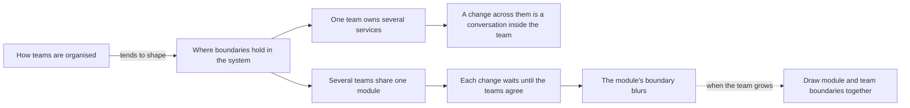

## Before you start

- [[design.l4.merging-a-service-back]] — you know that a split or a merge is weighed against drivers, the needs and constraints written in its ADR.
- [[design.l3.bounded-context]] — you know a boundary inside which one model and its words apply.
- [[management.l1.scrum-from-junior-seat]] — you know a Scrum team's roles and that it plans one sprint together.

## The situation

At stage-3 Đơn Hàng runs three services: `DonHang.Api`, `DonHang.Notifications` and `DonHang.Payments`. In a planning meeting a teammate quotes a rule from an article: a system copies the structure of the organisation that builds it. "We are one team with three services. Either each service gets a team of its own, or we split the wrong way." Another teammate shrugs: how people are grouped is a management matter, not a code matter. You open the sprint document and the two ADRs that created the services. What does the way a team is organised say about where Đơn Hàng's boundaries should fall?

## Core concepts

- **Conway's law** — the observation that the structure of a system tends to mirror the communication structure of the organisation that builds it.
- communication structure — who has to talk to whom before a change can be made: inside one team that is a conversation, between teams it is a request and an agreement.
- team boundary — the line between what one team can change on its own and what needs another team to agree.
- the team's shape as a driver — the number of teams and how they split the work, weighed like any other need or constraint when boundaries are drawn.

## How it works



In the situation above, the organisation is one team, and Conway's law is the arrow on the left. Who talks to whom decides which changes are cheap and which are slow, and over time the boundaries in the code tend to settle along those lines. The law describes a tendency, not a rule that maps one service to one team. The two branches are two ways team and system boundaries can line up: one team over several parts, or several teams in one part.

Follow the upper branch. When one team owns several services, a change that crosses them is discussed at the same daily and planned on the same sprint board. The split still has the network's costs (calls that can fail or be slow, and one more thing to build, deploy and watch), but it adds no waiting between people.

Follow the lower branch. When several teams share one module, each change needs them to agree first, so work waits on another team's plans. To avoid that wait, each team tends to add what it needs in whatever code it can change without asking. Because no single team keeps the module's boundary, the boundary tends to blur.

The dotted arrow is the way out. When a team grows into several, drawing module boundaries and team boundaries together lets each team change its part without waiting for another, except when the contract where they meet has to change. So the team's shape is itself an architectural driver: when it changes, weigh the boundaries again.

## In the Đơn Hàng system

`DonHang.Api` holds two modules: Ordering, for orders, and Catalog, for products. Other code reaches Catalog only through the `ICatalog` interface, its module contract.

Who builds Đơn Hàng, and how one sprint's work is shared out:

```markdown file=docs/team/sprint-example.md tag=stage-3 lines=1-18
# Sprint 14 của đội Đơn Hàng

Độ dài: hai tuần. Đội: một product owner, một scrum master, bốn lập trình viên,
một tester.

## Mục tiêu sprint

> Khách hàng tự hủy được đơn chưa thanh toán mà không cần gọi tổng đài.

## Sprint backlog

| Việc | Người nhận | Ước lượng | Trạng thái cuối sprint |
|---|---|---|---|
| API `POST /api/v1/orders/{id}/cancel` | Dev 1 | 3 | Xong |
| Nút "Hủy đơn" trên màn hình đơn hàng | Dev 2 | 3 | Xong |
| Chặn hủy đơn đã thanh toán | Dev 1 | 2 | Xong |
| Ngừng gửi thông báo cho đơn đã hủy | Dev 3 | 2 | Chưa xong, chuyển sprint sau |
| Sửa lỗi tổng tiền sai ở đơn nhiều dòng | Dev 4 | 1 | Xong |
```

Lines 3–4 describe the team that builds Đơn Hàng: one product owner, one scrum master, four developers and one tester. The backlog in lines 14–18 puts an API endpoint, a button in the app and the notification work on one board, shared among the same four developers. Developers are named by number, not by service, and nothing here gives a service a team of its own.

Why Payments became a service:

```markdown file=docs/adr/0003-tach-payments-thanh-service.md tag=stage-3 lines=1-17
# 0003. Tách Payments thành service riêng, nối với API bằng saga

Trạng thái: Đã chấp nhận
Ngày: quyết định trước stage-3, viết lại thành ADR trong Sprint 16
Người quyết định: trưởng nhóm
Hạn góp ý: không có (viết sau khi đã làm)

ADR này viết sau khi đã làm, theo ADR 0001. Cách luồng hoàn tiền chạy từng
bước ở `docs/design/refund-design.md` (bản 2); ADR này chỉ ghi quyết định.

### Bối cảnh

Hoàn tiền phải đáp ứng `docs/team/refund-requirements.md`: nhận yêu cầu trong
2 giây kể cả khi cổng thanh toán lỗi (YC-7), không hoàn hai lần (YC-9), tự
gửi lại trong 24 giờ (YC-10). Khóa API của cổng và các dòng tiền là phần nhạy
cảm nhất của hệ thống. Ở thiết kế bản 1, mọi bản sao của `DonHang.Api` đều giữ
khóa đó và đọc ghi được bảng `payments`.
```

Line 5 names one decider, "trưởng nhóm" (the team lead), the same as line 5 of ADR `0002`. Lines 13–17 give the reasons: the refund requirements, and, as the most sensitive part of the system, the money rows and the API key of the payment gateway, the outside service that moves the money. No team appears among them.

ADR `0002`, outside these excerpts, gives its own reasons in lines 17–21: another service must also message customers, and a slow or failing email server should not take resources from the process that takes orders. So ADRs `0002` and `0003` split services for reasons of their own (a second service that must also message customers, keeping email failures away from taking orders, the refund requirements and the gateway's key), and none of them is a team. The docs describe one team and one decider, with no team per service.

## Trade-offs

| Shape | A change across two parts | Waiting on another team | What it costs |
|---|---|---|---|
| One team, three services (stage-3) | a conversation inside the team | none | the network's costs, paid for the ADRs' reasons |
| One team per service, same split | an agreement on the message between two teams | whenever the message between them changes | more agreements than the work of three small services needs |
| Several teams sharing one module | an agreement before every change | often | a boundary nobody keeps, which tends to blur |
| Teams drawn along module boundaries | inside a team's module: a conversation; across a contract: an agreement | only when a contract changes | boundaries that must already hold, such as Catalog behind `ICatalog` |

The first and fourth rows keep the people who must talk inside one team for most changes. The second adds teams the work did not ask for, and the third puts teams where no boundary separates them.

## What would you choose if…

…the team stays at four developers and a teammate proposes splitting Catalog into a service "so we move faster"? One team already changes Ordering and Catalog without waiting for anyone, so a service would add the network's costs and remove no waiting. Keep Catalog a module unless drivers of its own call for a split, as ADRs `0002` and `0003` named theirs.

…enough developers join that one sprint board no longer fits, and a second team is formed for the product and catalog work? Draw the new team's boundary along Catalog's module boundary, so `ICatalog` is where the two teams meet. Whether Catalog then also becomes a service is a separate question, decided by its own drivers.

…someone proposes giving Notifications and Payments a team each, to match the services? Ask what each new team would change on its own. While one team can plan all the work in one sprint, extra teams add the agreements the law warns about and remove no waiting.

## Seniors often assume…

- **"How teams are organised is a management matter that has no effect on the code."** → Actually who has to talk to whom decides which changes are cheap, and boundaries tend to settle along those lines whether anyone plans them or not. You notice this when a module two teams share collects code each team put wherever it could reach, and pull requests wait for the other team's review.
- **"Splitting into microservices is what lets one small team move faster."** → Actually one team already changes any part without waiting for another team, so services cannot remove waiting that does not exist. They buy independence in releasing, in running more copies of one part without the others, and in failing, and charge the network's costs for it. You notice this when a small team's sprints fill with pipelines, dashboards and message changes instead of features.
- **"Conway's law means every service must have a team of its own."** → Actually the law describes a tendency, not a mapping: one team can own several services, as Đơn Hàng's one team owns three. The risk it points to is the opposite case, several teams inside one part. You notice this belief when a plan sizes the teams by counting services rather than by the work.

## Try it (3 minutes)

Open `docs/team/sprint-example.md` in the `don-hang` repository at tag `stage-3`.

1. Find the backlog row that changes notifications, and the row it depends on (the row that must be done first for it to make sense).
2. Suppose notifications had a team of its own. Say which rows would then need two teams to agree before they could finish, and what the two teams would have to agree on.

Expected result: one pair of rows and one sentence naming what the teams must agree on.

<details><summary>Suggested answer</summary>

1. Line 17, "Ngừng gửi thông báo cho đơn đã hủy" (stop sending notifications for cancelled orders), depends on line 14, the cancel endpoint in the API.
2. Line 17 would need both teams: the order is cancelled in the API, and the notification is sent by the other side. The API tells Notifications about an order by sending it a message, so whichever side checks for a cancelled order, the two teams must agree on what that message says. Today that is a conversation between Dev 1 and Dev 3 at the same daily.

</details>

## Connections

- [[design.l4.architectural-drivers]] — the list of drivers this lesson adds the team's shape to.
- [[design.l4.merging-a-service-back]] — the same weighing of drivers; a change in the teams is one more reason to reopen a boundary.
- [[design.l3.bounded-context]] — a model boundary, kept most easily when one team owns both sides of the words it protects.
- [[design.l3.subdomains]] — the business view of the same question: parts of the problem a team can be drawn around.
- [[management.l3.proposing-an-adr]] — how a boundary change between teams is proposed so people on both sides can object.
- [[management.l4.scaling-with-small-teams]] — next for how to organise the teams themselves, which this lesson leaves out.

## Five-line summary

1. Conway's law: a system's structure tends to mirror the communication structure of the organisation that builds it.
2. Đơn Hàng's docs describe one team: a product owner, a scrum master, four developers and a tester, with no team per service.
3. ADRs `0002` and `0003` split services for reasons of their own, such as email failures and the gateway's key, not along a team boundary.
4. One team owning several services discusses changes inside the team; several teams sharing one module must agree on each change, and its boundary blurs.
5. Drawing module and team boundaries together lets each team change alone except when a contract changes, so a growing team is an architectural driver.
