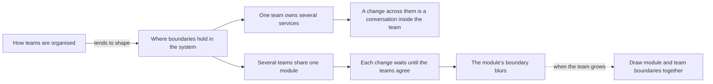

## Bạn cần biết trước

- [[design.l4.merging-a-service-back]] — bạn biết một lần tách hay một lần gộp đều được cân với các yếu tố định hình kiến trúc, tức những nhu cầu và ràng buộc ghi trong ADR của nó.
- [[design.l3.bounded-context]] — bạn biết một ranh giới mà bên trong đó chỉ một model và bộ từ ngữ của nó có hiệu lực.
- [[management.l1.scrum-from-junior-seat]] — bạn biết các vai trong một đội Scrum, và cả đội cùng lập kế hoạch cho một sprint.

## Tình huống

Ở stage-3, Đơn Hàng chạy ba service: `DonHang.Api`, `DonHang.Notifications` và `DonHang.Payments`. Trong buổi họp lập kế hoạch, một đồng nghiệp dẫn một quy tắc đọc được trong một bài viết: hệ thống sẽ sao chép cấu trúc của tổ chức xây nên nó. "Mình là một đội mà có ba service. Hoặc mỗi service có đội riêng, hoặc mình đang tách sai." Một đồng nghiệp khác nhún vai: chia người thế nào là chuyện quản lý, không phải chuyện code. Bạn mở tài liệu sprint và hai ADR đã tạo ra các service. Cách tổ chức đội nói lên điều gì về chỗ đặt ranh giới của Đơn Hàng?

## Khái niệm cốt lõi

- **định luật Conway** (Conway's law) — nhận xét rằng cấu trúc của một hệ thống có xu hướng phản chiếu cấu trúc trao đổi của tổ chức xây nên nó.
- cấu trúc trao đổi — ai phải nói chuyện với ai thì một thay đổi mới làm được: trong một đội đó là một cuộc trao đổi, giữa các đội đó là một yêu cầu và một thỏa thuận.
- ranh giới đội — đường phân cách giữa những gì một đội tự thay đổi được và những gì cần đội khác đồng ý.
- hình dạng đội như một yếu tố định hình kiến trúc — số đội và cách họ chia việc, được cân như mọi nhu cầu hay ràng buộc khác khi vẽ ranh giới.

## Cơ chế hoạt động



Trong tình huống trên, tổ chức là một đội, và định luật Conway là mũi tên bên trái. Ai nói chuyện với ai sẽ quyết định thay đổi nào rẻ, thay đổi nào chậm, và lâu dần ranh giới trong code có xu hướng lắng xuống theo đúng những đường đó. Định luật mô tả một xu hướng, không phải quy tắc mỗi service một đội. Hai nhánh là hai cách ranh giới đội và ranh giới hệ thống khớp với nhau: một đội trên nhiều phần, hoặc nhiều đội trong một phần.

Đi theo nhánh trên. Khi một đội sở hữu nhiều service, thay đổi chạm qua các service đó được bàn trong cùng một buổi daily và lên kế hoạch trên cùng một bảng sprint. Việc tách vẫn mang theo cái giá của mạng (lời gọi có thể lỗi hoặc chậm, thêm một thứ phải build, deploy và theo dõi), nhưng không thêm chuyện người này phải chờ người kia.

Đi theo nhánh dưới. Khi nhiều đội dùng chung một module, mỗi thay đổi đều cần các đội đồng ý trước, nên công việc phải chờ kế hoạch của đội khác. Để khỏi chờ, mỗi đội có xu hướng thêm thứ mình cần vào bất kỳ chỗ code nào mình sửa được mà không phải hỏi ai. Vì không đội nào giữ ranh giới của module, ranh giới đó dần nhòe đi.

Mũi tên đứt nét là lối ra. Khi một đội lớn lên thành nhiều đội, vẽ ranh giới module và ranh giới đội cùng lúc giúp mỗi đội sửa phần của mình mà không phải chờ đội khác, trừ khi hợp đồng ở chỗ hai bên gặp nhau phải đổi. Vậy nên hình dạng của đội tự nó là một yếu tố định hình kiến trúc: khi nó đổi, hãy cân lại các ranh giới.

## Trong hệ thống Đơn Hàng

`DonHang.Api` chứa hai module: Ordering, cho đơn hàng, và Catalog, cho sản phẩm. Code khác chỉ tới được Catalog qua interface `ICatalog`, hợp đồng của module này.

Ai xây Đơn Hàng, và việc của một sprint được chia ra sao:

```markdown file=docs/team/sprint-example.md tag=stage-3 lines=1-18
# Sprint 14 của đội Đơn Hàng

Độ dài: hai tuần. Đội: một product owner, một scrum master, bốn lập trình viên,
một tester.

## Mục tiêu sprint

> Khách hàng tự hủy được đơn chưa thanh toán mà không cần gọi tổng đài.

## Sprint backlog

| Việc | Người nhận | Ước lượng | Trạng thái cuối sprint |
|---|---|---|---|
| API `POST /api/v1/orders/{id}/cancel` | Dev 1 | 3 | Xong |
| Nút "Hủy đơn" trên màn hình đơn hàng | Dev 2 | 3 | Xong |
| Chặn hủy đơn đã thanh toán | Dev 1 | 2 | Xong |
| Ngừng gửi thông báo cho đơn đã hủy | Dev 3 | 2 | Chưa xong, chuyển sprint sau |
| Sửa lỗi tổng tiền sai ở đơn nhiều dòng | Dev 4 | 1 | Xong |
```

Dòng 3–4 mô tả đội xây Đơn Hàng: một product owner, một scrum master, bốn lập trình viên và một tester. Backlog ở dòng 14–18 đặt một endpoint API, một nút trong app và việc thông báo lên cùng một bảng, chia cho cùng bốn lập trình viên. Lập trình viên được gọi theo số, không theo service, và không chỗ nào ở đây cho một service có đội riêng.

Vì sao Payments thành service:

```markdown file=docs/adr/0003-tach-payments-thanh-service.md tag=stage-3 lines=1-17
# 0003. Tách Payments thành service riêng, nối với API bằng saga

Trạng thái: Đã chấp nhận
Ngày: quyết định trước stage-3, viết lại thành ADR trong Sprint 16
Người quyết định: trưởng nhóm
Hạn góp ý: không có (viết sau khi đã làm)

ADR này viết sau khi đã làm, theo ADR 0001. Cách luồng hoàn tiền chạy từng
bước ở `docs/design/refund-design.md` (bản 2); ADR này chỉ ghi quyết định.

### Bối cảnh

Hoàn tiền phải đáp ứng `docs/team/refund-requirements.md`: nhận yêu cầu trong
2 giây kể cả khi cổng thanh toán lỗi (YC-7), không hoàn hai lần (YC-9), tự
gửi lại trong 24 giờ (YC-10). Khóa API của cổng và các dòng tiền là phần nhạy
cảm nhất của hệ thống. Ở thiết kế bản 1, mọi bản sao của `DonHang.Api` đều giữ
khóa đó và đọc ghi được bảng `payments`.
```

Dòng 5 ghi một người quyết định, "trưởng nhóm", giống dòng 5 của ADR `0002`. Dòng 13–17 nêu lý do: các yêu cầu về hoàn tiền, và phần nhạy cảm nhất của hệ thống là các dòng tiền cùng khóa API của cổng thanh toán, dịch vụ bên ngoài chuyển tiền. Không có đội nào trong số các lý do đó.

ADR `0002`, nằm ngoài các đoạn trích này, nêu lý do riêng ở dòng 17–21: một service khác cũng phải báo tin cho khách, và server email chậm hay lỗi không được lấy tài nguyên của process nhận đơn. Như vậy ADR `0002` và `0003` tách service vì những lý do riêng (một service thứ hai cũng phải báo tin cho khách, giữ lỗi email tránh xa phần nhận đơn, các yêu cầu hoàn tiền và khóa của cổng thanh toán), và không lý do nào là một đội. Tài liệu mô tả một đội và một người quyết định, không có đội riêng cho từng service.

## Đánh đổi

| Hình dạng | Một thay đổi chạm hai phần | Chờ đội khác | Cái giá |
|---|---|---|---|
| Một đội, ba service (stage-3) | một cuộc trao đổi trong đội | không | cái giá của mạng, trả cho những lý do trong các ADR |
| Mỗi service một đội, cách tách giữ nguyên | một thỏa thuận giữa hai đội về message | mỗi khi message giữa hai bên đổi | nhiều thỏa thuận hơn mức công việc của ba service nhỏ cần |
| Nhiều đội dùng chung một module | một thỏa thuận trước mỗi thay đổi | thường xuyên | một ranh giới không ai giữ, dần nhòe đi |
| Đội vẽ theo ranh giới module | trong module của một đội: một cuộc trao đổi, qua hợp đồng: một thỏa thuận | chỉ khi hợp đồng đổi | ranh giới phải vững sẵn, như Catalog đứng sau `ICatalog` |

Hàng đầu và hàng thứ tư giữ những người phải nói chuyện với nhau trong cùng một đội cho phần lớn thay đổi. Hàng thứ hai thêm những đội mà công việc không đòi hỏi, còn hàng thứ ba đặt các đội vào chỗ không có ranh giới nào tách họ ra.

## Bạn sẽ chọn gì nếu…

…đội vẫn bốn lập trình viên, và một đồng nghiệp đề xuất tách Catalog thành service "cho nhanh hơn"? Một đội đã sửa được cả Ordering lẫn Catalog mà không phải chờ ai, nên một service sẽ thêm cái giá của mạng mà không bớt được lần chờ nào. Hãy giữ Catalog là module, trừ khi có những yếu tố riêng đòi tách, như ADR `0002` và `0003` đã nêu tên yếu tố của chúng.

…có đủ lập trình viên mới vào tới mức một bảng sprint không còn chứa nổi, và một đội thứ hai được lập cho phần sản phẩm và catalog? Hãy vẽ ranh giới của đội mới theo ranh giới module của Catalog, để `ICatalog` là chỗ hai đội gặp nhau. Còn Catalog có thành service hay không là một câu hỏi khác, do các yếu tố riêng của nó quyết định.

…ai đó đề xuất cho Notifications và Payments mỗi bên một đội, cho khớp với các service? Hãy hỏi mỗi đội mới sẽ tự mình thay đổi được gì. Chừng nào một đội còn lên kế hoạch được toàn bộ công việc trong một sprint, thêm đội chỉ thêm những thỏa thuận mà định luật cảnh báo, và không bớt được lần chờ nào.

## Senior hay nhầm rằng…

- **"Tổ chức đội thế nào là chuyện quản lý, không ảnh hưởng gì tới code."** → Thực ra ai phải nói chuyện với ai sẽ quyết định thay đổi nào rẻ, và ranh giới có xu hướng lắng xuống theo những đường đó, dù có ai lên kế hoạch hay không. Bạn sẽ nhận ra khi một module hai đội dùng chung đầy code mà mỗi đội đặt vào bất cứ chỗ nào với tới được, và pull request phải chờ đội kia review.
- **"Tách thành microservice là điều giúp một đội nhỏ đi nhanh hơn."** → Thực ra một đội vốn đã sửa được mọi phần mà không phải chờ đội nào khác, nên service không thể xóa đi sự chờ đợi vốn không tồn tại. Service mua sự độc lập khi release, khi chạy thêm bản sao của một phần mà không cần các phần khác, và khi lỗi, rồi tính tiền bằng cái giá của mạng. Bạn sẽ nhận ra khi các sprint của một đội nhỏ đầy việc pipeline, dashboard và sửa message thay vì tính năng.
- **"Định luật Conway nghĩa là service nào cũng phải có đội riêng."** → Thực ra định luật mô tả một xu hướng, không phải một phép ánh xạ: một đội có thể sở hữu nhiều service, như một đội của Đơn Hàng sở hữu ba service. Rủi ro mà nó chỉ ra là trường hợp ngược lại, nhiều đội bên trong một phần. Bạn sẽ nhận ra niềm tin này khi một kế hoạch tính số đội bằng cách đếm service thay vì nhìn vào công việc.

## Thử ngay (3 phút)

Mở `docs/team/sprint-example.md` trong repo `don-hang` ở tag `stage-3`.

1. Tìm hàng backlog thay đổi phần thông báo, và hàng mà nó phụ thuộc vào (hàng phải xong trước thì nó mới có nghĩa).
2. Giả sử phần thông báo có đội riêng. Nói những hàng nào khi đó cần hai đội đồng ý mới xong được, và hai đội phải thống nhất điều gì.

Kết quả mong đợi: một cặp hàng và một câu nêu điều hai đội phải thống nhất.

<details><summary>Gợi ý đáp án</summary>

1. Dòng 17, "Ngừng gửi thông báo cho đơn đã hủy", phụ thuộc vào dòng 14, endpoint hủy đơn trong API.
2. Dòng 17 sẽ cần cả hai đội: đơn bị hủy ở API, còn thông báo do bên kia gửi. API báo cho Notifications về một đơn bằng cách gửi message, nên dù bên nào kiểm tra đơn đã hủy, hai đội vẫn phải thống nhất message đó nói gì. Hiện giờ đó chỉ là một cuộc trao đổi giữa Dev 1 và Dev 3 trong cùng buổi daily.

</details>

## Liên hệ

- [[design.l4.architectural-drivers]] — danh sách các yếu tố định hình kiến trúc mà bài này thêm hình dạng đội vào.
- [[design.l4.merging-a-service-back]] — cùng phép cân các yếu tố ấy, và một thay đổi về đội là thêm một lý do để mở lại một ranh giới.
- [[design.l3.bounded-context]] — một ranh giới của model, giữ dễ nhất khi một đội sở hữu cả hai phía của bộ từ ngữ mà nó bảo vệ.
- [[design.l3.subdomains]] — góc nhìn nghiệp vụ của cùng câu hỏi: những phần của bài toán mà một đội có thể được vẽ quanh đó.
- [[management.l3.proposing-an-adr]] — cách đề xuất một thay đổi ranh giới giữa các đội để người ở cả hai phía phản đối được.
- [[management.l4.scaling-with-small-teams]] — tiếp theo: cách tổ chức chính các đội, phần bài này không bàn tới.

## Tóm tắt 5 dòng

1. Định luật Conway: cấu trúc của hệ thống có xu hướng phản chiếu cấu trúc trao đổi của tổ chức xây nên nó.
2. Tài liệu của Đơn Hàng mô tả một đội: một product owner, một scrum master, bốn lập trình viên và một tester, không có đội riêng cho từng service.
3. ADR `0002` và `0003` tách service vì những lý do riêng, như lỗi email và khóa của cổng thanh toán, không theo ranh giới đội.
4. Một đội sở hữu nhiều service thì bàn thay đổi ngay trong đội. Nhiều đội dùng chung một module thì phải thống nhất từng thay đổi, và ranh giới của module nhòe đi.
5. Vẽ ranh giới module và ranh giới đội cùng lúc giúp mỗi đội tự sửa phần mình trừ khi hợp đồng đổi, nên một đội đang lớn là một yếu tố định hình kiến trúc.
