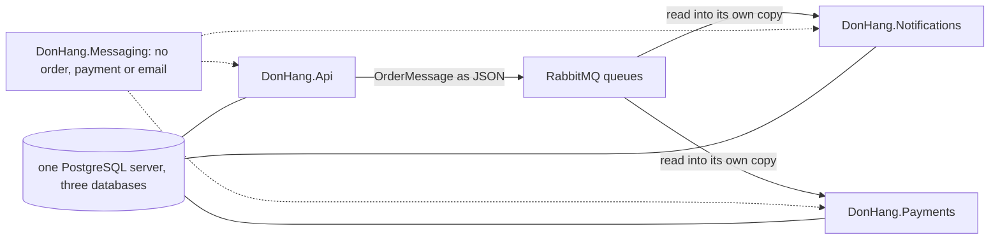

## Before you start

- [[design.l4.where-boundaries-are-enforced]] — you know that between services the boundary is held by the network, and what that independence costs.
- [[design.l3.module-owns-its-tables]] — you know that a part reading another part's tables depends on its table and column names.
- [[devops.l3.promoting-between-environments]] — you know that promoting to production is a commit to `envs/production` naming the tags staging checked.

## The situation

At stage-3 `OrderMessage` is written three times: in `DonHang.Domain` (the copy `DonHang.Api` publishes), in `DonHang.Notifications` and in `DonHang.Payments`. A teammate proposes one shared project with an `Order` class that all three reference in place of the copies. Another opens the production `kustomization.yaml`: all six images (the API, Notifications and Payments, plus a migration image for each) carry the same commit tag, and the three databases sit on one PostgreSQL server. "If everything moves together anyway," they ask, "what did splitting off the services buy us?" You need to tell services that change on their own from services that only run apart. What makes a split real?

## Core concepts

- **distributed monolith** — a system split into services that still cannot change, release or fail on their own, so it pays the network's costs without getting the services' independence.
- a change in step — one change that has to land in several services at the same time, or one of them breaks.
- a tie — anything two services share: a class, a table, a server, a release, a call one waits on; each tie is a place where they can still be forced to move together.
- a contract made of JSON — the shape of a message both sides agree on, while each side keeps its own copy of the class that reads it.

## How it works



A distributed monolith shows itself through four signs: a change that always touches several services, services released only together, services reading each other's tables, and chains of calls in which one slow service stalls the rest. Each sign is a tie strong enough to make services move together. The diagram draws the ties of code and data between `DonHang.Api` and the two services at stage-3.

The solid arrows carry what they share about an order: the JSON of `OrderMessage`, which each side reads into its own copy of the class. No domain class crosses; the services never see `Order`. The message waits in a RabbitMQ queue, so a slow Notifications does not hold up an order being placed. A refund request to `DonHang.Api` gets its `202` (accepted, not yet done) before Payments asks the payment provider to move the money.

The dashed arrows are a weaker tie. All three projects reference `DonHang.Messaging`, which knows no order, payment or email.

The plain lines are the tie the teammate rightly noticed. Each service has a database of its own and maps no other service's tables, yet the three databases share one PostgreSQL server. That server stopping takes all three databases down at once, and every service's work that needs its database fails together.

One tie is not drawn: the release, and it is looser than it looks. Each image has its own entry in the production `kustomization.yaml`, so a promotion commit can change one service's tag and leave the others alone. At stage-3 all six carry one commit because CI builds and publishes them together, not because they must.

## In the Đơn Hàng system

How Payments knows an order:

```csharp file=DonHang.Payments/Messages.cs tag=stage-3 lines=1-6
namespace DonHang.Payments;

// The body of an order.* message, as DonHang.Api publishes it; Payments
// reads only order.refund-requested. Its own copy of the shape, like
// DonHang.Notifications has: the JSON is the contract, not a shared class.
public sealed record OrderMessage(int OrderId, string CustomerEmail, string CustomerName, DateTimeOffset OccurredAt);
```

Lines 3–5 say that Payments keeps its own copy, as Notifications does, and line 6 repeats the shape of the API's record field by field. So Payments builds without any Đơn Hàng project that knows orders. The copy does not remove the tie; it moves the tie into the JSON. The readers find each field by its name, and both reject a message whose `CustomerEmail` is missing, so renaming `CustomerEmail` in the API would still make the API and both services change in step. The teammate's shared project would not fix it either: each service reads the new name only once it is rebuilt and released with the new class.

What keeps a shared domain project out:

```csharp file=DonHang.Tests/Architecture/ModuleBoundaryTests.cs tag=stage-3 lines=56-72
    // From stage-3 Notifications and Payments are services of their own: the
    // only Đơn Hàng project either may use is the shared DonHang.Messaging.
    // Everything else they know about an order arrives in a message.
    [Theory]
    [InlineData(typeof(OrderEventsConsumer))]
    [InlineData(typeof(RefundRequestedConsumer))]
    public void ServiceUsesNoDonHangProjectButMessaging(Type typeInTheService)
    {
        var referenced = typeInTheService.Assembly.GetReferencedAssemblies()
            .Select(assembly => assembly.Name!)
            .Where(name => name.StartsWith("DonHang.") && name != "DonHang.Messaging")
            .ToList();

        Assert.Empty(referenced);
    }

    // DonHang.Messaging is shared plumbing: it knows no order, payment or email.
```

Each project compiles to an assembly named after it, so line 64's list is the list of projects the service uses. Lines 60–61 run the test twice, with `OrderEventsConsumer` from Notifications and `RefundRequestedConsumer` from Payments; any type of a service leads to its assembly. The test fails when either service references a `DonHang.` project other than `DonHang.Messaging`. A shared `DonHang.Shared` project with an `Order` class would fail this test until the test itself is changed, in plain view of the reviewers. Line 72 says why the one allowed project is safe: it carries messages, not the meaning of an order.

## Trade-offs

| How services share the order | A change to the order's shape reaches | Can one service be released alone? | What it costs |
|---|---|---|---|
| One shared project of domain classes | every service that references it | yes, but every service's next build carries every change to `Order`, used or not | one place to change, and every service tied to all of `Order` |
| Reading the other service's tables | every reader of the changed columns | only while no column it reads changes | no message to design, and a table that cannot change without its readers |
| Its own copy of a message, JSON as the contract (stage-3) | only the services that read a changed field | yes, while the fields stay the same | copies to keep alike, and a renamed field still moves in step |

Read the rows as ties of different strength. The first two make every change to the shared thing a change in step. The third keeps the tie to the fields that actually cross, which is why Đơn Hàng chose it. It still is a tie: the services are independent only as long as the message's shape holds.

## What would you choose if…

…a teammate proposed the shared `Order` project anyway, for convenience? Weigh it against the second sign. Every change to `Order`, even to a field Notifications never reads, would reach all three in their next build. Keep the copies unless the services already change together for other reasons, and then ask whether they should be services at all.

…every refund change needed edits in both `DonHang.Api` and `DonHang.Payments`, merged and promoted together each time? That is the first two signs. Look at what knowledge both sides hold; moving it to one side removes the change in step. If no move does, the split may not be paying for itself, a question for the lesson on merging a service back.

…the team found that stopping the shared PostgreSQL server takes all three databases down together? Ask whether any service's drivers ask it to keep working while the others' data is down. If one does, give that service a server of its own. If none does, one server is a tie worth keeping for what it saves to run.

## Seniors often assume…

- **"Once each part runs in its own container, the system is no longer a monolith."** → Actually a container decides where code runs, not what it can change or release without. Services that must be released together, or that stall when one is slow, are one system with network calls inside it. You notice this belief when every release lists all the services, and rolling one back means rolling back the others.
- **"Services should share one project of domain classes, so that every service uses the same `Order`."** → Actually a shared class ties every service to every change of it, even to fields a service never reads. Đơn Hàng keeps a copy per service, and `ModuleBoundaryTests` fails a reference to any Đơn Hàng project but `DonHang.Messaging`. You notice this belief when a change to a field one service never uses still changes what that service runs.
- **"Giving each service its own database is enough to avoid a distributed monolith."** → Actually separate databases remove only the table tie. A renamed `CustomerEmail`, releases made together and a chain of waiting calls each remain, and at stage-3 the three databases still share one server. You notice this belief when a database change goes out cleanly but renaming a field both services read still needs the API and both services deployed at once.

## Try it (3 minutes)

Open `deploy/gitops/config-repo-kustomize/envs/production/kustomization.yaml` and `DonHang.Payments/Messages.cs` in the `don-hang` repository at tag `stage-3`. For each change below, say whether it can reach production for one service alone or must move several services in step, and name them.

1. A fix inside `RefundRequestedConsumer` that changes no message.
2. Renaming `CustomerEmail` to `Email` in the API's `OrderMessage`.
3. Moving the `donhang_payments` database to a PostgreSQL server of its own.

Expected result: one answer per change, "alone" or "in step", with the services named.

<details><summary>Suggested answer</summary>

1. Alone: a new Payments image, and a promotion commit that changes only the `donhang-payments` entry's tag and digest. The other entries in `images:` stay as they are.
2. In step: the API publishes `Email`, while the copies in Notifications and Payments still read `CustomerEmail`, and both reject a message without it. All three change together.
3. Alone, as far as the services go: of the services, only Payments and its migration image connect to `donhang_payments`, so no other service changes. The `db-backup` CronJob, which dumps all three databases from host `db`, must learn the new server too.

</details>

## Connections

- [[design.l4.where-boundaries-are-enforced]] — the services row of that lesson, checked for whether its independence is real.
- [[design.l4.merging-a-service-back]] — what to weigh when these signs are found and no change removes them.
- [[backend.l3.payments-service]] — the split this lesson tests: what Payments owns, and why it runs on its own.
- [[backend.l3.choreography-vs-orchestration]] — the refund flow through messages, which keeps it free of a chain of waiting calls.
- [[design.l3.module-owns-its-tables]] — the table tie inside one process, before any network.
- [[devops.l3.promoting-between-environments]] — the promotion commit that can move one image without the others.

## Five-line summary

1. A distributed monolith is services that cannot change, release or fail on their own, paying the network's costs without the independence.
2. Its signs: changes touching several services, releases made together, services reading each other's tables, and chains where one slow service stalls the rest.
3. Đơn Hàng's services share no domain classes: each keeps its own `OrderMessage`, and `ModuleBoundaryTests` allows only `DonHang.Messaging`.
4. Each image has its own entry in production's `kustomization.yaml`, so one service can be promoted alone, though stage-3 builds all six together.
5. Ties remain: one PostgreSQL server under three databases, and renaming a field both services read, such as `CustomerEmail`, moves all three in step.
