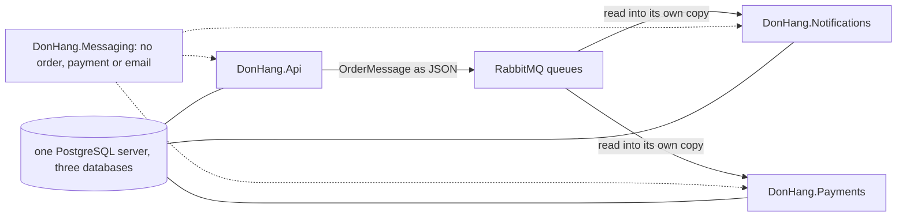

## Bạn cần biết trước

- [[design.l4.where-boundaries-are-enforced]] — bạn biết giữa các service, ranh giới do mạng giữ, và sự độc lập đó tốn những gì.
- [[design.l3.module-owns-its-tables]] — bạn biết một phần đọc bảng của phần khác sẽ phụ thuộc vào tên bảng và tên cột của phần đó.
- [[devops.l3.promoting-between-environments]] — bạn biết promote lên production là một commit vào `envs/production`, ghi các tag mà staging đã kiểm.

## Tình huống

Ở stage-3, `OrderMessage` được viết ba lần: trong `DonHang.Domain` (bản mà `DonHang.Api` publish), trong `DonHang.Notifications` và trong `DonHang.Payments`. Một đồng nghiệp đề xuất gom về một project dùng chung, có class `Order` để cả ba tham chiếu thay cho các bản sao. Một người khác mở `kustomization.yaml` của production: cả sáu image (API, Notifications và Payments, cộng một image migration cho mỗi cái) mang cùng một tag commit, và ba database nằm trên cùng một PostgreSQL server. Người đó hỏi: "Đằng nào mọi thứ cũng đi cùng nhau, vậy tách service ra thì được gì?" Bạn cần phân biệt service thay đổi được một mình với service chỉ chạy tách nhau. Điều gì làm một lần tách trở thành thật?

## Khái niệm cốt lõi

- **distributed monolith** (hệ thống đã chia thành service nhưng các service vẫn phải sửa, phát hành và hỏng cùng nhau) — một hệ thống đã chia thành service nhưng các service vẫn không thể tự thay đổi, tự release hay tự lỗi riêng. Nó trả đủ cái giá của mạng mà không nhận được sự độc lập của service.
- thay đổi đồng bộ — một thay đổi phải có mặt ở nhiều service cùng lúc, nếu không một trong số đó sẽ hỏng.
- một mối ràng buộc — bất cứ thứ gì hai service dùng chung: một class, một bảng, một server, một lần release, một lời gọi mà bên này phải chờ. Mỗi mối ràng buộc là một chỗ chúng vẫn có thể bị buộc phải thay đổi cùng nhau.
- hợp đồng bằng JSON — hình dạng message mà hai bên đã thống nhất, trong khi mỗi bên giữ bản sao riêng của class dùng để đọc nó.

## Cơ chế hoạt động



Một distributed monolith lộ ra qua bốn dấu hiệu: thay đổi nào cũng chạm tới nhiều service, các service chỉ được release cùng nhau, service này đọc bảng của service kia, và những chuỗi lời gọi trong đó một service chậm kéo cả chuỗi đứng lại. Mỗi dấu hiệu là một mối ràng buộc đủ chặt để buộc các service thay đổi cùng nhau. Sơ đồ vẽ các mối ràng buộc về code và dữ liệu giữa `DonHang.Api` và hai service ở stage-3.

Các mũi tên liền mang những gì chúng dùng chung về một đơn: JSON của `OrderMessage`, mà mỗi bên đọc vào bản sao class của riêng mình. Không class domain nào đi qua, các service không bao giờ thấy `Order`. Message nằm chờ trong hàng đợi RabbitMQ, nên Notifications chậm cũng không làm chậm lúc đặt đơn. Một yêu cầu hoàn tiền gửi tới `DonHang.Api` nhận `202` (đã nhận, chưa xong) trước khi Payments nhờ nhà cung cấp thanh toán chuyển tiền.

Các mũi tên đứt nét là một mối ràng buộc lỏng hơn. Cả ba project đều tham chiếu `DonHang.Messaging`, project này không biết gì về đơn, thanh toán hay email.

Các đường thẳng là mối ràng buộc mà người đồng nghiệp nhận ra đúng. Mỗi service có database riêng và không map bảng nào của service khác, nhưng ba database lại dùng chung một PostgreSQL server. Server đó dừng là cả ba database sập cùng lúc, và mọi công việc cần database của mọi service đều thất bại cùng nhau.

Có một mối ràng buộc không được vẽ: lần release, và nó lỏng hơn vẻ ngoài. Mỗi image có một entry riêng trong `kustomization.yaml` của production, nên một commit promotion có thể đổi tag của một service mà để nguyên các service khác. Ở stage-3, cả sáu image mang cùng một commit vì CI build và publish chúng cùng nhau, chứ không phải vì chúng buộc phải vậy.

## Trong hệ thống Đơn Hàng

Payments biết về một đơn như thế nào:

```csharp file=DonHang.Payments/Messages.cs tag=stage-3 lines=1-6
namespace DonHang.Payments;

// The body of an order.* message, as DonHang.Api publishes it; Payments
// reads only order.refund-requested. Its own copy of the shape, like
// DonHang.Notifications has: the JSON is the contract, not a shared class.
public sealed record OrderMessage(int OrderId, string CustomerEmail, string CustomerName, DateTimeOffset OccurredAt);
```

Dòng 3–5 nói Payments giữ bản sao riêng, giống Notifications, và dòng 6 lặp lại từng field trong record của API. Nhờ vậy Payments build được mà không cần project nào của Đơn Hàng biết về đơn. Bản sao không xóa mối ràng buộc, nó chỉ dời mối ràng buộc vào JSON. Bên đọc tìm từng field theo tên, và cả hai service đều từ chối message thiếu `CustomerEmail`, nên đổi tên `CustomerEmail` ở API vẫn buộc API và cả hai service thay đổi đồng bộ. Project dùng chung mà đồng nghiệp đề xuất cũng không giải quyết được: mỗi service chỉ đọc được tên mới khi nó được build lại và release cùng class mới.

Thứ giữ project domain dùng chung ở ngoài:

```csharp file=DonHang.Tests/Architecture/ModuleBoundaryTests.cs tag=stage-3 lines=56-72
    // From stage-3 Notifications and Payments are services of their own: the
    // only Đơn Hàng project either may use is the shared DonHang.Messaging.
    // Everything else they know about an order arrives in a message.
    [Theory]
    [InlineData(typeof(OrderEventsConsumer))]
    [InlineData(typeof(RefundRequestedConsumer))]
    public void ServiceUsesNoDonHangProjectButMessaging(Type typeInTheService)
    {
        var referenced = typeInTheService.Assembly.GetReferencedAssemblies()
            .Select(assembly => assembly.Name!)
            .Where(name => name.StartsWith("DonHang.") && name != "DonHang.Messaging")
            .ToList();

        Assert.Empty(referenced);
    }

    // DonHang.Messaging is shared plumbing: it knows no order, payment or email.
```

Mỗi project được compile thành một assembly mang tên nó, nên danh sách ở dòng 64 chính là danh sách project mà service dùng. Dòng 60–61 chạy test hai lần, với `OrderEventsConsumer` của Notifications và `RefundRequestedConsumer` của Payments. Type nào của một service cũng dẫn tới assembly của service đó. Test fail khi một trong hai service tham chiếu project `DonHang.` nào khác ngoài `DonHang.Messaging`. Một project `DonHang.Shared` có class `Order` sẽ làm test này fail cho đến khi chính test được sửa, ngay trước mắt người review. Dòng 72 nói vì sao project duy nhất được phép lại an toàn: nó chở message, không chở ý nghĩa của một đơn.

## Đánh đổi

| Các service dùng chung đơn bằng cách nào | Thay đổi hình dạng đơn lan tới | Release riêng một service được không? | Cái giá |
|---|---|---|---|
| Một project dùng chung chứa class domain | mọi service tham chiếu nó | được, nhưng lần build kế tiếp của mọi service mang theo mọi thay đổi của `Order`, dù có dùng hay không | một chỗ để sửa, và mọi service bị buộc vào toàn bộ `Order` |
| Đọc bảng của service kia | mọi bên đọc các cột bị đổi | chỉ khi không cột nào nó đọc thay đổi | không phải thiết kế message, và một bảng không đổi được nếu không kéo theo bên đọc |
| Bản sao message riêng, JSON là hợp đồng (stage-3) | chỉ các service đọc field bị đổi | được, khi các field giữ nguyên | các bản sao phải giữ giống nhau, và đổi tên field vẫn phải thay đổi đồng bộ |

Hãy đọc các hàng như những mối ràng buộc có độ chặt khác nhau. Hai hàng đầu biến mọi thay đổi của thứ dùng chung thành thay đổi đồng bộ. Hàng thứ ba thu hẹp mối ràng buộc về đúng các field thật sự đi qua, nên Đơn Hàng chọn nó. Nó vẫn là một mối ràng buộc: các service chỉ độc lập khi hình dạng message còn giữ nguyên.

## Bạn sẽ chọn gì nếu…

…một đồng nghiệp vẫn đề xuất project `Order` dùng chung, cho tiện? Hãy cân nó với dấu hiệu thứ hai. Mọi thay đổi của `Order`, kể cả ở field Notifications không bao giờ đọc, sẽ tới cả ba ở lần build kế tiếp. Hãy giữ các bản sao, trừ khi các service vốn đã thay đổi cùng nhau vì lý do khác, và khi đó hãy hỏi liệu chúng có nên là service hay không.

…mỗi thay đổi về hoàn tiền đều cần sửa cả `DonHang.Api` lẫn `DonHang.Payments`, lần nào cũng merge và promote cùng nhau? Đó là hai dấu hiệu đầu. Hãy xem cả hai bên đang giữ kiến thức gì. Dời kiến thức đó về một bên sẽ xóa được thay đổi đồng bộ. Nếu không cách dời nào làm được, lần tách có thể không đáng giá, và đó là câu hỏi của bài về gộp một service trở lại.

…team phát hiện dừng PostgreSQL server dùng chung là cả ba database sập cùng lúc? Hãy hỏi có yếu tố định hình kiến trúc nào của service nào đòi nó tiếp tục chạy khi dữ liệu của các service khác đã sập không. Nếu có, hãy cho service đó một server riêng. Nếu không, một server là mối ràng buộc đáng giữ vì những gì nó tiết kiệm khi vận hành.

## Senior hay nhầm rằng…

- **"Khi mỗi phần chạy trong container riêng, hệ thống không còn là monolith nữa."** → Thực ra container quyết định code chạy ở đâu, không quyết định code thay đổi hay release được mà không cần đến phần nào. Các service phải release cùng nhau, hoặc đứng lại khi một service chậm, vẫn là một hệ thống, chỉ có lời gọi mạng nằm bên trong. Bạn sẽ nhận ra niềm tin này khi lần release nào cũng liệt kê đủ mọi service, và rollback một service nghĩa là rollback cả các service khác.
- **"Các service nên dùng chung một project chứa class domain, để service nào cũng dùng cùng một `Order`."** → Thực ra một class dùng chung buộc mọi service vào mọi thay đổi của nó, kể cả field mà service không bao giờ đọc. Đơn Hàng giữ mỗi service một bản sao, và `ModuleBoundaryTests` fail khi có tham chiếu tới bất kỳ project Đơn Hàng nào ngoài `DonHang.Messaging`. Bạn sẽ nhận ra niềm tin này khi thay đổi ở một field mà một service không hề dùng vẫn làm đổi thứ service đó chạy.
- **"Cho mỗi service một database riêng là đủ để tránh distributed monolith."** → Thực ra database riêng chỉ xóa mối ràng buộc qua bảng. Đổi tên `CustomerEmail`, release cùng nhau và chuỗi lời gọi phải chờ nhau vẫn còn nguyên, và ở stage-3 ba database vẫn dùng chung một server. Bạn sẽ nhận ra niềm tin này khi một thay đổi database ra production suôn sẻ, nhưng đổi tên một field mà cả hai service cùng đọc vẫn phải deploy API và cả hai service cùng lúc.

## Thử ngay (3 phút)

Mở `deploy/gitops/config-repo-kustomize/envs/production/kustomization.yaml` và `DonHang.Payments/Messages.cs` trong repo `don-hang` ở tag `stage-3`. Với mỗi thay đổi dưới đây, hãy nói nó có thể lên production cho riêng một service, hay phải kéo nhiều service thay đổi đồng bộ, và nêu tên các service đó.

1. Một bản sửa bên trong `RefundRequestedConsumer`, không đổi message nào.
2. Đổi tên `CustomerEmail` thành `Email` trong `OrderMessage` của API.
3. Chuyển database `donhang_payments` sang một PostgreSQL server riêng.

Kết quả mong đợi: mỗi thay đổi một câu trả lời, "một mình" hoặc "đồng bộ", kèm tên các service.

<details><summary>Gợi ý đáp án</summary>

1. Một mình: một image Payments mới, và một commit promotion chỉ đổi tag và digest của entry `donhang-payments`. Các entry khác trong `images:` giữ nguyên.
2. Đồng bộ: API publish `Email`, trong khi các bản sao ở Notifications và Payments vẫn đọc `CustomerEmail`, và cả hai từ chối message thiếu field đó. Cả ba phải thay đổi cùng nhau.
3. Một mình, xét về các service: trong các service, chỉ Payments và image migration của nó kết nối tới `donhang_payments`, nên không service nào khác phải đổi. CronJob `db-backup`, vốn dump cả ba database từ host `db`, cũng phải biết server mới.

</details>

## Liên hệ

- [[design.l4.where-boundaries-are-enforced]] — hàng service của bài đó, được kiểm xem sự độc lập của nó có thật không.
- [[design.l4.merging-a-service-back]] — cần cân nhắc gì khi phát hiện các dấu hiệu này mà không thay đổi nào xóa được chúng.
- [[backend.l3.payments-service]] — lần tách mà bài này kiểm: Payments sở hữu gì, và vì sao nó chạy riêng.
- [[backend.l3.choreography-vs-orchestration]] — luồng hoàn tiền đi qua message, nhờ vậy không có chuỗi lời gọi phải chờ nhau.
- [[design.l3.module-owns-its-tables]] — mối ràng buộc qua bảng bên trong một process, trước khi có mạng.
- [[devops.l3.promoting-between-environments]] — commit promotion có thể đưa một image lên mà không đụng các image khác.

## Tóm tắt 5 dòng

1. Distributed monolith là các service không thể tự thay đổi, tự release hay tự lỗi riêng, trả cái giá của mạng mà không có sự độc lập.
2. Dấu hiệu của nó: thay đổi chạm nhiều service, release cùng nhau, service đọc bảng của nhau, và những chuỗi mà một service chậm kéo cả chuỗi đứng lại.
3. Các service của Đơn Hàng không dùng chung class domain nào: mỗi service giữ `OrderMessage` riêng, và `ModuleBoundaryTests` chỉ cho phép `DonHang.Messaging`.
4. Mỗi image có entry riêng trong `kustomization.yaml` của production, nên có thể promote riêng một service, dù stage-3 build cả sáu cùng nhau.
5. Mối ràng buộc vẫn còn: một PostgreSQL server dưới ba database, và đổi tên một field mà cả hai service cùng đọc, như `CustomerEmail`, kéo cả ba thay đổi đồng bộ.
