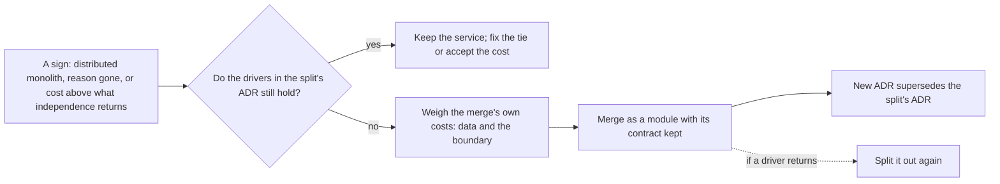

## Before you start

- [[design.l4.distributed-monolith]] — you know the signs of services that cannot change, release or fail on their own.
- [[management.l3.superseding-an-adr]] — you know that a changed decision gets a new ADR, and the old one only gains a pointer to it.
- [[design.l3.before-extracting-a-module]] — you know that a module can become a service only once it shares no objects, transactions or tables with the rest.

## The situation

At stage-3 Notifications is a service of its own: one more image, pipeline, database and dashboard to run. In a planning meeting a teammate proposes moving it back into `DonHang.Api`, where Ordering is the module that takes orders. "It was a module at stage-2 and it worked. Let's admit the split was a mistake, rewrite ADR `0002`, and fold the code into Ordering." Another teammate objects that a team never goes back once a service exists. You are asked to settle it with something better than either feeling. What should decide whether a service moves back into one process?

## Core concepts

- merging a service back — moving a service's code into another process, where it runs as a module and its calls across the network become method calls.
- the drivers of a split — the needs and constraints, written in the split's ADR, that made the service worth its costs; a merge is weighed against the same list.
- the cost of independence — what a separate service adds to run and to reason about: an image, a pipeline, a database, a dashboard, calls that can fail and data that arrives later.
- a kept contract — the messages or interface a part is reached through, left unchanged when the part moves, so its callers do not depend on where it runs.

## How it works



In the situation above, the proposal is a merge, and the question is the same one that decided the split. Three signs make a merge worth weighing. The services behave as a distributed monolith, and moving the shared logic or data to one service does not stop them changing together. The reason for the split has gone. Or running them apart costs more than their independence returns.

A sign only starts the question. The diamond checks the drivers the split's ADR names. If they still hold, the default is to keep the service and fix the tie behind the sign: its running cost is the price that ADR accepted. If they no longer hold, the merge is an ordinary architecture change, as the split was.

A merge has costs of its own. The service's separate database either moves into the other database or stays apart, used by the module from inside one process. And the boundary the network used to hold must now be held by the compiler and by tests. The compiler stops other projects from naming the module's `internal` types, so only its module contract is reachable, and an architecture test fails when a forbidden reference appears.

Merging the service back as a module, with its contract kept, leaves the dotted arrow open: if a driver returns, splitting it out again is cheap. A merge that is made gets a new ADR that supersedes the old one; a rejected proposal is kept too.

## In the Đơn Hàng system

What ADR `0002` weighed and accepted when it split Notifications out:

```markdown file=docs/adr/0002-tach-notifications-thanh-service.md tag=stage-3 lines=23-47
Chỉ chuyện số bản sao thì chưa đủ lý do: job gửi email vẫn chạy được với số
bản sao của API.

### Các phương án

- Giữ email là module trong `DonHang.Api`: không tốn gì thêm, nhưng service
  khác muốn báo tin cho khách phải đi qua API, và lỗi email vẫn nằm trong
  process nhận đơn.
- Tách `DonHang.Notifications` thành service có database riêng
  (`donhang_notifications`), nhận message qua RabbitMQ: mọi service báo tin
  cùng một cách, Notifications dừng thì đơn vẫn đặt được, message chờ trong
  queue.

### Quyết định

Tách. API ghi message vào outbox cùng transaction với đơn; message mang sẵn
email và tên khách vì Notifications không đọc bảng `customers`.

### Hệ quả

- Thêm một image, một pipeline build, một database và một dashboard phải chạy.
- Gọi qua mạng có thể lỗi; đơn và email không còn được lưu trong một
  transaction, email đến sau một lúc.
- Bảng `notifications` cũ còn lại trong `donhang`, không ai đọc (nợ N1 trong
  `docs/team/tech-debt-register.md`, ADR 0008).
```

The first option, lines 28–30, is exactly the shape the teammate proposes: email as a module in `DonHang.Api`, "không tốn gì thêm" (costing nothing more). The same lines show the two drivers it lost on: "service khác … phải đi qua API" (another service must go through the API) and "lỗi email vẫn nằm trong process nhận đơn" (email failures stay in the process that takes orders). The context above the excerpt, lines 17–21, names that other service: Payments. A merge would have to show that both drivers have gone.

Lines 23–24 add what does not count: the number of running copies of the API alone was not enough reason to split, because the email job ran fine with the API's copies. A merge proposal cannot lean on it either. Line 43 lists the running costs the teammate dislikes; the ADR accepted them in exchange for the two drivers. Lines 46–47 show a merge's data question in small: after the split, the old `notifications` table stayed behind in `donhang`, unread, as recorded debt that ADR `0008` takes up.

How the merge, if made, would be recorded:

```markdown file=docs/adr/README.md tag=stage-3 lines=39-46
5. Trước khi merge, trạng thái thành `Đã chấp nhận` hoặc `Bị từ chối`. ADR bị
   từ chối vẫn được merge và giữ lại, để cùng ý tưởng đó không được đề xuất lại
   mà không có lý do mới.

ADR đã chấp nhận không được viết lại. Khi quyết định đổi, một ADR mới ghi
quyết định mới; ADR cũ chỉ được sửa trạng thái thành `Bị thay thế bởi NNNN`
kèm đường dẫn. Đội không dùng file riêng cho bản đề xuất (có đội gọi đó là
RFC): ADR ở trạng thái `Đề xuất` đóng cả hai vai.
```

Lines 43–45 rule out the teammate's rewrite: a merge gets a new ADR, and `0002` changes only its status to `Bị thay thế bởi` (Superseded by) the new number, with a link. Its two drivers stay readable, so the new ADR can name which of them stopped holding. Lines 39–41 cover the other outcome: a merge proposal that is rejected is still kept, so the same idea does not return without a new reason.

## Trade-offs

| Shape for Notifications | Another service messaging customers | A slow email server | What it costs | Splitting it out again |
|---|---|---|---|---|
| Separate service (stage-3) | publishes a message, as the API does | orders are still placed; messages wait in the queue | an image, a pipeline, a database and a dashboard more | already split |
| Module in `DonHang.Api`, contract and own data kept | has to go through the API | shares resources with the process that takes orders | one process less to run; the boundary is held by the compiler and tests | cheap: the contract and the data are already apart |
| Code folded into Ordering, no boundary | has to go through the API | shares resources with the process that takes orders | least to run at first | a new extraction, after cutting shared classes and tables |

The first two rows trade the two drivers of `0002` against the cost of independence; which one fits depends on whether those drivers hold. The third row saves only the work of keeping the boundary, and gives up the cheap way back.

## What would you choose if…

…Payments no longer needed to message customers, and a year of measurements showed the email server itself never slowed down or failed? Both drivers of `0002` would be gone, leaving the separation little to keep away from order taking. Weigh the second row: a module in `DonHang.Api` with its contract kept, and a new ADR that supersedes `0002` and names the two drivers that stopped holding.

…every change to order emails needed edits in both `DonHang.Api` and `DonHang.Notifications`, released together? That is a sign of a distributed monolith, not yet a reason to merge. First look for knowledge to move to one side. If no move removes the change in step and the drivers still hold, keep the service and accept the tie while they hold.

…the only complaint were that one more image and dashboard are tedious to run? Line 43 shows the ADR accepted that cost when it split. Keep the service while its drivers hold; reduce the running cost in other ways instead.

## Seniors often assume…

- **"Once a service has been split out, the team should never merge it back."** → Actually a split is a choice made for drivers, and drivers change. When the reason behind ADR `0002` is gone, keeping the service means paying the cost of independence for nothing. You notice this belief when a service's ADR names reasons nobody can still point to, yet the team keeps running it.
- **"Merging services back means returning to one big ball of code with no boundaries."** → Actually a service can come back as a module that keeps its contract and its own data, with the boundary held by the compiler and tests, as it is today for Catalog, a module inside `DonHang.Api` reached only through its contract (`ICatalog` and the two other public types the architecture test lists). Only the third row of the trade-offs gives the boundary up. You notice this belief when a merge is rejected out of fear of a tangle, though nobody proposed removing the boundary.
- **"If a split turns out to be wrong, the old ADR should be edited to say it never made sense."** → Actually `0002` was right for its drivers when it was written; a merge records that those drivers changed. `docs/adr/README.md` keeps accepted ADRs unchanged except for the status that points to the replacement. You notice an edited ADR when a later merge proposal cannot show which reason stopped holding, because the reasons were erased.

## Try it (3 minutes)

Open `docs/adr/0002-tach-notifications-thanh-service.md` and `docs/adr/README.md` in the `don-hang` repository at tag `stage-3`. The teammate's proposal is now a pull request with a new ADR, "Gộp Notifications vào `DonHang.Api`".

1. List what the new ADR's context must show, using `0002`'s lines.
2. Say which lines of `0002` change once the new ADR is accepted, and which stay.

Expected result: a short list of conditions with line numbers from `0002`, and the lines of `0002` that change.

<details><summary>Suggested answer</summary>

1. The context must show that both drivers of lines 17–21 have gone: no other service needs to message customers, and the email server itself no longer slows down or fails. It must not rest on the number of copies, which lines 23–24 found not enough on its own. It should name the merge's own costs: what happens to `donhang_notifications`, and how the boundary is held once the network no longer holds it.
2. Only the status on line 3 changes, to `Bị thay thế bởi` with the new number and a link. The context, options, decision and consequences stay as written.

</details>

## Connections

- [[design.l4.distributed-monolith]] — the signs that most often start a merge proposal, and the first fix to try before one.
- [[design.l3.when-to-extract-a-service]] — the same weighing in the other direction: what a split must earn.
- [[design.l3.before-extracting-a-module]] — why a module that kept its contract and its own data can be split out again cheaply.
- [[management.l3.superseding-an-adr]] — how the new ADR replaces `0002` without rewriting it.
- [[management.l3.exit-plan]] — the same idea for a vendor: keep the way back planned when you choose.
- [[design.l4.conways-law]] — next: another driver of where boundaries fall.

## Five-line summary

1. Merging a service back is an ordinary architecture change, right when the drivers that justified the split no longer hold.
2. Weigh a merge when services act as a distributed monolith, the split's reason has gone, or running them costs more than independence returns.
3. ADR `0002` split Notifications so Payments could message customers and email failures stayed out of order taking; a merge must show both gone.
4. A merge costs too: the separate database is folded back or kept apart, and the compiler and tests must hold the boundary.
5. Merged back as a module with its contract kept, a service stays cheap to split again; a new ADR supersedes `0002`.
