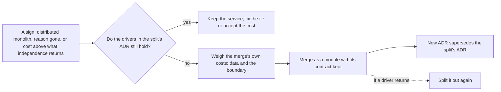

## Bạn cần biết trước

- [[design.l4.distributed-monolith]] — bạn biết các dấu hiệu của những service không thể tự thay đổi, tự release hay tự lỗi riêng.
- [[management.l3.superseding-an-adr]] — bạn biết khi quyết định đổi thì có một ADR mới, còn ADR cũ chỉ thêm một dòng trỏ sang nó.
- [[design.l3.before-extracting-a-module]] — bạn biết một module chỉ thành service được khi nó không còn dùng chung object, transaction hay bảng nào với phần còn lại.

## Tình huống

Ở stage-3, Notifications là một service riêng: thêm một image, một pipeline, một database và một dashboard phải chạy. Trong buổi họp lập kế hoạch, một đồng nghiệp đề xuất đưa nó về lại `DonHang.Api`, nơi Ordering là module nhận đơn. "Ở stage-2 nó là module và vẫn chạy ổn. Cứ nhận là tách ra là sai, viết lại ADR `0002`, rồi gộp code vào Ordering." Một người khác phản đối: service đã tách thì không bao giờ quay lại. Bạn được nhờ phân xử bằng thứ gì đó vững hơn cảm giác của cả hai. Điều gì nên quyết định một service có quay về chạy chung một process hay không?

## Khái niệm cốt lõi

- gộp một service trở lại — chuyển code của một service vào một process khác, ở đó nó chạy như một module và các lời gọi qua mạng trở thành lời gọi method.
- các yếu tố của lần tách — những nhu cầu và ràng buộc, ghi trong ADR của lần tách, khiến service đáng với cái giá của nó. Lần gộp được cân với đúng danh sách đó.
- cái giá của sự độc lập — những gì một service riêng thêm vào việc vận hành và việc hiểu hệ thống: một image, một pipeline, một database, một dashboard, những lời gọi có thể lỗi và dữ liệu đến muộn.
- hợp đồng được giữ nguyên — các message hoặc interface mà bên ngoài dùng để tới một phần, không đổi khi phần đó dời chỗ, nhờ vậy bên gọi không phụ thuộc vào nơi nó chạy.

## Cơ chế hoạt động



Trong tình huống trên, đề xuất là gộp, và câu hỏi cũng chính là câu hỏi đã quyết định lần tách. Có ba dấu hiệu khiến việc gộp đáng cân nhắc. Các service hoạt động như một distributed monolith, và dời logic hay dữ liệu dùng chung về một service vẫn không làm chúng thôi thay đổi cùng nhau. Lý do tách đã không còn. Hoặc chạy chúng riêng tốn hơn những gì sự độc lập mang lại.

Một dấu hiệu chỉ mở ra câu hỏi. Hình thoi kiểm các yếu tố mà ADR của lần tách nêu tên. Nếu chúng vẫn đúng, mặc định là giữ service và sửa mối ràng buộc đằng sau dấu hiệu: chi phí vận hành của nó là cái giá ADR đó đã chấp nhận. Nếu chúng không còn đúng, gộp là một thay đổi kiến trúc bình thường, như lần tách trước đó.

Gộp cũng có cái giá riêng. Database riêng của service hoặc được chuyển vào database kia, hoặc vẫn để riêng và được module dùng từ bên trong một process. Ranh giới trước đây do mạng giữ giờ phải do compiler và test giữ. Compiler chặn các project khác gọi tên các type `internal` của module, nên chỉ hợp đồng của module là với tới được, và architecture test fail khi xuất hiện một tham chiếu bị cấm.

Gộp service trở lại thành module, giữ nguyên hợp đồng, sẽ để ngỏ mũi tên đứt nét: nếu một yếu tố quay lại, tách nó ra lần nữa không tốn bao nhiêu. Lần gộp nào được làm thì có một ADR mới thay thế ADR cũ. Đề xuất bị từ chối cũng được giữ lại.

## Trong hệ thống Đơn Hàng

Những gì ADR `0002` đã cân và chấp nhận khi tách Notifications ra:

```markdown file=docs/adr/0002-tach-notifications-thanh-service.md tag=stage-3 lines=23-47
Chỉ chuyện số bản sao thì chưa đủ lý do: job gửi email vẫn chạy được với số
bản sao của API.

### Các phương án

- Giữ email là module trong `DonHang.Api`: không tốn gì thêm, nhưng service
  khác muốn báo tin cho khách phải đi qua API, và lỗi email vẫn nằm trong
  process nhận đơn.
- Tách `DonHang.Notifications` thành service có database riêng
  (`donhang_notifications`), nhận message qua RabbitMQ: mọi service báo tin
  cùng một cách, Notifications dừng thì đơn vẫn đặt được, message chờ trong
  queue.

### Quyết định

Tách. API ghi message vào outbox cùng transaction với đơn; message mang sẵn
email và tên khách vì Notifications không đọc bảng `customers`.

### Hệ quả

- Thêm một image, một pipeline build, một database và một dashboard phải chạy.
- Gọi qua mạng có thể lỗi; đơn và email không còn được lưu trong một
  transaction, email đến sau một lúc.
- Bảng `notifications` cũ còn lại trong `donhang`, không ai đọc (nợ N1 trong
  `docs/team/tech-debt-register.md`, ADR 0008).
```

Phương án đầu tiên, dòng 28–30, đúng là hình dạng mà đồng nghiệp đề xuất: email là một module trong `DonHang.Api`, "không tốn gì thêm". Cũng những dòng đó cho thấy hai yếu tố khiến nó thua: "service khác … phải đi qua API" và "lỗi email vẫn nằm trong process nhận đơn". Phần bối cảnh phía trên đoạn trích, dòng 17–21, nêu tên service khác đó: Payments. Muốn gộp thì phải chỉ ra được cả hai yếu tố đều đã không còn.

Dòng 23–24 nói thêm điều không được tính: riêng số bản sao đang chạy của API chưa đủ lý do để tách, vì job email chạy ổn với số bản sao của API. Đề xuất gộp cũng không dựa vào nó được. Dòng 43 liệt kê các chi phí vận hành mà đồng nghiệp không thích. ADR đã chấp nhận chúng để đổi lấy hai yếu tố kia. Dòng 46–47 cho thấy câu hỏi dữ liệu của một lần gộp ở quy mô nhỏ: sau khi tách, bảng `notifications` cũ nằm lại trong `donhang`, không ai đọc, thành một khoản nợ đã ghi sổ mà ADR `0008` xử lý.

Lần gộp, nếu được làm, sẽ được ghi lại thế nào:

```markdown file=docs/adr/README.md tag=stage-3 lines=39-46
5. Trước khi merge, trạng thái thành `Đã chấp nhận` hoặc `Bị từ chối`. ADR bị
   từ chối vẫn được merge và giữ lại, để cùng ý tưởng đó không được đề xuất lại
   mà không có lý do mới.

ADR đã chấp nhận không được viết lại. Khi quyết định đổi, một ADR mới ghi
quyết định mới; ADR cũ chỉ được sửa trạng thái thành `Bị thay thế bởi NNNN`
kèm đường dẫn. Đội không dùng file riêng cho bản đề xuất (có đội gọi đó là
RFC): ADR ở trạng thái `Đề xuất` đóng cả hai vai.
```

Dòng 43–45 loại bỏ chuyện viết lại mà đồng nghiệp muốn: gộp thì có một ADR mới, còn `0002` chỉ đổi trạng thái thành `Bị thay thế bởi` kèm số của ADR mới và đường dẫn. Hai yếu tố của nó vẫn đọc được, nên ADR mới chỉ ra được yếu tố nào đã thôi đúng. Dòng 39–41 lo kết cục còn lại: đề xuất gộp bị từ chối vẫn được giữ, để cùng ý tưởng đó không quay lại khi chưa có lý do mới.

## Đánh đổi

| Hình dạng cho Notifications | Một service khác cần báo tin cho khách | Server email chậm | Cái giá | Tách ra lần nữa |
|---|---|---|---|---|
| Service riêng (stage-3) | publish một message, như API đang làm | đơn vẫn đặt được, message chờ trong queue | thêm một image, một pipeline, một database và một dashboard | đã tách sẵn |
| Module trong `DonHang.Api`, giữ hợp đồng và dữ liệu riêng | phải đi qua API | dùng chung tài nguyên với process nhận đơn | bớt một process phải chạy, ranh giới do compiler và test giữ | rẻ: hợp đồng và dữ liệu đã tách sẵn |
| Code gộp thẳng vào Ordering, không ranh giới | phải đi qua API | dùng chung tài nguyên với process nhận đơn | lúc đầu ít thứ phải chạy nhất | một lần tách mới, sau khi cắt các class và bảng dùng chung |

Hai hàng đầu đánh đổi hai yếu tố của `0002` lấy cái giá của sự độc lập. Hàng nào hợp tùy vào việc các yếu tố đó còn đúng hay không. Hàng thứ ba chỉ tiết kiệm công giữ ranh giới, và mất luôn đường quay lại rẻ.

## Bạn sẽ chọn gì nếu…

…Payments không còn cần báo tin cho khách, và đo suốt một năm cho thấy chính server email chưa bao giờ chậm hay lỗi? Cả hai yếu tố của `0002` đều đã không còn, sự tách biệt gần như chẳng còn gì để giữ cách xa phần nhận đơn. Hãy cân hàng thứ hai: một module trong `DonHang.Api` giữ nguyên hợp đồng, và một ADR mới thay thế `0002`, nêu tên hai yếu tố đã thôi đúng.

…mọi thay đổi về email đơn hàng đều phải sửa cả `DonHang.Api` lẫn `DonHang.Notifications`, rồi release cùng nhau? Đó là dấu hiệu của distributed monolith, chưa phải lý do để gộp. Trước hết hãy tìm kiến thức có thể dời về một bên. Nếu không cách dời nào xóa được thay đổi đồng bộ mà các yếu tố vẫn đúng, hãy giữ service và chấp nhận mối ràng buộc trong lúc chúng còn đúng.

…lời phàn nàn duy nhất là thêm một image và một dashboard thì chạy mệt? Dòng 43 cho thấy ADR đã chấp nhận cái giá đó khi tách. Hãy giữ service trong lúc các yếu tố của nó còn đúng, và giảm chi phí vận hành bằng cách khác.

## Senior hay nhầm rằng…

- **"Service đã tách ra thì đội không bao giờ nên gộp nó lại."** → Thực ra tách là một lựa chọn vì những yếu tố cụ thể, và yếu tố thì thay đổi. Khi lý do đằng sau ADR `0002` không còn, giữ service nghĩa là trả cái giá của sự độc lập mà không được gì. Bạn sẽ nhận ra niềm tin này khi ADR của một service nêu những lý do không ai còn chỉ ra được, vậy mà đội vẫn tiếp tục chạy nó.
- **"Gộp service lại nghĩa là quay về một đống code lớn không có ranh giới."** → Thực ra một service có thể quay về thành module, giữ hợp đồng và dữ liệu riêng, với ranh giới do compiler và test giữ, như Catalog hiện nay: một module trong `DonHang.Api` chỉ được dùng qua hợp đồng của nó (`ICatalog` và hai type public khác mà architecture test liệt kê). Chỉ hàng thứ ba trong bảng đánh đổi mới bỏ ranh giới. Bạn sẽ nhận ra niềm tin này khi một đề xuất gộp bị bác vì sợ code rối, dù không ai đề xuất bỏ ranh giới.
- **"Nếu tách ra hóa ra là sai, nên sửa ADR cũ để ghi rằng nó chưa bao giờ hợp lý."** → Thực ra `0002` đúng với các yếu tố của nó lúc được viết. Lần gộp ghi lại rằng các yếu tố đó đã đổi. `docs/adr/README.md` giữ nguyên ADR đã chấp nhận, chỉ trừ trạng thái trỏ sang ADR thay thế. Bạn sẽ nhận ra một ADR đã bị sửa khi một đề xuất gộp sau này không chỉ ra được lý do nào đã thôi đúng, vì các lý do đã bị xóa.

## Thử ngay (3 phút)

Mở `docs/adr/0002-tach-notifications-thanh-service.md` và `docs/adr/README.md` trong repo `don-hang` ở tag `stage-3`. Đề xuất của đồng nghiệp giờ là một pull request kèm ADR mới, "Gộp Notifications vào `DonHang.Api`".

1. Liệt kê những gì phần bối cảnh của ADR mới phải chỉ ra, dựa vào các dòng của `0002`.
2. Nói dòng nào của `0002` thay đổi khi ADR mới được chấp nhận, và dòng nào giữ nguyên.

Kết quả mong đợi: một danh sách ngắn các điều kiện kèm số dòng trong `0002`, và các dòng của `0002` sẽ thay đổi.

<details><summary>Gợi ý đáp án</summary>

1. Phần bối cảnh phải chỉ ra rằng cả hai yếu tố ở dòng 17–21 đều đã không còn: không service nào khác cần báo tin cho khách, và chính server email không còn chậm hay lỗi. Nó không được dựa vào số bản sao, thứ mà dòng 23–24 đã thấy là tự nó chưa đủ. Nó nên nêu cái giá riêng của lần gộp: `donhang_notifications` sẽ ra sao, và ranh giới được giữ thế nào khi mạng không còn giữ nó.
2. Chỉ trạng thái ở dòng 3 thay đổi, thành `Bị thay thế bởi` kèm số mới và đường dẫn. Bối cảnh, các phương án, quyết định và hệ quả giữ nguyên như đã viết.

</details>

## Liên hệ

- [[design.l4.distributed-monolith]] — các dấu hiệu thường mở đầu một đề xuất gộp, và cách sửa đầu tiên nên thử trước đó.
- [[design.l3.when-to-extract-a-service]] — cùng phép cân ấy theo chiều ngược lại: lần tách phải mang lại được gì.
- [[design.l3.before-extracting-a-module]] — vì sao một module giữ hợp đồng và dữ liệu riêng có thể tách ra lại mà không tốn bao nhiêu.
- [[management.l3.superseding-an-adr]] — ADR mới thay thế `0002` thế nào mà không viết lại nó.
- [[management.l3.exit-plan]] — cùng ý đó với một vendor: khi chọn thì lên sẵn đường quay lại.
- [[design.l4.conways-law]] — tiếp theo: một yếu tố khác quyết định ranh giới nằm ở đâu.

## Tóm tắt 5 dòng

1. Gộp một service trở lại là một thay đổi kiến trúc bình thường, đúng khi các yếu tố từng biện minh cho lần tách không còn đúng.
2. Hãy cân nhắc gộp khi các service hoạt động như distributed monolith, lý do tách đã mất, hoặc chạy riêng tốn hơn những gì sự độc lập mang lại.
3. ADR `0002` tách Notifications để Payments báo tin được cho khách và lỗi email nằm ngoài phần nhận đơn. Muốn gộp phải chỉ ra cả hai đã không còn.
4. Gộp cũng có giá: database riêng được gộp về hoặc để riêng, và compiler cùng test phải giữ ranh giới.
5. Gộp lại thành module giữ nguyên hợp đồng thì service vẫn tách ra lại dễ dàng, và một ADR mới thay thế `0002`.
