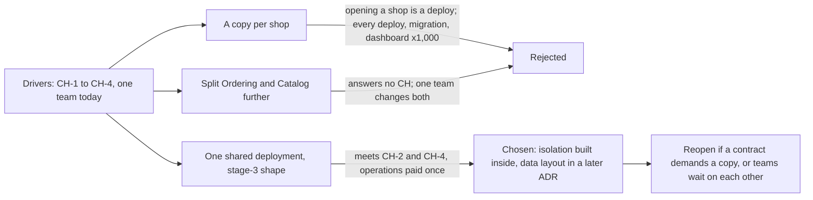

## Before you start

- [[design.l4.a-thousand-shops]] — you know the drivers that change for 1,000 shops: isolation, opening and configuring shops, and the number of teams.
- [[design.l4.distributed-monolith]] — you know that services one team must always change together pay the network's costs without the independence.
- [[backend.l3.tenant-isolation-models]] — you know shops can be kept apart by shared tables, a schema each or a database each.

## The situation

The requirements for 1,000 shops are agreed, and the team now has to choose how Đơn Hàng will run for them. Two proposals arrive in the same week. The product owner asks whether every shop should get its own copy of the whole system from the first day, to be safe. A developer wants to split Ordering and Catalog into services, so that the system "looks ready" for 1,000 shops.

Both sound careful, and they pull in opposite directions. Which way of running Đơn Hàng meets the multi-shop drivers, and what does that choice leave for the team to build inside the system?

## Core concepts

- a copy per shop — the whole system, with its own services and databases, deployed once for each shop.
- one shared deployment — a single running copy of the system that serves every shop, so a shop is data inside it rather than a deployment of its own.
- isolation inside the system — when the deployment no longer keeps shops apart, requests, rows and messages must carry their shop, and the code and data layout must enforce it.
- a condition to reopen — a situation the decision names in advance, in which the team agrees to look at the choice again.

## How it works



In the situation above, the product owner's idea is a copy per shop and the developer's idea is the split. ADR `0012` adds one shared deployment and judges all three against the same drivers: each shop sees only its own data (`CH-1`), opens without a deploy (`CH-2`), is not slowed by a busy neighbor (`CH-3`), and has its own settings (`CH-4`). The first box also holds the team-count driver: today one team changes everything.

A copy per shop isolates best: a busy shop slows only itself. But each new shop becomes another copy to stand up, which is a deploy, so it fails `CH-2`. Every deploy, migration and dashboard also multiplies by the number of shops.

Splitting Ordering and Catalog further adds nothing toward any of the four requirements, because the shop would still be data inside each service. With one team, that team would still change both parts together, which is how a distributed monolith starts.

The shared deployment keeps the stage-3 shape: `DonHang.Api` runs Ordering and Catalog as modules in one process, and Notifications and Payments run as separate services. Opening a shop means adding data, and settings are data too; a deploy or a migration runs once for every shop. The price is that isolation no longer comes from how the system is deployed. Every request, row and message must know its shop, and a later ADR chooses the data layout.

The last box is the part people forget. The ADR names, in advance, what would make the team look at the choice again.

## In the Đơn Hàng system

The three options as ADR `0012` writes them:

```markdown file=docs/adr/0012-phuc-vu-moi-cua-hang-tu-mot-ban-trien-khai.md tag=stage-4 lines=21-33
### Các phương án

- Một bản toàn hệ thống cho mỗi cửa hàng: cô lập tốt nhất, một cửa hàng đông
  chỉ làm chậm chính nó (CH-1, CH-3). Nhưng mọi deploy, migration, dashboard
  và cảnh báo nhân lên 1.000 lần, và mở cửa hàng mới là dựng thêm một bản,
  tức là một lần deploy (trái CH-2).
- Một bản triển khai chung, giữ hình dạng stage-3: cửa hàng trở thành dữ liệu
  bên trong hệ thống. Mở cửa hàng là thêm dữ liệu (CH-2), cấu hình là dữ liệu
  (CH-4); deploy và migration chạy một lần cho mọi cửa hàng. Cô lập (CH-1,
  CH-3) không còn có sẵn từ cách triển khai mà phải làm bên trong hệ thống.
- Tách thêm Ordering và Catalog thành service: không trả lời yêu cầu nào ở
  trên, vì cửa hàng vẫn là dữ liệu bên trong mỗi service. Cùng một đội vẫn sửa
  hai phần đó cùng lúc, nên tách ra có nguy cơ thành một distributed monolith.
```

Each option names the requirements it meets or misses, so no option wins on a feeling. The first bullet adds warnings to the list: each copy needs its own set, so they multiply 1,000 times too. The second bullet states its own cost in its last sentence. The third bullet is rejected because it answers no requirement and, with one team changing both parts, risks a distributed monolith; it is not rejected for being too complex.

The decision, its consequences and when to reopen it:

```markdown file=docs/adr/0012-phuc-vu-moi-cua-hang-tu-mot-ban-trien-khai.md tag=stage-4 lines=35-57
### Quyết định

Chọn một bản triển khai chung, giữ hình dạng stage-3. Đây là phương án duy
nhất đáp ứng CH-2 và CH-4 mà không nhân chi phí vận hành theo số cửa hàng.
Phần nó không cho sẵn, cô lập giữa các cửa hàng, được làm bên trong hệ thống:
cách lưu dữ liệu của từng cửa hàng do một ADR sau quyết định.

### Hệ quả

- Mỗi request, mỗi dòng dữ liệu và mỗi message phải biết nó thuộc cửa hàng
  nào; cô lập dữ liệu (CH-1) dựa vào cách lưu dữ liệu mà ADR sau chọn.
- Giới hạn tải hiện có (`orders`, `catalog-reads` trong `Program.cs`) không
  biết cửa hàng; CH-3 cần xem lại chúng.
- Một lỗi hay một deploy hỏng chạm tới mọi cửa hàng cùng lúc; cách phát hành
  phải tính tới điều đó.
- Không thêm service nào; Ordering và Catalog vẫn là module trong một process.

Đội xem lại quyết định khi:

- Một cửa hàng có hợp đồng đòi một bản hệ thống riêng. Cửa hàng đó được cấp
  một bản riêng của cùng hệ thống, các cửa hàng khác vẫn được phục vụ như cũ.
- Số đội tăng tới mức các đội phải chờ nhau để sửa cùng một module; lúc đó
  ranh giới module, và có thể là service, được xem lại theo ranh giới đội.
```

The decision calls the shared deployment the only option that meets `CH-2` and `CH-4` without multiplying operating costs by the number of shops. It leaves the data layout to a later ADR on purpose.

The consequences list what the choice costs. The existing rate limits `orders` and `catalog-reads` in `Program.cs` do not know shops, so they cannot stop one busy shop from slowing the others; `CH-3` needs them reviewed. A bug or a broken deploy reaches every shop at once, so releasing must allow for it.

The two conditions to reopen are concrete: one shop gets its own copy while the others are served as before, and module boundaries are looked at again along team lines.

## Trade-offs

| Option | Isolation between shops (`CH-1`, `CH-3`) | Opening a shop (`CH-2`) | Running it | What it costs |
|---|---|---|---|---|
| A copy per shop | best: a busy shop slows only itself | a new copy, so a deploy | every deploy, migration and dashboard once per shop | operations that grow with every shop |
| One shared deployment (chosen) | not given by the deployment; enforced inside, by a later data layout and limits that know the shop | adding data | deploys and migrations run once for all shops | a bug or a broken deploy reaches every shop at once |
| Split Ordering and Catalog | no better than the shared deployment: the shop is still data inside each service | no better than the shared deployment | more services to run | one team changing both together, the start of a distributed monolith |

No row is free. The chosen one moves the cost from per-shop operations into the code and the data: isolation is built once inside the system, and every release carries the risk of reaching every shop at once.

## What would you choose if…

…a shop signs a contract that demands a copy of the system of its own? That is the first condition to reopen. Give that shop a separate copy of the same system and keep serving the other shops from the shared deployment. One contract does not move every shop onto copies.

…the company grows to three or four teams, and two of them wait on each other every sprint to change Catalog? That is the second condition. Look again at module boundaries along team lines, and consider a service only where a team boundary now calls for it; the split then answers a driver that exists.

…a broken deploy stops ordering for every shop at once? ADR `0012` listed this consequence when it chose. If the outage shows only that risk, improve how Đơn Hàng releases rather than moving to copies, which would bring back the costs the ADR rejected. If it reveals a driver the requirements missed, write that driver down and reopen the ADR with it.

## Seniors often assume…

- **"Each shop should get its own copy of the system, because that is always the safest isolation."** → Actually a copy per shop isolates best, but isolation is one driver among four. It makes opening a shop a deploy, against `CH-2`, and multiplies every deploy, migration and dashboard by 1,000. You notice this when opening a shop needs a ticket to the release team and a new set of dashboards each time.
- **"A system for 1,000 shops needs a bigger architecture than a system for one shop."** → Actually ADR `0012` keeps the stage-3 shape and adds no service. What changes is that every request, row and message must know its shop. You notice this when a proposal adds services for the multi-shop work but cannot name the `CH` requirement each one answers.
- **"Once one shared deployment is chosen, giving a single shop its own copy later is impossible."** → Actually the first condition to reopen names exactly that case: the shop gets a separate copy of the same system, and the other shops are served as before. You notice this when a sales conversation ends with "our architecture cannot do that" although the ADR already says how.

## Try it (3 minutes)

1. Take three requests that might reach the team after ADR `0012`: (a) a shop's new contract demands that it runs on a copy of the system of its own; (b) a developer wants Catalog as a service "to be ready for growth", while the same single team still changes Ordering and Catalog together; (c) since a second team was hired, each team's Ordering changes sit unreleased until the other team's Ordering changes are ready.
2. For each one, say whether it reopens ADR `0012`, and which line of the ADR supports your answer.

Expected result: two requests reopen the decision and one does not.

<details><summary>Suggested answer</summary>

(a) reopens it: the first condition. Only that shop gets a separate copy; the others stay on the shared deployment. (b) does not: it is the third option the ADR already rejected, because it answers no `CH` requirement and one team would still change both parts together. (c) reopens it: the second condition. Module boundaries, and perhaps services, are looked at again along team lines.

</details>

## Connections

- [[design.l4.a-thousand-shops]] — the drivers this lesson's ADR is judged against.
- [[management.l3.weighing-options-in-an-adr]] — the same way of weighing options against one set of needs, applied here to how the whole system runs.
- [[design.l4.distributed-monolith]] — the risk that rules out splitting Ordering and Catalog while one team changes both.
- [[backend.l3.tenant-isolation-models]] — the data layouts the later ADR chooses between to enforce isolation inside the shared deployment.
- [[backend.l3.multi-tenancy]] — why each request must carry its shop once shops share one running system.
- [[design.l4.conways-law]] — the reason the second condition to reopen watches how teams wait on each other.
- [[backend.l4.shop-data-layout]] — next for the data: the ADR that decides how each shop's rows are stored.

## Five-line summary

1. Đơn Hàng serves every shop from one shared deployment, so a shop is data inside the system and isolation is enforced inside it.
2. ADR `0012` weighs a copy per shop, one shared deployment in the stage-3 shape, and splitting Ordering and Catalog against `CH-1` to `CH-4`.
3. A copy per shop isolates best but turns opening a shop into a deploy and multiplies deploys, migrations and dashboards by the shop count.
4. Splitting Ordering and Catalog answers no multi-shop requirement, and one team changing both risks a distributed monolith.
5. The ADR leaves the data layout to a later ADR and reopens if a contract demands a copy or teams wait on each other.
