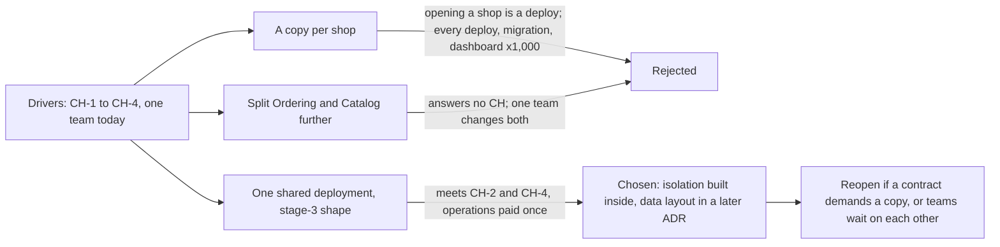

## Bạn cần biết trước

- [[design.l4.a-thousand-shops]] — bạn biết những yếu tố đổi khi có 1.000 cửa hàng: cô lập, mở và cấu hình cửa hàng, và số đội.
- [[design.l4.distributed-monolith]] — bạn biết những service mà một đội lúc nào cũng phải sửa cùng nhau sẽ gánh mọi chi phí của mạng mà không được sự độc lập.
- [[backend.l3.tenant-isolation-models]] — bạn biết các cửa hàng có thể được giữ tách nhau bằng bảng dùng chung, mỗi cửa hàng một schema hoặc mỗi cửa hàng một database.

## Tình huống

Yêu cầu cho 1.000 cửa hàng đã thống nhất, giờ đội phải chọn Đơn Hàng sẽ chạy thế nào để phục vụ chúng. Trong cùng một tuần có hai đề xuất. Product owner hỏi có nên cho mỗi cửa hàng một bản toàn hệ thống ngay từ ngày đầu, cho chắc ăn. Một lập trình viên muốn tách Ordering và Catalog thành service, để hệ thống "trông sẵn sàng" cho 1.000 cửa hàng.

Cả hai nghe đều cẩn thận, nhưng kéo về hai hướng ngược nhau. Cách chạy Đơn Hàng nào đáp ứng các yếu tố đa cửa hàng, và lựa chọn đó để lại cho đội phải tự xây gì bên trong hệ thống?

## Khái niệm cốt lõi

- một bản cho mỗi cửa hàng — toàn bộ hệ thống, với service và database riêng, được deploy một lần cho mỗi cửa hàng.
- một bản triển khai chung — một bản hệ thống duy nhất đang chạy, phục vụ mọi cửa hàng, nên cửa hàng là dữ liệu bên trong nó chứ không phải một bản triển khai riêng.
- cô lập bên trong hệ thống — khi cách triển khai không còn giữ các cửa hàng tách nhau, request, dòng dữ liệu và message phải mang theo cửa hàng của mình, còn code và cách bố trí dữ liệu phải ép điều đó.
- điều kiện mở lại — một tình huống quyết định nêu trước, khi xảy ra thì đội đồng ý xem lại lựa chọn.

## Cơ chế hoạt động



Trong tình huống trên, ý của product owner là một bản cho mỗi cửa hàng, còn ý của lập trình viên là tách service. ADR `0012` thêm phương án một bản triển khai chung và xét cả ba theo cùng các yếu tố: mỗi cửa hàng chỉ thấy dữ liệu của mình (`CH-1`), mở được mà không cần deploy (`CH-2`), không bị hàng xóm đông khách làm chậm (`CH-3`), và có cấu hình riêng (`CH-4`). Ô đầu tiên còn chứa yếu tố về số đội: hôm nay một đội sửa mọi thứ.

Một bản cho mỗi cửa hàng cô lập tốt nhất: cửa hàng đông chỉ làm chậm chính nó. Nhưng mỗi cửa hàng mới lại là thêm một bản phải dựng, tức là một lần deploy, nên trái `CH-2`. Mọi lần deploy, migration và dashboard cũng nhân lên theo số cửa hàng.

Tách thêm Ordering và Catalog không giúp được yêu cầu nào trong bốn yêu cầu, vì cửa hàng vẫn là dữ liệu bên trong mỗi service. Chỉ có một đội thì đội đó vẫn sửa cả hai phần cùng lúc, và distributed monolith bắt đầu đúng như thế.

Bản triển khai chung giữ hình dạng stage-3: `DonHang.Api` chạy Ordering và Catalog thành các module trong một process, còn Notifications và Payments chạy thành service riêng. Mở cửa hàng là thêm dữ liệu, cấu hình cũng là dữ liệu. Một lần deploy hay một migration chạy một lần cho mọi cửa hàng. Cái giá là cô lập không còn đến từ cách triển khai hệ thống. Mỗi request, mỗi dòng dữ liệu và mỗi message phải biết cửa hàng của mình, và một ADR sau sẽ chọn cách bố trí dữ liệu.

Ô cuối là phần hay bị quên. ADR nêu trước điều gì sẽ khiến đội xem lại lựa chọn.

## Trong hệ thống Đơn Hàng

Ba phương án, như ADR `0012` viết:

```markdown file=docs/adr/0012-phuc-vu-moi-cua-hang-tu-mot-ban-trien-khai.md tag=stage-4 lines=21-33
### Các phương án

- Một bản toàn hệ thống cho mỗi cửa hàng: cô lập tốt nhất, một cửa hàng đông
  chỉ làm chậm chính nó (CH-1, CH-3). Nhưng mọi deploy, migration, dashboard
  và cảnh báo nhân lên 1.000 lần, và mở cửa hàng mới là dựng thêm một bản,
  tức là một lần deploy (trái CH-2).
- Một bản triển khai chung, giữ hình dạng stage-3: cửa hàng trở thành dữ liệu
  bên trong hệ thống. Mở cửa hàng là thêm dữ liệu (CH-2), cấu hình là dữ liệu
  (CH-4); deploy và migration chạy một lần cho mọi cửa hàng. Cô lập (CH-1,
  CH-3) không còn có sẵn từ cách triển khai mà phải làm bên trong hệ thống.
- Tách thêm Ordering và Catalog thành service: không trả lời yêu cầu nào ở
  trên, vì cửa hàng vẫn là dữ liệu bên trong mỗi service. Cùng một đội vẫn sửa
  hai phần đó cùng lúc, nên tách ra có nguy cơ thành một distributed monolith.
```

Mỗi phương án nêu tên yêu cầu nó đáp ứng hay bỏ lỡ, nên không phương án nào thắng nhờ cảm giác. Gạch đầu dòng đầu tiên thêm cảnh báo vào danh sách: mỗi bản cần một bộ cảnh báo riêng, nên chúng cũng nhân lên 1.000 lần. Gạch đầu dòng thứ hai tự nói cái giá của mình ở câu cuối. Gạch đầu dòng thứ ba bị loại vì không trả lời yêu cầu nào và, khi một đội sửa cả hai phần, có nguy cơ thành distributed monolith. Nó không bị loại vì quá phức tạp.

Quyết định, hệ quả và khi nào mở lại:

```markdown file=docs/adr/0012-phuc-vu-moi-cua-hang-tu-mot-ban-trien-khai.md tag=stage-4 lines=35-57
### Quyết định

Chọn một bản triển khai chung, giữ hình dạng stage-3. Đây là phương án duy
nhất đáp ứng CH-2 và CH-4 mà không nhân chi phí vận hành theo số cửa hàng.
Phần nó không cho sẵn, cô lập giữa các cửa hàng, được làm bên trong hệ thống:
cách lưu dữ liệu của từng cửa hàng do một ADR sau quyết định.

### Hệ quả

- Mỗi request, mỗi dòng dữ liệu và mỗi message phải biết nó thuộc cửa hàng
  nào; cô lập dữ liệu (CH-1) dựa vào cách lưu dữ liệu mà ADR sau chọn.
- Giới hạn tải hiện có (`orders`, `catalog-reads` trong `Program.cs`) không
  biết cửa hàng; CH-3 cần xem lại chúng.
- Một lỗi hay một deploy hỏng chạm tới mọi cửa hàng cùng lúc; cách phát hành
  phải tính tới điều đó.
- Không thêm service nào; Ordering và Catalog vẫn là module trong một process.

Đội xem lại quyết định khi:

- Một cửa hàng có hợp đồng đòi một bản hệ thống riêng. Cửa hàng đó được cấp
  một bản riêng của cùng hệ thống, các cửa hàng khác vẫn được phục vụ như cũ.
- Số đội tăng tới mức các đội phải chờ nhau để sửa cùng một module; lúc đó
  ranh giới module, và có thể là service, được xem lại theo ranh giới đội.
```

Quyết định gọi bản triển khai chung là phương án duy nhất đáp ứng `CH-2` và `CH-4` mà không nhân chi phí vận hành theo số cửa hàng. Nó cố ý để cách bố trí dữ liệu cho một ADR sau.

Phần hệ quả liệt kê lựa chọn này tốn gì. Hai giới hạn tải hiện có, `orders` và `catalog-reads` trong `Program.cs`, không biết cửa hàng, nên không ngăn được một cửa hàng đông làm chậm các cửa hàng khác. `CH-3` cần xem lại chúng. Một lỗi hay một deploy hỏng chạm tới mọi cửa hàng cùng lúc, nên cách phát hành phải tính tới điều đó.

Hai điều kiện mở lại đều cụ thể: một cửa hàng được cấp bản riêng trong khi các cửa hàng khác vẫn được phục vụ như cũ, và ranh giới module được xem lại theo ranh giới đội.

## Đánh đổi

| Phương án | Cô lập giữa các cửa hàng (`CH-1`, `CH-3`) | Mở cửa hàng (`CH-2`) | Vận hành | Cái giá |
|---|---|---|---|---|
| Một bản cho mỗi cửa hàng | tốt nhất: cửa hàng đông chỉ làm chậm chính nó | một bản mới, tức là một lần deploy | mỗi lần deploy, migration và dashboard nhân theo từng cửa hàng | chi phí vận hành lớn lên với mỗi cửa hàng |
| Một bản triển khai chung (được chọn) | cách triển khai không cho sẵn, phải ép bên trong bằng cách bố trí dữ liệu chọn sau và giới hạn tải biết cửa hàng | thêm dữ liệu | deploy và migration chạy một lần cho mọi cửa hàng | một lỗi hay một deploy hỏng chạm tới mọi cửa hàng cùng lúc |
| Tách Ordering và Catalog | không hơn bản triển khai chung: cửa hàng vẫn là dữ liệu bên trong mỗi service | không hơn bản triển khai chung | thêm service phải vận hành | một đội sửa cả hai cùng lúc, khởi đầu của distributed monolith |

Không hàng nào miễn phí. Hàng được chọn chuyển chi phí từ vận hành theo từng cửa hàng vào code và dữ liệu: cô lập được xây một lần bên trong hệ thống, và mỗi lần phát hành đều mang rủi ro chạm tới mọi cửa hàng cùng lúc.

## Bạn sẽ chọn gì nếu…

…một cửa hàng ký hợp đồng đòi có bản hệ thống riêng? Đó là điều kiện mở lại thứ nhất. Hãy cấp cho cửa hàng đó một bản riêng của cùng hệ thống, và tiếp tục phục vụ các cửa hàng khác từ bản triển khai chung. Một hợp đồng không kéo mọi cửa hàng sang mô hình mỗi cửa hàng một bản.

…công ty lớn lên thành ba, bốn đội, và hai trong số đó sprint nào cũng phải chờ nhau để sửa Catalog? Đó là điều kiện thứ hai. Hãy xem lại ranh giới module theo ranh giới đội, và chỉ tính tới service ở chỗ ranh giới đội giờ thật sự cần. Khi đó tách service mới đáp ứng một yếu tố có thật.

…một deploy hỏng làm mọi cửa hàng cùng lúc không đặt đơn được? ADR `0012` đã ghi hệ quả này khi chọn. Nếu sự cố chỉ cho thấy đúng rủi ro đó, hãy cải thiện cách Đơn Hàng phát hành thay vì chuyển sang mỗi cửa hàng một bản, vì như thế sẽ mang lại đúng những chi phí ADR đã loại. Nếu nó lộ ra một yếu tố mà bản yêu cầu bỏ sót, hãy ghi yếu tố đó lại và mở lại ADR với nó.

## Senior hay nhầm rằng…

- **"Mỗi cửa hàng nên có một bản hệ thống riêng, vì đó luôn là cách cô lập an toàn nhất."** → Thực ra mỗi cửa hàng một bản đúng là cô lập tốt nhất, nhưng cô lập chỉ là một trong bốn yếu tố. Nó khiến mở cửa hàng thành một lần deploy, trái `CH-2`, và nhân mọi lần deploy, migration và dashboard lên 1.000 lần. Bạn sẽ nhận ra khi lần nào mở cửa hàng cũng phải gửi ticket cho đội phát hành và dựng thêm một bộ dashboard mới.
- **"Hệ thống cho 1.000 cửa hàng cần kiến trúc lớn hơn hệ thống cho một cửa hàng."** → Thực ra ADR `0012` giữ hình dạng stage-3 và không thêm service nào. Điều thay đổi là mỗi request, mỗi dòng dữ liệu và mỗi message phải biết cửa hàng của mình. Bạn sẽ nhận ra khi một đề xuất thêm service cho phần việc đa cửa hàng nhưng không nêu được mỗi service đáp ứng yêu cầu `CH` nào.
- **"Đã chọn một bản triển khai chung thì sau này không thể cấp cho một cửa hàng bản riêng."** → Thực ra điều kiện mở lại thứ nhất nêu đúng trường hợp đó: cửa hàng được cấp một bản riêng của cùng hệ thống, các cửa hàng khác vẫn được phục vụ như cũ. Bạn sẽ nhận ra khi một cuộc trao đổi bán hàng kết thúc bằng câu "kiến trúc của chúng tôi không làm được", dù ADR đã nói sẵn cách làm.

## Thử ngay (3 phút)

1. Lấy ba đề nghị có thể đến với đội sau ADR `0012`: (a) hợp đồng mới của một cửa hàng đòi cửa hàng đó chạy trên bản hệ thống riêng; (b) một lập trình viên muốn tách Catalog thành service "để sẵn sàng cho tăng trưởng", trong khi vẫn chỉ một đội sửa Ordering và Catalog cùng nhau; (c) từ khi tuyển thêm đội thứ hai, thay đổi Ordering của mỗi đội nằm chờ chưa phát hành được cho tới khi thay đổi Ordering của đội kia xong.
2. Với mỗi đề nghị, nói nó có mở lại ADR `0012` không, và dòng nào của ADR chống lưng cho câu trả lời.

Kết quả mong đợi: hai đề nghị mở lại quyết định, một đề nghị thì không.

<details><summary>Gợi ý đáp án</summary>

(a) mở lại: điều kiện thứ nhất. Chỉ cửa hàng đó được cấp bản riêng, các cửa hàng khác vẫn ở bản triển khai chung. (b) không mở lại: đây là phương án thứ ba mà ADR đã loại, vì nó không đáp ứng yêu cầu `CH` nào và một đội vẫn sẽ sửa cả hai phần cùng nhau. (c) mở lại: điều kiện thứ hai. Ranh giới module, và có thể là service, được xem lại theo ranh giới đội.

</details>

## Liên hệ

- [[design.l4.a-thousand-shops]] — các yếu tố mà ADR trong bài này dùng để cân.
- [[management.l3.weighing-options-in-an-adr]] — cùng cách cân các phương án theo một bộ nhu cầu, ở đây áp dụng cho cách cả hệ thống chạy.
- [[design.l4.distributed-monolith]] — rủi ro loại phương án tách Ordering và Catalog khi một đội sửa cả hai.
- [[backend.l3.tenant-isolation-models]] — các cách bố trí dữ liệu mà ADR sau chọn giữa chúng để ép cô lập bên trong bản triển khai chung.
- [[backend.l3.multi-tenancy]] — vì sao mỗi request phải mang cửa hàng của mình khi các cửa hàng dùng chung một hệ thống đang chạy.
- [[design.l4.conways-law]] — lý do điều kiện mở lại thứ hai theo dõi chuyện các đội chờ nhau.
- [[backend.l4.shop-data-layout]] — tiếp theo về dữ liệu: ADR quyết định dữ liệu của từng cửa hàng được lưu thế nào.

## Tóm tắt 5 dòng

1. Đơn Hàng phục vụ mọi cửa hàng từ một bản triển khai chung, nên cửa hàng là dữ liệu bên trong hệ thống và cô lập phải được ép từ bên trong.
2. ADR `0012` cân ba phương án, mỗi cửa hàng một bản, một bản triển khai chung giữ hình dạng stage-3, và tách Ordering với Catalog, theo `CH-1` tới `CH-4`.
3. Mỗi cửa hàng một bản cô lập tốt nhất, nhưng khiến mở cửa hàng thành một lần deploy và nhân deploy, migration và dashboard theo số cửa hàng.
4. Tách Ordering và Catalog không đáp ứng yêu cầu đa cửa hàng nào, và một đội sửa cả hai có nguy cơ tạo ra distributed monolith.
5. ADR để cách bố trí dữ liệu cho một ADR sau, và sẽ mở lại nếu một hợp đồng đòi bản riêng hoặc các đội phải chờ nhau.
