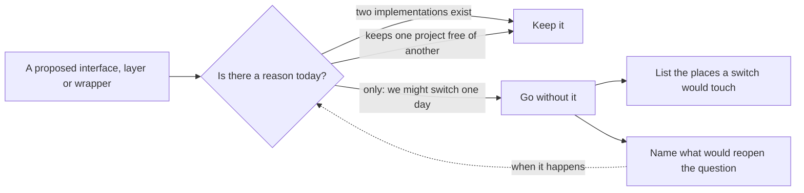

## Before you start

- [[design.l4.architectural-drivers]] — you know that a choice is made from drivers, the needs and constraints that exist, not from a style.
- [[management.l3.vendor-lock-in]] — you know lock-in as the cost of leaving a vendor, which grows with each use of its own features.
- [[design.l2.decorator-pattern]] — you know `ProductCache` wraps `EfProductRepository` behind the same `IProductRepository`.
- [[design.l3.one-way-module-dependencies]] — you know `DonHang.Domain` references no project, and dependencies between modules point one way.

## The situation

It is the first week of Sprint 18. A developer on the team proposes putting every RabbitMQ call in Đơn Hàng behind one broker-neutral interface, so that switching to another message broker one day means writing one new class. In the same review, someone asks why `CatalogService` reads a list of products straight from its `CatalogDbContext` while one product goes through `IProductRepository`. Both sound like a question of tidiness: should everything sit behind an interface, or nothing? The team lead asks you to read the code and the proposal before deciding. When is an extra interface worth its cost, and when is it a price paid now for a future that may not come?

## Core concepts

- **over-abstraction** — adding interfaces, layers or general-purpose wrappers for needs nobody has yet, so that each one is more code to read and change, paid for now against a future that may not come.
- a present reason — a need the abstraction serves today, such as a second implementation that already exists, or a project that must not see another one.
- the cost of an abstraction — the reading, the extra jump from caller to code, and the changes it needs whenever what it wraps changes, whether or not the imagined future arrives.
- a known switching cost — a written list of the places a change of product would touch, kept instead of a layer, so the cost is known without being paid in advance.

## How it works



In the situation above, both questions enter on the left: the broker-neutral interface and the repository that `CatalogService` does not use for product lists. Each one meets the same test, which asks for a reason that exists today, not one that might exist later.

Follow the two upper arrows. An interface earns its place when it already has work to do. `IProductRepository` has two implementations, the EF Core repository and the cache wrapped around it, so the interface is what lets the cache sit in front without its callers knowing. `IOutbox` has a different reason: it lets `DonHang.Domain` ask for a message to be sent without referencing the project that knows RabbitMQ, which keeps dependencies pointing one way.

Follow the lower arrow. When the only reason is "we might switch one day", the interface is over-abstraction. It costs reading and upkeep now, and it has to guess the shape of a product nobody has chosen yet, so it saves work only if that guess turns out right.

Going without the layer does not mean ignoring the future. The two boxes on the right replace it with something cheaper: a list of the places a switch would touch, and the events that would make the team ask again. The dotted arrow closes the loop. When one of those events happens, the reason exists today, and the same test now says yes to paying.

## In the Đơn Hàng system

How Catalog reads a list of products, and why it skips a repository for it:

```csharp file=DonHang.Catalog/CatalogService.cs tag=stage-4 lines=5-29
// The one implementation of ICatalog. A page of products is a query to shape,
// so it reads CatalogDbContext directly; one product at a time goes through
// IProductRepository, which is the ProductCache (CatalogModule).
internal sealed class CatalogService(CatalogDbContext db, IProductRepository products) : ICatalog
{
    // lesson: backend.l2.offset-pagination
    // Sorting by the unique id keeps every page in the same, fixed order.
    public async Task<List<CatalogProduct>> ListAsync(int limit, int offset, int? maxPriceVnd)
    {
        IQueryable<Product> query = db.Products;

        // lesson: backend.l2.filtering-with-query-parameters
        // Added to the query before it runs, so PostgreSQL filters, not C#.
        if (maxPriceVnd is not null)
        {
            query = query.Where(p => p.PriceVnd <= maxPriceVnd);
        }

        return await query
            .OrderBy(p => p.Id)
            .Skip(offset)
            .Take(limit)
            .Select(p => new CatalogProduct(p.Id, p.Name, p.PriceVnd))
            .ToListAsync();
    }
```

Lines 5–7 give the reason in the code itself: a list of products is a query to shape, so it reads `CatalogDbContext` directly. Shaping means lines 14–28 add the price filter, the order, `offset` and `limit` to the query on `db.Products` before it runs. Line 8 shows both dependencies; `CatalogModule` is where `ProductCache` is registered around `EfProductRepository`, and `CatalogProduct` is the plain type each row becomes. The deciding reason is the diagram's test: a repository for product lists would have no cache in front of it and no second implementation to swap in.

`IOutbox`, in `DonHang.Domain`, declares one method, `Add(string routingKey, object message)`. The comment in `IOutbox.cs` says its implementation, `EfOutbox`, is in `DonHang.Infrastructure`. That is the present reason: the domain code queues a message while `DonHang.Domain` still references no project.

The decision on the broker-neutral proposal:

```markdown file=docs/adr/0011-khong-boc-message-broker-sau-lop-chung.md tag=stage-4 lines=40-60
### Quyết định

Từ chối phương án bọc. Không yếu tố nào hôm nay cần broker khác, và lớp bọc
sẽ che chính những tính năng giữ cho message không mất và không quay vòng.
Thay vì trả trước, ADR này ghi lại những chỗ phải sửa nếu một ngày phải đổi.

Các file production dùng `RabbitMQ.Client`:

- `DonHang.Messaging/RabbitMqConnection.cs`: một kết nối mỗi process.
- `DonHang.Messaging/RabbitMqPublisher.cs`: publish có publisher confirm,
  dùng bởi relay outbox của API và của Payments.
- `DonHang.Messaging/MessageTracing.cs`: mang trace context trong header.
- `DonHang.Api/Messaging/RabbitMqTopology.cs` và
  `DonHang.Api/Messaging/PaymentEventsConsumer.cs`.
- `DonHang.Notifications/RabbitMqTopology.cs` và
  `DonHang.Notifications/OrderEventsConsumer.cs`.
- `DonHang.Payments/RabbitMqTopology.cs` và
  `DonHang.Payments/RefundRequestedConsumer.cs`.

Test trong `DonHang.Tests/Messaging/` và `DonHang.Tests/Notifications/` cũng
dùng thư viện này, để chạy với một RabbitMQ thật.
```

Lines 42–44 reject the wrapper for two reasons: no driver today needs another broker, and the layer would hide the very features that keep messages from being lost or going round forever. Instead, lines 46–57 list the nine production files that use `RabbitMQ.Client`, and lines 59–60 add the tests that run against a real RabbitMQ.

Outside this excerpt, the ADR names the features the services rely on, among them a dead-letter queue per service and publisher confirms. It states the dilemma: a neutral interface keeps only what every broker shares, so it either hides those features or exposes them and stops being neutral.

The ADR also names three events that would reopen the question: a requirement needs a feature RabbitMQ lacks; the company that hosts Đơn Hàng offers only another broker and the team stops running RabbitMQ; or the files using `RabbitMQ.Client` directly grow until the list no longer gives an estimate. Outside the nine files, the code that saves messages to the outbox, records them in the inbox and handles them never names RabbitMQ; it uses only `IOutbox`, the JSON message and the service's own calls. A switch rewrites the listed files, not the business rules.

## Trade-offs

| Choice | Code to read and keep now | Cost when the need arrives | What it hides |
|---|---|---|---|
| Use the class directly (`CatalogService` and `CatalogDbContext`) | nothing extra | add an interface then, when a reason appears | nothing |
| Interface with a reason today (`IProductRepository`, `IOutbox`) | one interface | already paid; a new implementation plugs in | only what callers should not depend on |
| Neutral layer for a possible future (the wrapper ADR `0011` rejects) | an interface, its implementation and the gaps between brokers | lower only if the next broker fits the shape guessed today | the RabbitMQ features the services rely on, unless it gives up being neutral |
| Use directly and list the cost (ADR `0011`) | a list of nine files in an ADR | rewrite the listed files and the tests, known in advance | nothing, as long as the list stays true |

The second and fourth rows are what Đơn Hàng does. Only the third pays before the need is known and hides something used today.

## What would you choose if…

…a teammate wants a repository for the product list as well, so that every read in Catalog looks the same? Nothing today calls for it: `ListAsync` has one caller, one way to read, and no cache in front. Sameness alone is not a driver. Keep reading `CatalogDbContext` directly until a second implementation, such as a cache for product lists, is actually needed.

…the company that hosts Đơn Hàng will offer only a different broker, and the team will stop running RabbitMQ? That is the second event ADR `0011` names, so the reason now exists. Record the switch in a new ADR, sized from the nine files and the tests the old one lists; the code behind `IOutbox` keeps its shape.

…a new service needs to publish messages too? It uses `DonHang.Messaging` like the API and Payments do. If the number of files that use `RabbitMQ.Client` directly grows until the ADR's list no longer gives an estimate, that is the third event, and the question of a layer opens again.

## Seniors often assume…

- **"Every class should sit behind an interface, so that it can be replaced later."** → Actually each interface is code to read and one more jump from caller to code, and it is paid for whether the replacement ever comes or not. When every caller lives in the same codebase, as in Đơn Hàng, adding an interface on the day a second implementation is needed is an ordinary refactoring. You notice this when "go to definition" lands on an interface, and a second jump finds the only class behind it.
- **"A broker-neutral layer over RabbitMQ costs nothing, because the services only call it."** → Actually the layer must be written, read and changed, and it can keep only what all brokers share. So it either hides features like dead-letter queues and publisher confirms or exposes them and is no longer neutral. You notice this when a fix needs one more RabbitMQ setting on a queue and the layer has no place to put it.
- **"An interface with only one production implementation is always over-abstraction."** → Actually the count is not the test; the reason is. `IOutbox` has one production implementation, `EfOutbox`, yet it keeps `DonHang.Domain` free of any project, and the tests give it a fake. You notice this belief when someone proposes removing such an interface and the domain project would then have to reference the messaging code.

## Try it (3 minutes)

In the `don-hang` repository:

1. Run `git grep -l "using RabbitMQ.Client" stage-4 -- "*.cs"`.
2. Compare the files it prints with lines 46–60 of ADR `0011` above.
3. Say which of these files a switch to another broker would rewrite, and name one part of Đơn Hàng it would leave alone.

Expected result: 13 files, the nine production files of the ADR's list plus four under `DonHang.Tests/Messaging/` and `DonHang.Tests/Notifications/`.

<details><summary>Suggested answer</summary>

A switch rewrites all 13: the nine production files, and the tests that run against a real RabbitMQ. It leaves alone the code that only sees `IOutbox`, such as the domain code that queues a message with an order, because nothing there names RabbitMQ.

</details>

## Connections

- [[design.l4.architectural-drivers]] — the same test applied to a single interface: a driver that exists today, not a guess.
- [[management.l3.vendor-lock-in]] — the cost ADR `0011` chooses to know and accept, instead of paying for a layer against it.
- [[design.l2.decorator-pattern]] — the present reason behind `IProductRepository`: the cache that wraps the EF Core repository.
- [[design.l3.one-way-module-dependencies]] — the present reason behind `IOutbox`: `DonHang.Domain` references no project.
- [[design.l2.unit-of-work]] — where the row `IOutbox` adds is saved together with the order.
- [[backend.l3.outbox-pattern]] — the mechanism `IOutbox` belongs to, and the code that publishes outbox rows to RabbitMQ with the publisher confirms the wrapper would hide.
- [[design.l4.evolutionary-architecture]] — next: changing an architecture in small checked steps when a driver does change.

## Five-line summary

1. An abstraction earns its place with a reason that exists today; adding one for a need nobody has yet is over-abstraction.
2. `IProductRepository` has two implementations, and `IOutbox` keeps `DonHang.Domain` free of other projects; both have present reasons.
3. `CatalogService` reads a list of products straight from `CatalogDbContext`, because no second implementation or boundary calls for a repository there.
4. ADR `0011` rejects a broker-neutral layer: no driver needs another broker, and the layer would hide features the services rely on.
5. Instead it lists the nine files a switch would touch and names what would reopen the question, so the cost is known, not prepaid.
