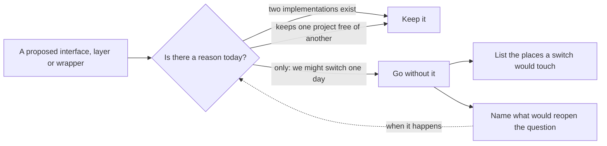

## Bạn cần biết trước

- [[design.l4.architectural-drivers]] — bạn biết một lựa chọn được quyết từ các yếu tố định hình kiến trúc, tức những nhu cầu và ràng buộc đang có, chứ không từ một phong cách.
- [[management.l3.vendor-lock-in]] — bạn biết vendor lock-in là cái giá phải trả để rời một vendor, và nó lớn dần mỗi lần dùng một tính năng riêng của vendor đó.
- [[design.l2.decorator-pattern]] — bạn biết `ProductCache` bọc `EfProductRepository` sau cùng một `IProductRepository`.
- [[design.l3.one-way-module-dependencies]] — bạn biết `DonHang.Domain` không tham chiếu project nào, và phụ thuộc giữa các module chỉ đi một chiều.

## Tình huống

Tuần đầu của Sprint 18. Một developer trong đội đề xuất đặt mọi lời gọi RabbitMQ trong Đơn Hàng sau một interface chung, không gắn với broker nào, để nếu một ngày đổi sang message broker khác thì chỉ cần viết một class mới. Cũng trong buổi review đó, có người hỏi vì sao `CatalogService` đọc danh sách sản phẩm thẳng từ `CatalogDbContext`, còn từng sản phẩm lại đi qua `IProductRepository`. Cả hai nghe như chuyện gọn gàng: mọi thứ nên nằm sau interface, hay không gì cả? Trưởng nhóm nhờ bạn đọc code và đề xuất trước khi quyết. Khi nào một interface thêm vào đáng với cái giá của nó, và khi nào nó là khoản trả trước cho một tương lai có thể không tới?

## Khái niệm cốt lõi

- **trừu tượng hóa thừa** (over-abstraction) — thêm interface, tầng hay lớp bọc đa dụng cho những nhu cầu chưa ai có. Mỗi thứ như vậy là thêm code phải đọc và phải sửa, trả ngay bây giờ cho một tương lai có thể không tới.
- lý do hiện tại — một nhu cầu mà lớp trừu tượng phục vụ ngay hôm nay, chẳng hạn một implementation thứ hai đã tồn tại, hoặc một project không được phép thấy project khác.
- cái giá của một lớp trừu tượng — công đọc, thêm một bước nhảy từ chỗ gọi tới code thật, và những chỗ phải sửa mỗi khi thứ nó bọc thay đổi, dù tương lai được hình dung có tới hay không.
- chi phí chuyển đổi đã biết — một danh sách viết ra các chỗ mà việc đổi sản phẩm sẽ đụng tới, giữ thay cho một tầng, để cái giá được biết trước mà không phải trả trước.

## Cơ chế hoạt động



Trong tình huống trên, cả hai câu hỏi đều vào từ bên trái: interface chung cho mọi broker, và repository mà `CatalogService` không dùng để đọc danh sách sản phẩm. Mỗi câu gặp cùng một phép thử: lý do phải có ngay hôm nay, không phải lý do có thể có sau này.

Đi theo hai mũi tên phía trên. Một interface đáng có khi nó đã có việc để làm. `IProductRepository` có hai implementation, repository EF Core và cache bọc quanh nó. Chính interface cho phép cache đứng phía trước mà bên gọi không hề biết. `IOutbox` có lý do khác: nó cho `DonHang.Domain` yêu cầu gửi một message mà không phải tham chiếu project biết về RabbitMQ, nhờ vậy phụ thuộc vẫn đi một chiều.

Đi theo mũi tên phía dưới. Khi lý do duy nhất là "biết đâu một ngày mình đổi", interface đó là trừu tượng hóa thừa. Nó tốn công đọc và công giữ ngay bây giờ. Nó còn phải đoán hình dạng của một sản phẩm chưa ai chọn, nên chỉ tiết kiệm được công khi lần đoán ấy hóa ra đúng.

Không làm tầng đó không có nghĩa là bỏ mặc tương lai. Hai ô bên phải thay nó bằng thứ rẻ hơn: danh sách các chỗ mà một lần đổi sẽ đụng tới, và những sự kiện khiến đội phải hỏi lại. Mũi tên đứt nét khép vòng lại. Khi một trong các sự kiện đó xảy ra, lý do đã có ngay hôm nay, và cùng phép thử ấy giờ nói là nên trả.

## Trong hệ thống Đơn Hàng

Catalog đọc danh sách sản phẩm thế nào, và vì sao nó bỏ qua repository ở chỗ này:

```csharp file=DonHang.Catalog/CatalogService.cs tag=stage-4 lines=5-29
// The one implementation of ICatalog. A page of products is a query to shape,
// so it reads CatalogDbContext directly; one product at a time goes through
// IProductRepository, which is the ProductCache (CatalogModule).
internal sealed class CatalogService(CatalogDbContext db, IProductRepository products) : ICatalog
{
    // lesson: backend.l2.offset-pagination
    // Sorting by the unique id keeps every page in the same, fixed order.
    public async Task<List<CatalogProduct>> ListAsync(int limit, int offset, int? maxPriceVnd)
    {
        IQueryable<Product> query = db.Products;

        // lesson: backend.l2.filtering-with-query-parameters
        // Added to the query before it runs, so PostgreSQL filters, not C#.
        if (maxPriceVnd is not null)
        {
            query = query.Where(p => p.PriceVnd <= maxPriceVnd);
        }

        return await query
            .OrderBy(p => p.Id)
            .Skip(offset)
            .Take(limit)
            .Select(p => new CatalogProduct(p.Id, p.Name, p.PriceVnd))
            .ToListAsync();
    }
```

Dòng 5–7 nêu lý do ngay trong code: danh sách sản phẩm là một query cần định hình, nên nó đọc thẳng `CatalogDbContext`. Định hình ở đây là dòng 14–28 thêm điều kiện lọc giá, thứ tự sắp xếp, `offset` và `limit` vào query trên `db.Products` trước khi query chạy. Dòng 8 cho thấy cả hai phụ thuộc. `CatalogModule` là nơi đăng ký `ProductCache` bọc quanh `EfProductRepository`, còn `CatalogProduct` là type đơn giản mà mỗi dòng dữ liệu được chuyển thành. Lý do quyết định là phép thử trong sơ đồ: một repository cho danh sách sản phẩm sẽ không có cache nào đứng trước, cũng không có implementation thứ hai nào để thay vào.

`IOutbox`, trong `DonHang.Domain`, khai báo đúng một method, `Add(string routingKey, object message)`. Comment trong `IOutbox.cs` nói implementation của nó, `EfOutbox`, nằm ở `DonHang.Infrastructure`. Đó là lý do hiện tại: code domain xếp một message vào hàng chờ, trong khi `DonHang.Domain` vẫn không tham chiếu project nào.

Quyết định về đề xuất interface chung cho mọi broker:

```markdown file=docs/adr/0011-khong-boc-message-broker-sau-lop-chung.md tag=stage-4 lines=40-60
### Quyết định

Từ chối phương án bọc. Không yếu tố nào hôm nay cần broker khác, và lớp bọc
sẽ che chính những tính năng giữ cho message không mất và không quay vòng.
Thay vì trả trước, ADR này ghi lại những chỗ phải sửa nếu một ngày phải đổi.

Các file production dùng `RabbitMQ.Client`:

- `DonHang.Messaging/RabbitMqConnection.cs`: một kết nối mỗi process.
- `DonHang.Messaging/RabbitMqPublisher.cs`: publish có publisher confirm,
  dùng bởi relay outbox của API và của Payments.
- `DonHang.Messaging/MessageTracing.cs`: mang trace context trong header.
- `DonHang.Api/Messaging/RabbitMqTopology.cs` và
  `DonHang.Api/Messaging/PaymentEventsConsumer.cs`.
- `DonHang.Notifications/RabbitMqTopology.cs` và
  `DonHang.Notifications/OrderEventsConsumer.cs`.
- `DonHang.Payments/RabbitMqTopology.cs` và
  `DonHang.Payments/RefundRequestedConsumer.cs`.

Test trong `DonHang.Tests/Messaging/` và `DonHang.Tests/Notifications/` cũng
dùng thư viện này, để chạy với một RabbitMQ thật.
```

Dòng 42–44 bác lớp bọc vì hai lý do: hôm nay không yếu tố nào cần broker khác, và tầng đó sẽ che chính những tính năng giữ cho message không bị mất và không quay vòng mãi. Thay vào đó, dòng 46–57 liệt kê chín file production dùng `RabbitMQ.Client`, còn dòng 59–60 thêm các test chạy với RabbitMQ thật.

Ngoài đoạn trích, ADR nêu tên các tính năng mà các service dựa vào, trong đó có dead-letter queue cho từng service và publisher confirm. ADR cũng nói rõ thế khó: một interface trung lập chỉ giữ được những gì mọi broker cùng có, nên nó hoặc che các tính năng đó, hoặc để lộ chúng ra và thôi trung lập.

ADR còn nêu tên ba sự kiện sẽ mở lại câu hỏi. Một yêu cầu cần tính năng mà RabbitMQ không có. Công ty host Đơn Hàng chỉ cung cấp broker khác và đội thôi tự chạy RabbitMQ. Hoặc số file dùng thẳng `RabbitMQ.Client` tăng tới mức danh sách không còn cho ra được ước lượng. Ngoài chín file đó, code lưu message vào outbox, ghi nhận chúng vào inbox và xử lý chúng không hề gọi tên RabbitMQ. Nó chỉ dùng `IOutbox`, message JSON và các lời gọi riêng của service. Một lần đổi sẽ viết lại các file trong danh sách, không đụng tới quy tắc nghiệp vụ.

## Đánh đổi

| Lựa chọn | Code phải đọc và giữ bây giờ | Cái giá khi nhu cầu tới | Thứ bị che |
|---|---|---|---|
| Dùng thẳng class (`CatalogService` và `CatalogDbContext`) | không thêm gì | lúc đó mới thêm interface, khi có lý do | không gì |
| Interface có lý do ngay hôm nay (`IProductRepository`, `IOutbox`) | một interface | đã trả rồi, implementation mới cắm vào là chạy | chỉ những gì bên gọi không nên phụ thuộc |
| Tầng trung lập cho một tương lai có thể có (lớp bọc mà ADR `0011` bác) | một interface, implementation của nó và các chỗ vênh giữa các broker | chỉ thấp hơn nếu broker tiếp theo khớp với hình dạng đoán hôm nay | các tính năng RabbitMQ mà service dựa vào, trừ khi nó thôi trung lập |
| Dùng thẳng và liệt kê cái giá (ADR `0011`) | một danh sách chín file trong một ADR | viết lại các file và test trong danh sách, biết trước | không gì, miễn danh sách còn đúng |

Hàng thứ hai và thứ tư là cách Đơn Hàng làm. Chỉ hàng thứ ba trả tiền trước khi biết nhu cầu, và che đi thứ đang được dùng hôm nay.

## Bạn sẽ chọn gì nếu…

…một đồng nghiệp muốn có thêm repository cho danh sách sản phẩm, để mọi lần đọc trong Catalog trông giống nhau? Hôm nay không có gì đòi hỏi điều đó: `ListAsync` có một chỗ gọi, chỉ đọc theo một kiểu, và không có cache đứng trước. Riêng chuyện giống nhau không phải là một yếu tố định hình kiến trúc. Hãy tiếp tục đọc thẳng `CatalogDbContext` cho tới khi thật sự cần một implementation thứ hai, chẳng hạn một cache cho danh sách sản phẩm.

…công ty host Đơn Hàng sẽ chỉ cung cấp một broker khác, và đội sẽ thôi tự chạy RabbitMQ? Đó là sự kiện thứ hai mà ADR `0011` nêu tên, nên lý do giờ đã có. Hãy ghi lần đổi vào một ADR mới, ước lượng từ chín file và các test mà ADR cũ liệt kê. Code đứng sau `IOutbox` vẫn giữ nguyên hình dạng.

…một service mới cũng cần publish message? Nó dùng `DonHang.Messaging` như API và Payments đang dùng. Nếu số file dùng thẳng `RabbitMQ.Client` tăng tới mức danh sách trong ADR không còn cho ra được ước lượng, đó là sự kiện thứ ba, và câu hỏi về một tầng bọc lại được mở ra.

## Senior hay nhầm rằng…

- **"Class nào cũng nên nằm sau một interface, để sau này còn thay được."** → Thực ra mỗi interface là thêm code phải đọc và thêm một bước nhảy từ chỗ gọi tới code thật, và cái giá đó phải trả dù có bao giờ thay hay không. Khi mọi chỗ gọi đều nằm trong cùng một codebase, như ở Đơn Hàng, thêm interface vào đúng ngày cần implementation thứ hai chỉ là một lần refactoring bình thường. Bạn sẽ nhận ra khi "go to definition" dừng ở một interface, và phải nhảy thêm lần nữa mới tới class duy nhất đứng sau nó.
- **"Một tầng trung lập bọc RabbitMQ chẳng tốn gì, vì các service chỉ việc gọi nó."** → Thực ra tầng đó phải được viết, được đọc và được sửa, và nó chỉ giữ được những gì mọi broker cùng có. Vì vậy nó hoặc che các tính năng như dead-letter queue và publisher confirm, hoặc để lộ chúng ra và không còn trung lập. Bạn sẽ nhận ra khi một bản sửa cần thêm một thiết lập RabbitMQ cho một queue, và tầng bọc không có chỗ nào để đặt nó.
- **"Interface chỉ có một implementation production thì luôn là trừu tượng hóa thừa."** → Thực ra phép thử không nằm ở con số mà ở lý do. `IOutbox` chỉ có một implementation production, `EfOutbox`, nhưng nó giữ cho `DonHang.Domain` không phụ thuộc project nào, và test dùng một fake cho nó. Bạn sẽ nhận ra niềm tin này khi có người đề xuất bỏ một interface như vậy, và project domain sẽ phải tham chiếu tới code messaging.

## Thử ngay (3 phút)

Trong repo `don-hang`:

1. Chạy `git grep -l "using RabbitMQ.Client" stage-4 -- "*.cs"`.
2. So các file nó in ra với dòng 46–60 của ADR `0011` ở trên.
3. Nói những file nào sẽ bị viết lại khi đổi sang broker khác, và nêu một phần của Đơn Hàng không bị đụng tới.

Kết quả mong đợi: 13 file, gồm chín file production trong danh sách của ADR và bốn file dưới `DonHang.Tests/Messaging/` và `DonHang.Tests/Notifications/`.

<details><summary>Gợi ý đáp án</summary>

Một lần đổi sẽ viết lại cả 13 file: chín file production, và các test chạy với RabbitMQ thật. Nó không đụng tới code chỉ thấy `IOutbox`, chẳng hạn code domain xếp một message vào hàng chờ cùng với đơn hàng, vì không chỗ nào ở đó gọi tên RabbitMQ.

</details>

## Liên hệ

- [[design.l4.architectural-drivers]] — cùng phép thử đó áp vào một interface: một yếu tố đang có hôm nay, không phải một phỏng đoán.
- [[management.l3.vendor-lock-in]] — cái giá mà ADR `0011` chọn biết trước và chấp nhận, thay vì trả tiền làm một tầng để chống lại nó.
- [[design.l2.decorator-pattern]] — lý do hiện tại đằng sau `IProductRepository`: cache bọc quanh repository EF Core.
- [[design.l3.one-way-module-dependencies]] — lý do hiện tại đằng sau `IOutbox`: `DonHang.Domain` không tham chiếu project nào.
- [[design.l2.unit-of-work]] — nơi dòng mà `IOutbox` thêm vào được lưu cùng với đơn hàng.
- [[backend.l3.outbox-pattern]] — cơ chế mà `IOutbox` thuộc về, và code publish các dòng outbox lên RabbitMQ với publisher confirm, đúng thứ lớp bọc sẽ che đi.
- [[design.l4.evolutionary-architecture]] — tiếp theo: đổi một kiến trúc bằng những bước nhỏ có kiểm tra khi một yếu tố thật sự thay đổi.

## Tóm tắt 5 dòng

1. Một lớp trừu tượng chỉ đáng có khi có lý do ngay hôm nay. Thêm nó cho nhu cầu chưa ai có là trừu tượng hóa thừa.
2. `IProductRepository` có hai implementation, còn `IOutbox` giữ `DonHang.Domain` không phụ thuộc project khác. Cả hai đều có lý do hiện tại.
3. `CatalogService` đọc danh sách sản phẩm thẳng từ `CatalogDbContext`, vì ở đó không có implementation thứ hai hay ranh giới nào đòi hỏi một repository.
4. ADR `0011` bác một tầng trung lập bọc broker: không yếu tố nào cần broker khác, và tầng đó sẽ che các tính năng mà các service dựa vào.
5. Thay vào đó, ADR liệt kê chín file mà một lần đổi sẽ đụng tới và nêu tên những gì sẽ mở lại câu hỏi, để cái giá được biết trước chứ không trả trước.
