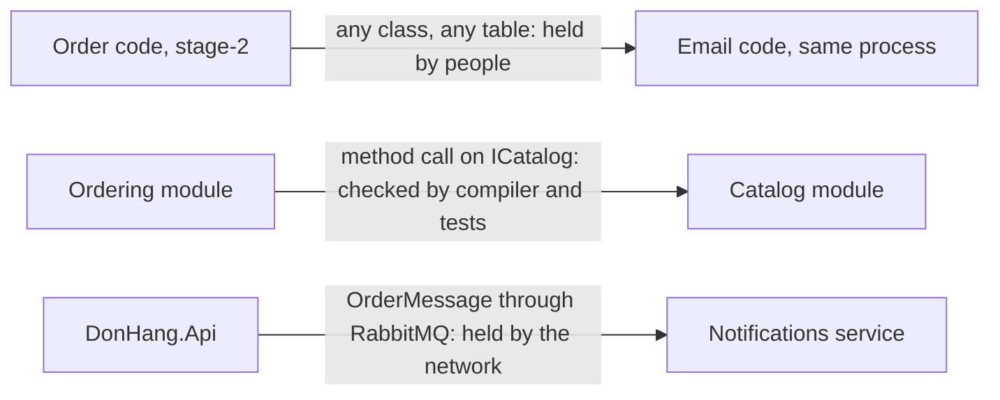

## Before you start

- [[design.l4.architectural-drivers]] — you know a style is chosen per part, from that part's drivers.
- [[design.l3.testing-module-boundaries]] — you know `ModuleBoundaryTests` catch the two changes to Catalog that the compiler accepts.
- [[backend.l3.message-broker]] — you know Notifications learns about an order only from a message that waits in its queue.

## The situation

A teammate wants the order email to list the names of the products bought. In `DonHang.Api`, Ordering gets a product's price with one method call on `ICatalog`, though it cannot name Catalog's `internal` classes. In `DonHang.Notifications` there is no `ICatalog` to ask and no `orders` table in its own database; it references only `DonHang.Messaging`, shared code for sending and receiving messages that knows no order or product. At stage-2, the email code inside `DonHang.Api` could have read any table. The same wish meets a different wall in each place. What holds each wall, and what does each one cost?

## Core concepts

- a boundary held by people — a line between parts that no tool checks; it lasts only as long as everyone who changes the code respects it.
- a boundary checked at build time — a line the compiler and the tests check before a change is merged, while a call across it is still an ordinary method call in one process.
- a boundary held by the network — a line between processes; one part cannot run the other's code at all and knows it only from what crosses the network.
- the price of independence — what a stronger boundary costs: calls that can fail, data that agrees only after a while, and more to run.

## How it works



Each row of the diagram is one style, and the label on its arrow says where the boundary between the two parts is held.

The top row is a monolith without modules, as Đơn Hàng was at stage-2: order code and email code ran in one process and shared the `donhang` database, where emails were rows in the `notifications` table. Nothing stopped either side from using the other's classes or tables. In the situation above, that is why the stage-2 email code could have read any table. The boundary existed in the team's heads.

The middle row is a modular monolith. Catalog's insides are `internal`, so other projects cannot name them, and `ModuleBoundaryTests` fail on the two changes the compiler accepts. The check runs when the code is built and tested, yet Ordering still reaches Catalog with a method call that returns in the same process.

The bottom row is between services. Notifications runs in a process of its own, and `DonHang.Api` cannot reach into it, nor it into `DonHang.Api`. What Notifications knows about an order is what an `OrderMessage` carries. That is the wall the teammate hit.

Moving down the rows buys independence: a service can be built, released, scaled and stopped on its own. It also costs more. A call can fail on the way, an email arrives some time after its order, and ADR 0002 counts one more image, build pipeline, database and dashboard to run for Notifications alone. Stage-3 Đơn Hàng uses two rows at once, because its parts have different drivers.

## In the Đơn Hàng system

What the compiler already holds, and what the tests add for Catalog:

```csharp file=DonHang.Tests/Architecture/ModuleBoundaryTests.cs tag=stage-3 lines=9-31
// lesson: design.l3.testing-module-boundaries
// The compiler already stops other projects from naming Catalog's `internal`
// types. These tests catch the two things it allows: a reference from Catalog
// to Ordering's projects, and one more type made public. From stage-3 they
// also keep the Notifications and Payments services apart from the rest.
public sealed class ModuleBoundaryTests
{
    private static readonly string[] ProjectsCatalogMustNotUse =
    [
        "DonHang.Domain",
        "DonHang.Infrastructure",
        "DonHang.Api",
    ];

    // Catalog's whole contract. Making another type public fails the test
    // below until this list changes too, so the pull request that widens the
    // contract shows it to its reviewers as an edit to this file.
    private static readonly string[] CatalogPublicTypes =
    [
        "CatalogModule",
        "CatalogProduct",
        "ICatalog",
    ];
```

Lines 10–12 name the two checks of a modular monolith: the compiler refuses `internal` types from other projects, and the tests catch what it allows. Lines 12–13 add that the same tests keep the two services apart. The network only stops a service from running code in another process; a project reference would bring another part's code into the service's own process, and the tests refuse that. Lines 26–31 list everything Catalog shows to other modules, `ICatalog` among them. Nothing here runs in production, so a call across Catalog's boundary can stay an ordinary method call.

What Notifications knows about an order:

```csharp file=DonHang.Notifications/OrderMessage.cs tag=stage-3 lines=1-6
namespace DonHang.Notifications;

// The body of an order.* message, as DonHang.Api publishes it. This service
// keeps its own copy of the shape instead of referencing DonHang.Domain:
// the JSON is the contract between the two, not a shared class.
public sealed record OrderMessage(int OrderId, string CustomerEmail, string CustomerName, DateTimeOffset OccurredAt);
```

Line 6 is the whole of it: an order id, the customer's email address and name, and a time. Lines 3–5 say why it is a copy: the two processes share JSON, not a class. Product names are not in the message, so the teammate's email needs a change to the message itself, agreed by both sides.

## Trade-offs

| Style | Where the boundary is held | A call across it | Released, scaled, failing | More to run |
|---|---|---|---|---|
| Monolith without modules | by people | a method call, to any class | together | nothing beyond one process |
| Modular monolith | by the compiler and tests, before merge | a method call, to the contract only | together | nothing beyond one process |
| Services | by the network, while running | a message or a request that can fail | can be each on its own | images, a database, and the build and monitoring for each service |

Read the rows from top to bottom as a price list. Each row adds a stronger wall than the one above, and in Đơn Hàng the tests still check the services too. In the services row, independence costs calls that can fail and data that agrees only after a while. Which row a part needs depends on whether its drivers ask for that independence.

## What would you choose if…

…the team found that Ordering code kept reaching into Catalog's classes, but no driver asked for a separate release or for Catalog failing on its own? The problem is a boundary held by people. A modular monolith fixes it with `internal` types and tests, and keeps the method call. A service would fix it too, but would add costs no driver pays for.

…someone proposed making Catalog a service? At stage-3 Ordering's `OrderService` asks for each item's current price while an order is placed, and the answer comes from `ICatalog` in the same process. As a service, Catalog would put another process, one that can be down or slow on its own, inside the step that takes orders. Unless Catalog has a driver of its own, keep it a module.

…a small staff tool were written and changed by one developer? A boundary held by people is held by one person here, and module tests would guard against nobody. One process without modules fits until a second person, or a second part that changes for its own reasons, arrives.

## Seniors often assume…

- **"A modular monolith is just a monolith that has not been split into services yet."** → Actually it is a style with its own place: the boundary is checked, and the call stays an ordinary method call. Catalog at stage-3 is a module because no driver asks for more, not because a split is pending. You notice this belief when a team plans to split every module "eventually" and no ADR names a reason.
- **"A boundary only really exists once the parts run in separate processes."** → Actually `ModuleBoundaryTests` fail a pull request that widens Catalog's contract, and the compiler refuses Catalog's `internal` types, before anything runs. A boundary held at build time is a real one; it just does not need the network. You notice this belief when the only proposed fix for tangled code is a new service.
- **"A system should use one style throughout; mixing modules and services is a half-finished migration."** → Actually stage-3 Đơn Hàng mixes them on purpose. Notifications and Payments are services because their drivers asked for it, while Ordering and Catalog stay modules of `DonHang.Api`. You notice this belief when a part is split only so that it matches the others.

## Try it (3 minutes)

Each change below is tried in the `don-hang` repository at tag `stage-3`. For each one, say which style's boundary stops it and when: while editing and building, when the tests run, or not at all.

1. In `DonHang.Infrastructure`, a teammate uses Catalog's `internal` class `Product` directly.
2. A teammate makes one more Catalog type `public` so that Ordering can use it.
3. In `DonHang.Notifications`, a teammate wants to look up the order's products in the `order_items` table.

Expected result: you have one answer per change, naming the compiler, the tests or no tool at all.

<details><summary>Suggested answer</summary>

1. The compiler stops it while building: other projects cannot name Catalog's `internal` types. This is the modular monolith's boundary.
2. The compiler accepts it, but `CatalogMakesPublicOnlyItsContract` fails when the tests run, until the list in `ModuleBoundaryTests` changes too, which the pull request then shows to its reviewers.
3. Not at all, by any tool. `order_items` is in the `donhang` database, owned by Ordering, on the same PostgreSQL server as `donhang_notifications`. Notifications' config names only its own database, but a second connection to `donhang` would build and pass every test: this part of the wall is held by people. The table also holds a product id, quantity and price, not a name, so the message has to change instead.

</details>

## Connections

- [[design.l4.architectural-drivers]] — which drivers place a part in each row; this lesson shows what each row holds.
- [[design.l3.module-contracts]] — the middle row up close: `ICatalog` as the only door into Catalog.
- [[design.l3.modular-monolith]] — the style of the middle row, taught on its own.
- [[design.l3.testing-module-boundaries]] — the tests that hold the middle row's boundary.
- [[backend.l3.message-broker]] — how the bottom row's messages travel and wait.
- [[design.l4.distributed-monolith]] — what happens when services sit in the bottom row but still have to change together.

## Five-line summary

1. Monolith, modular monolith and services differ in where the boundary between parts is held: by people, at build time, or by the network.
2. In a monolith without modules nothing stops one part from using another part's classes or tables.
3. In a modular monolith `internal` types and `ModuleBoundaryTests` keep Catalog's insides out, while a call across stays a method call.
4. Notifications cannot run Ordering's code and knows an order only from `OrderMessage`; that independence costs failing calls, delayed data and more to run.
5. Stage-3 Đơn Hàng mixes modules and services on purpose, each part placed where its own drivers put it.
