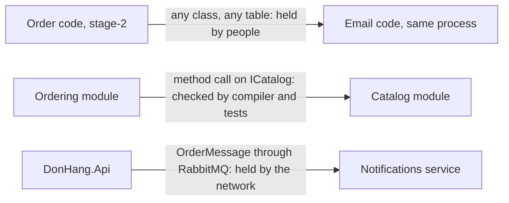

## Bạn cần biết trước

- [[design.l4.architectural-drivers]] — bạn biết kiểu kiến trúc được chọn cho từng phần, từ các yếu tố định hình kiến trúc của phần đó.
- [[design.l3.testing-module-boundaries]] — bạn biết `ModuleBoundaryTests` bắt được hai thay đổi ở Catalog mà compiler vẫn chấp nhận.
- [[backend.l3.message-broker]] — bạn biết Notifications chỉ biết về một đơn qua message nằm chờ trong hàng đợi của nó.

## Tình huống

Một đồng nghiệp muốn email báo đơn liệt kê tên các sản phẩm đã mua. Trong `DonHang.Api`, Ordering lấy giá sản phẩm bằng một lần gọi method trên `ICatalog`, dù không gọi tên được các class `internal` của Catalog. Trong `DonHang.Notifications` thì không có `ICatalog` nào để hỏi, và database riêng của nó cũng không có bảng `orders`. Service này chỉ tham chiếu `DonHang.Messaging`, phần code dùng chung để gửi và nhận message, không biết gì về đơn hay sản phẩm. Còn ở stage-2, code gửi email nằm trong `DonHang.Api` có thể đọc bất kỳ bảng nào. Cùng một mong muốn, mỗi nơi lại vấp một bức tường khác. Thứ gì giữ từng bức tường, và mỗi bức tốn những gì?

## Khái niệm cốt lõi

- ranh giới do con người giữ — đường phân chia giữa các phần mà không công cụ nào kiểm tra. Nó chỉ tồn tại khi mọi người sửa code đều tôn trọng nó.
- ranh giới được kiểm tra lúc build — đường phân chia mà compiler và test kiểm tra trước khi thay đổi được merge, trong khi lời gọi qua nó vẫn là một lần gọi method bình thường trong cùng process.
- ranh giới do mạng giữ — đường phân chia giữa các process. Phần này hoàn toàn không chạy được code của phần kia, và chỉ biết phần kia qua những gì đi qua mạng.
- cái giá của sự độc lập — thứ mà một ranh giới mạnh hơn phải trả: lời gọi có thể thất bại, dữ liệu chỉ khớp nhau sau một lúc, và nhiều thứ hơn phải vận hành.

## Cơ chế hoạt động



Mỗi hàng của sơ đồ là một kiểu kiến trúc, và nhãn trên mũi tên cho biết ranh giới giữa hai phần được giữ ở đâu.

Hàng trên cùng là một monolith không chia module, như Đơn Hàng ở stage-2: code xử lý đơn và code gửi email chạy trong cùng process và dùng chung database `donhang`, nơi mỗi email là một dòng trong bảng `notifications`. Không gì ngăn bên này dùng class hay bảng của bên kia. Trong tình huống trên, đó là lý do code email ở stage-2 có thể đọc bất kỳ bảng nào. Ranh giới chỉ nằm trong đầu các thành viên team.

Hàng giữa là một modular monolith. Phần bên trong của Catalog là `internal`, nên các project khác không gọi tên được, và `ModuleBoundaryTests` fail với hai thay đổi mà compiler chấp nhận. Việc kiểm tra diễn ra khi code được build và test, vậy mà Ordering vẫn đến được Catalog bằng một lần gọi method trả về ngay trong cùng process.

Hàng dưới cùng là giữa các service. Notifications chạy trong process riêng, `DonHang.Api` không thò tay vào đó được, và ngược lại. Những gì Notifications biết về một đơn chính là những gì một `OrderMessage` mang theo. Đó là bức tường mà đồng nghiệp kia vấp phải.

Đi xuống các hàng là mua thêm sự độc lập: một service có thể được build, release, scale và dừng riêng. Nhưng cái giá cũng tăng. Lời gọi có thể thất bại giữa đường, email đến sau đơn một khoảng thời gian, và ADR 0002 đếm thêm một image, một pipeline build, một database và một dashboard phải vận hành chỉ riêng cho Notifications. Đơn Hàng ở stage-3 dùng hai hàng cùng lúc, vì các phần của nó có yếu tố định hình kiến trúc khác nhau.

## Trong hệ thống Đơn Hàng

Những gì compiler đã giữ sẵn, và những gì test thêm vào cho Catalog:

```csharp file=DonHang.Tests/Architecture/ModuleBoundaryTests.cs tag=stage-3 lines=9-31
// lesson: design.l3.testing-module-boundaries
// The compiler already stops other projects from naming Catalog's `internal`
// types. These tests catch the two things it allows: a reference from Catalog
// to Ordering's projects, and one more type made public. From stage-3 they
// also keep the Notifications and Payments services apart from the rest.
public sealed class ModuleBoundaryTests
{
    private static readonly string[] ProjectsCatalogMustNotUse =
    [
        "DonHang.Domain",
        "DonHang.Infrastructure",
        "DonHang.Api",
    ];

    // Catalog's whole contract. Making another type public fails the test
    // below until this list changes too, so the pull request that widens the
    // contract shows it to its reviewers as an edit to this file.
    private static readonly string[] CatalogPublicTypes =
    [
        "CatalogModule",
        "CatalogProduct",
        "ICatalog",
    ];
```

Dòng 10–12 nêu hai lớp kiểm tra của một modular monolith: compiler từ chối các type `internal` khi project khác dùng tới, còn test bắt những gì compiler cho qua. Dòng 12–13 bổ sung rằng cũng chính các test này giữ hai service tách khỏi phần còn lại. Mạng chỉ ngăn một service chạy code trong process khác. Một project reference sẽ kéo code của phần khác vào chính process của service, và test từ chối điều đó. Dòng 26–31 liệt kê mọi thứ Catalog cho các module khác thấy, trong đó có `ICatalog`. Không thứ gì ở đây chạy trong production, nên lời gọi qua ranh giới của Catalog vẫn có thể là một lần gọi method bình thường.

Những gì Notifications biết về một đơn:

```csharp file=DonHang.Notifications/OrderMessage.cs tag=stage-3 lines=1-6
namespace DonHang.Notifications;

// The body of an order.* message, as DonHang.Api publishes it. This service
// keeps its own copy of the shape instead of referencing DonHang.Domain:
// the JSON is the contract between the two, not a shared class.
public sealed record OrderMessage(int OrderId, string CustomerEmail, string CustomerName, DateTimeOffset OccurredAt);
```

Dòng 6 là tất cả: mã đơn, địa chỉ email và tên khách, và một thời điểm. Dòng 3–5 giải thích vì sao đây là một bản sao: hai process dùng chung JSON, không dùng chung class. Tên sản phẩm không có trong message, nên muốn email có tên sản phẩm thì phải sửa chính message, và cả hai bên phải đồng ý.

## Đánh đổi

| Kiểu | Ranh giới được giữ ở đâu | Một lời gọi qua ranh giới | Release, scale, lỗi | Phải vận hành thêm |
|---|---|---|---|---|
| Monolith không chia module | bởi con người | gọi method, tới bất kỳ class nào | cùng nhau | không gì ngoài một process |
| Modular monolith | bởi compiler và test, trước khi merge | gọi method, chỉ tới hợp đồng | cùng nhau | không gì ngoài một process |
| Service | bởi mạng, lúc đang chạy | một message hay một request có thể thất bại | có thể riêng từng cái | image, một database, cùng build và giám sát cho mỗi service |

Hãy đọc các hàng từ trên xuống như một bảng giá. Mỗi hàng thêm một bức tường chắc hơn hàng trên, và ở Đơn Hàng, test vẫn kiểm tra cả các service. Ở hàng service, sự độc lập phải trả bằng lời gọi có thể thất bại và dữ liệu chỉ khớp nhau sau một lúc. Một phần cần hàng nào tùy vào việc các yếu tố định hình kiến trúc của nó có đòi sự độc lập đó hay không.

## Bạn sẽ chọn gì nếu…

…team phát hiện code của Ordering cứ thò vào các class của Catalog, nhưng không yếu tố định hình nào đòi release riêng hay để Catalog lỗi riêng? Vấn đề nằm ở một ranh giới do con người giữ. Modular monolith sửa được nó bằng type `internal` và test, mà vẫn giữ lời gọi method. Một service cũng sửa được, nhưng kéo theo những chi phí không yếu tố định hình nào cần đến.

…có người đề xuất tách Catalog thành service? Ở stage-3, `OrderService` của Ordering hỏi giá hiện tại của từng món trong lúc đặt đơn, và câu trả lời đến từ `ICatalog` ngay trong cùng process. Nếu Catalog là service, bước nhận đơn sẽ phải chờ thêm một process, một process có thể sập hay chậm theo cách riêng của nó. Trừ khi Catalog có yếu tố định hình của riêng mình, hãy giữ nó là module.

…một công cụ nhỏ cho nhân viên do một lập trình viên viết và sửa? Ranh giới do con người giữ ở đây chỉ do một người giữ, và test module không bảo vệ khỏi ai cả. Một process không chia module là vừa vặn, cho đến khi có người thứ hai, hoặc một phần thứ hai thay đổi vì lý do riêng của nó.

## Senior hay nhầm rằng…

- **"Modular monolith chỉ là một monolith chưa được tách thành service."** → Thực ra đó là một kiểu kiến trúc có chỗ đứng riêng: ranh giới được kiểm tra, còn lời gọi vẫn là một lần gọi method bình thường. Catalog ở stage-3 là module vì không yếu tố định hình nào đòi hơn thế, không phải vì đang chờ tách. Bạn sẽ nhận ra niềm tin này khi team lên kế hoạch "rồi sẽ" tách mọi module mà không ADR nào nêu lý do.
- **"Ranh giới chỉ thực sự tồn tại khi các phần chạy trong những process riêng."** → Thực ra `ModuleBoundaryTests` làm fail một pull request mở rộng hợp đồng của Catalog, và compiler từ chối các type `internal` của Catalog, trước khi bất cứ thứ gì chạy. Ranh giới được giữ lúc build là ranh giới thật, chỉ là nó không cần đến mạng. Bạn sẽ nhận ra niềm tin này khi cách sửa duy nhất được đề xuất cho code rối là tạo một service mới.
- **"Một hệ thống nên dùng một kiểu kiến trúc xuyên suốt. Trộn module với service là một cuộc chuyển đổi làm dở."** → Thực ra Đơn Hàng ở stage-3 cố ý trộn hai thứ đó. Notifications và Payments là service vì yếu tố định hình của chúng đòi vậy, còn Ordering và Catalog vẫn là module của `DonHang.Api`. Bạn sẽ nhận ra niềm tin này khi một phần bị tách ra chỉ để giống các phần còn lại.

## Thử ngay (3 phút)

Mỗi thay đổi dưới đây được thử trong repo `don-hang` ở tag `stage-3`. Với từng thay đổi, hãy nói ranh giới của kiểu kiến trúc nào chặn nó và chặn lúc nào: lúc sửa và build, lúc chạy test, hay không bao giờ.

1. Trong `DonHang.Infrastructure`, một đồng nghiệp dùng trực tiếp class `internal` `Product` của Catalog.
2. Một đồng nghiệp chuyển thêm một type của Catalog sang `public` để Ordering dùng được.
3. Trong `DonHang.Notifications`, một đồng nghiệp muốn tra các sản phẩm của đơn trong bảng `order_items`.

Kết quả mong đợi: mỗi thay đổi có một câu trả lời, nêu tên compiler, test, hoặc không công cụ nào.

<details><summary>Gợi ý đáp án</summary>

1. Compiler chặn nó lúc build: các project khác không gọi tên được type `internal` của Catalog. Đây là ranh giới của modular monolith.
2. Compiler chấp nhận, nhưng `CatalogMakesPublicOnlyItsContract` fail khi chạy test, cho đến khi danh sách trong `ModuleBoundaryTests` cũng được sửa theo, và pull request sẽ cho người review thấy chỗ sửa đó.
3. Không công cụ nào chặn cả. `order_items` nằm trong database `donhang` do Ordering sở hữu, trên cùng PostgreSQL server với `donhang_notifications`. Config của Notifications chỉ nêu database của chính nó, nhưng một connection thứ hai tới `donhang` vẫn build được và qua mọi test: phần tường này do con người giữ. Bảng đó cũng chỉ chứa id sản phẩm, số lượng và giá, không có tên, nên thứ phải sửa là message.

</details>

## Liên hệ

- [[design.l4.architectural-drivers]] — yếu tố định hình kiến trúc nào đặt một phần vào từng hàng. Bài này cho thấy mỗi hàng giữ được gì.
- [[design.l3.module-contracts]] — nhìn gần hàng giữa: `ICatalog` là cửa duy nhất vào Catalog.
- [[design.l3.modular-monolith]] — kiểu kiến trúc của hàng giữa, được dạy riêng.
- [[design.l3.testing-module-boundaries]] — các test giữ ranh giới của hàng giữa.
- [[backend.l3.message-broker]] — message của hàng dưới cùng đi và chờ như thế nào.
- [[design.l4.distributed-monolith]] — chuyện gì xảy ra khi các service nằm ở hàng dưới cùng nhưng vẫn phải sửa cùng nhau.

## Tóm tắt 5 dòng

1. Monolith, modular monolith và service khác nhau ở chỗ ranh giới giữa các phần được giữ ở đâu: bởi con người, lúc build, hay bởi mạng.
2. Trong một monolith không chia module, không gì ngăn một phần dùng class hay bảng của phần khác.
3. Trong modular monolith, type `internal` và `ModuleBoundaryTests` giữ phần bên trong của Catalog ở ngoài tầm với, còn lời gọi qua ranh giới vẫn là gọi method.
4. Notifications không chạy được code của Ordering và chỉ biết một đơn qua `OrderMessage`. Sự độc lập đó trả bằng lời gọi thất bại, dữ liệu đến chậm và nhiều thứ hơn phải vận hành.
5. Đơn Hàng ở stage-3 cố ý trộn module và service, mỗi phần đặt ở chỗ mà yếu tố định hình kiến trúc của chính nó chỉ ra.
