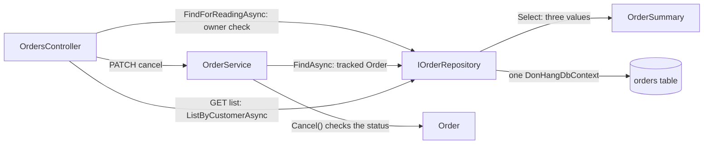

## Before you start

- [[backend.l2.projection-queries]] — you know `ListByCustomerAsync` selects three values into `OrderSummary`, and that a projection holding no entities is not tracked.
- [[design.l3.aggregate-root]] — you know every change to an order goes through `Order`'s methods, and `IOrderRepository` hands out whole orders.
- [[design.l2.domain-model]] — you know `Order.Cancel()` decides whether an order may be cancelled, while `OrderService` runs the use case.

## The situation

A teammate reviews the orders code at stage-2 and frowns. Cancelling an order goes through `OrderService`: it loads the whole `Order` with its items, lets `Cancel()` refuse a shipped order, then saves. The list of a customer's orders takes another road: it reads three values per order straight into `OrderSummary`, and never builds an `Order` at all. The teammate suggests sending the list through the same path, so the status rules guard every way to reach an order. Yet the list changes nothing, and a page of whole orders would also load every item, which the list never shows. Is it a flaw that reading and changing orders take two different paths, or a design?

## Core concepts

- **CQRS** (Command Query Responsibility Segregation) — giving the code that reads data its own model, separate from the model the code that changes data goes through, so the reading side can return exactly what a screen needs without passing through the writing side's rules.
- the write side — the code that changes data; in Đơn Hàng, `OrderService` loading a tracked `Order` whose methods check the status rules before `SaveChangesAsync`.
- the read side — the code that only reads, runs no rule and returns the shape a screen needs; in Đơn Hàng, `ListByCustomerAsync` returning `OrderSummary`.

## How it works



In the situation above, a cancel request travels the write side. `OrdersController` first reads the order with `FindForReadingAsync` to check that the caller owns it, a read on the read side, then passes the id to `OrderService.CancelOrderAsync`. The service asks `IOrderRepository` for the order with `FindAsync`, which returns a tracked `Order` with its items. `Cancel()` then checks the status rule and throws `OrderStatusException` for an order that is already cancelled or shipped. Only when the rule passes does `SaveChangesAsync` write the new status.

A list request travels the read side. `OrdersController` calls `ListByCustomerAsync` itself, without `OrderService`. The query selects each order's id, its status and its customer's name into `OrderSummary`, so no `Order` is built, no rule runs and nothing is tracked.

That split is CQRS, and here it is a split in the code alone. Both sides read the `orders` table through the same `DonHangDbContext`. One interface, `IOrderRepository`, still offers `FindAsync` to the write side next to `ListByCustomerAsync` for the read side. There is no second database, no copy to keep in step, and no message between the two sides.

What the split buys is freedom on each side. The write side may load the whole order to check its rules; the read side may return whatever shape a screen asks for, because no rule depends on it. Some shapes a query over the write side's tables cannot give cheaply: a screen listing every status an order has passed through gets nothing from `orders`, whose row keeps only the current `status`. Then the read side can get data of its own, a table that only it reads, which a later lesson builds. While a query can serve the screen, one set of tables for both sides is simpler.

## In the Đơn Hàng system

The write side of one use case, in `OrderService`:

```csharp file=DonHang.Domain/OrderService.cs tag=stage-2 lines=36-49
    // lesson: design.l2.domain-model
    // Find, let the order decide, notify, save. An order that is already
    // cancelled or shipped makes order.Cancel() throw OrderStatusException.
    // The notification is saved with the order, by the same SaveChangesAsync.
    public async Task<Order> CancelOrderAsync(int orderId)
    {
        var order = await repository.FindAsync(orderId)
            ?? throw new KeyNotFoundException($"order {orderId} not found");

        order.Cancel();
        notifier.Send(order, "order cancelled");
        await repository.SaveChangesAsync();
        return order;
    }
```

`FindAsync` loads the order so the change tracker follows it. `order.Cancel()` is where the status rule lives; when it throws, the method leaves before `SaveChangesAsync`, so nothing is written. `ShipOrderAsync`, further down the same file, has the same shape with `order.Ship()`. The write side's job is to refuse a wrong change before anything is saved, and that needs the whole order.

Both sides, in one class:

```csharp file=DonHang.Infrastructure/EfOrderRepository.cs tag=stage-2 lines=6-29
// lesson: design.l1.the-repository-layer
public sealed class EfOrderRepository(DonHangDbContext db) : IOrderRepository
{
    // Tracked: cancelling and shipping load the order with this, change it,
    // and SaveChangesAsync writes what changed.
    public Task<Order?> FindAsync(int id) =>
        db.Orders.Include(o => o.Items).FirstOrDefaultAsync(o => o.Id == id);

    // lesson: backend.l2.no-tracking-queries
    public Task<Order?> FindForReadingAsync(int id) =>
        db.Orders.AsNoTracking().Include(o => o.Items).FirstOrDefaultAsync(o => o.Id == id);

    // lesson: backend.l2.cursor-pagination
    // lesson: backend.l2.projection-queries
    // One customer's orders after the cursor, in id order, one page at a time.
    // The Select puts only three columns in the SQL; reading o.Customer inside
    // it makes EF Core write the JOIN, so no Include is needed.
    public Task<List<OrderSummary>> ListByCustomerAsync(int customerId, int afterId, int limit) =>
        db.Orders
            .Where(o => o.CustomerId == customerId && o.Id > afterId)
            .OrderBy(o => o.Id)
            .Take(limit)
            .Select(o => new OrderSummary(o.Id, o.Status, o.Customer!.FullName))
            .ToListAsync();
```

Every method here starts from the same `db.Orders`. `FindAsync` returns an `Order` with its items, tracked, for the write side. `ListByCustomerAsync` ends in `Select(o => new OrderSummary(...))`: the SQL asks for three values, and because the results hold no entities, EF Core tracks nothing. `FindForReadingAsync` belongs to the read side: it changes nothing and runs no rule, even though the shape it returns happens to be a whole `Order`. The interface in `DonHang.Domain/IOrderRepository.cs`, outside this excerpt, declares these methods side by side. CQRS at stage-2 is not a new project or a new database; it is the decision that the list never needs an `Order`.

## Seniors often assume…

- **"CQRS needs a separate read database kept in sync by messages."** → Actually CQRS gives reads their own model, separate from the one changes go through; a second store for reads is one later option, not the definition, because the split already pays off when both sides query the same tables. You notice this at stage-2, where `ListByCustomerAsync` and `FindAsync` both start from `db.Orders`, yet the list never touches `Order`'s rules.
- **"CQRS and storing each order as the list of everything that happened to it come as a pair."** → Actually storing that list is a different way to keep data, which a later lesson of this module covers, and the two answer different questions: CQRS decides which code reads, the other idea decides what is stored. You can split reads from writes over ordinary rows, as Đơn Hàng does. You notice this when you look at the `orders` table: each row holds only the current `status`, and the read side still has its own path.
- **"Reads should load the `Order` aggregate too, so the domain model stays the only way to reach the data."** → Actually the rules in `Order` protect changes, and a read changes nothing, so no rule has anything to check. Loading whole orders for a list costs the items, the tracking and every mapped column, for values the screen never shows. You notice this when a list page built from `FindAsync` returns orders whose items nobody reads.

## Try it (3 minutes)

In the root folder of the example repository, in Git Bash:

1. Run `git grep -F -e "repository." -e "orderService." stage-2 -- DonHang.Api/Controllers/OrdersController.cs`.
2. Sort the calls it prints into two groups: those that change an order and those that only read. Which group passes through `Order`'s methods?

Expected result: six lines from `OrdersController.cs`. Three call `orderService.`: `PlaceOrderAsync`, `CancelOrderAsync` and `ShipOrderAsync`. Three call `repository.`: `FindForReadingAsync` twice and `ListByCustomerAsync` once.

<details><summary>Suggested answer</summary>

The three `orderService.` calls change an order: placing builds a new `Order`, cancelling and shipping load one with `FindAsync` and call `Cancel()` or `Ship()`. They form the write side and pass through `Order`'s rules.

The three `repository.` calls only read. `ListByCustomerAsync` returns `OrderSummary` values, and `FindForReadingAsync` returns an untracked order, used to answer `GET` for one order and to check who owns an order before cancelling it. None of them can save a change.

The cancel endpoint uses both sides: it reads an untracked copy for the owner check, then hands the change to `OrderService`.

</details>

## Connections

- [[backend.l2.projection-queries]] — the mechanism the read side uses here, now seen as one half of a design.
- [[backend.l2.no-tracking-queries]] — another way to read without tracking, which still returns whole `Order` entities.
- [[design.l1.the-repository-layer]] — the repository that, at stage-2, serves both sides through one interface.
- [[design.l3.read-model]] — what comes next: the read side gets data of its own, stored in the shape one query needs.

## Five-line summary

1. CQRS gives reading code its own model, separate from the one changes go through, so reads return what a screen needs.
2. At stage-2 cancelling or shipping loads a tracked `Order` through `OrderService`, and its methods check the status rule before `SaveChangesAsync`.
3. The order list never builds an `Order`: `ListByCustomerAsync` selects three values into `OrderSummary`, so no rule runs and nothing is tracked.
4. Both sides use the same `DonHangDbContext` and one `IOrderRepository`, so CQRS can start as a split in the code alone.
5. Until a screen needs a shape the write side's tables cannot give cheaply, one set of tables for both sides is simpler.
