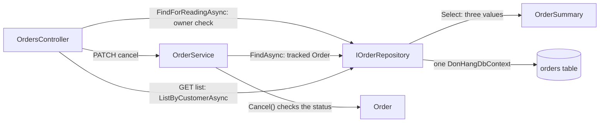

## Bạn cần biết trước

- [[backend.l2.projection-queries]] — bạn biết `ListByCustomerAsync` chọn ba giá trị vào `OrderSummary`, và một projection không chứa entity nào thì không bị theo dõi.
- [[design.l3.aggregate-root]] — bạn biết mọi thay đổi lên một đơn đều đi qua các method của `Order`, còn `IOrderRepository` trao ra nguyên cả đơn.
- [[design.l2.domain-model]] — bạn biết `Order.Cancel()` quyết định một đơn có được hủy hay không, còn `OrderService` chạy use case.

## Tình huống

Một đồng đội đọc code đơn hàng ở stage-2 và nhíu mày. Hủy đơn thì đi qua `OrderService`: tải nguyên `Order` cùng các item, để `Cancel()` từ chối đơn đã giao, rồi lưu. Danh sách đơn của một khách lại đi đường khác: đọc thẳng ba giá trị của mỗi đơn vào `OrderSummary` và không hề dựng một `Order` nào. Đồng đội đề nghị cho danh sách đi chung đường, để các quy tắc trạng thái canh mọi lối tới một đơn. Nhưng danh sách không đổi gì cả, và một trang toàn đơn đầy đủ sẽ tải luôn mọi item, thứ danh sách không bao giờ hiện. Đọc và đổi đơn đi hai đường khác nhau là lỗi, hay là thiết kế?

## Khái niệm cốt lõi

- **CQRS** (tách phần code ghi dữ liệu khỏi phần code đọc dữ liệu, để mỗi bên có hình dạng hợp với việc của nó) — viết tắt của Command Query Responsibility Segregation: cho code đọc dữ liệu một mô hình riêng, tách khỏi mô hình mà code đổi dữ liệu phải đi qua. Nhờ vậy phía đọc trả về đúng thứ một màn hình cần mà không phải qua các quy tắc của phía ghi.
- phía ghi — phần code đổi dữ liệu. Trong Đơn Hàng, đó là `OrderService` tải một `Order` được theo dõi, các method của nó kiểm tra quy tắc trạng thái trước `SaveChangesAsync`.
- phía đọc — phần code chỉ đọc, không chạy quy tắc nào và trả về hình dạng một màn hình cần. Trong Đơn Hàng, đó là `ListByCustomerAsync` trả về `OrderSummary`.

## Cơ chế hoạt động



Trong tình huống trên, một yêu cầu hủy đi theo phía ghi. Trước hết `OrdersController` đọc đơn bằng `FindForReadingAsync` để kiểm tra người gọi có sở hữu đơn không, đây là một lần đọc thuộc phía đọc. Sau đó nó chuyển id cho `OrderService.CancelOrderAsync`. Service xin `IOrderRepository` đơn đó bằng `FindAsync`, nhận về một `Order` được theo dõi cùng các item. Rồi `Cancel()` kiểm tra quy tắc trạng thái và ném `OrderStatusException` nếu đơn đã hủy hoặc đã giao. Chỉ khi quy tắc qua được, `SaveChangesAsync` mới ghi trạng thái mới.

Một yêu cầu lấy danh sách đi theo phía đọc. `OrdersController` tự gọi `ListByCustomerAsync`, không qua `OrderService`. Truy vấn chọn id, trạng thái và tên khách của mỗi đơn vào `OrderSummary`, nên không `Order` nào được dựng, không quy tắc nào chạy và không gì bị theo dõi.

Cách tách đó chính là CQRS, và ở đây nó chỉ là một lần tách trong code. Cả hai phía đều đọc bảng `orders` qua cùng một `DonHangDbContext`. Một interface duy nhất, `IOrderRepository`, vẫn đưa `FindAsync` cho phía ghi bên cạnh `ListByCustomerAsync` cho phía đọc. Không có database thứ hai, không có bản sao phải giữ cho khớp, không có message nào chạy giữa hai phía.

Thứ cách tách này mang lại là sự tự do cho mỗi phía. Phía ghi được tải nguyên đơn để kiểm tra quy tắc. Phía đọc được trả về bất kỳ hình dạng nào màn hình yêu cầu, vì không quy tắc nào dựa vào nó. Có những hình dạng mà truy vấn trên các bảng của phía ghi không cho ra được với chi phí thấp: một màn hình liệt kê mọi trạng thái một đơn từng trải qua sẽ không lấy được gì từ `orders`, vì mỗi dòng chỉ giữ `status` hiện tại. Khi đó phía đọc có thể có dữ liệu riêng, một bảng chỉ mình nó đọc, và một bài sau sẽ dựng bảng này. Chừng nào một truy vấn còn phục vụ được màn hình, dùng chung một bộ bảng cho cả hai phía là đơn giản hơn.

## Trong hệ thống Đơn Hàng

Phía ghi của một use case, trong `OrderService`:

```csharp file=DonHang.Domain/OrderService.cs tag=stage-2 lines=36-49
    // lesson: design.l2.domain-model
    // Find, let the order decide, notify, save. An order that is already
    // cancelled or shipped makes order.Cancel() throw OrderStatusException.
    // The notification is saved with the order, by the same SaveChangesAsync.
    public async Task<Order> CancelOrderAsync(int orderId)
    {
        var order = await repository.FindAsync(orderId)
            ?? throw new KeyNotFoundException($"order {orderId} not found");

        order.Cancel();
        notifier.Send(order, "order cancelled");
        await repository.SaveChangesAsync();
        return order;
    }
```

`FindAsync` tải đơn để change tracker theo dõi nó. `order.Cancel()` là nơi quy tắc trạng thái nằm. Khi nó ném lỗi, method thoát ra trước `SaveChangesAsync`, nên không gì được ghi. `ShipOrderAsync`, ở phía dưới cùng file, có cùng dáng đó với `order.Ship()`. Nhiệm vụ của phía ghi là từ chối một thay đổi sai trước khi lưu bất cứ thứ gì, và muốn vậy nó cần nguyên cả đơn.

Cả hai phía, trong cùng một class:

```csharp file=DonHang.Infrastructure/EfOrderRepository.cs tag=stage-2 lines=6-29
// lesson: design.l1.the-repository-layer
public sealed class EfOrderRepository(DonHangDbContext db) : IOrderRepository
{
    // Tracked: cancelling and shipping load the order with this, change it,
    // and SaveChangesAsync writes what changed.
    public Task<Order?> FindAsync(int id) =>
        db.Orders.Include(o => o.Items).FirstOrDefaultAsync(o => o.Id == id);

    // lesson: backend.l2.no-tracking-queries
    public Task<Order?> FindForReadingAsync(int id) =>
        db.Orders.AsNoTracking().Include(o => o.Items).FirstOrDefaultAsync(o => o.Id == id);

    // lesson: backend.l2.cursor-pagination
    // lesson: backend.l2.projection-queries
    // One customer's orders after the cursor, in id order, one page at a time.
    // The Select puts only three columns in the SQL; reading o.Customer inside
    // it makes EF Core write the JOIN, so no Include is needed.
    public Task<List<OrderSummary>> ListByCustomerAsync(int customerId, int afterId, int limit) =>
        db.Orders
            .Where(o => o.CustomerId == customerId && o.Id > afterId)
            .OrderBy(o => o.Id)
            .Take(limit)
            .Select(o => new OrderSummary(o.Id, o.Status, o.Customer!.FullName))
            .ToListAsync();
```

Mọi method ở đây đều bắt đầu từ cùng một `db.Orders`. `FindAsync` trả về một `Order` cùng các item, được theo dõi, cho phía ghi. `ListByCustomerAsync` kết thúc bằng `Select(o => new OrderSummary(...))`: câu SQL chỉ xin ba giá trị, và vì kết quả không chứa entity nào nên EF Core không theo dõi gì. `FindForReadingAsync` thuộc phía đọc: nó không đổi gì và không chạy quy tắc nào, dù hình dạng nó trả về tình cờ là nguyên một `Order`. Interface trong `DonHang.Domain/IOrderRepository.cs`, nằm ngoài đoạn trích này, khai báo các method đó cạnh nhau. CQRS ở stage-2 không phải một project mới hay một database mới. Nó là quyết định rằng danh sách không bao giờ cần một `Order`.

## Senior hay nhầm rằng…

- **"CQRS cần một database đọc riêng, giữ cho khớp bằng message."** → Thực ra CQRS cho phía đọc một mô hình riêng, tách khỏi mô hình mà các thay đổi đi qua. Một kho lưu thứ hai dành cho phía đọc chỉ là một lựa chọn về sau, không phải định nghĩa, vì cách tách đã có lợi ngay khi cả hai phía truy vấn cùng các bảng. Bạn sẽ nhận ra ở stage-2: `ListByCustomerAsync` và `FindAsync` đều bắt đầu từ `db.Orders`, vậy mà danh sách không bao giờ chạm vào các quy tắc của `Order`.
- **"CQRS và lưu mỗi đơn dưới dạng danh sách mọi chuyện đã xảy ra với nó luôn đi thành cặp."** → Thực ra lưu danh sách đó là một cách giữ dữ liệu khác, một bài sau trong module này sẽ nói tới, và hai ý tưởng trả lời hai câu hỏi khác nhau: CQRS quyết định code nào đọc, ý tưởng kia quyết định lưu cái gì. Bạn tách được đọc khỏi ghi trên các dòng dữ liệu bình thường, như Đơn Hàng đang làm. Bạn sẽ nhận ra khi nhìn bảng `orders`: mỗi dòng chỉ giữ `status` hiện tại, vậy mà phía đọc vẫn có đường riêng của nó.
- **"Phía đọc cũng nên tải aggregate `Order`, để domain model vẫn là lối duy nhất tới dữ liệu."** → Thực ra các quy tắc trong `Order` bảo vệ thay đổi, còn một lần đọc không đổi gì, nên chẳng quy tắc nào có gì để kiểm tra. Tải nguyên đơn cho một danh sách sẽ tốn công tải các item, công theo dõi và mọi cột đã map, chỉ để lấy những giá trị màn hình không bao giờ hiện. Bạn sẽ nhận ra khi một trang danh sách dựng từ `FindAsync` trả về các đơn mà chẳng ai đọc tới item của chúng.

## Thử ngay (3 phút)

Trong thư mục gốc của repo ví dụ, dùng Git Bash:

1. Chạy `git grep -F -e "repository." -e "orderService." stage-2 -- DonHang.Api/Controllers/OrdersController.cs`.
2. Chia các lời gọi được in ra thành hai nhóm: nhóm đổi một đơn và nhóm chỉ đọc. Nhóm nào đi qua các method của `Order`?

Kết quả mong đợi: sáu dòng từ `OrdersController.cs`. Ba dòng gọi `orderService.`: `PlaceOrderAsync`, `CancelOrderAsync` và `ShipOrderAsync`. Ba dòng gọi `repository.`: hai lần `FindForReadingAsync` và một lần `ListByCustomerAsync`.

<details><summary>Gợi ý đáp án</summary>

Ba lời gọi `orderService.` đổi một đơn: đặt đơn dựng một `Order` mới, còn hủy và giao thì tải đơn bằng `FindAsync` rồi gọi `Cancel()` hoặc `Ship()`. Chúng tạo thành phía ghi và đi qua các quy tắc của `Order`.

Ba lời gọi `repository.` chỉ đọc. `ListByCustomerAsync` trả về các giá trị `OrderSummary`, còn `FindForReadingAsync` trả về một đơn không được theo dõi, dùng để trả lời `GET` cho một đơn và để kiểm tra ai sở hữu đơn trước khi hủy. Không lời gọi nào trong số này lưu được một thay đổi.

Endpoint hủy dùng cả hai phía: nó đọc một bản không được theo dõi để kiểm tra người sở hữu, rồi giao thay đổi cho `OrderService`.

</details>

## Liên hệ

- [[backend.l2.projection-queries]] — cơ chế mà phía đọc dùng ở đây, giờ được nhìn như một nửa của một thiết kế.
- [[backend.l2.no-tracking-queries]] — một cách khác để đọc mà không bị theo dõi, nhưng vẫn trả về nguyên các entity `Order`.
- [[design.l1.the-repository-layer]] — repository mà ở stage-2 phục vụ cả hai phía qua một interface.
- [[design.l3.read-model]] — bài tiếp theo: phía đọc có dữ liệu riêng, lưu đúng hình dạng một truy vấn cần.

## Tóm tắt 5 dòng

1. CQRS cho code đọc một mô hình riêng, tách khỏi mô hình mà các thay đổi đi qua, nên phía đọc trả về đúng thứ màn hình cần.
2. Ở stage-2, hủy hay giao đơn đều tải một `Order` được theo dõi qua `OrderService`, và các method của nó kiểm tra quy tắc trạng thái trước `SaveChangesAsync`.
3. Danh sách đơn không bao giờ dựng một `Order`: `ListByCustomerAsync` chọn ba giá trị vào `OrderSummary`, nên không quy tắc nào chạy và không gì bị theo dõi.
4. Hai phía dùng chung một `DonHangDbContext` và một `IOrderRepository`, nên CQRS có thể bắt đầu chỉ là một lần tách trong code.
5. Chừng nào chưa có màn hình cần một hình dạng mà các bảng của phía ghi không cho ra được với chi phí thấp, dùng chung một bộ bảng cho cả hai phía là đơn giản hơn.
