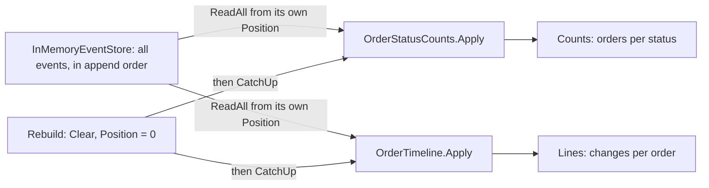

## Before you start

- [[design.l3.stream-concurrency]] — the sample store appends each order's events to its stream and also to `all`, the list of every event in append order.
- [[design.l3.read-model]] — you know `order_status_history` is a read model that `RecordOrderStatusHistory` writes from the events `Order` records.

## The situation

The stage-3 sample store holds the events of orders 5 and 6. A colleague asks for two new views: how many orders are in each status, and each order's list of changes with their times. Neither view existed when those orders were placed or changed.

You have met this request before. In production, `order_status_history` arrived at stage-3, and an order placed earlier shows only `placed`, because the changes in between were overwritten. The sample is different: every event it ever accepted is still in the store. Can a view written today be filled with everything that already happened, and filled again if its data is lost?

## Core concepts

- **event projection** — code that reads events in the order they were stored and updates a read model from each one; it is the only code that writes that read model.
- position — how many events of the store's full list a projection has applied so far; the sample keeps it as `Position`.
- catching up — applying only the events after the position, moving the position forward with each one; the sample's `CatchUp`.
- rebuilding — clearing a projection's data, setting its position back to 0 and catching up from the first event; the sample's `Rebuild`.

## How it works



In the situation above, each new view is the read model of one event projection over the same store. `OrderStatusCounts` keeps in `Counts` how many orders are in each status, and `OrderTimeline` keeps in `Lines` each order's list of changes. Neither records an event or is called by the order's methods; each only reads.

Each projection keeps its own position. `CatchUp` asks the store, through `ReadAll`, for every event after that position, in append order across all streams. It applies each one and adds one to the position. A second call applies only what arrived since the first. Until someone calls `CatchUp`, the projection's data lags behind the store: an order cancelled a moment ago still counts under the status it had before, such as `new`.

Because the store keeps every event, a projection written today starts at position 0 and catches up through all of them. So `OrderTimeline` lists orders 5 and 6 with every change since they were placed, though it did not exist then. For the same reason any projection's data can be thrown away. `Rebuild` clears it, sets the position back to 0 and catches up again; the test below shows the result equals the live projection for `OrderStatusCounts`.

`RecordOrderStatusHistory` in production is a projection too: it turns each domain event `Order` records into one `order_status_history` row. But each event reaches it once and is then kept nowhere. There is nothing to replay, so orders older than stage-3 keep only the `placed` row the migration took from `orders.placed_at`.

## In the Đơn Hàng system

The base class both sample projections share:

```csharp file=samples/DonHang.Samples/Samples/Design/EventSourcing/OrderProjections.cs tag=stage-3 lines=10-28
public abstract class OrderProjection
{
    public int Position { get; private set; }

    public void CatchUp(InMemoryEventStore store)
    {
        foreach (var domainEvent in store.ReadAll(Position))
        {
            Apply(domainEvent);
            Position++;
        }
    }

    public void Rebuild(InMemoryEventStore store)
    {
        Clear();
        Position = 0;
        CatchUp(store);
    }
```

`Position` has a private setter, so only `CatchUp` and `Rebuild` move it. `store.ReadAll(Position)` returns every order's events after the first `Position` of them. Each projection writes its own `Apply` and `Clear`. Outside this excerpt, `OrderStatusCounts` also remembers each order's current status; its `Apply` moves the order from that status's count to the new one and removes a status whose count drops to 0. `OrderTimeline.Apply` adds a line such as `paid at 09:30` to the order's list.

The test that rebuilds a projection:

```csharp file=samples/DonHang.Samples.Tests/EventSourcingTests.cs tag=stage-3 lines=62-80
    // lesson: design.l3.event-projections
    // Rebuilt from nothing, a projection equals the one kept up to date.
    [Fact]
    public void Rebuild_GivesTheSameCountsAsTheLiveProjection()
    {
        var store = StoreWithThreeOrders();
        var live = new OrderStatusCounts();
        live.CatchUp(store);
        var paid = store.Load(1);
        paid.Ship(At);
        store.Save(paid);
        live.CatchUp(store);

        var rebuilt = new OrderStatusCounts();
        rebuilt.Rebuild(store);

        Assert.Equal(live.Counts, rebuilt.Counts);
        Assert.Equal(live.Position, rebuilt.Position);
    }
```

`StoreWithThreeOrders`, outside this excerpt, places orders 1 to 3 and pays order 1; `At` is a fixed time the test class uses for every change. `live` applies the events in two steps, before and after order 1 is shipped. `rebuilt` starts empty and applies them all in one `Rebuild`. The counts and the positions are equal. In `Projection_LagsUntilCatchUp`, the counts still show order 2 as `new` after its cancel until `CatchUp` runs. In `ProjectionWrittenLater_CoversOrdersThatExistedBefore`, a timeline created after three orders were saved finds all three.

## Seniors often assume…

- **"A projection's data is as precious as the events and must be protected the same way."** → Actually the events are the record, and a projection's data is computed from them. While the events are kept, losing that data costs one `Rebuild`, and the test shows the rebuilt result equals the live one. The events have no such second source. You notice this when an `Apply` has a bug: you fix the code and rebuild, instead of editing by hand the data it wrote.
- **"A read model added later can only show what happened after the day it was added."** → Actually that holds only when the events were not kept. A new sample projection starts at position 0, so `OrderTimeline` covers orders saved before it was written. `order_status_history` is the opposite case: its events were never stored, so for older orders there is nothing to replay. You notice this when `scripts/design/order-history.sh`, the read-model lesson's script that prints an order's history rows, shows order 7, which existed before stage-3 and is `shipped`, with only a `placed` row.
- **"Each projection needs its own copy of the events."** → Actually both sample projections read the same store through `ReadAll`. Each keeps only a number, its position, and its own read model, so adding a third projection adds no event. You notice this in the Try it output below: the counts and the timeline come from one store in one run, and they agree that order 5 is cancelled.

## Try it (3 minutes)

1. In the root folder of the example repository at `stage-3`, run `scripts/design/event-sourcing.sh` in a bash shell (Git Bash on Windows). Find the block under `== projections over every event`.
2. Read the two timeline lines first. Then, before reading the `counts:` line, write down which statuses it lists and whether `paid` is among them.

Expected result: the block has three lines: `counts: cancelled 1, new 1`, `order 5: new at 09:00, paid at 09:30, cancelled at 11:00` and `order 6: new at 10:00`.

<details><summary>Suggested answer</summary>

`paid` is not listed. Order 5 passed through `paid`, but `OrderStatusCounts` keeps where each order is now. When `OrderCancelled` arrived, it took order 5 out of the `paid` count, and a count that reaches 0 is removed.

The timeline keeps all three changes of order 5, because it answers a different question from the same events.

</details>

## Connections

- [[design.l3.read-model]] — the same kind of read model, fed by events that are not kept; this lesson shows what keeping them adds.
- [[design.l3.stream-concurrency]] — the step before: writers append to one order's stream; a projection reads every stream's events in append order.
- [[backend.l3.eventual-consistency]] — the same trade as the lag before `CatchUp`: the read side agrees with the store only after a delay.
- [[backend.l2.projection-queries]] — a different meaning of the same word: there a projection is a `Select` into a shape; here it builds a read model from events.
- [[design.l3.snapshots]] — the next lesson: saving one order's state at a version so loading it replays fewer events.

## Five-line summary

1. An event projection builds a read model from stored events, so it can be thrown away and rebuilt by replaying every event.
2. The sample's `OrderStatusCounts` and `OrderTimeline` read the same events; one counts orders per status, the other lists each order's changes.
3. Each projection keeps its position, the number of events it has applied, and `CatchUp` applies only newer ones, so its data lags until it runs.
4. A projection written after events were stored starts at position 0, so `OrderTimeline` covers orders placed before it existed.
5. `RecordOrderStatusHistory` is a projection over events never kept, so orders older than stage-3 show only `placed` and cannot be rebuilt.
