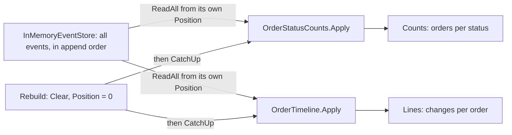

## Bạn cần biết trước

- [[design.l3.stream-concurrency]] — store của mẫu nối các event của mỗi đơn vào stream của đơn đó, đồng thời nối vào `all`, danh sách mọi event theo thứ tự được nối.
- [[design.l3.read-model]] — bạn biết `order_status_history` là một read model do `RecordOrderStatusHistory` ghi từ các event mà `Order` ghi nhận.

## Tình huống

Store mẫu ở stage-3 đang giữ các event của đơn 5 và đơn 6. Một đồng nghiệp cần thêm hai màn hình: mỗi trạng thái đang có bao nhiêu đơn, và danh sách các lần thay đổi của từng đơn kèm thời điểm. Lúc hai đơn đó được đặt hay thay đổi, chưa có màn hình nào trong hai màn hình này.

Bạn đã gặp yêu cầu kiểu này. Trên production, `order_status_history` có từ stage-3, và một đơn đặt trước đó chỉ hiện `placed`, vì các thay đổi ở giữa đã bị ghi đè. Mẫu thì khác: mọi event store từng nhận vẫn còn nguyên trong đó. Một màn hình viết hôm nay có điền được bằng tất cả những gì đã xảy ra không, và có điền lại được không nếu dữ liệu của nó bị mất?

## Khái niệm cốt lõi

- **event projection** (code đọc các event theo thứ tự và dựng từ chúng một read model, xóa đi rồi dựng lại được) — code đọc các event theo đúng thứ tự chúng được lưu và cập nhật một read model từ từng event. Đây là code duy nhất ghi vào read model đó.
- vị trí — số event trong danh sách đầy đủ của store mà một projection đã áp tới lúc này. Mẫu giữ nó trong `Position`.
- bắt kịp — chỉ áp các event nằm sau vị trí, mỗi event áp xong thì vị trí tiến thêm một. Đó là `CatchUp` của mẫu.
- dựng lại — xóa dữ liệu của một projection, đưa vị trí về 0 rồi bắt kịp từ event đầu tiên. Đó là `Rebuild` của mẫu.

## Cơ chế hoạt động



Với tình huống trên, mỗi màn hình mới là read model của một event projection trên cùng một store. `OrderStatusCounts` giữ trong `Counts` số đơn ở mỗi trạng thái, còn `OrderTimeline` giữ trong `Lines` danh sách thay đổi của từng đơn. Không projection nào ghi nhận event hay được các method của đơn gọi tới. Chúng chỉ đọc.

Mỗi projection giữ vị trí riêng. `CatchUp` dùng `ReadAll` xin store mọi event sau vị trí đó, theo thứ tự được nối, trên tất cả các stream. Nó áp từng event và cộng một vào vị trí. Lần gọi thứ hai chỉ áp những event mới tới từ sau lần thứ nhất. Chừng nào chưa ai gọi `CatchUp`, dữ liệu của projection còn đi sau store: một đơn vừa bị hủy vẫn được đếm theo trạng thái trước đó, chẳng hạn `new`.

Vì store giữ mọi event, một projection viết hôm nay bắt đầu từ vị trí 0 và bắt kịp qua tất cả. Nhờ vậy `OrderTimeline` liệt kê đơn 5 và đơn 6 cùng mọi thay đổi từ lúc đặt, dù lúc đó nó chưa tồn tại. Cũng vì lý do này, dữ liệu của bất kỳ projection nào đều bỏ đi được. `Rebuild` xóa dữ liệu, đưa vị trí về 0 rồi bắt kịp lại. Test bên dưới cho thấy với `OrderStatusCounts`, kết quả bằng đúng projection đang chạy.

`RecordOrderStatusHistory` trên production cũng là một projection: nó biến mỗi domain event mà `Order` ghi nhận thành một dòng `order_status_history`. Nhưng mỗi event chỉ tới nó một lần rồi không được giữ ở đâu cả. Không có gì để áp lại, nên các đơn cũ hơn stage-3 chỉ còn dòng `placed` mà migration lấy từ `orders.placed_at`.

## Trong hệ thống Đơn Hàng

Lớp cơ sở mà cả hai projection của mẫu dùng chung:

```csharp file=samples/DonHang.Samples/Samples/Design/EventSourcing/OrderProjections.cs tag=stage-3 lines=10-28
public abstract class OrderProjection
{
    public int Position { get; private set; }

    public void CatchUp(InMemoryEventStore store)
    {
        foreach (var domainEvent in store.ReadAll(Position))
        {
            Apply(domainEvent);
            Position++;
        }
    }

    public void Rebuild(InMemoryEventStore store)
    {
        Clear();
        Position = 0;
        CatchUp(store);
    }
```

`Position` có setter private, nên chỉ `CatchUp` và `Rebuild` dịch được nó. `store.ReadAll(Position)` trả về event của mọi đơn nằm sau `Position` event đầu tiên. Mỗi projection tự viết `Apply` và `Clear` của mình. Ngoài đoạn trích này, `OrderStatusCounts` còn nhớ trạng thái hiện tại của từng đơn. `Apply` của nó chuyển đơn từ số đếm của trạng thái đó sang trạng thái mới, và bỏ hẳn một trạng thái khi số đếm của nó về 0. `OrderTimeline.Apply` thêm một dòng như `paid at 09:30` vào danh sách của đơn.

Test dựng lại một projection:

```csharp file=samples/DonHang.Samples.Tests/EventSourcingTests.cs tag=stage-3 lines=62-80
    // lesson: design.l3.event-projections
    // Rebuilt from nothing, a projection equals the one kept up to date.
    [Fact]
    public void Rebuild_GivesTheSameCountsAsTheLiveProjection()
    {
        var store = StoreWithThreeOrders();
        var live = new OrderStatusCounts();
        live.CatchUp(store);
        var paid = store.Load(1);
        paid.Ship(At);
        store.Save(paid);
        live.CatchUp(store);

        var rebuilt = new OrderStatusCounts();
        rebuilt.Rebuild(store);

        Assert.Equal(live.Counts, rebuilt.Counts);
        Assert.Equal(live.Position, rebuilt.Position);
    }
```

`StoreWithThreeOrders`, nằm ngoài đoạn trích, đặt các đơn 1 tới 3 và thanh toán đơn 1. `At` là một thời điểm cố định mà class test dùng cho mọi thay đổi. `live` áp các event qua hai bước, trước và sau khi đơn 1 được giao. `rebuilt` bắt đầu rỗng và áp tất cả trong một lần `Rebuild`. Số đếm và vị trí của hai bên bằng nhau. Trong `Projection_LagsUntilCatchUp`, sau khi đơn 2 bị hủy, số đếm vẫn hiện nó là `new` cho tới khi `CatchUp` chạy. Trong `ProjectionWrittenLater_CoversOrdersThatExistedBefore`, một timeline tạo ra sau khi ba đơn đã được lưu vẫn tìm thấy đủ cả ba.

## Senior hay nhầm rằng…

- **"Dữ liệu của projection quý như các event và phải được bảo vệ y như vậy."** → Thực ra event mới là bản ghi gốc, còn dữ liệu của projection được tính ra từ chúng. Chừng nào event còn được giữ, mất dữ liệu đó chỉ tốn một lần `Rebuild`, và test cho thấy kết quả dựng lại bằng đúng bản đang chạy. Event thì không có nguồn thứ hai như thế. Bạn sẽ nhận ra khi một `Apply` có bug: bạn sửa code rồi dựng lại, thay vì sửa tay dữ liệu nó đã ghi.
- **"Read model thêm vào sau chỉ hiện được những gì xảy ra từ ngày nó được thêm."** → Thực ra điều đó chỉ đúng khi event không được giữ lại. Một projection mới của mẫu bắt đầu từ vị trí 0, nên `OrderTimeline` bao được cả những đơn lưu trước khi nó được viết. `order_status_history` là trường hợp ngược lại: event của nó chưa bao giờ được lưu, nên với các đơn cũ không có gì để áp lại. Bạn sẽ nhận ra khi `scripts/design/order-history.sh`, script của bài read model in các dòng lịch sử của một đơn, hiện đơn 7, vốn có từ trước stage-3 và đang `shipped`, chỉ với một dòng `placed`.
- **"Mỗi projection cần một bản sao event riêng."** → Thực ra cả hai projection của mẫu đọc cùng một store qua `ReadAll`. Mỗi projection chỉ giữ một con số, tức vị trí của nó, cùng read model của riêng nó, nên thêm projection thứ ba không thêm event nào. Bạn sẽ nhận ra khi xem output ở phần Thử ngay bên dưới: số đếm và timeline đến từ một store trong một lần chạy, và cả hai cùng nói đơn 5 đã bị hủy.

## Thử ngay (3 phút)

1. Ở thư mục gốc của repo ví dụ tại `stage-3`, chạy `scripts/design/event-sourcing.sh` trong bash (Git Bash trên Windows). Tìm khối nằm dưới `== projections over every event`.
2. Đọc hai dòng timeline trước. Sau đó, trước khi đọc dòng `counts:`, ghi ra giấy dòng đó sẽ liệt kê những trạng thái nào và có `paid` hay không.

Kết quả mong đợi: khối có ba dòng: `counts: cancelled 1, new 1`, `order 5: new at 09:00, paid at 09:30, cancelled at 11:00` và `order 6: new at 10:00`.

<details><summary>Gợi ý đáp án</summary>

Không có `paid`. Đơn 5 từng đi qua `paid`, nhưng `OrderStatusCounts` chỉ giữ mỗi đơn đang ở đâu lúc này. Khi `OrderCancelled` tới, nó đưa đơn 5 ra khỏi số đếm của `paid`, và số đếm nào về 0 thì bị bỏ đi.

Timeline vẫn giữ đủ ba thay đổi của đơn 5, vì nó trả lời một câu hỏi khác từ cùng những event đó.

</details>

## Liên hệ

- [[design.l3.read-model]] — cùng loại read model, nhưng được nuôi bằng các event không được giữ lại. Bài này cho thấy giữ chúng lại thì được thêm gì.
- [[design.l3.stream-concurrency]] — bước ngay trước: bên ghi nối event vào stream của một đơn, còn projection đọc event của mọi stream theo thứ tự được nối.
- [[backend.l3.eventual-consistency]] — cùng kiểu đánh đổi như độ trễ trước `CatchUp`: phía đọc chỉ khớp với store sau một khoảng trễ.
- [[backend.l2.projection-queries]] — cùng một từ nhưng nghĩa khác: ở đó projection là một `Select` đổ vào một hình dạng, còn ở đây nó dựng read model từ event.
- [[design.l3.snapshots]] — bài tiếp theo: lưu trạng thái của một đơn tại một version để khi nạp chỉ phải áp lại ít event hơn.

## Tóm tắt 5 dòng

1. Event projection dựng một read model từ các event đã lưu, nên có thể bỏ đi rồi dựng lại bằng cách áp lại mọi event.
2. `OrderStatusCounts` và `OrderTimeline` của mẫu đọc cùng những event: một cái đếm số đơn theo trạng thái, cái kia liệt kê các thay đổi của từng đơn.
3. Mỗi projection giữ vị trí của nó, tức số event đã áp, và `CatchUp` chỉ áp những event mới hơn, nên dữ liệu đi sau store cho tới khi nó chạy.
4. Một projection viết sau khi event đã được lưu bắt đầu từ vị trí 0, nên `OrderTimeline` bao được cả các đơn đặt trước khi nó tồn tại.
5. `RecordOrderStatusHistory` là một projection trên các event không được giữ, nên các đơn cũ hơn stage-3 chỉ hiện `placed` và không dựng lại được.
