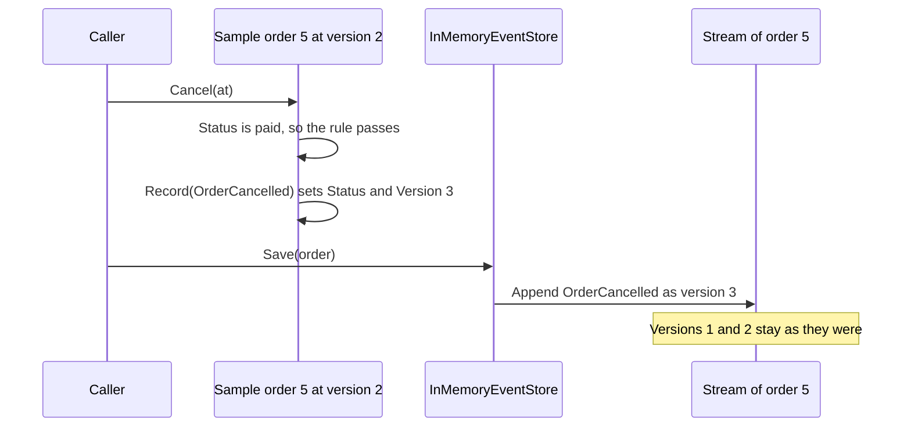

## Before you start

- [[design.l3.read-model]] — you know `RecordOrderStatusHistory` adds one `order_status_history` row for each event `Order` records, while `orders.status` is still overwritten.
- [[design.l3.domain-events]] — you know a domain event such as `OrderCancelled` is a past-tense record that something happened, recorded only after the change succeeds.
- [[backend.l3.outbox-pattern]] — you know `NotifyCustomerOnOrderEvents` adds an `outbox_messages` row for other services in the same save as the order's change.

## The situation

At stage-3 you place an order and then cancel it. `order_status_history` now holds two rows for it, `placed` then `cancelled`, and `outbox_messages` holds two messages, `order.placed` and `order.cancelled`. A teammate looks at both tables and says Đơn Hàng already keeps everything that happened to its orders, so `orders.status` is only a copy. You check what the cancel wrote: it set `status` to `cancelled` in the order's row, and the other two tables got rows built from the event, beside it. Neither table holds the order's total or what it contains. What would Đơn Hàng have to store for the list of what happened to be the order itself?

## Core concepts

- **event sourcing** — storing an aggregate as the ordered list of events that happened to it, instead of storing its current state as the record; the state is worked out from those events whenever it is needed.
- **event stream** — the events of one aggregate in the order they happened, each carrying the next version number (in the sample, the first event is version 1, the second version 2).
- **event store** — the storage that holds event streams and only appends events to the end of a stream; an event once saved is never updated or deleted.
- the sample order — `EventSourcedOrder`, a stage-3 sample class in `samples/DonHang.Samples`, kept apart from the real `Order`, which Đơn Hàng still stores by its state.

## How it works



In the situation above, the real `Order` keeps its state in a row, and its events only feed other tables. The sample turns this around. Follow a cancel of the sample's order 5 through the diagram. The order is already in memory at version 2: its stream holds `OrderPlaced` as version 1 and `OrderPaid` as version 2. How it got its fields back from those two events is the subject of the next lesson.

`Cancel` first checks its rule against the current state: an order that is `cancelled` or `shipped` cannot be cancelled. Status `paid` passes. Only then does it record `OrderCancelled`, which applies the event to the order's own fields, so `Status` becomes `cancelled` and `Version` becomes 3. The event also joins the order's list of new events.

The caller then hands the order to the event store's `Save`. The store appends the new events to the end of order 5's stream, so `OrderCancelled` becomes version 3. Versions 1 and 2 stay exactly as they were. No row anywhere says `cancelled`: the status exists only as the result of applying the stream's three events.

Compare the real `Order` at stage-3. Its cancel writes `cancelled` over the old status in `orders`, and that row is what every use case loads next time.

## In the Đơn Hàng system

The sample order's methods, from `Cancel` to the step that records an event:

```csharp file=samples/DonHang.Samples/Samples/Design/EventSourcing/EventSourcedOrder.cs tag=stage-3 lines=74-93
    public void Cancel(DateTimeOffset at)
    {
        if (Status is "cancelled" or "shipped") throw new InvalidOperationException($"order {Id} is {Status}, so it cannot be cancelled");
        Record(new OrderCancelled(Id, at));
    }

    public void Ship(DateTimeOffset at)
    {
        if (Status != "paid") throw new InvalidOperationException($"order {Id} is {Status}, so it cannot be shipped");
        Record(new OrderShipped(Id, at));
    }

    // Called by the store once the new events are appended.
    public void MarkSaved() => newEvents.Clear();

    private void Record(OrderEvent domainEvent)
    {
        Apply(domainEvent);
        newEvents.Add(domainEvent);
    }
```

`Cancel` throws before anything is recorded when its rule fails, so a refused change leaves no event. `Record` does two things: `Apply` sets the fields the event changes, and the event goes into `newEvents`, the list the store will append. `Apply` is outside this excerpt; it only sets fields such as `Status` and adds one to `Version`. `MarkSaved` empties the list once the store has appended it. Nothing here writes a status to a table. Above this excerpt, the same file declares `OrderPlaced` with the customer's id and the order's total, `CustomerId` and `TotalVnd`, so the stream holds the total that neither table from the situation keeps.

The sample's event store:

```csharp file=samples/DonHang.Samples/Samples/Design/EventSourcing/InMemoryEventStore.cs tag=stage-3 lines=3-11
// lesson: design.l3.event-sourcing
// The sample's event store, in memory: one event stream per order, plus every
// event in the order it was appended. It only ever appends; no event is
// changed or removed once stored. (A real event store keeps this in a
// database, where a unique (stream, version) key does the check below.)
public sealed class InMemoryEventStore
{
    private readonly Dictionary<int, List<OrderEvent>> streams = [];
    private readonly List<OrderEvent> all = [];
```

`streams` keeps one list per order id: that list is the order's event stream, and an event's version is its position in it. `all` keeps every order's events in the order they were appended. The check the comment mentions is in the append method, outside this excerpt; a later lesson covers it. Outside this excerpt, the class has methods that append and methods that read, and none that change or remove an event.

The two tables from the situation are neither of these. `order_status_history` is a read model: `RecordOrderStatusHistory` writes it beside `orders`, and the `orders` row stays the truth that `OrderService` loads and changes. The outbox is not an event store either. `NotifyCustomerOnOrderEvents` builds each message from the order's id, the customer's email and name, and the event's time, which is what other services need. No message holds the total or the products, so no order could be rebuilt from `outbox_messages`.

## Seniors often assume…

- **"Keeping every change in a history table next to `orders` is already event sourcing."** → Actually event sourcing is decided by what the system loads as the truth, not by whether the events are kept somewhere. Đơn Hàng loads `Order` from its row in `orders` and never reads `order_status_history` to decide a change, so the history is a read model beside the state. When the two disagree, the row wins. You notice this in the orders the example repository already holds at stage-3: order 7 is `shipped` in `orders`, yet its history holds a single `placed` row, because it was placed before stage-3, when the history could copy only its `placed` row.
- **"Đơn Hàng's `outbox_messages` already holds every order event, so it can serve as the event store."** → Actually an outbox row holds what other services need from one change, not the event as the order applied it. The `order.placed` message carries the customer's email and name but not the total or the products. A change that records no event, such as `MarkPaid()` (at stage-3 the real `Order` records no event when it is paid, unlike the sample's `OrderPaid`), adds no outbox row at all. An event store must hold every event with everything needed to work out the state. You notice this when you read the body of an `order.placed` row: nothing in it says what the customer bought.
- **"An event store is a message broker such as RabbitMQ that keeps its messages forever."** → Actually a queue moves messages to consumers, while an event store is read back by stream. A message in the queues Đơn Hàng uses can be discarded once a consumer has handled it, and a queue hands messages out from its head, so it offers no way to ask for every event of order 5 from version 1. An event store answers exactly that question, every time the order is needed. You notice this in the Notifications service's `OrderEventsConsumer`: it handles each message as it arrives from `notifications.order-events` and never asks for an order's earlier messages.

## Try it (3 minutes)

1. In the root folder of the example repository at `stage-3`, run `scripts/design/event-sourcing.sh` in a bash shell (Git Bash on Windows). It runs the event sourcing sample with `dotnet run` on your machine and needs no containers. Read the first block of output, under `== the stream of order 5`, and the line that starts with `A cancels`.
2. Before opening the answer, write down what order 5's stream holds after that cancel, version by version.

Expected result: the first block lists `version 1: OrderPlaced at 09:00` and `version 2: OrderPaid at 09:30`. The `A cancels` line says the stream is now at version 3.

<details><summary>Suggested answer</summary>

After the cancel, the stream holds three events: `OrderPlaced` as version 1, `OrderPaid` as version 2 and `OrderCancelled` as version 3. The first two are unchanged; the cancel appended one event after them.

Nowhere is `cancelled` stored as a status. An order loaded now would work it out from the three events. The lines after this one show what happens when a second writer appends on top of an old version, the subject of a later lesson.

</details>

## Connections

- [[design.l3.read-model]] — the opposite choice: there the row in `orders` is the truth and the events feed a table beside it; here the events are the truth.
- [[design.l3.rebuilding-state-from-events]] — the next step: how `EventSourcedOrder` gets its fields back from its stream.
- [[design.l3.aggregate-root]] — the same guard on changes: the sample's `Cancel` checks its rule before recording anything, as `Order.Cancel()` does.
- [[backend.l3.message-broker]] — the tool this lesson keeps apart from an event store: Đơn Hàng's queues deliver messages to consumers and can drop each one once it is handled, so nothing there can be read back by order.
- [[backend.l3.outbox-pattern]] — the outbox whose rows look like events but are messages shaped for other services.

## Five-line summary

1. Event sourcing stores an aggregate as its ordered events, not its current state as the record, and works out the state from them.
2. Each aggregate's events form one event stream numbered by version; an event store only appends to its end and never changes a saved event.
3. In the stage-3 sample, `EventSourcedOrder.Cancel()` checks its rule against the current state, then records `OrderCancelled` and applies it to its own fields.
4. `order_status_history` is not event sourcing: the `orders` row is still the truth, and the history is a read model written beside it.
5. The outbox is no event store: its rows carry what other services need, such as the customer's email, and cannot rebuild an order.
