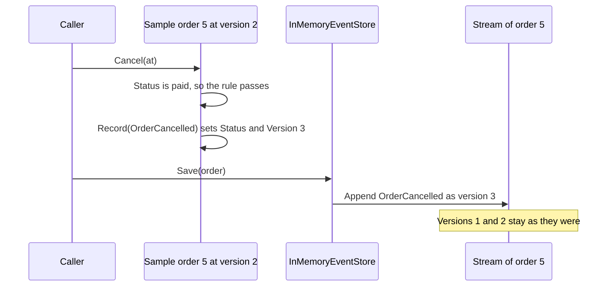

## Bạn cần biết trước

- [[design.l3.read-model]] — bạn biết `RecordOrderStatusHistory` thêm một dòng `order_status_history` cho mỗi event mà `Order` ghi nhận, trong khi `orders.status` vẫn bị ghi đè.
- [[design.l3.domain-events]] — bạn biết một domain event như `OrderCancelled` là bản ghi ở thì quá khứ rằng một việc đã xảy ra, và chỉ được ghi nhận sau khi thay đổi thành công.
- [[backend.l3.outbox-pattern]] — bạn biết `NotifyCustomerOnOrderEvents` thêm một dòng `outbox_messages` cho các service khác, trong cùng lần lưu với thay đổi của đơn.

## Tình huống

Ở stage-3, bạn đặt một đơn rồi hủy nó. Lúc này `order_status_history` có hai dòng cho đơn đó, `placed` rồi `cancelled`, còn `outbox_messages` có hai message, `order.placed` và `order.cancelled`. Một đồng đội nhìn cả hai bảng và nói Đơn Hàng đã giữ mọi chuyện xảy ra với các đơn rồi, nên `orders.status` chỉ là một bản sao. Bạn kiểm tra lần hủy đã ghi những gì: nó đặt `status` thành `cancelled` trong dòng của đơn, còn hai bảng kia nhận các dòng dựng từ event, nằm bên cạnh. Không bảng nào giữ tổng tiền của đơn hay đơn gồm những gì. Đơn Hàng phải lưu gì để danh sách những gì đã xảy ra chính là cái đơn?

## Khái niệm cốt lõi

- **event sourcing** (lưu một aggregate dưới dạng danh sách các event đã xảy ra với nó, trạng thái hiện tại được tính lại từ các event đó) — lưu một aggregate thành danh sách có thứ tự các event đã xảy ra với nó, thay vì lấy trạng thái hiện tại làm bản ghi. Mỗi khi cần, trạng thái được tính ra từ các event đó.
- **event stream** (các event của một aggregate theo đúng thứ tự, mỗi event mang số version kế tiếp) — các event của một aggregate theo thứ tự chúng xảy ra, mỗi event mang số version kế tiếp (trong mẫu, event đầu là version 1, event thứ hai là version 2).
- **event store** (nơi lưu các event stream, chỉ cho nối thêm event vào cuối, không sửa hay xóa event đã lưu) — nơi lưu các event stream và chỉ nối event vào cuối một stream. Event đã lưu thì không bao giờ bị sửa hay xóa.
- đơn mẫu — `EventSourcedOrder`, một class mẫu của stage-3 trong `samples/DonHang.Samples`, tách riêng khỏi `Order` thật, vốn vẫn được Đơn Hàng lưu theo trạng thái.

## Cơ chế hoạt động



Trong tình huống trên, `Order` thật giữ trạng thái trong một dòng, còn các event của nó chỉ để điền các bảng khác. Đơn mẫu làm ngược lại. Hãy theo một lần hủy đơn 5 của mẫu qua sơ đồ. Đơn đã nằm sẵn trong bộ nhớ ở version 2: stream của nó có `OrderPlaced` là version 1 và `OrderPaid` là version 2. Đơn lấy lại các field từ hai event đó bằng cách nào là chủ đề của bài sau.

`Cancel` trước hết kiểm tra quy tắc với trạng thái hiện tại: đơn đang `cancelled` hoặc `shipped` thì không hủy được. Trạng thái `paid` qua được. Chỉ khi đó nó mới ghi nhận `OrderCancelled`, và event này được áp vào chính các field của đơn, nên `Status` thành `cancelled` và `Version` thành 3. Event cũng được thêm vào danh sách event mới của đơn.

Sau đó caller đưa đơn cho `Save` của event store. Store nối các event mới vào cuối stream của đơn 5, nên `OrderCancelled` thành version 3. Version 1 và 2 giữ nguyên như cũ. Không có dòng nào ở đâu ghi `cancelled`: trạng thái này chỉ tồn tại như kết quả khi áp ba event trong stream.

So với `Order` thật ở stage-3: lần hủy của nó ghi `cancelled` đè lên trạng thái cũ trong `orders`, và dòng đó là thứ mọi use case tải lên ở lần sau.

## Trong hệ thống Đơn Hàng

Các method của đơn mẫu, từ `Cancel` tới bước ghi nhận một event:

```csharp file=samples/DonHang.Samples/Samples/Design/EventSourcing/EventSourcedOrder.cs tag=stage-3 lines=74-93
    public void Cancel(DateTimeOffset at)
    {
        if (Status is "cancelled" or "shipped") throw new InvalidOperationException($"order {Id} is {Status}, so it cannot be cancelled");
        Record(new OrderCancelled(Id, at));
    }

    public void Ship(DateTimeOffset at)
    {
        if (Status != "paid") throw new InvalidOperationException($"order {Id} is {Status}, so it cannot be shipped");
        Record(new OrderShipped(Id, at));
    }

    // Called by the store once the new events are appended.
    public void MarkSaved() => newEvents.Clear();

    private void Record(OrderEvent domainEvent)
    {
        Apply(domainEvent);
        newEvents.Add(domainEvent);
    }
```

Khi quy tắc không qua, `Cancel` ném exception trước khi ghi nhận bất cứ gì, nên một thay đổi bị từ chối không để lại event nào. `Record` làm hai việc: `Apply` đặt các field mà event thay đổi, và event được đưa vào `newEvents`, danh sách mà store sẽ nối vào stream. `Apply` nằm ngoài đoạn trích này. Nó chỉ đặt các field như `Status` và cộng thêm một vào `Version`. `MarkSaved` xóa sạch danh sách sau khi store đã nối nó vào. Không chỗ nào ở đây ghi trạng thái xuống bảng. Phía trên đoạn trích, cùng file khai báo `OrderPlaced` với id của khách và tổng tiền của đơn, `CustomerId` và `TotalVnd`, nên stream giữ đúng tổng tiền mà cả hai bảng trong tình huống không giữ.

Event store của mẫu:

```csharp file=samples/DonHang.Samples/Samples/Design/EventSourcing/InMemoryEventStore.cs tag=stage-3 lines=3-11
// lesson: design.l3.event-sourcing
// The sample's event store, in memory: one event stream per order, plus every
// event in the order it was appended. It only ever appends; no event is
// changed or removed once stored. (A real event store keeps this in a
// database, where a unique (stream, version) key does the check below.)
public sealed class InMemoryEventStore
{
    private readonly Dictionary<int, List<OrderEvent>> streams = [];
    private readonly List<OrderEvent> all = [];
```

`streams` giữ một danh sách cho mỗi id đơn: danh sách đó là event stream của đơn, và version của một event là vị trí của nó trong danh sách. `all` giữ event của mọi đơn theo thứ tự chúng được nối vào. Phép kiểm tra mà comment nhắc tới nằm trong method nối event, ngoài đoạn trích này, và một bài sau sẽ nói về nó. Ngoài đoạn trích, class có các method nối và các method đọc, không có method nào sửa hay xóa event.

Hai bảng trong tình huống không phải thứ nào trong hai thứ này. `order_status_history` là một read model: `RecordOrderStatusHistory` ghi nó bên cạnh `orders`, và dòng trong `orders` vẫn là sự thật mà `OrderService` tải lên và thay đổi. Outbox cũng không phải event store. `NotifyCustomerOnOrderEvents` dựng mỗi message từ id của đơn, email và tên của khách, cùng thời điểm của event, tức là những gì các service khác cần. Không message nào giữ tổng tiền hay sản phẩm, nên không đơn nào dựng lại được từ `outbox_messages`.

## Senior hay nhầm rằng…

- **"Giữ mọi thay đổi trong một bảng lịch sử bên cạnh `orders` đã là event sourcing rồi."** → Thực ra event sourcing được quyết định bởi thứ hệ thống tải lên làm sự thật, không phải bởi event có được giữ ở đâu đó hay không. Đơn Hàng tải `Order` từ dòng của nó trong `orders` và không bao giờ đọc `order_status_history` để quyết định một thay đổi, nên lịch sử là một read model nằm cạnh trạng thái. Khi hai bên lệch nhau, dòng trong `orders` thắng. Bạn sẽ nhận ra điều này ở các đơn mà repo ví dụ đã có sẵn tại stage-3: đơn 7 là `shipped` trong `orders`, nhưng lịch sử của nó chỉ có một dòng `placed`, vì đơn được đặt trước stage-3, khi lịch sử chỉ chép được dòng `placed` của nó.
- **"`outbox_messages` của Đơn Hàng đã giữ mọi event của đơn, nên dùng nó làm event store được."** → Thực ra một dòng outbox giữ những gì các service khác cần từ một thay đổi, chứ không phải event đúng như đơn đã áp. Message `order.placed` mang email và tên của khách nhưng không có tổng tiền hay sản phẩm. Một thay đổi không ghi nhận event nào, như `MarkPaid()` (ở stage-3, `Order` thật không ghi nhận event nào khi được thanh toán, khác với `OrderPaid` của mẫu), thì không thêm dòng outbox nào cả. Event store phải giữ mọi event cùng đủ mọi thứ cần để tính ra trạng thái. Bạn sẽ nhận ra khi đọc phần thân của một dòng `order.placed`: không có gì trong đó cho biết khách đã mua gì.
- **"Event store là một message broker như RabbitMQ, chỉ khác là giữ message mãi mãi."** → Thực ra queue chuyển message tới consumer, còn event store được đọc lại theo stream. Một message trong các queue mà Đơn Hàng dùng có thể bị bỏ đi sau khi consumer đã xử lý, và queue phát message từ đầu hàng, nên không có cách nào hỏi nó mọi event của đơn 5 từ version 1. Event store trả lời đúng câu hỏi đó, mỗi lần cần tới đơn. Bạn sẽ nhận ra điều này ở `OrderEventsConsumer` của service Notifications: nó xử lý từng message khi message tới từ `notifications.order-events` và không bao giờ hỏi các message trước đó của một đơn.

## Thử ngay (3 phút)

1. Ở thư mục gốc của repo ví dụ tại `stage-3`, chạy `scripts/design/event-sourcing.sh` trong bash (Git Bash trên Windows). Script chạy mẫu event sourcing bằng `dotnet run` trên máy bạn và không cần container nào. Đọc khối output đầu tiên, dưới `== the stream of order 5`, và dòng bắt đầu bằng `A cancels`.
2. Trước khi mở đáp án, ghi ra stream của đơn 5 chứa gì sau lần hủy đó, theo từng version.

Kết quả mong đợi: khối đầu tiên liệt kê `version 1: OrderPlaced at 09:00` và `version 2: OrderPaid at 09:30`. Dòng `A cancels` cho biết stream giờ đã ở version 3.

<details><summary>Gợi ý đáp án</summary>

Sau lần hủy, stream có ba event: `OrderPlaced` là version 1, `OrderPaid` là version 2 và `OrderCancelled` là version 3. Hai event đầu không đổi, lần hủy chỉ nối thêm một event sau chúng.

Không chỗ nào lưu `cancelled` làm trạng thái. Một đơn được tải lên lúc này sẽ tự tính ra trạng thái từ ba event. Các dòng sau dòng này cho thấy chuyện gì xảy ra khi một bên ghi thứ hai nối event lên trên một version cũ, chủ đề của một bài sau.

</details>

## Liên hệ

- [[design.l3.read-model]] — lựa chọn ngược lại: ở đó dòng trong `orders` là sự thật và các event điền một bảng bên cạnh, còn ở đây các event là sự thật.
- [[design.l3.rebuilding-state-from-events]] — bước tiếp theo: `EventSourcedOrder` lấy lại các field từ stream của nó bằng cách nào.
- [[design.l3.aggregate-root]] — cùng một kiểu canh thay đổi: `Cancel` của mẫu kiểm tra quy tắc trước khi ghi nhận bất cứ gì, giống `Order.Cancel()`.
- [[backend.l3.message-broker]] — công cụ mà bài này tách khỏi event store: các queue của Đơn Hàng giao message cho consumer và có thể bỏ từng message sau khi xử lý, nên không có gì ở đó đọc lại được theo đơn.
- [[backend.l3.outbox-pattern]] — outbox, nơi các dòng trông giống event nhưng thực ra là message được định hình cho các service khác.

## Tóm tắt 5 dòng

1. Event sourcing lưu một aggregate thành các event có thứ tự của nó, không lấy trạng thái hiện tại làm bản ghi, và tính ra trạng thái từ các event đó.
2. Các event của mỗi aggregate tạo thành một event stream đánh số theo version, event store chỉ nối vào cuối stream và không bao giờ sửa event đã lưu.
3. Trong mẫu của stage-3, `EventSourcedOrder.Cancel()` kiểm tra quy tắc với trạng thái hiện tại, rồi ghi nhận `OrderCancelled` và áp nó vào chính các field của mình.
4. `order_status_history` không phải event sourcing: dòng trong `orders` vẫn là sự thật, còn lịch sử là một read model được ghi bên cạnh.
5. Outbox không phải event store: các dòng của nó mang những gì service khác cần, như email của khách, và không dựng lại được một đơn.
