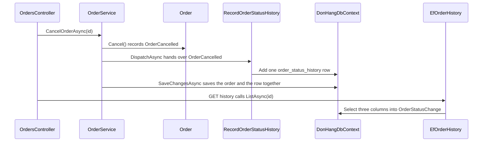

## Before you start

- [[design.l3.cqrs]] — you know the read side may have its own model, and that a screen listing every status an order passed through gets nothing from `orders`.
- [[design.l3.dispatching-domain-events]] — you know an order's events reach every registered handler before `SaveChangesAsync`, and handlers add rows to that same save.
- [[backend.l3.eventual-consistency]] — you know that inside one PostgreSQL database a query starting after a commit sees the change, while services joined by messages agree only later.
- [[backend.l3.compensating-action]] — you know `FailRefund()` moves an order from `refunding` back to `paid`, so a status can go back as well as forward.

## The situation

At stage-2 the customer who owns order 7 writes to support: the order shows `shipped`, but when did it ship, and what happened before that? You open the order's row in `orders`. Besides its id, its customer and its idempotency key, it holds `placed_at` and a `status` of `shipped`. Each change wrote the new status over the old one, so the row cannot say when the order was shipped or which statuses it passed through. The only time it keeps is when the order was placed. You could add the history somewhere, but where should it live, and which code should write it?

## Core concepts

- **read model** — data stored in the shape one query needs, written from the changes the write side makes rather than by the use cases that make those changes; in Đơn Hàng, the table `order_status_history`.
- the history row — one row per event `Order` records: the event's name, the status the order moved to and the time it happened.
- the history handler — `RecordOrderStatusHistory`, a domain event handler that turns each event an `Order` records into one history row.

## How it works



In the situation above, the read model is a new table, `order_status_history`, added at stage-3. Follow a cancel through the diagram. `OrdersController` calls `CancelOrderAsync(id)` on `OrderService`, which calls `Cancel()`; `Cancel()` checks the status rule and records `OrderCancelled`. `DispatchAsync` then hands that event to every handler registered for it. One is `RecordOrderStatusHistory`, which adds one row: the event `cancelled`, the status `cancelled` and the event's time.

Notice who writes the row. `CancelOrderAsync` does not mention the history, and `Order` has no property that points to the table. The handler reacts after `Order` has made the change. A new use case that records one of these events and dispatches them before its save, as every `OrderService` method does, gets its history row with no line about the history; a use case writing the row itself would have to remember to.

The row joins the same `DonHangDbContext` before `SaveChangesAsync`, so one transaction stores the new status and its history row, or neither. A request that starts after the save finds both. The price is one more insert on every change that records an event.

Reading takes the other path. `OrdersController` handles `GET /api/v1/orders/{id}/history` by calling `ListAsync(id)` on `EfOrderHistory`, which selects the event, the status and the time of that order's rows into `OrderStatusChange` records. The table already has the shape the screen needs, so the query builds no `Order` and runs no rule.

## In the Đơn Hàng system

The history handler, from the method for the first event to the one that adds the row:

```csharp file=DonHang.Infrastructure/RecordOrderStatusHistory.cs tag=stage-3 lines=17-40
    public Task HandleAsync(OrderPlaced domainEvent) => AddRow(domainEvent, "placed", "new");

    public Task HandleAsync(OrderCancelled domainEvent) => AddRow(domainEvent, "cancelled", "cancelled");

    public Task HandleAsync(OrderShipped domainEvent) => AddRow(domainEvent, "shipped", "shipped");

    // The refund saga's three changes to an order (backend.l3.saga).
    public Task HandleAsync(OrderRefundRequested domainEvent) => AddRow(domainEvent, "refund-requested", "refunding");

    public Task HandleAsync(OrderRefunded domainEvent) => AddRow(domainEvent, "refunded", "cancelled");

    public Task HandleAsync(OrderRefundFailed domainEvent) => AddRow(domainEvent, "refund-failed", "paid");

    private Task AddRow(IDomainEvent domainEvent, string eventName, string status)
    {
        db.OrderStatusHistory.Add(new OrderStatusHistoryEntry
        {
            Order = domainEvent.Order, // EF Core fills in order_id, even for a new order
            Event = eventName,
            Status = status,
            OccurredAt = domainEvent.OccurredAt,
        });
        return Task.CompletedTask;
    }
```

There is one `HandleAsync` for each of the six events `Order` records, and each maps its event to a name and a status. A placed order starts with the status `new`, so the `placed` row records `new`. `refunded` leaves the order `cancelled`, as a cancel does; the event name keeps the two apart. `refund-failed` leads back to `paid`, a step backwards the history keeps.

`OrderStatusHistoryEntry` is the class for one `order_status_history` row, and `AddRow` adds one to `db.OrderStatusHistory`. The row points to the `Order` object rather than copying its id, and EF Core sets `order_id` from it when it saves the row. `AddRow` saves nothing: the save belongs to the use case that dispatched the event.

The endpoint that reads it:

```csharp file=DonHang.Api/Controllers/OrdersController.cs tag=stage-3 lines=78-95
    // lesson: design.l3.read-model
    // GET /api/v1/orders/7/history: the order's status changes, oldest first,
    // from the read model order_status_history. The OrderOwner check needs the
    // order's customer, so it runs on an untracked copy first, as in Get; the
    // history itself comes from IOrderHistory and never builds an Order.
    [Authorize]
    [HttpGet("{id:int}/history")]
    public async Task<ActionResult<List<OrderStatusChangeDto>>> History(int id)
    {
        var order = await repository.FindForReadingAsync(id);
        if (order is null) return NotFound();

        var allowed = await authorization.AuthorizeAsync(User, order, "OrderOwner");
        if (!allowed.Succeeded) return Forbid();

        var changes = await history.ListAsync(id);
        return Ok(changes.Select(c => new OrderStatusChangeDto(c.Event, c.Status, c.OccurredAt)).ToList());
    }
```

The order is loaded once, untracked as the single-order endpoint `Get` does, and only for the `OrderOwner` check, which depends on the order's customer. The history comes from `history.ListAsync(id)`. Its implementation, `EfOrderHistory` in `DonHang.Infrastructure/EfOrderHistory.cs`, is outside this excerpt; it filters `order_status_history` by the order's id and selects three columns into `OrderStatusChange`, in the order the rows were added.

## Seniors often assume…

- **"A read model always lives in a separate database and lags behind the writes."** → Actually a read model is defined by its shape and by who writes it, not by where it is stored. `order_status_history` sits in the same database as `orders` and is saved in the same transaction, so it never trails a status change that recorded an event. Keeping a read model in another database, filled by a message consumer, is an option when writes must not wait for it; readers then see the change only after the message is handled. You notice this when the history endpoint shows `cancelled` in the first request after a cancel succeeds.
- **"To show an order's history, add a list of changes to `Order` and let its methods fill it."** → Actually `Order` exists to guard changes, and no rule of `Order` reads the history. A list inside the aggregate would be loaded or carried along with every order a use case changes, and the next screen that wants another shape would grow `Order` again. The handler keeps the history outside, written from the events `Order` already records. You notice this when you read `Order` in `DonHang.Domain/Entities.cs` at stage-3 and find no property that leads to the history.
- **"The new table can be filled with the full history of existing orders from the data already in `orders`."** → Actually `orders` kept only the current status and the time the order was placed; every status in between was overwritten. The migration that created the table writes one `placed` row per existing order, from `placed_at`, because that is all `orders` still holds. You notice this when an order shipped before stage-3 shows a history of a single `placed` row.

## Try it (3 minutes)

1. In the root folder of the example repository at `stage-3`, after running `scripts/up.sh`, run `scripts/design/order-history.sh` in a bash shell (Git Bash on Windows). It gets an access token for the customer who owns order 7 by itself, then prints order 7's row in `orders` and its history, places and cancels a new order, and prints that order's history and its `order_status_history` rows.
2. Compare the history of order 7 with the history of the order the script places and then cancels.

Expected result: order 7 shows `shipped` in `orders`, yet its history holds one entry, `placed` with status `new`. The new order's history holds two entries, `placed` then `cancelled`, and `order_status_history` shows the same two rows for it.

<details><summary>Suggested answer</summary>

Order 7 changed before stage-3. When it was shipped, the new status overwrote the old one in `orders`, and no history table existed yet. The migration that created `order_status_history` could only write what `orders` still knew: one `placed` row, taken from `placed_at`.

The new order changed after stage-3. Placing it recorded `OrderPlaced` and cancelling it recorded `OrderCancelled`. Each event reached `RecordOrderStatusHistory`, which added a row before the same `SaveChangesAsync` that saved the order.

</details>

## Connections

- [[design.l3.cqrs]] — the split this lesson builds on: there the read side shared the write side's tables; here it gets a table of its own.
- [[backend.l2.resource-based-authorization]] — the `OrderOwner` check the history endpoint reuses before it reads the read model.
- [[design.l3.ubiquitous-language]] — the `event` column keeps apart `cancelled` and `refunded`, two changes that both leave the order `cancelled`.
- [[design.l3.event-sourcing]] — the opposite choice for the write side: store every event instead of the current status.

## Five-line summary

1. A read model stores data in the shape one query needs and is written from the write side's changes, not by its use cases.
2. At stage-2 each change overwrote `orders.status`, so an order's row could not say which statuses it passed through or when.
3. `RecordOrderStatusHistory` turns every event `Order` records into one `order_status_history` row; `Order` does not know the table exists.
4. The row joins the order's `SaveChangesAsync`, so history never trails a change that records an event; the cost is one extra insert per event.
5. Orders placed before stage-3 have only a `placed` row: `orders` overwrote the statuses in between, so the migration had nothing else to copy.
