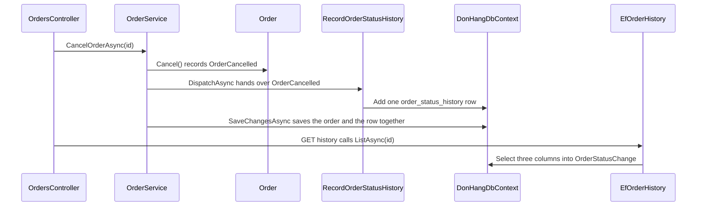

## Bạn cần biết trước

- [[design.l3.cqrs]] — bạn biết phía đọc có thể có mô hình riêng, và một màn hình liệt kê mọi trạng thái một đơn từng trải qua sẽ không lấy được gì từ `orders`.
- [[design.l3.dispatching-domain-events]] — bạn biết các event của một đơn tới mọi handler đã đăng ký trước `SaveChangesAsync`, và handler thêm dòng vào chính lần lưu đó.
- [[backend.l3.eventual-consistency]] — bạn biết trong cùng một database PostgreSQL, một truy vấn bắt đầu sau khi commit sẽ thấy thay đổi, còn các service nối với nhau bằng message thì chỉ khớp nhau về sau.
- [[backend.l3.compensating-action]] — bạn biết `FailRefund()` đưa một đơn từ `refunding` về lại `paid`, nên trạng thái có thể lùi chứ không chỉ tiến.

## Tình huống

Ở stage-2, khách sở hữu đơn 7 viết cho bộ phận hỗ trợ: đơn đang hiện `shipped`, nhưng giao lúc nào, và trước đó đã có chuyện gì? Bạn mở dòng của đơn trong `orders`. Ngoài id, khách hàng và idempotency key, dòng này giữ `placed_at` và `status` là `shipped`. Mỗi lần đổi, trạng thái mới ghi đè lên trạng thái cũ, nên dòng này không nói được đơn được giao lúc nào hay đã đi qua những trạng thái nào. Mốc thời gian duy nhất nó giữ là lúc đặt đơn. Bạn có thể lưu lịch sử ở đâu đó, nhưng lưu ở đâu, và code nào sẽ ghi nó?

## Khái niệm cốt lõi

- **read model** (dữ liệu lưu sẵn theo đúng hình dạng một truy vấn cần, được cập nhật từ các thay đổi của phía ghi) — dữ liệu được ghi từ những thay đổi mà phía ghi tạo ra, chứ không do các use case tạo ra thay đổi đó tự ghi. Trong Đơn Hàng, đó là bảng `order_status_history`.
- dòng lịch sử — mỗi event mà `Order` ghi nhận ứng với một dòng: tên event, trạng thái mà đơn chuyển sang và thời điểm xảy ra.
- handler lịch sử — `RecordOrderStatusHistory`, một handler domain event biến mỗi event mà một `Order` ghi nhận thành một dòng lịch sử.

## Cơ chế hoạt động



Với tình huống trên, read model là một bảng mới, `order_status_history`, thêm vào ở stage-3. Hãy theo một lần hủy đơn qua sơ đồ. `OrdersController` gọi `CancelOrderAsync(id)` trên `OrderService`, service gọi `Cancel()`. `Cancel()` kiểm tra quy tắc trạng thái và ghi nhận `OrderCancelled`. Sau đó `DispatchAsync` đưa event này tới mọi handler đăng ký cho nó. Một trong số đó là `RecordOrderStatusHistory`, handler này thêm một dòng: event `cancelled`, trạng thái `cancelled` và thời điểm của event.

Hãy để ý ai ghi dòng đó. `CancelOrderAsync` không nhắc gì tới lịch sử, và `Order` không có property nào trỏ tới bảng. Handler phản ứng sau khi `Order` đã đổi xong. Một use case mới, miễn là ghi nhận một trong các event này và dispatch chúng trước khi lưu như mọi method của `OrderService`, sẽ có dòng lịch sử mà không cần dòng code nào về lịch sử. Nếu use case tự ghi dòng đó, nó phải nhớ mà ghi.

Dòng lịch sử vào cùng `DonHangDbContext` trước `SaveChangesAsync`, nên một giao dịch lưu cả trạng thái mới lẫn dòng lịch sử của nó, hoặc không lưu gì cả. Một request bắt đầu sau lần lưu sẽ thấy cả hai. Cái giá là thêm một lệnh insert cho mỗi thay đổi có ghi nhận event.

Đọc thì đi đường khác. `OrdersController` xử lý `GET /api/v1/orders/{id}/history` bằng cách gọi `ListAsync(id)` trên `EfOrderHistory`. Truy vấn này chọn event, trạng thái và thời điểm trong các dòng của đơn đó vào các record `OrderStatusChange`. Bảng đã có sẵn hình dạng màn hình cần, nên truy vấn không dựng `Order` nào và không chạy quy tắc nào.

## Trong hệ thống Đơn Hàng

Handler lịch sử, từ method cho event đầu tiên tới method thêm dòng:

```csharp file=DonHang.Infrastructure/RecordOrderStatusHistory.cs tag=stage-3 lines=17-40
    public Task HandleAsync(OrderPlaced domainEvent) => AddRow(domainEvent, "placed", "new");

    public Task HandleAsync(OrderCancelled domainEvent) => AddRow(domainEvent, "cancelled", "cancelled");

    public Task HandleAsync(OrderShipped domainEvent) => AddRow(domainEvent, "shipped", "shipped");

    // The refund saga's three changes to an order (backend.l3.saga).
    public Task HandleAsync(OrderRefundRequested domainEvent) => AddRow(domainEvent, "refund-requested", "refunding");

    public Task HandleAsync(OrderRefunded domainEvent) => AddRow(domainEvent, "refunded", "cancelled");

    public Task HandleAsync(OrderRefundFailed domainEvent) => AddRow(domainEvent, "refund-failed", "paid");

    private Task AddRow(IDomainEvent domainEvent, string eventName, string status)
    {
        db.OrderStatusHistory.Add(new OrderStatusHistoryEntry
        {
            Order = domainEvent.Order, // EF Core fills in order_id, even for a new order
            Event = eventName,
            Status = status,
            OccurredAt = domainEvent.OccurredAt,
        });
        return Task.CompletedTask;
    }
```

Mỗi event trong sáu event mà `Order` ghi nhận có một `HandleAsync`, và mỗi method gắn event của nó với một tên và một trạng thái. Đơn vừa đặt bắt đầu với trạng thái `new`, nên dòng `placed` ghi `new`. `refunded` để đơn ở `cancelled`, giống như hủy đơn, và chính tên event giúp phân biệt hai trường hợp. `refund-failed` đưa đơn về lại `paid`, một bước lùi mà lịch sử vẫn giữ lại.

`OrderStatusHistoryEntry` là class cho một dòng của `order_status_history`, còn `AddRow` thêm một dòng như vậy vào `db.OrderStatusHistory`. Dòng này trỏ tới object `Order` thay vì chép id của nó, và EF Core điền `order_id` từ object đó khi lưu dòng. `AddRow` không lưu gì: lưu là phần của use case đã dispatch event.

Endpoint đọc dữ liệu này:

```csharp file=DonHang.Api/Controllers/OrdersController.cs tag=stage-3 lines=78-95
    // lesson: design.l3.read-model
    // GET /api/v1/orders/7/history: the order's status changes, oldest first,
    // from the read model order_status_history. The OrderOwner check needs the
    // order's customer, so it runs on an untracked copy first, as in Get; the
    // history itself comes from IOrderHistory and never builds an Order.
    [Authorize]
    [HttpGet("{id:int}/history")]
    public async Task<ActionResult<List<OrderStatusChangeDto>>> History(int id)
    {
        var order = await repository.FindForReadingAsync(id);
        if (order is null) return NotFound();

        var allowed = await authorization.AuthorizeAsync(User, order, "OrderOwner");
        if (!allowed.Succeeded) return Forbid();

        var changes = await history.ListAsync(id);
        return Ok(changes.Select(c => new OrderStatusChangeDto(c.Event, c.Status, c.OccurredAt)).ToList());
    }
```

Đơn được tải một lần, không bị theo dõi, giống endpoint một đơn `Get`, và chỉ để kiểm tra `OrderOwner`, vì phép kiểm tra này cần biết khách của đơn. Lịch sử đến từ `history.ListAsync(id)`. Phần cài đặt của nó, `EfOrderHistory` trong `DonHang.Infrastructure/EfOrderHistory.cs`, nằm ngoài đoạn trích này. Nó lọc `order_status_history` theo id của đơn và chọn ba cột vào `OrderStatusChange`, theo thứ tự các dòng được thêm vào.

## Senior hay nhầm rằng…

- **"Read model luôn nằm ở một database riêng và luôn chậm hơn các lần ghi."** → Thực ra một read model được xác định bởi hình dạng của nó và bởi ai ghi nó, không phải bởi nơi lưu. `order_status_history` nằm cùng database với `orders` và được lưu trong cùng giao dịch, nên nó không bao giờ đi sau một lần đổi trạng thái có ghi nhận event. Đặt read model ở database khác, do một message consumer điền vào, là một lựa chọn khi các lần ghi không được phép chờ nó. Khi đó người đọc chỉ thấy thay đổi sau khi message được xử lý. Bạn sẽ nhận ra khi endpoint lịch sử đã hiện `cancelled` ngay ở request đầu tiên sau khi hủy thành công.
- **"Muốn hiện lịch sử của một đơn thì thêm vào `Order` một danh sách thay đổi và để các method của nó điền vào."** → Thực ra `Order` tồn tại để canh các thay đổi, và không quy tắc nào của `Order` đọc tới lịch sử. Một danh sách nằm trong aggregate sẽ bị tải hoặc mang theo cùng mỗi đơn mà một use case thay đổi, và màn hình tiếp theo muốn một hình dạng khác lại làm `Order` phình thêm. Handler giữ lịch sử ở bên ngoài, ghi từ các event mà `Order` vốn đã ghi nhận. Bạn sẽ nhận ra khi đọc `Order` trong `DonHang.Domain/Entities.cs` ở stage-3 và không thấy property nào dẫn tới lịch sử.
- **"Bảng mới có thể được điền đủ lịch sử của các đơn cũ từ dữ liệu sẵn có trong `orders`."** → Thực ra `orders` chỉ giữ trạng thái hiện tại và thời điểm đặt đơn, mọi trạng thái ở giữa đã bị ghi đè. Migration tạo bảng ghi một dòng `placed` cho mỗi đơn đang có, lấy từ `placed_at`, vì đó là tất cả những gì `orders` còn giữ. Bạn sẽ nhận ra khi một đơn giao trước stage-3 có lịch sử chỉ gồm một dòng `placed`.

## Thử ngay (3 phút)

1. Ở thư mục gốc của repo ví dụ tại `stage-3`, sau khi chạy `scripts/up.sh`, chạy `scripts/design/order-history.sh` trong bash (Git Bash trên Windows). Script tự lấy access token cho khách sở hữu đơn 7, in dòng của đơn 7 trong `orders` và lịch sử của nó, đặt rồi hủy một đơn mới, sau đó in lịch sử của đơn này cùng các dòng `order_status_history` của nó.
2. So sánh lịch sử của đơn 7 với lịch sử của đơn mà script đặt rồi hủy.

Kết quả mong đợi: đơn 7 hiện `shipped` trong `orders`, nhưng lịch sử chỉ có một mục, `placed` với trạng thái `new`. Lịch sử của đơn mới có hai mục, `placed` rồi `cancelled`, và `order_status_history` cũng có đúng hai dòng đó cho đơn này.

<details><summary>Gợi ý đáp án</summary>

Đơn 7 thay đổi trước stage-3. Khi đơn được giao, trạng thái mới ghi đè trạng thái cũ trong `orders`, và lúc đó chưa có bảng lịch sử nào. Migration tạo `order_status_history` chỉ ghi được những gì `orders` còn biết: một dòng `placed`, lấy từ `placed_at`.

Đơn mới thay đổi sau stage-3. Đặt đơn ghi nhận `OrderPlaced`, hủy đơn ghi nhận `OrderCancelled`. Mỗi event tới `RecordOrderStatusHistory`, handler này thêm một dòng trước chính lần `SaveChangesAsync` lưu đơn.

</details>

## Liên hệ

- [[design.l3.cqrs]] — cách tách mà bài này dựa vào: ở đó phía đọc dùng chung bảng với phía ghi, còn ở đây nó có bảng riêng.
- [[backend.l2.resource-based-authorization]] — phép kiểm tra `OrderOwner` mà endpoint lịch sử dùng lại trước khi đọc read model.
- [[design.l3.ubiquitous-language]] — cột `event` phân biệt `cancelled` với `refunded`, hai thay đổi cùng để đơn ở `cancelled`.
- [[design.l3.event-sourcing]] — lựa chọn ngược lại cho phía ghi: lưu mọi event thay vì trạng thái hiện tại.

## Tóm tắt 5 dòng

1. Read model lưu dữ liệu theo đúng hình dạng một truy vấn cần và được ghi từ các thay đổi của phía ghi, không do các use case của phía ghi tự ghi.
2. Ở stage-2, mỗi lần đổi đều ghi đè `orders.status`, nên dòng của một đơn không nói được đơn đã qua những trạng thái nào và lúc nào.
3. `RecordOrderStatusHistory` biến mỗi event mà `Order` ghi nhận thành một dòng `order_status_history`, còn `Order` không hề biết bảng này tồn tại.
4. Dòng lịch sử đi cùng `SaveChangesAsync` của đơn, nên lịch sử không bao giờ đi sau một thay đổi có ghi nhận event, cái giá là thêm một lệnh insert cho mỗi event.
5. Các đơn đặt trước stage-3 chỉ có dòng `placed`: `orders` đã ghi đè các trạng thái ở giữa, nên migration không còn gì khác để chép.
